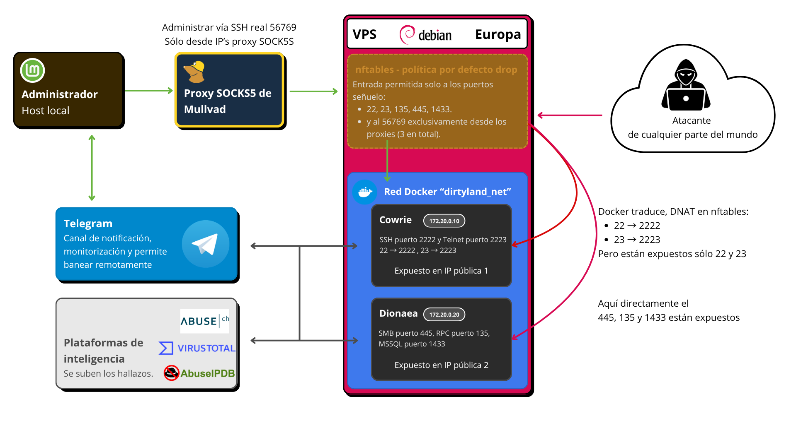

> [!WARNING]
> **Dies ist eine KI-Übersetzung, erstellt mit Claude.** Das Original-README umfasst fast fünftausend Zeilen, und es von Hand zu übersetzen, ist nicht realistisch. Die maßgebliche Version, und die einzige, die ich geschrieben habe, ist die spanische: [README.md](README.md).

[🇪🇸 Español](README.md) · [🇬🇧 English](README.en.md) · [🇧🇬 Български](README.bg.md) · [🇫🇷 Français](README.fr.md) · **🇩🇪 Deutsch**

# 1. Einleitung

## 1.1 Zweck

Lieber Leser, ich möchte dir direkt, persönlich und kurz vermitteln, welchen Zweck dieses Projekt hat.

Das Projekt ist schon lang genug, ohne dass mich auch noch etwas so Einfaches und Persönliches wie das hier viele Worte kostet.

Dieses Projekt entsteht mit einem doppelten Zweck:

- **Einerseits ein technischer und beruflicher:** eine Honeypot-Infrastruktur zu entwerfen, aufzubauen und zu betreiben, die die Aktivität echter Angreifer anlocken, erfassen und untersuchen kann, und dabei strenge Kriterien für Design, Sicherheit und Eindämmung anzuwenden. Die Infrastruktur an sich ist etwas, das mich begeistert.

- **Andererseits ein persönlicher Zweck:** als Visitenkarte meiner Kompetenzen im Bereich der defensiven Cybersicherheit zu dienen, in einer Zeit, in der ich mich in diesem Feld beruflich weiterentwickeln möchte.

Anders als bei einer Laborübung **ist diese Arbeit echten Bedrohungen ausgesetzt**, und ich bin mir der Strenge, des Wissens und der Haltung, die man hier hineinstecken muss, voll bewusst, denn für mich steht nicht wenig auf dem Spiel; hier darf es keine "menschlichen Fehler" geben, und genau das ist auch die Idee:

- Meine **Fähigkeit** zu **zeigen**, etwas von Anfang bis Ende umzusetzen, und dabei **eine Strenge, einen Standard, ohne menschliche Fehler** einzuhalten; in der Verteidigung sind Fehler nicht zulässig.

Eine Maschine kontrolliert dem Internet auszusetzen und zu beobachten, wer sie mit welchen Werkzeugen und mit welchen Zielen anzugreifen versucht, **bietet zudem einen direkten Einblick in die reale Bedrohungslage, den man in simulierten Umgebungen nicht bekommt, samt dem Stress, dem Druck und der Verantwortung, die dabei auf einem lasten.**

Dieser reale Charakter ist für mich das, was dem Projekt seinen Wert und seinen Sinn gibt. Über die technische Übung hinaus steht hinter der Arbeit eine tiefere Motivation: **einen, wenn auch bescheidenen, Beitrag zur Abwehr von Cyberkriminalität zu leisten**. Das Erfassen von Malware und Angriffsindikatoren und deren Meldung an die zuständigen Plattformen und Behörden (falls nötig) ist nicht nur eine Lernübung, sondern **ein echter, wenn auch kleiner, Beitrag zur gemeinsamen Abwehrarbeit**, die Analysten und Sicherheitsteams auf der ganzen Welt leisten.

Was die Ansprüche angeht, zielte das Projekt sehr hoch. Auch wenn ich genau weiß, dass der größte Teil der erfassten Aktivität automatisierter und opportunistischer Datenverkehr sein wird, wurde es mit dem Anspruch entworfen, auch bedeutendere Bedrohungen (APTs) erkennen und dokumentieren zu können.

**Nach dem Höchsten zu streben und dabei realistisch anzuerkennen, was wahrscheinlich ist**, gehört zu dem Ansatz, mit dem es angegangen wurde.

Insgesamt soll dieses Projekt praktische Kompetenzen in **sicherem Infrastrukturaufbau, System- und Netzwerkadministration sowie defensiver Cybersicherheit und Threat Intelligence** zeigen und zugleich das echte Interesse und die Berufung widerspiegeln, mit denen es umgesetzt wurde.

<p align="center">Ich hoffe, dass du jedes Wort und jeden Schritt zu schätzen weißt, verstehst und vor allem genießt, so wie ich es genossen habe. Danke.</p>

## 1.2 Umfang

Gegenstand dieses Projekts sind Entwurf, Aufbau und Betrieb einer Honeypot-Infrastruktur, die darauf ausgerichtet ist, die Aktivität echter Angreifer im Internet zu erfassen und zu untersuchen. Konkret umfasst die Arbeit:

- Den Aufbau von **zwei sich ergänzenden Honeypots, Cowrie (für SSH und Telnet) und Dionaea (für zahlreiche Netzwerkprotokolle)**, auf einem virtuellen privaten Server (VPS) mit Docker-Containern.
- Den Entwurf und die Umsetzung der **Sicherheits- und Eindämmungsmaßnahmen**, die nötig sind, um die Maschine verantwortungsvoll zu exponieren:
  - Firewall-Konfiguration mit nftables.
  - Strikte Kontrolle des ausgehenden Verkehrs (Egress).
  - Härtung der Container.
- Die Anpassung der Honeypots, um sie für Angreifer glaubwürdiger zu machen.
- Das Sammeln, Beobachten und Analysieren der erfassten Aktivität (Zugriffsversuche, ausgeführte Befehle und abgelegte Malware).
- Die Meldung der gewonnenen Indikatoren an Threat-Intelligence-Plattformen.

**Ausdrücklich nicht zum Umfang** dieser Arbeit gehören:

- **Jede offensive Nutzung der Infrastruktur.** Das Projekt ist streng defensiv und beobachtend.
- **Die Zuordnung der Angriffe** zu bestimmten Akteuren, Gruppen oder Ländern, im Einklang mit dem Neutralitätsansatz, der im Abschnitt über ethische Erwägungen dargelegt wird.
- **Eine erschöpfende forensische Analyse oder ein tiefgehendes Reverse Engineering** der erfassten Malware, die über die Ziele dieses Projekts hinausgehen und ein Thema für künftige Arbeiten sein könnten.
- **Ein Aufbau auf Unternehmens- oder Produktionsniveau.** Es handelt sich um ein akademisches und Portfolio-Projekt, wenn auch mit professionellen Maßstäben an Strenge und Sicherheit entworfen.

## 1.3 Zielgruppe

Diese Arbeit **richtet sich nicht an Anfänger**.

Sie setzt technische Vorkenntnisse voraus, daher sind ihre Adressaten Personen mit einem Profil auf **mittlerem oder fortgeschrittenem Niveau**:

- Frischgebackene Absolventen eines Informatik- oder Telekommunikationsstudiums
- Masterstudierende
- Fachleute und Experten aus dem Bereich der Cybersicherheit.

Ebenso kann sie von Interesse sein für:

- Sicherheitsanalysten
- Nachrichtendienstliches Personal
- Angehörige der Sicherheitsbehörden mit Zuständigkeiten in der Cybersicherheit.

Im gesamten Dokument wird vorausgesetzt, dass der Leser mit Grundbegriffen von Netzwerken, Linux-artigen Betriebssystemen und der Serveradministration vertraut ist. Auch wenn viele dieser Begriffe im Laufe des Projekts ausführlich erklärt werden (mit didaktischem Anspruch), wird nicht bei null angefangen.

## 1.4 Ethischer und rechtlicher Hinweis

Dieses **Projekt bewegt sich streng im** Bereich **der defensiven Forschung in der Cybersicherheit**. Sein **Zweck** ist ausschließlich **die Untersuchung der Techniken, Werkzeuge und Verhaltensweisen von Angreifern**, um die Bedrohungen besser zu verstehen und zu lernen, sich gegen sie zu verteidigen. **Es geht in keinem Fall darum, jemanden anzugreifen, jemandem zu schaden oder Vergeltung an jemandem zu üben.**

### Überlegungen zu Daten und Datenschutz

Beim Betrieb des Honeypots werden Daten erfasst, die die Angreifer selbst erzeugen, darunter Quell-IP-Adressen.

Es sei daran erinnert, dass **eine IP**-Adresse **im Sinne folgender Vorschriften als personenbezogenes Datum gelten kann**:

- Die Datenschutz-Grundverordnung (**DSGVO**) der Europäischen Union.
- Das spanische Organgesetz 3/2018 über den Schutz personenbezogener Daten und die Gewährleistung digitaler Rechte (**LOPDGDD**), das sie in Spanien ausgestaltet.

In diesem Sinne hat der Gerichtshof der Europäischen Union in seinem Urteil Breyer (Rechtssache C-582/14 vom 19. Oktober 2016) entschieden, dass **eine dynamische IP-Adresse ein personenbezogenes Datum sein kann**, wenn eine vernünftige Möglichkeit besteht, sie einer identifizierbaren Person zuzuordnen. Auch wenn das Urteil noch unter der Richtlinie 95/46/EG, der Vorgängerin der DSGVO, ergangen ist, deckt sich sein Maßstab mit dem, den die heutige Verordnung in ihrem Erwägungsgrund 26 festhält.

Die Datenschutzvorschriften **schützen jede natürliche Person, auch diejenigen, die rechtswidrige Tätigkeiten ausüben**. Die DSGVO schützt keine juristischen Personen wie Unternehmen.

Ebenso wenig wäre es richtig, sich auf die Ausnahme für ausschließlich persönliche oder familiäre Tätigkeiten (Art. 2 Abs. 2 lit. c DSGVO) zu berufen, weil es sich um ein Einzelprojekt handelt. Der Gerichtshof legt diese Ausnahme eng aus: In der Rechtssache Ryneš (Rechtssache C-212/13) befand er, dass eine an einem Wohnhaus angebrachte Kamera, die einen Teil des öffentlichen Raums aufnahm, bereits nicht mehr darunter fiel. **Ein dem Internet ausgesetzter Server, dessen Daten zudem mit öffentlichen Plattformen geteilt werden, fällt erst recht in den Anwendungsbereich der Verordnung.**

Die Verarbeitung dieser Daten im Rahmen dieses Projekts stützt sich auf das **berechtigte Interesse (Art. 6 Abs. 1 lit. f DSGVO)** und dient der Gewährleistung der Netz- und Informationssicherheit, einem Zweck, den die Verordnung selbst in ihrem Erwägungsgrund 49 ausdrücklich als berechtigtes Interesse anerkennt.

Dabei werden jedoch die Grundsätze der **Datenminimierung und Verhältnismäßigkeit** angewandt: Es wird nur das erfasst, was für die Analyse der Bedrohungen nötig ist.

**Aus Vorsicht** wurden in diesem Dokument **die folgenden Daten anonymisiert oder unkenntlich gemacht:**

- IP-Adressen.
- Bestimmte Payloads.
- URLs und Adressen von Command-and-Control-Servern (C2).
- Die eigenen Daten der Projektinfrastruktur (die öffentliche IP des Servers, Zugangsdaten und alle Daten, die seine Sicherheit gefährden könnten).
- Weitere Daten über den Angreifer.

Auch wenn diese Daten nicht zu den besonderen Kategorien gehören, die die DSGVO als sensibel einstuft (Art. 9: Gesundheit, Weltanschauung, ethnische Herkunft usw.), wurde trotzdem entschieden, sie zu anonymisieren.

Der ursprüngliche Analysebericht mit den vollständigen Daten **wird ab Abschluss des Projekts höchstens ein Jahr lang verschlüsselt und lokal auf meinem eigenen Computer aufbewahrt**, danach wird er gelöscht. **Er wird weder auf GitHub noch an irgendeinen anderen Ort im Internet hochgeladen**, weil sich nicht garantieren lässt, dass Veröffentlichtes endgültig gelöscht wird:

- Falls ihn jemand vorher herunterlädt.
- Der Commit-Verlauf.
- WayBackMachine

Die Entscheidung, zu anonymisieren und nicht zu pseudonymisieren, beruht darauf, dass **die DSGVO nur auf wirklich anonymisierte Daten nicht mehr anwendbar ist**, die per Definition niemanden identifizierbar machen, während **pseudonymisierte Daten weiterhin personenbezogene Daten sind**, weil man mit den passenden Zusatzinformationen wieder auf die Person zurückschließen kann.

Und schließlich zur "Löschung nach höchstens 1 Jahr": Solange ich den ursprünglichen Bericht aufbewahre, kann ich die Platzhalter wieder auflösen. Nach einer strengen Lesart von Erwägungsgrund 26, der die Mittel des Verantwortlichen selbst berücksichtigt, wäre die veröffentlichte Fassung für jeden Leser anonym, für mich aber pseudonymisiert, bis ich das Original lösche. Juristisch ist umstritten, ob man es aus der Sicht des Empfängers der Daten oder aus der Sicht von jedermann betrachten muss. Aber **das Löschen des Originals nach Ablauf der Frist räumt diesen Zweifel nach beiden Auslegungen aus.**

### Neutralität und geopolitischer Kontext

Im gesamten Projekt wird das Land, das zu jeder IP-Adresse gehört, **nur als technische Angabe gezeigt, nie als Zuordnung**. Die IP-Adressen wurden, wie erklärt, aus Gründen des Datenschutzes anonymisiert.

Das Land dagegen bleibt erhalten, weil es für sich allein niemanden identifiziert, aber man sollte es mit Vorsicht deuten: **Es ist nicht möglich, eine IP, eine Malware-Probe oder irgendeine andere Angabe mit völliger Sicherheit einem bestimmten Land zuzuordnen.** Die Adresse, die beim Honeypot ankommt, ist nur der letzte Hop der Verbindung, und dahinter kann ein Proxy stecken, ein VPN, das Tor-Netzwerk, ein in einem Drittland gemieteter VPS, ein Command-and-Control-Server (C2) oder, sehr häufig, ein kompromittiertes IoT-Gerät, das Teil eines Botnetzes ist und dessen Besitzer nicht einmal weiß, dass es gerade angreift.

Dazu kommen **False Flags**, also absichtlich hinterlassene Spuren (Sprache der Zeichenketten, Zeitzonen, wiederverwendete Infrastruktur), damit der Angriff von einem anderen Ort zu kommen scheint.

Selbst **die Geolokalisierung einer IP zeigt, wo der Adressbereich registriert ist, nicht, wo sich die Maschine befindet**, und schon gar nicht, wo die Person ist, die sie steuert. Außerdem werden, wie wir später sehen werden, IPv4-Bereiche zwischen Organisationen verschiedener Länder gekauft, verkauft und vermietet, sodass ein in einem Land registrierter Block in einem anderen betrieben werden kann, was die Sache noch weiter durcheinanderbringt und jeden Versuch einer geografischen Zuordnung zusätzlich erschwert.

**Dass eine Verbindung mit einem bestimmten Land angezeigt wird, bedeutet daher nicht, dass dieses Land oder irgendjemand, der dort lebt, der Urheber des Angriffs ist.**

Es gibt außerdem einen Grund, der mit dem Kontext zu tun hat: Angesichts der aktuellen geopolitischen Lage in Europa wurde es für wichtig gehalten, dass diese Arbeit auf einer technischen und sachlichen Ebene bleibt, ohne Zuordnungen vorzunehmen und ohne irgendeine Art von Dramatisierung oder Ausnutzung der Lage zu befeuern. **Das Interesse des Projekts liegt im technischen "Wie" der Angriffe, nicht im "Wer"** und auch nicht in ihrer geografischen Herkunft.

### Zur Sicherheit des eigenen Systems

Bei einem Grundprinzip der Disziplin sollte man ehrlich sein: **Es gibt kein zu 100 % sicheres System**, und ein Honeypot geht schon seiner Natur nach als absichtlich exponierte Maschine von vornherein davon aus.

Was dagegen möglich ist, und das ist der Ansatz dieser Arbeit, ist ein **äußerst strenges, professionelles Design mit mehreren Eindämmungsschichten**, sodass das Risiko auf ein bekanntes und kontrolliertes Minimum sinkt.

### Genehmigung des Anbieters und Einhaltung seiner Bedingungen

Vor Beginn des Projekts bestand der erste Schritt darin, **den Anbieter ausdrücklich um Genehmigung zu bitten**, also das Unternehmen, das den virtuellen privaten Server (VPS) bereitstellt.

Dazu wurde eine E-Mail geschickt, die mit voller Transparenz die Art des Projekts und die geplanten Tätigkeiten erklärte: den Aufbau von Honeypots, um die Aktivität echter Angreifer zu erfassen und zu untersuchen. **Der Anbieter antwortete und bestätigte sein Einverständnis mit der Tätigkeit.** Diese E-Mail wird in diesem Dokument aus Datenschutzgründen nicht wiedergegeben, wird aber als Nachweis aufbewahrt, dass die Tätigkeit im Voraus mitgeteilt und genehmigt wurde.

Ebenso wurden die Richtlinien und Nutzungsbedingungen des Anbieters einzeln geprüft, um sicherzustellen, dass der Betrieb des Honeypots innerhalb der von ihm festgelegten Bedingungen bleibt.

**Es wird dringend empfohlen**, dass jeder, der ein Projekt dieser Art nachbauen möchte, **vorher bei seinem Anbieter eine Genehmigung einholt und dessen Nutzungsbedingungen prüft, bevor er irgendetwas aufbaut**. Es ist ein einfacher Schritt, der rechtliche Probleme und Ärger mit dem Dienst vermeidet, und es ist die verantwortungsvolle Vorgehensweise.

## 1.5 Risiken

Jeder Honeypot birgt ein inhärentes Risiko: Eine Maschine wird absichtlich echten Angreifern ausgesetzt. Die Hauptgefahr ist nicht so sehr, dass der Angreifer innerhalb der Emulation "gewinnt", sondern **dass die kompromittierte oder missbrauchte Maschine zu einem Werkzeug wird, um Dritte anzugreifen**, wobei der gesamte Verkehr von der öffentlichen IP des Projekts ausgeht (mit den entsprechenden rechtlichen Folgen, Folgen für den Ruf und einer möglichen Aufnahme in Blacklists). Im Folgenden werden die erkannten Risiken und die jeweils ergriffenen Maßnahmen beschrieben.

### Risiko 1: Missbrauch der wget- und curl-Emulation zur DDoS-Verstärkung (SSRF)

Das am besten dokumentierte Risiko bei Cowrie ist das in der Schwachstelle **CVE-2025-34469** beschriebene. Es handelt sich um einen SSRF-Fehler (Server-Side Request Forgery) in der Emulation der Befehle wget und curl: Im emulierten Shell-Modus (dem standardmäßig verwendeten) führen diese Emulationen echte HTTP-Anfragen an das vom Angreifer angegebene Ziel aus. Da es für diese Anfragen keine Ratenbegrenzung gab, konnte ein nicht authentifizierter Angreifer diese Befehle wiederholt aufrufen, um unbegrenzten HTTP-Verkehr gegen ein Opfer zu erzeugen, **wobei er den Honeypot als Verstärkungsknoten für Denial-of-Service-Angriffe nutzte** und seine eigene IP hinter der des Honeypots verbarg.

**Wie es in diesem Projekt abgemildert wird:**

- Die eingesetzte Cowrie-Version (3.0.10) ist neuer als 2.9.0, die Version, die diese Schwachstelle offiziell behebt. Daher **ist der Aufbau für diese konkrete CVE nicht anfällig**.

- Außerdem, und unabhängig vom Patch, setzt die Firewall für ausgehenden Verkehr (Egress) den ausgehenden Verbindungen der Container eine strikte Ratenbegrenzung (siehe Abschnitt zum Egress). Das bedeutet, dass die Maschine selbst bei einem ähnlichen Fehler nicht das Verkehrsvolumen erzeugen könnte, das nötig ist, um einen Angriff zu verstärken. **Das ist Defense in Depth: Man verlässt sich nicht nur darauf, dass die Software gepatcht ist.**

### Risiko 2: Ausbruch aus der Emulation in das echte System

Auch wenn Cowrie ein falsches Dateisystem und eine falsche Shell simuliert, lässt sich nicht völlig ausschließen, dass es eine Schwachstelle gibt, die einem Angreifer erlaubt, aus der Emulation auszubrechen und Code auf dem echten System auszuführen. **Das Risiko ist gering, aber nicht null.**

**Wie es in diesem Projekt abgemildert wird:**

- Cowrie läuft in einem **eigenen Docker-Container**, nicht direkt auf dem Host-System.
- Der **Container ist gehärtet** (no-new-privileges, Grenzen für Speicher, CPU und Anzahl der Prozesse), sodass ein etwaiger Ausbruch auf eine eingeschränkte Umgebung träfe.
- Die Firewall für ausgehenden Verkehr **sperrt den Zugriff auf interne Netze und auf die eigene Infrastruktur** und verhindert so laterale Bewegung (Pivoting), selbst im Fall eines Ausbruchs.

### Risiko 3: Missbrauch des Proxy-Modus (hohe Interaktion)

Cowrie hat einen Modus mit hoher Interaktion (Proxy), der den SSH-Verkehr an ein echtes System weiterleitet. Wäre er unkontrolliert aktiviert, könnte er genutzt werden, um andere Systeme zu erreichen.

**Wie es in diesem Projekt abgemildert wird:**

- **Der Aufbau nutzt den emulierten Shell-Modus (backend = shell), nicht den Proxy-Modus.** Das wurde in den Startprotokollen von Cowrie überprüft. Dahinter gibt es kein echtes System, an das weitergeleitet werden könnte.

### Risiko 4: Der Angreifer erkennt, dass er in einem Honeypot ist

Ein Angreifer, der merkt, dass er es mit einem Honeypot zu tun hat, kann aufgeben, sein Verhalten verfälschen oder im schlimmsten Fall Vergeltung üben. Für Dritte entsteht dadurch kein Schaden, aber **es gefährdet sehr wohl das Ziel des Projekts (Erkenntnisse sammeln)**.

**Wie es in diesem Projekt abgemildert wird:**

- **Anpassung von Cowrie**, um seine Glaubwürdigkeit zu erhöhen (Hostname, Systemdaten passend zu einem echten Debian, plausible Benutzer und ein plausibles Dateisystem), beschrieben im entsprechenden Abschnitt.

Und noch eine letzte, sehr wichtige Sache **zu Risiko 4:**

**Objektiv betrachtet ist es fast unmöglich, dass die Cowrie- und Dionaea-Maschine nicht wie ein Honeypot aussieht.**

Warum?

1. Es sind Honeypots mit mittlerer beziehungsweise niedriger Interaktion, sie haben weder Festplatten noch irgendeinen dauerhaften Speicher; wenn du dich einloggst und eine Datei anlegst, wird sie beim Ausloggen gelöscht.

   Und das ist verräterisch.

2. Es gibt Skripte, Kontrollstrukturen oder die Nutzung von "python3", die sich wirklich unmöglich nachbilden lassen.

   Und das ist verräterisch.

3. Befehle, die die Simulation sprengen können. Downloads von Programmen wie "nmap" oder "masscan" oder, etwas seltener, Updates oder das Aktualisieren der Maschine. Ist es etwa realistisch, es so zu programmieren, dass sich jedes beliebige Programm herunterladen lässt?

   Und das ist verräterisch.

**Schon anhand dieser 3 Gründe verstehst du hoffentlich, dass es fast unmöglich ist, etwas zu 100 % Realistisches nachzubilden.** Die Lösung dafür, die wir nicht verwenden werden, ist ein Honeypot mit hoher Interaktion, eine echte Maschine.

# 2. Architektur, Infrastruktur und Konzepte.

Die ausführlichen Erklärungen stehen im Hauptdokument. Dieses Repository
deckt Abschnitt 3 ab, die Verfahren.

## 2.1 Architektur



## 2.2 Infrastruktur

|  | VPS |
| ---: | :---   |
| CPU | 1 core |
| RAM | 2GB  |
| SPEICHER | 40GB (NVME) |
| IP('s) | 2 |
| BANDBREITE | 4TB/Monat |
| BETRIEBSSYSTEM | Debian 13, Trixie |
| HoneyPot | Cowrie + Dionaea |

# 3 Verfahren

Wir folgen nicht nur einer logischen Reihenfolge, sondern auch einer Priorität nach Wichtigkeit. Das Vorgehen wäre bei fast jeder Maschine fast jedes Anbieters dasselbe.

## 3.1 Das Einzige, was NICHT Kopieren und Einfügen ist.

Diese Anleitung ist dafür gedacht, Befehle zu kopieren und einzufügen, ohne viel nachzudenken. <br>Sie enthält Erklärungen, wo sie nötig sind, und an manchen Stellen musst du selbst etwas eintragen: deine IPs, deine Ports, deine Schlüssel.

Das sind die neun Dateien, die du später anfassen musst:

| Datei | Abschnitt | Warum man sie nicht kopieren kann |
|---|---|---|
| `/etc/hosts` | 3.2.1 | Sie enthält den Namen der Maschine |
| `/etc/netplan/50-cloud-init.yaml` | 3.2.7 | Sie enthält die zweite öffentliche IP |
| `/etc/ssh/sshd_config.d/99-hardening.conf` | 3.2.5, 3.2.6 | Administrationsport und erlaubter Benutzer |
| `/etc/nftables.conf` (Teile 1 und 2) | 3.3 | Sie werden **vor** dem Hochladen des Repositorys angewendet: zu diesem Zeitpunkt gibt es nichts zu kopieren |
| `/etc/nftables.conf` (Teile 3 und 4) | 3.3.2, 3.8.2 | Man könnte sie kopieren; sie werden absichtlich eingefügt, denn die Firewall wird Zeile für Zeile geprüft, und das Einfügen zwingt dazu, sie anzusehen |
| `/opt/dirtyland/docker-compose.yml` | 3.4 | Sie enthält deine beiden öffentlichen IPs in `ports:` |
| `/opt/dirtyland/cowrie/etc/cowrie.cfg` und `userdb.txt` | 3.4 | Die Legende und die Passwörter des Köders |
| `/opt/dirtyland/Telegram Reports/telegram.cfg` | 3.4.2.7 | Deine beiden Bot-Tokens und dein Chat |
| `/opt/dirtyland/platform-reporter/config.ini` | 3.5.5, 3.8.1 | Die API-Keys der fünf Plattformen |

In der ganzen Anleitung siehst du `[IP VPS]`, die von Cowrie, und `[IP VPS 2]`, die von Dionaea. Alles andere wird unverändert eingefügt.

## 3.2 Nach dem Mieten des VPS (nach der Bezahlung)

### 3.2.1 Sofort erledigen.

Der Zugang zum VPS erfolgt über SSH.<br>
Beim Kauf werden wir aufgefordert, den öffentlichen Schlüssel einzutragen, den wir auf unserem lokalen Rechner erzeugen. Wichtig ist, dass der private Schlüssel ein Passwort hat, eine "Passphrase".

In meinem Fall, mit Linux Mint:

```bash
ssh-keygen -t ed25519 -C "admin-honeypot"
```

Wir lassen uns den öffentlichen Schlüssel anzeigen, fügen ihn auf der Seite des VPS-Anbieters ein und bestätigen. 

```bash
cat ~/.ssh/honeypot_vps.pub
```

Damit können wir jetzt auf die Maschine zugreifen.

> [!IMPORTANT]
> Wenn wir den privaten Schlüssel löschen, den wir lokal haben, verlieren wir den Zugang. Wollten wir ihn also wechseln, müssten wir zuerst einen neuen privaten erzeugen und danach den ersten entfernen.

```bash
ssh -i ~/.ssh/honeypot_vps root@[IP]
```

Das Passwort des Benutzers ändern, den man uns gegeben hat. Ob "root", "admin" oder welcher auch immer. Normalerweise sollten wir sogar eine E-Mail bekommen haben, dass das Passwort so bald wie möglich geändert werden muss.

Sobald wir per ssh drin sind:

```bash
passwd
```

Dieser Schritt ist, anders als die folgenden, der dringendste. Wir können auch gleich die Gelegenheit nutzen und den Hostname ändern, falls nötig:

```bash
sudo hostnamectl set-hostname hostname
```

```bash
sudo nano /etc/hosts
```
Und darin, in derselben Zeile wie 127.0.0.1, schreibst du daneben den "hostname".

**In meinem Fall wird gewarnt, dass DAS ALLEIN nicht funktionieren wird. Wenn dein Fall NICHT so ist wie meiner, überspring den Schritt und mach mit 3.2.2 weiter. Sonst bearbeite die Datei, aber wir bearbeiten auch die von cloud-init (die Vorlage). Die Warnung lautet so:**

<pre>
    GNU nano 8.4                       /etc/hosts
# Your system has configured 'manage_etc_hosts' as True.
# As a result, if you wish for changes to this file to persist
# then you will need to either
# a.) make changes to the master file in /etc/cloud/templates/hosts.debian.tmpl
# b.) change or remove the value of 'manage_etc_hosts' in
#     /etc/cloud/cloud.cfg or cloud-config from user-data
#
</pre>

```bash
sudo cp -a /etc/cloud/cloud.cfg /etc/cloud/cloud.cfg.bak-$(date +%F)
```

```bash
sudo tee /etc/cloud/cloud.cfg.d/99-dirtyland-hostname.cfg > /dev/null <<'EOF'
preserve_hostname: true
manage_etc_hosts: false
EOF
```

```bash
sudo sed -i 's/^\( *\)- update_etc_hosts$/\1# - update_etc_hosts/' /etc/cloud/cloud.cfg
```

```bash
grep -n "update_etc_hosts" /etc/cloud/cloud.cfg
```

Wir starten neu, oder `exec bash`, oder öffnen ein neues Terminal:

```bash
hostnamectl && cat /etc/hosts
```

### 3.2.2 Überprüfungen an unserem Produkt.

Die Architektur des VPS sieht <b>zwei öffentliche IPs auf derselben Maschine</b> vor: 
- Eine für den Linux-Köder (Cowrie, SSH/Telnet)
- und eine andere, getrennte, für den Windows-Köder (Dionaea, SMB/RPC/MSSQL).

Der Grund für zwei IP-Adressen ist, dass es keinen Sinn ergibt, wenn sich Windows und Linux dieselbe IP teilen. Würde Dionaea eine Windows-Umgebung und eine andere auf Basis von Debian 13 mit nur einer IP-Adresse simulieren, würde das verraten, dass der VPS ein Honeypot ist.

Deshalb beantragen (oder ergänzen) wir beim Mieten des VPS eine zweite öffentliche IP.

Für jede der beiden IPs prüfen wir:

- Dass der Server geografisch an dem Ort steht, den wir bestellt haben.
- Dass die IP einen guten Ruf hat. Wenn nicht, verlangen wir eine Rückerstattung.
  - Dafür suchen wir auf diesen Seiten:
    - https://www.virustotal.com/gui/home/url
    - https://www.abuseipdb.com/
    - https://viz.greynoise.io/
    - https://www.shodan.io/
    - https://www.ipvoid.com/

- Dass dieser IP kein Domainname des vorherigen Besitzers zugeordnet ist (PTR-Eintrag). Aus Hygiene und aus ethischen Gründen gegenüber der Person, die diese IP vorher benutzt hat.


- Die Ports und alles, was auf dem VPS offen liegt, prüfen.

<pre>
root@hostname:~# ss -tulnp
Netid   State    Recv-Q   Send-Q     Local Address:Port     Peer Address:Port   Process                                                                         
udp     UNCONN   0        0             127.0.0.54:53            0.0.0.0:*       users:(("systemd-resolve",pid=4099,fd=22))                                     
udp     UNCONN   0        0          127.0.0.53%lo:53            0.0.0.0:*       users:(("systemd-resolve",pid=4099,fd=20))                                     
udp     UNCONN   0        0                0.0.0.0:5355          0.0.0.0:*       users:(("systemd-resolve",pid=4099,fd=11))                                     
udp     UNCONN   0        0                   [::]:5355             [::]:*       users:(("systemd-resolve",pid=4099,fd=13))                                     
tcp     LISTEN   0        128              0.0.0.0:22            0.0.0.0:*       users:(("sshd",pid=6944,fd=6))                                                 
tcp     LISTEN   0        4096          127.0.0.54:53            0.0.0.0:*       users:(("systemd-resolve",pid=4099,fd=23))                                     
tcp     LISTEN   0        4096       127.0.0.53%lo:53            0.0.0.0:*       users:(("systemd-resolve",pid=4099,fd=21))                                     
tcp     LISTEN   0        4096             0.0.0.0:5355          0.0.0.0:*       users:(("systemd-resolve",pid=4099,fd=12))                                     
tcp     LISTEN   0        128                 [::]:22               [::]:*       users:(("sshd",pid=6944,fd=7))                                                 
tcp     LISTEN   0        4096                [::]:5355             [::]:*       users:(("systemd-resolve",pid=4099,fd=14))                                     
</pre>

**Schau auf die Spalte Local Address.** Beginnt sie mit `127.` oder `[::1]`, lauscht der Port nur innerhalb der Maschine, und es ist egal, was es ist. Sorgen machen sollte dir, was auf `0.0.0.0`, auf `[::]` oder auf einer öffentlichen IP lauscht.

| Port | Was es ist | Offen nach außen? |
|---|---|---|
| 53 auf `127.0.0.53` und `.54` | Der DNS-Resolver von systemd | Nein, Loopback |
| 25 | `exim4`, die lokale Mail, die Debian mitbringt | Nein, Loopback |
| 22 auf `0.0.0.0` | Dein SSH. Das Einzige, was gerade offen ist, und das, was du härten wirst | Ja |
| 5355 auf `0.0.0.0` | LLMNR, ebenfalls von systemd-resolved | Ja, aber nftables mit `policy drop` blockiert es |

### 3.2.3 Voraussetzungen vor der Härtung und Konfiguration des Hosts.

- Mullvad abonnieren (in meinem Fall) und prüfen, dass es funktioniert. Was die Firewall per SSH hereinlässt, ist nicht "das VPN", sondern die **Ausgangs-IPs seiner SOCKS5-Proxys**.
  Funktioniert das VPN, aber die Verbindung geht nicht über den Proxy, weist dich die Maschine ab (3.2.6.3).

> [!IMPORTANT]
> Nie nur eine dieser IPs: Relays fallen aus oder werden umnummeriert, und dann sperrt dich deine eigene Firewall aus. Hier sind es drei, in verschiedenen Ländern.

- Und damit wir den Zugang zur Maschine nicht verlieren, brauchen wir auf der Website des VPS-Anbieters ein Web-Zugangspanel, um die Maschine von dort aus zu konfigurieren, falls der SSH-Zugang oder sonst etwas ausfällt.

> [!TIP]
> Schau es dir an, **bevor** du es brauchst. Viele liefern es mit einem alten `noVNC` **ohne Zwischenablage** aus, und dort tippt man alles von Hand. Das `root`-Passwort sollte lang sein, aber tippbar.

### 3.2.4 Prinzip der minimalen Rechte.

Wir legen einen neuen Benutzer an, damit wir nicht ständig root benutzen und uns nicht als "root" per SSH anmelden. 
<p>Wir aktualisieren die Maschine:</p>

```bash
apt update && apt upgrade -y
```

Und legen einen neuen Benutzer an. Der Name ist völlig egal, denn vom VPS wird nichts nach außen gezeigt.

```bash
adduser --gecos "" user
```

Wir geben ihm "sudo"-Rechte:

```bash
usermod -aG sudo user
```
Falls sudo nicht existiert, wird es installiert: `apt install sudo`.

```bash
groups user
```
Und es sollte etwa Folgendes erscheinen:

`[NOMBRE USUARIO]: [NOMBRE USUARIO] sudo users`

### 3.2.5 Zugang des neuen Benutzers per SSH.

> [!IMPORTANT]
> **Noch als root:**

```bash
mkdir -p /home/user/.ssh
```
Die Schlüssel, die ich auf meinem eigenen Rechner für den Zugang zu root erzeugt habe, werden kopiert, damit sie auch für den neuen Benutzer gelten:

```bash
cp /root/.ssh/authorized_keys /home/user/.ssh/authorized_keys
```

Da "root" sie angelegt hat, gehören sie root. Wir ändern den Besitzer auf den neuen Benutzer und setzen die Rechte so, wie SSH sie verlangt. Die drei Befehle sind mit `&&` verkettet, in einem einzigen Einfügen:

```bash
chown -R user:user /home/user/.ssh/ && chmod 700 /home/user/.ssh && chmod 600 /home/user/.ssh/authorized_keys
```

> [!NOTE]
> <b>`&&` und nicht `;`.</b> Mit `&&` wird jeder Befehl <b>nur ausgeführt, wenn der vorherige erfolgreich war</b> Schlägt etwas fehl, bricht die Kette sofort ab, und der Fehler ist zu sehen.

Wenn du prüfen willst, ob alles OK ist:

```bash
ls -lah /home/user/.ssh/
```
Es muss Folgendes anzeigen:
- `drwx------` .
- `drwx------` ..
- `-rw-------` authorized_keys

Und wenn du wirklich prüfen willst, dass es funktioniert, versuch dich per ssh mit dem neuen Benutzer zu verbinden. Sicherheitshalber öffnen wir ein weiteres Terminal, ohne dieses zu schließen, und führen aus:

```bash
ssh -i ~/.ssh/claveprivada user@[IP]
```

```bash
whoami && echo " " && groups && echo " " && id && echo " " && sudo whoami
```

Es zeigt: <br>
`user` <br>
`user sudo user` <br>
`uid=1000(user) gid=1000(user) groups=1000(user),27(sudo),100(users)` <br>
`root`

### 3.2.6 SSH absichern.

In diesem neuen Abschnitt:
- Öffne ein neues Terminal, STRG + UMSCHALT + T, unabhängig vom Betriebssystem.
- Wir legen fest, welchen anderen Port als 22 wir für die Verbindung per SSH verwenden.
	- Er soll nicht 22 sein, damit die Bots ihn nicht angreifen, denn sie zielen standardmäßig auf diesen.
	- Und auch keiner der offensichtlichen: Ein `2222`, ein `4444` oder ein `4445` werden genauso oft gescannt wie der 22 selbst und bringen dir nichts.
- Die Namen der Proxyserver kennen, über die wir ausschließlich von diesen IPs aus per SSH zugreifen werden, und auf keine andere Weise.

Zum Ansatz der operativen Sicherheit sollte man das klarstellen, damit das Ziel nicht verwechselt wird: 
- Hier geht es nicht um ausgefeilte OPSEC, etwa das VPN bar per Post zu bezahlen, um keine finanzielle Spur zu hinterlassen. Das ist nicht nötig, denn diese Spur würden nur Banken oder Regierungen sehen, und das Bedrohungsmodell dieses Projekts ist ein anderes, deutlich enger gefasstes. 
- Von Mullvad will man etwas ganz Bestimmtes: dass es die echte IP verbirgt, indem es selbst die Anfragen stellt. Was man dagegen gut hüten sollte, ist die Mullvad-Kontonummer, denn sie dient gleichzeitig als Benutzername und als Passwort.

#### 3.2.6.1 Falls du von Linux aus zugreifst.

> [!IMPORTANT]
> **Auf unserem Host-Rechner, NICHT AUF DEM VPS.**

Wie gesagt greifen wir über einen SOCKS-Proxy zu, also müssen wir als Erstes die IPs und die Server selbst kennen.

Mullvad veröffentlicht die vollständige Liste in seiner API. Dies holt die Relays, die SOCKS5 haben **und aktiv sind**, mit Land und Stadt:

```bash
curl -s https://api.mullvad.net/www/relays/all/ | jq -r '.[] | select(.socks_name and .active) | [(.socks_name | sub("\\.relays\\.mullvad\\.net$";"")), .country_name, .city_name] | @tsv' | sort | awk -F'\t' '{printf "%-26s %-20s %s\n", $1, $2, $3}'
```

Es sind über fünfhundert, also filtert man normalerweise. Das Land steht auf Englisch, Spanien ist also `spain`:

```bash
curl -s https://api.mullvad.net/www/relays/all/ | jq -r '.[] | select(.socks_name and .active) | [(.socks_name | sub("\\.relays\\.mullvad\\.net$";"")), .country_name, .city_name] | @tsv' | grep -i spain | awk -F'\t' '{printf "%-26s %-20s %s\n", $1, $2, $3}'
```

Wenn du `jq` nicht hast: `sudo apt install -y jq`.

**Wähle drei, in verschiedenen Ländern:** einen Haupt- und zwei Ersatz-Proxys. Der Name, den du brauchst, ist der links, ohne das Suffix `.relays.mullvad.net`.

Jetzt die Datei. Die Konfiguration steht nicht hier drin: Sie liegt im Repository, in **[Local SSH/For Linux/config](Local%20SSH/For%20Linux/config)**. Öffne sie, kopiere sie ganz und füge sie am Ende deiner `~/.ssh/config` ein.

Vorher sichern wir eine Kopie der bisherigen Datei und öffnen sie zum Einfügen:

```bash
cp ~/.ssh/config ~/.ssh/config.bak 2>/dev/null; nano ~/.ssh/config
```

Nach dem Einfügen ersetzt man die Platzhalter zwischen `< >`:

| Platzhalter | Durch |
|---|---|
| `<IP a la que te vas a conectar>` | die öffentliche IP deines VPS |
| `<Futuro puerto SSH>` | den Port, den du in 3.2.6.3 festlegst |
| `<proxy principal>` | das Relay, das du oben gewählt hast, ohne `.relays.mullvad.net` |
| `<proxy-respaldo-1>` und `<proxy-respaldo-2>` | die anderen beiden |
| `<pais-1>` und `<pais-2>` | den Namen, den du den beiden Ersatz-Aliasen geben willst (`se`, `fr`, `jp`...) |

Und man setzt die Rechte, die SSH verlangt:

```bash
chmod 600 ~/.ssh/config
```

**Wir prüfen (optional)**. Das liest die Aliase, die du gesetzt hast, aus der Datei selbst, es funktioniert also unabhängig davon, wie sie heißen:

```bash
for h in $(awk '/^Host dirtyland/{print $2}' ~/.ssh/config); do
  echo "=== $h ==="
  ssh -G $h | grep -Ei '^(hostname|port|user|identityfile|proxycommand)'
done
```

#### 3.2.6.2 Wenn dein Rechner Windows ist.

> [!IMPORTANT]
> **Auf unserem Host-Rechner, NICHT AUF DEM VPS. Wenn du 3.2.6.1 gemacht hast, mach diesen nicht.**

Geschrieben unter Windows 11 Pro.<br>
Der OpenSSH-Client ist seit Windows 10 standardmäßig dabei, liest dieselbe `~/.ssh/config` und bringt `ssh`, `scp` und `ssh-add` mit; man muss nichts installieren.

**1. Die drei Proxys auswählen.**

Dieselbe Mullvad-Liste wie unter Linux, hier mit PowerShell. Es erscheinen die aktiven Relays mit SOCKS5, nach Land sortiert:

```powershell
(Invoke-RestMethod https://api.mullvad.net/www/relays/all/) | Where-Object { $_.socks_name -and $_.active } | Sort-Object country_name, city_name | Format-Table @{n='Proxy';e={$_.socks_name -replace '\.relays\.mullvad\.net$',''};width=26}, @{n='Pais';e={$_.country_name};width=20}, @{n='Ciudad';e={$_.city_name};width=22}
```

Es sind über fünfhundert. Um nach Land zu filtern, fügt man den Filter hinzu:

```powershell
(Invoke-RestMethod https://api.mullvad.net/www/relays/all/) | Where-Object { $_.socks_name -and $_.active -and $_.country_name -eq 'Spain' } | Format-Table @{n='Proxy';e={$_.socks_name -replace '\.relays\.mullvad\.net$',''};width=26}, @{n='Ciudad';e={$_.city_name};width=22}
```
Wie wir sehen, zeigt es uns die Server in Spanien, Spain. Wollten wir ein anderes Land, entfernen wir Spain und setzen das betreffende Land auf Englisch ein.

**Wähle drei, in verschiedenen Ländern:** einen Haupt- und zwei Ersatz-Proxys. Der Name, den du brauchst, ist der in der Spalte `Proxy`, ohne das Suffix `.relays.mullvad.net`.

**2. Prüfen, ob du `connect.exe` hast.**

Das `ProxyCommand` unter Linux nutzt `nc -X 5`, um mit dem Relay SOCKS5 zu sprechen, und Windows bringt kein netcat mit. Ersetzt wird es durch `connect.exe`, das mit **Git für Windows** kommt (wenn du dieses Repository geklont hast, hast du es):

```powershell
Test-Path "C:\Program Files\Git\mingw64\bin\connect.exe"
```

Die Antwort muss `True` sein. <br>
Lautet sie `False`, installiere Git für Windows und wiederhole die Prüfung:

```powershell
winget install --id Git.Git -e
```

**3. Den Ordner `.ssh` anlegen und den privaten Schlüssel hineinlegen.**

```powershell
New-Item -ItemType Directory -Force -Path "$env:USERPROFILE\.ssh" | Out-Null
```

Kopiere `honeypot_vps` dorthin (die Datei ist dieselbe wie unter Linux und wird unverändert kopiert) und prüfe, dass sie an der richtigen Stelle liegt:

```powershell
Test-Path "$env:USERPROFILE\.ssh\honeypot_vps"
```

**4. Die Datei `%USERPROFILE%\.ssh\config` schreiben.**

Das ist die Datei, die bearbeitet werden muss. Die Konfiguration steht nicht hier drin: Sie liegt im Repository, in **[Local SSH/For Windows/config](Local%20SSH/For%20Windows/config)**. Sie ist dieselbe wie die für Linux, bis auf die Zeile mit `ProxyCommand`, die `connect.exe` statt netcat aufruft. Öffne sie, kopiere sie ganz und füge sie am Ende deiner `config` ein.

Vorher sichern wir eine Kopie der bisherigen Datei und öffnen sie zum Einfügen (falls sie nicht existiert, bietet dir der Editor an, sie anzulegen):

```powershell
if (Test-Path "$env:USERPROFILE\.ssh\config") { Copy-Item "$env:USERPROFILE\.ssh\config" "$env:USERPROFILE\.ssh\config.bak" -Force }
notepad "$env:USERPROFILE\.ssh\config"
```

Nach dem Einfügen ersetzt man die Platzhalter zwischen `< >`:

| Platzhalter | Durch |
|---|---|
| `<IP a la que te vas a conectar>` | die öffentliche IP deines VPS |
| `<Futuro puerto SSH>` | den Port, den du in 3.2.6.3 festlegst |
| `<proxy principal>` | das Relay, das du oben gewählt hast, ohne `.relays.mullvad.net` |
| `<proxy-respaldo-1>` und `<proxy-respaldo-2>` | die anderen beiden |
| `<pais-1>` und `<pais-2>` | den Namen, den du den beiden Ersatz-Aliasen geben willst (`se`, `fr`, `jp`...) |

> [!IMPORTANT]
> **Beim Speichern heißt die Datei `config`, ohne Endung.** Der Editor hängt von sich aus `.txt` an, wenn du im Dateityp-Menü nicht "Alle Dateien" wählst. Eine `config.txt` liest niemand, und das Symptom ist, dass `ssh dirtyland` antwortet, es kenne diesen Host nicht.
>
> Und bei "Codierung" **UTF-8**, nicht "UTF-8 mit BOM": Diese drei unsichtbaren Bytes am Anfang reichen, damit OpenSSH die erste Zeile nicht versteht. Die Vorlage ist absichtlich reines ASCII, deshalb haben ihre Kommentare keine Akzente, und jede der beiden Optionen ohne BOM funktioniert.

**5. Rechte des privaten Schlüssels.**

Unter Windows sind Rechte ACLs, keine Unix-Bits, also gibt es hier kein `chmod 600`. OpenSSH weigert sich, einen privaten Schlüssel zu verwenden, den andere lesen können, und ohne diesen Schritt scheitert es mit `UNPROTECTED PRIVATE KEY FILE`:

```powershell
icacls "$env:USERPROFILE\.ssh\honeypot_vps" /inheritance:r /grant:r "$($env:USERNAME):(R)"
```

`/inheritance:r` kappt die vom Ordner geerbten Rechte, denn genau daher kommt das Problem, und `/grant:r` lässt nur deinen Benutzer übrig, mit Leserecht. Ohne das Erste behebt das Zweite nichts: Die geerbten Rechte bleiben bestehen.

**6. Den SSH-Agenten einschalten.**

Der Schlüssel hat ein Passwort. Unter Linux läuft der Agent bereits; unter Windows gibt es den Dienst, aber er **ist standardmäßig deaktiviert**, also würde `ssh dirtyland` jedes Mal danach fragen. In einer PowerShell **als Administrator**:

```powershell
Set-Service ssh-agent -StartupType Automatic; Start-Service ssh-agent
```

Antwortet sie mit `Acceso denegado`, war diese PowerShell keine Administrator-PowerShell. Prüfe es, bevor du dich damit herumschlägst, denn vielleicht war es schon erledigt:

```powershell
Get-Service ssh-agent | Select-Object Name, Status, StartType
```

Erscheinen `Running` und `Automatic`, war der Fehler egal: Es war schon so, wie es sein muss.

Danach fügt man in einer normalen PowerShell den Schlüssel hinzu; das Passwort wird hier eingetippt, ein einziges Mal:

```powershell
ssh-add "$env:USERPROFILE\.ssh\honeypot_vps"
```

**7. Prüfen.**

Das liest die Aliase, die du gesetzt hast, aus der Datei selbst, es funktioniert also unabhängig davon, wie sie heißen. Es verbindet sich mit nichts: Es zeigt nur, was `ssh` verstanden hat.

```powershell
$alias = Select-String -Path "$env:USERPROFILE\.ssh\config" -Pattern '^Host (dirtyland\S*)' | ForEach-Object { $_.Matches[0].Groups[1].Value } | Select-Object -Unique
foreach ($h in $alias) { "=== $h ==="; ssh -G $h | Select-String -Pattern '^(hostname|port|user|identityfile|proxycommand)' }
```

#### 3.2.6.3 Zurück zum Absichern von SSH.

> [!IMPORTANT]
> **IM VPS, mit dem neuen Benutzer, NICHT als root.**

Die Härtung kommt in eine eigene Datei in `sshd_config.d/` und nicht in die Haupt-`sshd_config`, der Ordnung halber: So bleibt sie erkennbar und auffindbar, statt mit dem vermischt zu sein, was das Image des Anbieters mitgebracht hat.

```bash
sudo nano /etc/ssh/sshd_config.d/99-hardening.conf
```

Sie wird leer sein, wir fügen hinzu:

```conf
PermitRootLogin no
PubkeyAuthentication yes
PasswordAuthentication no
KbdInteractiveAuthentication no
AllowUsers user
MaxAuthTries 3
X11Forwarding no
AllowTcpForwarding no
AllowAgentForwarding no
```
Die erste SSH-Konfiguration bedeutet im Wesentlichen:
- Wir wollen den Zugang als root per SSH unterbinden.
- Nur der neu angelegte "user" darf sich anmelden.
- Verboten, sich per Passwort anzumelden, nur mit privatem Schlüssel.
- Hier ist der Port für den Zugang noch 22, später ändern wir ihn.

Wir prüfen die Syntax:

```bash
sudo sshd -t
```

```bash
sudo systemctl reload ssh
```

Sobald es nach dem Neustart angewendet ist, erzwingen wir, dass der Zugang ausschließlich über die SOCKS5-Proxys von Mullvad erfolgt. Deshalb:
- Wir müssen die IPs kennen, die wir verwenden, mindestens 2 und höchstens 3.
- Über welchen SSH-Port wir künftig zugreifen; in meinem Fall habe ich `56769` festgelegt.

**Und diese IPs sind nicht die, die die Mullvad-API liefert.** `ipv4_addr_in` ist die **Eingangs**-IP des Relays; die, die dein VPS ankommen sieht, und damit die, die du erlauben musst, ist die **Ausgangs**-IP. Man fragt sie über den Proxy selbst ab, **von deinem Rechner aus und mit aufgebautem Tunnel**. 

<b>Unter Linux:</b>

```bash
curl -sS -x socks5h://<proxy>.relays.mullvad.net:1080 https://am.i.mullvad.net/ip
```

<b>Unter Windows dasselbe, mit `curl.exe`:</b>

```bash
curl.exe -sS -x socks5h://<proxy>.relays.mullvad.net:1080 https://am.i.mullvad.net/ip
```

Einmal für jeden der drei Proxys, jeweils mit geändertem Namen. Diese drei Adressen kommen in die Regeln unten. Und schau sie dir erneut an, falls du eines Tages den Zugang verlierst, denn **Mullvad nummeriert sie um**.

Erscheint statt einer IP `curl: (28) Connection timed out`, ist dieses Relay außer Betrieb. Das liegt nicht an dir, und Warten hilft nicht: Wähle ein anderes und liste erneut auf, denn die Liste oben zeigt ohnehin nur die aktiven. Genau dafür ist das `-sS` da: Es unterdrückt die Fortschrittsanzeige, aber **nicht** die Fehler, denn mit `-s` allein gibt ein ausgefallenes Relay nichts aus, und es sieht so aus, als sei nichts passiert.

```bash
sudo apt install nftables -y
```

Um zu prüfen, ob es wirklich installiert ist:

```bash
sudo nft --version
```

Und wir erhalten etwas wie: `nftables v1.1.3 (Commodore Bullmoose #4)`.

Wir löschen den Inhalt, ohne die Datei selbst zu entfernen. Sehr wichtig: Sie nicht ganz löschen, nur damit sie leer ist, weil man zu faul ist, den Inhalt von Hand mit nano zu löschen:

```bash
sudo truncate -s 0 /etc/nftables.conf
```

```bash
sudo nano /etc/nftables.conf
```

> [!IMPORTANT]
> Und hier verwenden wir den Inhalt der Datei **[CORTAFUEGOS/nftables-PART-1.txt](CORTAFUEGOS/nftables-PART-1.txt)** aus dem Repository. Achte auf den Namen: Auch vor der Zahl steht ein Bindestrich.
> Hier werden sowohl der neue Port festgelegt, den wir gewählt haben, als auch der 22 für ssh, damit die ssh-Sitzung, die gerade offen ist, nicht geschlossen wird.

Um die Syntax der Datei zu prüfen:

```bash
sudo nft -c -f /etc/nftables.conf
```

Wir wenden an:

```bash
sudo nft -f /etc/nftables.conf
```

Jetzt ändern wir die ssh-Datei, um den neuen Port hinzuzufügen (denn wir haben bereits die Firewall-Regel angelegt, die nur von IP X auf Port Y annimmt, dem neuen SSH-Port):

```bash
sudo nano /etc/ssh/sshd_config.d/99-hardening.conf
```
So wird es aussehen:

```conf
Port 22
Port 56769
PermitRootLogin no
PubkeyAuthentication yes
PasswordAuthentication no
KbdInteractiveAuthentication no
AllowUsers user
MaxAuthTries 3
X11Forwarding no
AllowTcpForwarding no
AllowAgentForwarding no
```

`Port 22` muss ausgeschrieben werden, Weglassen reicht nicht: Sobald du irgendeinen `Port` ausdrücklich angibst, hört SSH nicht mehr standardmäßig auf 22, sondern nur auf denen, die du angibst. Würdest du nur `Port 56769` setzen, verlörst du den 22 beim nächsten Neuladen.

Wir prüfen die Syntax:

```bash
sudo sshd -t
```

```bash
sudo systemctl reload ssh
```

Das kleine `-t` sagt nur, ob die Datei korrekt geschrieben ist. Um zu sehen, **welche Konfiguration wirklich gilt**, sobald die Haupt-`sshd_config`, das, was der Anbieter mitgebracht hat, und unsere Datei zusammengeführt sind, gibt es das große `-T`, das die endgültige wirksame Konfiguration ausgibt:

```bash
sudo sshd -T | grep -Ei '^(port|permitrootlogin|pubkeyauthentication|passwordauthentication|allowusers|maxauthtries)'
```

Erscheint eine Direktive nicht mit dem Wert, den du gerade geschrieben hast, wird sie von einer anderen Datei überschrieben.

Wir öffnen ein weiteres Terminal, **ohne das vorherige zu schließen (STRG + UMSCHALT + T)**, das ist die Rettungsleine: Eine bereits begonnene Sitzung bricht nicht ab, auch wenn du die Konfiguration änderst, denn Änderungen betreffen nur neue Verbindungen. Mit ihr würdest du also zurückrollen, falls etwas schiefgeht. Während sie offen ist, versuchen wir den Zugang mit eingeschaltetem VPN, egal welcher Server (also mit dem neuen Port, den wir gesetzt haben):

> [!IMPORTANT]
> Ganz wichtig, nicht zu vergessen: Laut den Firewall-Regeln ist der ZUGANG NUR VON DEN Mullvad-Proxy-IPs MÖGLICH. Es ist also egal, ob das VPN eingeschaltet ist: Wenn du per ssh auf den VPS zugreifen willst, lässt er dich nicht hinein, weil du NICHT die IP des Proxys benutzt. Um die IP des Proxys zu benutzen, muss man Befehle ausführen usw. ... 
> 
> Und deshalb haben wir am Anfang einen Alias oder Shortcut angelegt. Und egal, mit welchem VPN-Server du verbunden bist: Der Alias benutzt immer dieselben Proxys, die du ihm beim Ausführen mitgegeben hast.

```bash
ssh dirtyland
```

Es wird funktionieren.

> [!TIP]
> Es empfiehlt sich deshalb, alle drei Aliase zu testen, einen pro Proxy, und danach zu versuchen, hineinzukommen, ohne über einen davon zu gehen. Letzteres sollte uns NICHT hineinlassen.

```bash
ssh dirtyland-<pais-1>
```

```bash
ssh dirtyland-<pais-2>
```

Dabei ersetzt du `<pais-1>` und `<pais-2>` durch die Namen, die du deinen beiden Ersatz-Aliasen gegeben hast. Wenn du dich nicht erinnerst, listet die Datei sie auf: `grep '^Host dirtyland' ~/.ssh/config`.

> [!TIP]
> **Wenn statt des Logins ein Fehler erscheint, die drei Verdächtigen, der Reihe nach:**
>
> - `Could not resolve hostname dirtyland` -> `ssh` findet den Alias nicht. Unter Windows ist meist die Datei als `config.txt` gespeichert worden; auf beiden Systemen kann es sein, dass sie nicht im Ordner `.ssh` deines Benutzers liegt.
> - `UNPROTECTED PRIVATE KEY FILE` -> die Rechte des privaten Schlüssels. Unter Linux ist es das `chmod 600`; unter Windows das `icacls` aus Abschnitt 3.2.6.2, das die Vererbung des Ordners kappt.
> - `Permission denied (publickey)`, und `ssh -vv dirtyland` zeigt direkt davor `Server accepts key: ...honeypot_vps` -> **es liegt weder am Schlüssel noch am Server**: Der Server sagt, dass er ihn akzeptiert. Sondern `ssh` konnte nicht signieren, weil ihm das Passwort des Schlüssels fehlt. Er muss noch mit `ssh-add` in den Agenten geladen werden (oder es läuft ohne interaktives Terminal, oder mit `BatchMode=yes`).

Danach bearbeiten wir die ssh-Datei erneut, entfernen offiziell den Port 22 und lassen nur den Port, den wir wollten (56769):

```bash
sudo nano /etc/ssh/sshd_config.d/99-hardening.conf
```
Wir entfernen nur den Port 22.
```conf
Port 56769
PermitRootLogin no
PubkeyAuthentication yes
PasswordAuthentication no
KbdInteractiveAuthentication no
AllowUsers user
MaxAuthTries 3
X11Forwarding no
AllowTcpForwarding no
AllowAgentForwarding no
```

Und fertig. <br>
Wahrscheinlich fragen wir uns: <br><i>Und was ist mit der Firewall-Regel für Port 22<br>
Muss man sie entfernen?</i><br>
Nein, wir lassen sie, Cowrie wird sie benutzen und dann von 22 --> 2222 umleiten.

Ganz wichtig: Wir machen ein reload, denn auch wenn wir den Port umgestellt haben und er uns tatsächlich nicht hineinlässt, ist dieser Port intern noch belegt. Und später könnten wir Cowrie dann nicht auf dem 22 aufsetzen. 

Dieser Befehl TRENNT UNSERE VERBINDUNG NICHT. Anders als ein `restart`.

```bash
sudo systemctl reload ssh
```

Wir führen aus:

```bash
sudo ss -tlnp | grep -E ':(22|56769) '
```

Um sicherzugehen, dass er wirklich freigegeben wurde. Es muss so aussehen:

<pre>
LISTEN 0      128          0.0.0.0:56769      0.0.0.0:*    users:(("sshd",pid=639,fd=6))            
LISTEN 0      128             [::]:56769         [::]:*    users:(("sshd",pid=639,fd=7))
</pre>

```bash
sudo systemctl enable nftables
```

```bash
sudo systemctl start nftables
```

Außerdem, ganz wichtig, versuchen wir eine Verbindung über Port 22, um zu sehen, ob wir wirklich NICHT mehr per ssh über diesen Port hineinkommen. Von außen, von unserem eigenen Rechner, testen wir:

```bash
ssh -i ~/.ssh/honeypot_vps -p 22 user@[IP VPS]
```

`ssh: connect to host [IP VPS] port 22: Connection refused`
- `refused` bedeutet erreichbar, aber ohne Dienst. `timed out` bedeutet gefiltert.
- **Port 22, refused:** Die Firewall hat tcp dport 22 accept, also passiert das SYN-Paket nftables und erreicht den Kernel. Aber in ss -tulnp lauscht nichts auf 22: nur auf 56769. Da kein zugehöriger Prozess gefunden wird, antwortet der Kernel mit einem RST, und dein nc übersetzt das als abgelehnte Verbindung. Das heißt, du bist bis ans Ende des Weges gekommen, und man hat dir geantwortet, dass dort niemand ist.
- **Port 23 oder ein erfundener, timed out:** Es gibt keine Regel, die sie annimmt, also landen sie in policy drop. Das Paket wird verworfen, ohne irgendeine Antwort zu erzeugen, und dein Client wartet, bis die drei Sekunden von -w 3 abgelaufen sind.

### 3.2.7 Konfiguration der zweiten IP.

Wie im Entwurf festgelegt (Abschnitt 3.2.2), hat die Maschine zwei öffentliche IPs: die Haupt-IP (`[IP VPS]`) für Cowrie und eine zweite (`[IP VPS 2]`) für Dionaea. Der Anbieter vergibt diese zweite IP auf einer eigenen Schnittstelle (`ethX`), die von cloud-init verwaltet wird. Nach einem Neustart der Maschine erscheint die Schnittstelle automatisch konfiguriert.

<b>(Optional)</b>

```bash
sudo reboot
```

Danach prüfen wir, dass die IP vorhanden ist:

```bash
echo " " && hostname -I && echo " " && ip -br a
```

Die einzige nötige Anpassung ist, den Konflikt der doppelten Standardroute zu beseitigen, den die neue Schnittstelle mitbringt. Wir bearbeiten netplan und entfernen den Block `routes` von `ethX` (nur ihre IP bleibt, ohne eigene Standardroute). Die Schnittstelle kann mal `eth2`, mal `eth1` oder irgendeine andere sein. In meinem Fall sind es drei Schnittstellen.

Sicherheitskopie, für alle Fälle.

```bash
sudo cp /etc/netplan/50-cloud-init.yaml /etc/netplan/50-cloud-init__$(date +%Y-%m-%d_%H:%M:%S).yaml.bak
```

Wir löschen den Inhalt der Datei nicht und auch sonst nichts, denn sie hat die IPs und MACs bereits zugeordnet, alles ist korrekt, und wir wollen nur eine Sache entfernen:

```bash
sudo nano /etc/netplan/50-cloud-init.yaml
```

Anders als sonst können wir hier nicht einfach kopieren und einfügen, denn bei jeder Neuinstallation oder neuen Maschine ändern sich die MACs. Es ergibt also keinen Sinn, zu übernehmen, was eine frühere Instanz oder Maschine benutzt hat (etwa ihre MACs).

**Du entfernst den Block routes von eth1.**

<pre>
      routes:
      - to: "default"
        via: "&lt;IP Gateway&gt;"
</pre>

Wichtig zu erwähnen: In MEINEM Fall entspricht `eth2` IPv6, und nichts weiter. Mein VPS legt IPv4 und IPv6 einfach nicht auf dieselbe Schnittstelle, sondern trennt und isoliert alles.

Wir prüfen die Syntax:

```bash
sudo netplan generate
```

Wir wenden mit Sicherheitsnetz an (es macht sich nach 20 Sekunden selbst rückgängig, falls wir den Zugang verlieren):

```bash
sudo netplan try --timeout 20
```

Bleibt der Zugang bestehen, bestätigen wir mit ENTER und machen es dauerhaft:

```bash
sudo netplan apply
```

Wir prüfen, dass **eine einzige** Standardroute übrig bleibt:

```bash
ip route show default
```

Es muss **genau eine Zeile** erscheinen. Erscheinen zwei, steht der Block `routes` noch irgendwo, und man muss zurück in `nano`.

Und dass beide öffentlichen IPs noch da sind:

```bash
ip -4 -br addr show scope global
```

<pre>
eth0             UP             [IP VPS]/24
eth1             UP             [IP VPS 2]/24
</pre>

Der Befehl enthält absichtlich nicht den Namen der Schnittstelle: Hier liegt die zweite IP auf `eth1`, aber auf einer anderen Maschine kann sie auf `eth2` liegen, und mit festem Namen käme nichts zurück, und es sähe so aus, als sei die IP verloren gegangen, obwohl sie nur anders heißt. So listet er **alle** mit ihrer Schnittstelle auf und prüft beide IPs, nicht nur die zweite: Fehlte die erste, hätte Cowrie nichts mehr, worauf es lauschen kann.

## 3.3 Docker + Firewall.

Es wurde die offizielle Docker-Anleitung für Debian befolgt (https://docs.docker.com/engine/install/debian/), ohne wesentliche Abweichungen vom empfohlenen Verfahren.
Voraussetzungen und Entfernen kollidierender Pakete:

```bash
sudo apt update
```
```bash
sudo apt install -y ca-certificates curl
```
```bash
for pkg in docker.io docker-doc docker-compose podman-docker containerd runc; do sudo apt remove -y $pkg; done
```
Auf dem Server war vorher kein kollidierendes Paket installiert, daher hat dieser Schritt nichts entfernt.

Aufnahme des offiziellen GPG-Schlüssels von Docker in den APT-Schlüsselbund, damit APT die Echtheit der Pakete prüfen kann:
```bash
sudo install -m 0755 -d /etc/apt/keyrings
```

```bash
sudo curl -fsSL https://download.docker.com/linux/debian/gpg -o /etc/apt/keyrings/docker.asc
```

```bash
sudo chmod a+r /etc/apt/keyrings/docker.asc
```

Eintragen des offiziellen Docker-Repositorys: erster, fehlgeschlagener Versuch und angewandte Korrektur.
Die offizielle Anleitung ermittelt den Codename der Distribution und die Architektur per Befehlsersetzung innerhalb eines Heredocs:
```bash
printf 'Types: deb\nURIs: https://download.docker.com/linux/debian\nSuites: trixie\nComponents: stable\nArchitectures: amd64\nSigned-By: /etc/apt/keyrings/docker.asc\n' | sudo tee /etc/apt/sources.list.d/docker.sources > /dev/null
```
  
Installation der Engine und ihrer Komponenten:

```bash
sudo apt update
```

```bash
sudo apt install -y docker-ce docker-ce-cli containerd.io docker-buildx-plugin docker-compose-plugin
```

Überprüfung der Installation:

```bash
sudo docker version
```

```bash
sudo systemctl status docker --no-pager
```

Installiert wurde Docker Engine 29.6.1, mit iptables-Backend auf der Kompatibilitätsschicht iptables-nft (Experimental: false), dem stabilen Backend, das Docker zum Zeitpunkt dieser Installation empfahl; das native nftables-Backend ist in dieser Version noch experimentell. Der Dienst war aktiv (systemctl status docker zeigte "active (running)").

Der Administrationsbenutzer wurde nicht zur Gruppe docker hinzugefügt. Mitglied dieser Gruppe zu sein, entspricht praktisch einem root-Zugang ohne Passwort, denn Docker hat keinen Prüfmechanismus, der dem von sudo gleichkäme. Auf einem Host, der echten Angreifern ausgesetzt werden soll, ist ein so trivialer Eskalationsweg nicht hinnehmbar. Alle Docker-Befehle werden mit sudo ausgeführt.

### <u>3.3.1 DNAT-Theorie und die Firewall-Regeln verstehen (optional).</u>

Dieser Abschnitt ist Theorie, und es gibt nichts auszuführen.<br>
Er erklärt, warum alle Regeln, die die Köder kontrollieren, in der Kette `forward` stehen und nicht in `input`. <br>
Wenn dir das schon klar ist, überspring ihn.

**Das Problem.** Cowrie und Dionaea sind Container, und ein Container hat keine öffentliche Adresse. Docker verteilt private Adressen aus seinem internen Netz, in unserem Fall `172.20.0.10` für Cowrie und `172.20.0.20` für Dionaea, mit dem Host auf `172.20.0.1` über die Bridge `dirtyland0` (wir benutzen eine eigene Bridge statt der Standard-`docker0`, sonst nichts). Diese Adressen existieren nur innerhalb des Servers. Die einzige zum Internet offene Schnittstelle ist `eth0` und `eth1` (_oder sogar `eth2`, das hängt von deinem Fall ab_) des Hosts. Die Frage ist also, wie ein Angreifer zu den Containern gelangt, und die Antwort ist DNAT.

**Aber vorher: Was ist NAT?** <br>
NAT (*Network Address Translation*) ist kein Protokoll, sondern eine Technik. Ein Protokoll legt fest, wie zwei Seiten miteinander sprechen: das Format der Nachrichten, die Reihenfolge, die Bedeutung jedes Feldes, wie es IP, TCP oder HTTP tun. <br>
NAT definiert keine neue Nachricht. Es schreibt die Adressen im Header der Pakete anderer Protokolle um, wenn sie ein Zwischengerät passieren. Es arbeitet mit IP-Adressen, also auf Schicht 3, aber wenn es zusätzlich Ports umschreibt (die Variante PAT oder NAPT, genau das, was beim Abbilden eines Host-Ports auf einen Container passiert), berührt es auch Schicht 4. Genau genommen wirkt es auf Schicht 3 und oft auf die Ports von Schicht 4.

Innerhalb von NAT gibt es zwei Varianten, je nachdem, welche Adresse umgeschrieben wird:

| | Was es umschreibt | Typischer Fall |
|---|---|---|
| **SNAT** (*Source NAT*) | Die **Quell**adresse | Ins Internet gehen: Deine private IP wird in eine öffentliche übersetzt, damit das Ziel weiß, wohin es antworten soll. Das macht der Router zu Hause. |
| **DNAT** (*Destination NAT*) | Die **Ziel**adresse | Ein Paket, das an einer öffentlichen IP ankommt, wird an eine interne Maschine umgeleitet. Das ist "einen Port öffnen", und genau das tut Docker, wenn es den Port eines Containers veröffentlicht. |

Was jede Variante ausmacht, ist, welches Ende sie umschreibt, unabhängig von den beteiligten Adresstypen.

**Wer entscheidet die Kette (input oder forward)?** <br>
Dass es ein DNAT gibt, bestimmt für sich allein nicht, ob der Verkehr nach `input` oder nach `forward` geht. Das bestimmt **die Art des bereits umgeschriebenen Ziels**: Gehört es zur Maschine selbst, geht er nach `input`; gehört es zu einer anderen Maschine oder einem Container, an den der Host weiterleiten muss, geht er nach `forward`. Da das umgeschriebene Ziel der Container ist, der netzwerktechnisch eine andere Maschine ist, geht der Verkehr der Köder **immer** nach `forward`.

Dass das Paket physisch durch den Host läuft, spielt keine Rolle, denn für die Firewall zählt, an wen es gerichtet ist, nicht, wo es hereinkommt. Und das entscheidet der Kernel in einer festen Abfolge. Die Reihenfolge ist der Schlüssel:

1. Das Paket kommt über `eth0` mit Ziel `[IP VPS 2]:445` an, unserer öffentlichen IP.
2. **PREROUTING-Phase.** Hier wird das DNAT angewendet, das Docker beim Veröffentlichen des Ports angelegt hat. Das Ziel wird umgeschrieben, und jetzt geht das Paket an `172.20.0.20:445`, den Container von Dionaea. Die Übersetzung geschieht, **bevor** der Kernel den Weg entscheidet.
3. **Routing-Entscheidung.** Der Kernel schaut auf das Ziel, das bereits umgeschrieben ist, und prüft, ob diese IP ihm gehört oder einer anderen Maschine. Da `172.20.0.20` nicht zum Host gehört, folgert er, dass das Paket weitergeleitet werden muss.
4. Als weiterzuleitendes Paket kommt es in die Kette `forward`. **Die `input` berührt es nie.**

Wie wir sehen, schützt die Kette `input` den Verkehr, der an die Maschine selbst gerichtet ist, wie das Administrations-SSH auf 56769, aber **sie sieht den Verkehr der Container nicht**. Der läuft über `forward`. Deshalb werden alle Regeln, die die Köder kontrollieren, sowohl der Eingang zu ihnen als auch der Ausgang ins Internet, in `forward` geschrieben, dem einzigen Punkt, an dem der Host als Router entscheidet, was er weiterleitet und was nicht.

**Wo man also nachschaut.**

| Um zu wissen... | Schau auf | Gehört dir |
|---|---|---|
| Ob der Host geschützt ist | `table inet filter`, Kette `input` | Ja. Dort steht dein SSH auf 56769, beschränkt auf die Proxys. |
| Ob die Köder geschützt oder offen sind | `table inet filter`, Kette `forward` | Ja. Das ist dein echter Kontrollpunkt über Docker. |
| Was Docker darunter macht | `table ip nat` und `table ip filter` | Nein. Der Kernel selbst warnt mit dem `do not touch`. Man liest sie, man bearbeitet sie nicht. |

Und die Unterscheidung zwischen den beiden Docker-Tabellen: **`ip nat` übersetzt Adressen, `ip filter` entscheidet, ob das Paket durchkommt**.

In `table ip nat` lebt das DNAT, von dem wir gesprochen haben. Ihre Kette `PREROUTING` ist genau die Phase, in der das Ziel des Eingehenden umgeschrieben wird. Mit laufendem Stack und veröffentlichtem 445 erscheint dort die Regel, die deine öffentliche IP auf den Container übersetzt; bei gestopptem Stack ist die Kette `DOCKER` leer, weil nichts veröffentlicht ist. Diese Tabelle blockiert nichts und erlaubt nichts, sie übersetzt nur. Ihr `POSTROUTING` macht die umgekehrte Arbeit, das SNAT: Die *masquerade*-Regel sorgt dafür, dass, wenn ein Container nach außen spricht, seine `172.x` in die öffentliche umgeschrieben wird, damit die Antwort zurückfindet.

In `table ip filter` entscheidet Docker, ob der bereits übersetzte Verkehr durchkommt, mit seiner eigenen Kette `FORWARD` (nicht deine) und ihren Unterketten `DOCKER-USER`, `DOCKER-FORWARD` und weiteren. Diese dagegen erlaubt oder blockiert, aber denk an das, was in 3.3.2 geprüft wird: Dein `forward` aus `inet filter` und die `FORWARD` von Docker hängen am selben Punkt des Kernels, und da ein `drop` endgültig ist, **hat dein `drop` Vorrang vor allem, was Docker erlaubt**. Deshalb ist deine der Wächter, und die von Docker ist für dich zweitrangig.

### 3.3.2 Firewall NACH Docker.

Zuerst eine Sicherheitskopie der bisherigen Datei:

```bash
sudo cp /etc/nftables.conf /etc/nftables__$(date +%Y-%m-%d_%H:%M:%S).conf.bak
```
Wieder leeren wir sie:
```bash
sudo truncate -s 0 /etc/nftables.conf
```

Und **wir setzen Teil 2 der Firewall ein**, also den Inhalt von **[CORTAFUEGOS/nftables-PART-2.txt](CORTAFUEGOS/nftables-PART-2.txt)** aus dem Repository.

```bash
sudo nano /etc/nftables.conf 
```

Wie vorher setzen wir Teil 2 einfach ein.

**Es ist dasselbe wie Teil 1, aber mit einer einzigen Änderung.** <br>
In Teil 1 begann die Datei mit `flush ruleset`. Das schadete nicht, denn Docker war noch nicht installiert, und es gab nichts anderes zu löschen. Jetzt aber schon. 

Docker hat seine eigenen Tabellen angelegt (`ip nat`, `ip filter`, `ip6 nat` und `ip6 filter`), die neben unserer (`inet filter`) bestehen, ohne sich in die Quere zu kommen, weil sie zu anderen Familien gehören und andere Namen haben. Aber `flush ruleset` **leert nicht nur das Unsere: Es löscht alles**, auch die von Docker, und lässt die Container ohne Adressübersetzung und ohne Filterung, bis Docker sie wieder anlegt.

Deshalb wird in Teil 2 dieses `flush ruleset` durch zwei Zeilen ersetzt, die nur unsere Tabelle zurücksetzen: `add table inet filter` und `delete table inet filter`.

Das `add` legt die Tabelle an, falls sie nicht existiert, damit das folgende `delete` nie fehlschlägt, weil es etwas Nichtexistentes löschen will, und das `delete` entfernt sie, um sie direkt danach sauber neu zu definieren. Die Wirkung ist ein Zurücksetzen unserer Tabelle, und nur unserer.

Vor dem Anwenden prüfen, dass die Syntax stimmt:

```bash
sudo nft -c -f /etc/nftables.conf
```

Nach dem Schreiben der Datei waren die Befehle, die bestätigten, dass die Korrektur funktioniert:

```bash
sudo nft -f /etc/nftables.conf
```
```bash
sudo nft list tables
```
Und die Ausgabe, die `nft list tables` liefern muss:
- table ip nat
- table ip filter
- table ip6 nat
- table ip6 filter
- table inet filter

## 3.4 Cowrie + Dionaea.

> [!IMPORTANT]
> ### Notfallknopf.
>
> Um docker compose zu stoppen:
>
> ```bash
> sudo docker compose -f /opt/dirtyland/docker-compose.yml down
> ```
>
> Und um die Kette `forward` zu leeren, deren Policy weiterhin auf drop steht, weil `flush` die Regeln löscht, aber die Policy nicht anfasst:
>
> ```bash
> sudo nft flush chain inet filter forward
> ```
>
> Sie sind nach abnehmender Härte geordnet. Nach jedem der beiden: <b>prüfe es, nimm es nicht einfach an</b>:
>
> ```bash
> sudo docker ps
> sudo ss -tulnp
> ```
>
> Die Ausgabe des ersten muss leer sein. Im zweiten darf nichts von Cowrie oder Dionaea übrig sein: nur interne Loopback-Ports und projektfremde Dienste.

<b>1. Vorbereitung der Ordner</b>

Das ganze Projekt lebt unter `/opt/dirtyland`. Statt im Lauf des Dokuments stückweise Ordner anzulegen, bauen wir **den kompletten Baum auf einmal**: So ist der Ausgangspunkt immer identisch, der Aufbau reproduzierbar, und kein späterer Abschnitt scheitert, weil ein Verzeichnis fehlt.

```bash
sudo mkdir -p \
  /opt/dirtyland/cowrie/{etc,fs,honeyfs,cmdpatch,keys,parches} \
  /opt/dirtyland/cowrie/txtcmds/usr/bin \
  /opt/dirtyland/dionaea/services-enabled \
  "/opt/dirtyland/Telegram Reports/state" \
  /opt/dirtyland/geoip \
  /opt/dirtyland/monitor \
  /opt/dirtyland/platform-reporter \
  /var/lib/dirtyland-reporter \
  /var/log/dirtyland-reporter
```

Der Baum sieht dann so aus:

<pre>
/opt/dirtyland/
├── docker-compose.yml       # la pila: Cowrie + Dionaea
├── build-dirtyland-fs.sh    # generador del sistema de ficheros falso (3.4.2.3)
├── cowrie/
│   ├── etc/                 # cowrie.cfg, userdb.txt, ps_command_output.json, ayudas-comandos.json
│   ├── fs/                  # fs.pickle: los METADATOS del sistema falso
│   ├── honeyfs/             # el CONTENIDO de los ficheros (aquí se extrae el /home)
│   ├── cmdpatch/            # los .py de los comandos emulados, ya parcheados
│   ├── parches/             # ficheros de la IMAGEN que corregimos (3.4.2.8): protocol.py
│   ├── keys/                # las claves de host SSH, generadas con ssh-keygen (3.4.2.10)
│   └── txtcmds/             # salidas enlatadas que sustituyen a las de Cowrie (3.4.2.8)
├── dionaea/
│   └── services-enabled/    # solo los servicios coherentes con un Windows
├── Telegram Reports/        # alertas de Cowrie: plugin de salida + baneos
│   └── state/               # el ÚNICO directorio con escritura para el contenedor
├── monitor/                 # vigilancia del anfitrión: send-alert.sh, digest, watchers
└── platform-reporter/       # reporte a AbuseIPDB / VirusTotal / MalwareBazaar / ThreatFox / URLhaus
    ├── orchestrator.py      # punto de entrada unico para los dos honeypots
    ├── collectors/          # leen Cowrie y Dionaea -> modelo comun
    ├── reporters/           # uno por plataforma
    ├── common/              # modelo, estado, cuotas, HTTP y la barrera de IPs
    ├── tests/               # comprueban que las puertas saltan (3.5.10)
    └── cron.d/
</pre>

Außerhalb von `/opt` werden zwei Dienstpfade für die Reporter angelegt, die keine Konfiguration, sondern Daten sind: `/var/lib/dirtyland-reporter` (der Stand dessen, was schon gemeldet wurde, um nichts doppelt zu melden) und `/var/log/dirtyland-reporter` (ihre Logs).

> [!IMPORTANT]
> Drei dieser Namen <b>kann man nicht ändern</b>, weil sie in den Skripten des Repositorys stehen:
> - `/opt/dirtyland/Telegram Reports/` wird vom Plugin `telegram_alert_cowrie.py` und vom Bann-Dienst benutzt und im Container <b>unter genau demselben Pfad</b> wie auf dem Host eingebunden, damit die Konstante des Plugins drinnen und draußen gilt.
> - `/opt/dirtyland/monitor/` ist der Ort, an dem `daily-digest.sh`, `ssh-watch.sh` und `dionaea-watch.sh` per absolutem Pfad nach `send-alert.sh` und `telegram.env` suchen.
> - `/opt/dirtyland/platform-reporter/config.ini` ist der Standardwert des Reporters, und `malware-watch.sh` und die Cron-Datei setzen diesen Pfad voraus.

Ab hier brauchen mehrere Abschnitte Dateien aus dem Repository: das `.tar` des honeyfs, die 70 Befehlsmodule und ihre vorgefertigten Ausgaben, die Ausgabe von `ps`, die `smb.yaml` von Dionaea, den Volume-Generator und den Reporter. Sie werden <b>alle auf einmal</b> hochgeladen, jetzt, und der Rest der Anleitung holt sie sich von dort.

Auf unserem Rechner, durch Klonen des Repositorys:

```bash
git clone https://github.com/iliangithub/Project_Dirtylands.git
```

Ist das Repo heruntergeladen, <b>wird der Ordner nicht so, wie er ist, auf den VPS hochgeladen</b>, sondern vorher mit `git archive` gepackt, das genau das herausholt, was im Commit festgeschrieben ist, und nichts sonst. Dieser Befehl packt, überträgt, entpackt auf dem VPS und löscht die `.tar.gz` auf beiden Seiten.

**Unter Linux:**

```bash
cd Project_Dirtylands && git archive --format=tar --prefix=dirtyland-repo/ HEAD | gzip > /tmp/dirtyland-repo.tar.gz && scp /tmp/dirtyland-repo.tar.gz dirtyland:/tmp/ && rm /tmp/dirtyland-repo.tar.gz && ssh dirtyland 'rm -rf /tmp/dirtyland-repo && tar -xzf /tmp/dirtyland-repo.tar.gz -C /tmp/ && rm /tmp/dirtyland-repo.tar.gz && echo subido'
```

**Unter Windows** funktioniert dieser Befehl nicht: PowerShell versteht `&&` nicht, es gibt kein `/tmp`, und `gzip` ist nicht dabei. Es ist derselbe wie oben mit dem, was es versteht (`;` zum Verketten und `if`, um bei einem Fehler nicht weiterzumachen), und auch er wird in einem Stück eingefügt:

```powershell
$repo = if (Test-Path .\Project_Dirtylands\.git) { ".\Project_Dirtylands" } else { "." }; git -C $repo archive --format=tar.gz --prefix=dirtyland-repo/ -o "$env:TEMP\dirtyland-repo.tar.gz" HEAD; if ($LASTEXITCODE -eq 0) { scp "$env:TEMP\dirtyland-repo.tar.gz" dirtyland:/tmp/ }; if ($LASTEXITCODE -eq 0) { ssh dirtyland "rm -rf /tmp/dirtyland-repo && tar -xzf /tmp/dirtyland-repo.tar.gz -C /tmp/ && rm /tmp/dirtyland-repo.tar.gz && echo subido"; Remove-Item "$env:TEMP\dirtyland-repo.tar.gz" }
```

Egal, ob du ihn neben dem Ordner oder schon darin einfügst.

Drei Unterschiede zum Linux-Befehl: 
- `git archive` komprimiert mit `--format=tar.gz` selbst und schreibt mit `-o`, also braucht man kein `gzip`
- die Zwischendatei kommt nach `%TEMP%` statt nach `/tmp`, das es unter Windows nicht gibt
- und die verbleibenden `&&` sind die innerhalb der Anführungszeichen, die die `bash` des VPS ausführt und nicht PowerShell.

> [!CAUTION]
> <b>Warum kein `scp -r` des Ordners.</b> Es kopiert das ganze Arbeitsverzeichnis und liest die `.gitignore` nicht, also nimmt es `.git/` und alle `__pycache__` mit. Und das Schlimme: Unsere `.gitignore` schließt absichtlich `config.ini`, `telegram.env` und `*.sqlite3` aus, also <b>die Schlüssel der fünf Plattformen</b> und den Zustand des Reporters. Wenn du den Reporter jemals auf deinem Rechner ausgeführt hast, existieren diese Dateien im lokalen Ordner, und ein `scp -r` lädt sie dir hoch. Hier gemessen: 1,6 MB mit `git archive` gegenüber 11,4 MB mit `scp -r`.

Die Übertragungen laufen über den <b>Alias</b> aus `~/.ssh/config`, der schon Port, Benutzer, Schlüssel und `ProxyCommand` enthält. Ohne ihn lehnt die Firewall die Verbindung ab, denn sie akzeptiert nur die Proxy-IPs von Mullvad.

Man prüft, ob alles vollständig angekommen ist:

```bash
cd /tmp/dirtyland-repo && for x in "3.6 Para facilitarnos la vida" "ANALISIS" "CORTAFUEGOS" "COWRIE FAKE ENVIRONMENT" "COWRIE FAKE ENVIRONMENT/COMANDOS COWRIE" "DIONAEA" "DOCKER-COMPOSE" "Local SSH" "README.md" "REPORTING PLATFORM SCRIPTS" "TELEGRAM SCRIPTS"; do [ -e "$x" ] && echo "  OK     $x" || echo "  FALTA  $x"; done; echo "  ----------"; echo "  $(ls -1 | wc -l) de 11 elementos en la raiz"
```

<pre>
  OK     3.6 Para facilitarnos la vida
  OK     ANALISIS
  OK     CORTAFUEGOS
  OK     COWRIE FAKE ENVIRONMENT
  OK     COWRIE FAKE ENVIRONMENT/COMANDOS COWRIE
  OK     DIONAEA
  OK     DOCKER-COMPOSE
  OK     Local SSH
  OK     README.md
  OK     REPORTING PLATFORM SCRIPTS
  OK     TELEGRAM SCRIPTS
  ----------
  11 de 11 elementos en la raiz
</pre>

Erscheint irgendein `FALTA`, ist die Übertragung unvollständig geblieben; man wiederholt das Vorige **und macht nicht weiter.**

Die Skripte des Repositorys werden immer mit Unix-Zeilenenden ausgeliefert, auch wenn sie unter Windows heruntergeladen werden, und eine `.gitattributes` stellt das sicher. Wenn du einmal ein Skript kopierst und es mit `203/EXEC` in systemd oder mit `bad interpreter` scheitert, ist diese Datei mit Windows-Zeilenenden angekommen: `sed -i 's/\r$//' fichero` behebt es.

```bash
cd /opt/dirtyland
```

```bash
sudo docker pull cowrie/cowrie:3.0.10
```

> [!CAUTION]
> <b>Die Cowrie-Version ist fest eingetragen, nicht `latest`.</b> Dieser Aufbau ersetzt interne Dateien von Cowrie, die 70 Module aus 3.4.2.8, und sie hängen von seiner internen API ab, die sich zwischen Versionen ohne Vorwarnung ändert. Das ist uns mit `3.0.11` passiert, die `cwd` vom Protokoll in die Shell verschob und `user` von einem Objekt in ein Dictionary verwandelte: Die Authentifizierung funktionierte, das MOTD erschien, und es kam kein Prompt. `3.0.10` ist die letzte kompatible. Vor einem Versionswechsel muss man prüfen, ob die API noch passt:
>
> ```bash
> sudo docker run --rm --entrypoint /cowrie/cowrie-env/bin/python3 cowrie/cowrie:<version> -c "
> h=open('/cowrie/cowrie-git/src/cowrie/shell/honeypot.py').read()
> print('COMPATIBLE' if ('self.protocol.cwd' in h and 'self.user[' not in h) else 'API NUEVA: hay que adaptar los modulos')"
> ```

```bash
sudo docker pull cowrie/dionaea@sha256:7c3c1b7e3b0476f9ac17c4568979eb4d6c35c2f56ee1a5b6f3d835267babdc47
```

<b>Auch Dionaea ist fest eingetragen</b>, und zwar per Digest statt per Tag, weil das Projekt nur `latest` veröffentlicht. Der Grund ist derselbe wie bei Cowrie: Wir ersetzen das TDS-Modul aus Schritt 5, und mit `latest` könnte ein neues Image es verändert mitbringen und unsere alte Kopie darübergelegt behalten, ohne irgendeinen Fehler. Um Dionaea gezielt zu aktualisieren, baut man den Patch neu und ändert den Digest, den man so abfragt:

```bash
sudo docker image inspect cowrie/dionaea -f '{{index .RepoDigests 0}}'
```

<b>2. Konfiguration des Docker-Daemons</b>

```bash
printf '{\n  "userland-proxy": false,\n  "log-driver": "json-file",\n  "log-opts": { "max-size": "10m", "max-file": "3" }\n}\n' | sudo tee /etc/docker/daemon.json > /dev/null
```
```bash
sudo systemctl restart docker
```

<b>3. Konfigurationsdateien von Cowrie</b>
```bash
sudo nano /opt/dirtyland/cowrie/etc/cowrie.cfg
```
Was wir hineingeschrieben haben:
```ini
[honeypot]
hostname = pc-dev-003-ignis

[shell]
kernel_version = 6.12.74+deb13+1-amd64
kernel_build_string = #1 SMP PREEMPT_DYNAMIC Debian 6.12.74-2 (2026-03-08)
hardware_platform = x86_64
operating_system = GNU/Linux
ssh_version = OpenSSH_10.0p2 Debian-7+deb13u4, OpenSSL 3.5.6 7 Apr 2026
```

Für diese andere Datei, die mit den Zugangsdaten:

```bash
sudo nano /opt/dirtyland/cowrie/etc/userdb.txt
```
```
root:x:root
admin:x:admin
alyosha:x:alyosha123
user-ssh:x:987654321
```

Das Format ist `usuario:x:contraseña`, eine Zeile pro Konto und keine doppelt. Auch der Platzhalter `*` und die Negation `!` werden nicht verwendet: Eine `userdb` mit `*:*:*` akzeptiert jeden Versuch und ist eines der unmittelbarsten Zeichen dafür, dass ein Honeypot dahintersteckt.

Die Passwörter sind absichtlich einfach, und `root:root` am meisten, denn fast alle Versuche richten sich gegen `root`: Wenn dieses Konto keines akzeptiert, prallt der Scan ab, ohne etwas zu erfassen. Der Preis ist das Bild einer schlecht administrierten Maschine, das trotzdem glaubwürdig bleibt. Auf dem Host bringt es kein Risiko, denn dort ist `root` per SSH deaktiviert, und man kommt nur mit Schlüssel von den Proxy-IPs hinein: Diese Datei beschreibt den emulierten Köder. `mihail` und `mykhailo` haben ein Verzeichnis in `/home` und tauchen hier nicht auf, sie existieren also, ohne dass sich jemand mit ihnen anmelden kann.

> Aus Erfahrung ist "admin" "admin" fast Pflicht, denn die Bots strengen sich nicht einmal für einen Wörterbuchangriff an, bei dem das Brute-Forcing länger als 3 oder 4 Sekunden dauern müsste. Sie gehen auf das Passwort, das wirklich am einfachsten ist. Es ist egal, ob wir das Passwort Nummer 1184 aus der Passwortliste "rockyou.txt" nehmen: Die Bots strengen sich einfach nicht für Brute-Forcing an.

Die Datei wird im Container schreibgeschützt (`:ro`) eingebunden, also erfordert jede Änderung ein `sudo docker restart dirtyland_cowrie`, damit Cowrie sie neu liest.

<b>4. Endgültige docker-compose.yml</b>

```bash
sudo nano /opt/dirtyland/docker-compose.yml
```

Der Inhalt dieser docker-compose liegt in **[DOCKER-COMPOSE/PART 1/docker-compose.yml](DOCKER-COMPOSE/PART%201/docker-compose.yml)**.

Denk daran, zu ersetzen, was in den `ports` jedes Köders steht:

- `[IP VPS]` -> die erste IP des Servers, die von Cowrie (Ports 22 und 23).
- `[IP VPS 2]` -> die zweite, die von Dionaea (445, 135 und 1433).

Und **direkt nach dem Einfügen** prüft man, ob das YAML stimmt:

```bash
sudo docker compose -f /opt/dirtyland/docker-compose.yml config >/dev/null && echo "compose OK"
```

Die Antwort muss `compose OK` sein. Wenn nicht, mach nicht weiter: Die folgenden Schritte binden Volumes ein und starten Container auf Basis dieser Datei.

YAML in `nano` einzufügen ist heikel, und deshalb steht die Prüfung hier und nicht drei Schritte später: Geht eine einzige Zeile verloren oder verschmilzt sie mit einer anderen, scheitert `docker compose` mit einem Fehler, der nicht sagt, welche Zeile falsch ist, etwa `did not find expected key`.

> [!NOTE]
> <b>Nur wenn das `config` oben fehlgeschlagen ist.</b> Such die Zeile nicht mit bloßem Auge. Füge die ganze Datei erneut ein. Und wenn `nano` dir beim Einfügen die Einrückung verschiebt, öffne es mit deaktivierter automatischer Einrückung:
>
> ```bash
> sudo nano -I /opt/dirtyland/docker-compose.yml
> ```
>

Jeder Köder wird an <b>seine</b> IP gebunden veröffentlicht, nicht auf allen Schnittstellen (`0.0.0.0`), also antwortet Cowrie vom ersten Start an nur über seine und Dionaea nur über seine. Dionaea wird mit drei Ports veröffentlicht, die zu einer Windows-Maschine passen (SMB 445, RPC 135, MSSQL 1433), und seine vollständige Anpassung folgt in Abschnitt 3.4.3.

<b>5. Der MSSQL-Patch für Dionaea</b>

Er kommt **vor** dem Starten des Stacks, und die Reihenfolge ist nicht verhandelbar: Die `docker-compose` bindet diese Datei ein, und wenn die Quelle einer Datei-Einbindung nicht existiert, **legt Docker ein Verzeichnis mit diesem Namen an**. Dionaea würde dann starten, ohne sein eigenes Modul importieren zu können.

Der Grund ist folgender. Ein `nmap -sV` gegen den 1433 eines Standard-Dionaea liefert, ohne Skripte oder sonst etwas:

<pre>
1433/tcp open  ms-sql-s  Dionaea honeypot MS-SQL server
</pre>

nmap bringt diese Signatur <b>ab Werk in seiner Datenbank</b> mit: Es erkennt das TDS-Pre-Login-Paket von Dionaea, das die Version fest eingebrannt enthält und einen SQL Server 2000 (`8.0.528`) ankündigt. Das sind zwei Probleme in derselben Zeile: Der Köder nennt seinen Namen, und außerdem behauptet er, eine Version zu sein, die nicht zur Legende passt.

Dafür gibt es keinen Konfigurationsschlüssel, also holt man die Datei aus dem Image (dieselbe Technik wie mit `createfs.py` in 3.4.2.3) und ändert die Nummer:

```bash
cid=$(sudo docker create cowrie/dionaea@sha256:7c3c1b7e3b0476f9ac17c4568979eb4d6c35c2f56ee1a5b6f3d835267babdc47) && sudo docker cp "$cid:/opt/dionaea/lib/dionaea/python/dionaea/mssql/include/tds.py" /opt/dirtyland/dionaea/tds.py && sudo docker rm -f "$cid"
```

```bash
sudo sed -i 's/LEIntField("Version",268566536)/LEIntField("Version",1276654090)/' /opt/dirtyland/dionaea/tds.py
```

Und **man prüft, ob das `sed` gegriffen hat**, denn wenn das Image diese Zeile änderte, täte das `sed` nichts und sagte nichts:

```bash
grep -c 'LEIntField("Version",1276654090)' /opt/dirtyland/dionaea/tds.py
```

<pre>
1
</pre>

Erscheint `0`, hat sich die Datei im Image geändert: Man muss nachsehen, wie dieses Feld jetzt heißt, bevor man weitermacht, und es nicht ignorieren.

```bash
sudo chown root:root /opt/dirtyland/dionaea/tds.py && sudo chmod 644 /opt/dirtyland/dionaea/tds.py
```

`1276654090` ist keine magische Zahl: Es sind die vier Bytes `0a 32 18 4c` in Little-Endian gelesen, also Version **10.50 build 6220**, das ist SQL Server 2008 R2 SP3, und das passt sehr wohl zu einem Windows 7. Für eine andere Version sind die Bytes `mayor, menor, build-en-2-bytes`.

<b>Und aus demselben Modul muss man eine zweite Datei herausholen: Ohne sie kann jeder Dionaea mit einem einzigen Paket hängen lassen.</b>

Das ist mir zweimal in einer Woche passiert, und ich musste diesen Patch im Eiltempo bauen. <br> 
Dionaea hörte auf, Verbindungen zu protokollieren, und blieb fünf Tage so, und nach dem Neustart hing es neunzig Sekunden später wieder, weil das Paket erneut geschickt wurde. <br>
Beide Male stammten die letzten Zeilen seines Logs von MSSQL. Es stürzt nicht ab, es <b>dreht sich im Kreis</b>, und deshalb merkt es niemand: `docker ps` sagt weiter `Up`, der Prozess existiert, und `nftables` zählt weiter die eingehenden Pakete. Zu sehen ist nur ein Kern auf 100 % und eine Datenbank, die nicht mehr wächst.

Der Fehler liegt in `handle_io_in()`, und es sind drei aufeinanderfolgende Zeilen:

<pre>
chunk = data[offset:offset+p.Length]
p = TDS_Header(chunk)      <b>&lt;-- se reescribe p con un trozo truncado</b>
offset += p.Length         <b>&lt;-- y se avanza con el Length del p NUEVO</b>
</pre>

Der TDS-Header belegt 8 Bytes, und sein `Length` ist die Größe des ganzen Pakets, kann also nicht kleiner als 8 sein, aber abgelehnt wird nur die `0`. Gibt jemand <b>1, 2 oder 3</b> an, fehlen dem abgeschnittenen Stück die Bytes, in denen `Length` steht, das erneute Parsen füllt sie mit Nullen auf, `Length` ergibt `0`, `offset += 0`, und die Schleife beginnt mit denselben Bytes von vorn. Für immer, und ohne eine Zeile zu schreiben, denn auf diesem Weg wird nichts protokolliert.

Die Korrektur sind zwei Zeilen und liegt im Repository, mit ihrer vollständigen Erklärung darin:

```bash
cid=$(sudo docker create cowrie/dionaea@sha256:7c3c1b7e3b0476f9ac17c4568979eb4d6c35c2f56ee1a5b6f3d835267babdc47) && sudo docker cp "$cid:/opt/dionaea/lib/dionaea/python/dionaea/mssql/mssql.py" /opt/dirtyland/dionaea/mssql.py && sudo docker rm -f "$cid"
```

```bash
sudo install -m 755 "/tmp/dirtyland-repo/DIONAEA/parche-mssql.py" /opt/dirtyland/dionaea/parche-mssql.py && sudo /opt/dirtyland/dionaea/parche-mssql.py /opt/dirtyland/dionaea/mssql.py
```

<pre>
parcheado: /opt/dirtyland/dionaea/mssql.py
</pre>

```bash
sudo chown root:root /opt/dirtyland/dionaea/mssql.py && sudo chmod 644 /opt/dirtyland/dionaea/mssql.py
```

> [!TIP]
> <b>Wenn du eine bereits funktionierende Installation AKTUALISIERST</b>, fass die `docker-compose.yml` nicht von Hand an: Man muss eine Zeile in eine Datei einfügen, in der deine IPs schon ersetzt sind. Bei einer Neuinstallation ist das nicht nötig, denn die compose wird komplett aus `DOCKER-COMPOSE/PART 1` eingefügt. Dies sagt, was fehlt, ohne etwas anzufassen:
>
> ```bash
> sudo /opt/dirtyland/montajes-dionaea.sh
> ```
>
> Und dies fügt es ein, mit korrekter Einrückung, legt eine Sicherheitskopie an und validiert das YAML:
>
> ```bash
> sudo /opt/dirtyland/montajes-dionaea.sh --apply
> ```
>
> Man kann es zweimal ausführen, und die Liste stammt aus der compose des Repositorys, also wird eine neue Einbindung automatisch angefordert. Wenn du es noch nicht installiert hast (es wird in 3.4.2.9 kopiert), funktioniert es genauso von `/tmp/dirtyland-repo/DOCKER-COMPOSE/montajes-dionaea.sh` aus. Es existiert wegen eines echten Fehlers: Diese Zeile wurde von Hand eingefügt und kam mit doppeltem Bindestrich heraus, und ohne diese Einbindung hängt Dionaea beim ersten fehlerhaften MSSQL-Paket wieder, während die compose weiterhin gültiges YAML ist.
>

> [!IMPORTANT]
> <b>Der Patch rät nicht.</b> Ist die Datei im Image nicht genau die erwartete, etwa nach einer Änderung des Digests in der `docker-compose`, fasst er nichts an, sagt `ESTE mssql.py NO ES EL ESPERADO` und endet mit einem Fehler. Ein halb angewendeter Patch wird ohne jeden Fehler darübergelegt, und das ist schlimmer. Zweimal ausgeführt, macht er nichts kaputt: Er sagt `ya estaba parcheado` und beendet sich.
>
> `test_parche_mssql.py` (Abschnitt 3.7.10) prüft nicht, ob sich der Text ändert: <b>Er führt die Schleife aus</b>, mit einem Paket mit `Length = 1`, vorher und nachher, und prüft, dass die erste nie endet und die zweite schon.

Den Fehler haben nicht wir eingeführt: Der `diff` unserer `tds.py` gegen die des Images ist eine einzige Zeile, die der Versionsnummer. Geändert hat sich, was man Dionaea geschickt hat, denn dafür muss jemand eine `Length` von 1, 2 oder 3 angeben, und dass der zweite Hänger neunzig Sekunden nach dem Neustart kam, zeigt, dass dieser Verkehr schon dauerhaft ist. Mit dem Patch meldet `nmap -sV` statt `Dionaea honeypot MS-SQL server` nun `ms-sql-s?`: Das macht den Port nicht zu einem SQL Server, der einer gründlichen Analyse standhält, aber es kündigt nicht mehr an, dass ein Honeypot dahintersteckt.

<b>6. Den Stack starten</b>

```bash
sudo docker compose -f /opt/dirtyland/docker-compose.yml up -d
```
### 3.4.1 Verbesserte Firewall-Regeln für die docker-compose.

```bash
sudo cp /etc/nftables.conf /etc/nftables_3.4.1.post.docker_creacion_compose___$(date +%Y-%m-%d_%H:%M:%S).conf.bak
```

Die folgende Firewall-Regel entspricht der Firewall-Regel aus Teil 3; auch sie liegt im Ordner des Repositorys:

```bash
sudo truncate -s 0 /etc/nftables.conf
```

```bash
sudo nano /etc/nftables.conf
```

Und wir setzen den Inhalt von **[CORTAFUEGOS/nftables-PART-3.txt](CORTAFUEGOS/nftables-PART-3.txt)** ein. Hier ist es wichtig, dass wir ihn gründlich prüfen.

```bash
cat /etc/nftables.conf
```

Zu den Regeln:
- In der Kette input (nicht forward) steht die Regel tcp dport 22 accept, die den 22 für jede IP öffnet. Diese Regel war für den Cowrie-Köder gedacht. Aber denk daran, dass der Verkehr zum Cowrie-Container über forward läuft (wegen des DNAT), nicht über input, also macht diese input-Regel den Container nicht erreichbar. Das Nettoergebnis bleibt ein Timeout auf dem 22, weil forward ihn blockiert. Wenn du diese Zeile tcp dport 22 accept in input siehst, könntest du denken, der 22 müsste sich verbinden lassen, aber nein, er verbindet sich nicht, denn für den Container entscheidet forward, und das verwirft ihn.

Um die Syntax der Datei zu prüfen:

```bash
sudo nft -c -f /etc/nftables.conf
```

Wir wenden an:

```bash
sudo nft -f /etc/nftables.conf
```

Außerdem sehen wir nach, ob die Container noch laufen:

```bash
sudo docker ps
```

Etwa so etwas sollte erscheinen:

<pre>
CONTAINER ID   IMAGE                   COMMAND                  CREATED        STATUS        PORTS                                                                                                                                NAMES
7d5ee4b4cb4c   cowrie/cowrie:3.0.10    "/cowrie/cowrie-env/…"   20 hours ago   Up 20 hours   [IP VPS]:22->2222/tcp, [IP VPS]:23->2223/tcp                   dirtyland_cowrie
e7f37419a6af   cowrie/dionaea@sha256:7c3c1b…   "/opt/dionaea/entryp…"   26 hours ago   Up 26 hours   [IP VPS 2]:135->135/tcp, [IP VPS 2]:445->445/tcp, [IP VPS 2]:1433->1433/tcp           dirtyland_dionaea
</pre>

Und ja, alles ist abgeriegelt und weiterhin nicht zum Internet offen. Um zu prüfen, dass das stimmt:

```bash
IP1=[IP VPS]; IP2=[IP VPS 2]; for par in "$IP1 22" "$IP1 23" "$IP2 135" "$IP2 445" "$IP2 1433"; do nc -vz -w 3 $par; done
```

Windows bringt kein `nc` mit, also ist es in PowerShell dies hier (die `3000` sind dieselben drei Sekunden Wartezeit wie bei `-w 3`):

```powershell
$ip1 = '[IP VPS]'; $ip2 = '[IP VPS 2]'; foreach ($prueba in @(@($ip1,22),@($ip1,23),@($ip2,135),@($ip2,445),@($ip2,1433))) { $h,$puerto = $prueba; $t = New-Object Net.Sockets.TcpClient; $abierto = $t.ConnectAsync($h,$puerto).Wait(3000); "{0,-16} {1,-6} {2}" -f $h, $puerto, $(if ($abierto) { 'ABIERTO' } else { 'cerrado o filtrado' }); $t.Close() }
```
<b>Es muss einen Fehler geben!</b><br> 
`nc: connect to [IP VPS] port 22 (tcp) timed out: Operation now in progress`<br>
In PowerShell dasselbe, nur anders gesagt: `cerrado o filtrado` bei allen fünf.

> [!IMPORTANT]
> <b>Noch ist nichts offen</b>

#### 3.4.1.1 Warum diese Regeln: die Eindämmung des ausgehenden Verkehrs erklärt.

Das Folgende erklärt die Regeln, die du gerade angewendet hast, Regel für Regel.

Ein Honeypot ist per Definition eine Maschine, die man absichtlich in Reichweite von Angreifern lässt. So gut Cowrie und Dionaea ihre Dienste auch emulieren, man muss vom Schlimmsten ausgehen: "dass jemand aus der Emulation ausbricht und echte Codeausführung in einem Container erlangt". In der Sicherheit plant man für den Fall, dass etwas schiefgeht, nicht im Vertrauen darauf, dass nichts schiefgeht.

Die Gefahr dieses Szenarios ist nicht, die Maschine zu verlieren, sondern dass **die Maschine zur Angriffsplattform gegen Dritte wird**: Massenscans, Denial of Service, Spam oder Verbreitung, alles von der öffentlichen IP des Projekts aus und damit mit den rechtlichen und rufschädigenden Folgen für den, dem der VPS gehört.

Deshalb ist die Kontrolle des ausgehenden Verkehrs (*egress*) das zentrale Stück der Eindämmung, und mit einem Prinzip dahinter: Die Barriere wird <b>nicht im Honeypot umgesetzt</b>, der emulierte Software ist und, wenn er kompromittiert wird, nicht mehr unter Kontrolle steht, sondern darunter, in der Kette `forward` der Firewall des Hosts, die weiter das Sagen hat, auch wenn der Container fällt. Was wirklich eindämmt, ist die harte Barriere.

<b>Die Philosophie ist freizügig, aber kontrolliert.</b> Allen ausgehenden Verkehr zu blockieren, garantiert null Schaden für Dritte, verhindert aber, dass Cowrie den Download der Payloads abschließt, die der Angreifer anordnet, und damit gehen die Samples verloren. Man hat sich entschieden, den Download zu erlauben und ihn mit chirurgischen Regeln auf das Minimum zu beschränken, denn Malware zu ernten ist eines der Ziele des Projekts: nur erlauben, was ein Download braucht, und die Maschine für jeden massenhaften Missbrauch nutzlos machen.

<b>Die gemeinsame Verankerung.</b> Alle Egress-Regeln teilen dieselbe Bedingung für die Quelle: Sie gelten nur für den Verkehr, der von der Bridge der Container ins Routing kommt (`iifname "dirtyland0"`) und dessen Quelle ihr Subnetz ist (`ip saddr 172.20.0.0/24`). Wir filtern nicht den gesamten ausgehenden Verkehr der Maschine, nur den der Container; der Verkehr des Hosts selbst geht über seine Kette `output` hinaus, die standardmäßig akzeptiert.

**Regel 1. Rückverkehr.** Bereits aufgebaute oder zugehörige Verbindungen (`established, related`) werden akzeptiert, ungültige werden verworfen. Das ist die Grundlage dafür, dass die Antworten auf legitimen Verkehr fließen. Wenn ein erlaubter Download eine Verbindung öffnet, gehört der Rückfluss zu dieser Verbindung und muss durchkommen. Das Verwerfen ungültiger Pakete beseitigt Verkehr mit anomalem oder beschädigtem Zustand.

**Regel 2. Anti-Pivoting.** Sechs Regeln, die verhindern, dass ein kompromittierter Container Ziele erreicht, die er nicht berühren darf:

| Bereich | Was es ist | Warum es blockiert wird |
|---|---|---|
| `10.0.0.0/8`, `172.16.0.0/12`, `192.168.0.0/16` | Private Adressen nach RFC 1918, im Internet nicht routbar | Verhindert, dass ein Angreifer in interne Netze springt: das des Anbieters, das anderer Kunden oder das der Maschine selbst |
| `169.254.0.0/16` | *Link-local* oder APIPA, die Adresse, die sich ein Rechner selbst zuweist, wenn er kein DHCP findet | Ein Container hat keinen legitimen Grund, dorthin zu gehen |
| `100.64.0.0/10` | CGNAT, der Block, der für die interne Nutzung der Netzbetreiber reserviert ist | Schließt einen weiteren Weg zur Infrastruktur des Hosting-Anbieters |
| Die öffentliche IP des Servers selbst | Unsere | Verhindert, dass sich der Container gegen den Host wendet und seine Dienste angreift, zum Beispiel das Administrations-SSH |

Der gemeinsame Zweck ist, die seitliche Bewegung zu unterbinden. Jede Blockierung wird mit dem Präfix `DL-EGRESS-PRIV` oder `DL-EGRESS-HOST` protokolliert.

**Regel 3. Anti-Spam.** Der ausgehende Verkehr zu den Mail-Ports wird blockiert: `25` (SMTP), `465` (SMTP über TLS) und `587` (authentifizierter Versand). Die Maschine kann nicht zum Spamversand benutzt werden, einem der häufigsten Missbräuche eines kompromittierten Servers.

**Regel 4. Anti-Amplification.** **Jeglicher** ausgehende UDP-Verkehr der Container wird blockiert. Ein Amplification-Angriff besteht darin, kleine UDP-Anfragen mit gefälschter Quelle an Reflektor-Server (DNS, NTP, memcached, SSDP) zu schicken, die mit einem viel größeren Volumen an das vorgetäuschte Opfer antworten. Ohne die Möglichkeit, UDP nach außen zu senden, kann die Maschine nicht der Ursprung davon sein.

Dass eine vollständige UDP-Sperre den Köder nicht kaputtmacht, wurde ausdrücklich geprüft. **Die DNS-Anfragen der Container gehen nicht über diesen Weg hinaus**. Der interne Resolver von Docker (`127.0.0.11`) leitet an den Resolver des Hosts weiter (`systemd-resolved`, auf `127.0.0.53`), und es ist der Host, der zum Auflösen ins Internet geht, über seine Kette `output`, nicht der Container über `forward`.

Eine in Kauf genommene Folge: Ein Payload, der per <b>TFTP</b> ausgeliefert wird, das über UDP läuft, ließe sich nicht herunterladen. Das wurde akzeptiert, weil die überwältigende Mehrheit per HTTP oder HTTPS über TCP verteilt wird, und im Gegenzug wird der Amplification-Vektor ausnahmslos geschlossen.

**Regel 5. Ausgehendes TCP mit Ratenbegrenzung.** Sie stützt sich auf ein bestimmtes Paket: das mit dem SYN-Flag, das jede neue TCP-Verbindung einleitet. Die SYNs zu filtern, heißt, die Versuche zu filtern, Verbindungen zu öffnen.

Die erste Zeile erlaubt das Öffnen neuer Verbindungen und begrenzt die Rate auf **10 pro Minute, mit einem Startpuffer von 20**. Bis zu zwanzig Öffnungen fast hintereinander werden toleriert, und ab dann ungefähr eine neue alle sechs Sekunden. Die zweite verwirft und protokolliert (`DL-EGRESS-RATE`) alles, was über diese Rate hinausgeht.

Die Logik dahinter ist eine **Asymmetrie zwischen legitimer Nutzung und Missbrauch**. Der Download eines Payloads sind eine oder zwei Verbindungen und passt locker hinein. Ein Portscan oder ein DDoS muss Tausende pro Sekunde öffnen und stößt sofort an die Grenze. Dieselbe Regel erlaubt das eine und macht das andere unmöglich.

Die dritte Zeile, den restlichen TCP-Verkehr zu akzeptieren, ist die, die den Download funktionieren lässt, denn die Grenze gilt nur für die <b>Öffnungen</b>: Ist die Verbindung einmal zugelassen, sind ihre folgenden Pakete keine SYNs mehr, und die Datei wird mit normaler Geschwindigkeit heruntergeladen. Begrenzt wird, wie viele neue Verbindungen pro Minute die Maschine öffnen kann, nicht der Durchsatz eines bereits erlaubten Downloads. Und jeder Zielport ist erlaubt, nicht nur 80 oder 443, denn Angreifer legen ihre Payloads auf Nicht-Standard-Ports, und die Ratenbegrenzung neutralisiert den Missbrauch bereits.

**Regel 6. Auffangregel.** Was auf keine der vorherigen Regeln gepasst hat, wird protokolliert (`DL-EGRESS-OTHER`) und verworfen. Zusammen mit der Standard-Policy der Kette (`policy drop`) garantiert sie, dass nichts Unvorhergesehenes hinausgeht. Was nicht ausdrücklich erlaubt ist, bleibt blockiert.

<b>Das Protokoll als Alarm.</b> Alle Blockierregeln hinterlassen einen Eintrag mit einem kennzeichnenden Präfix (`DL-EGRESS-PRIV`, `DL-EGRESS-HOST`, `DL-EGRESS-SMTP`, `DL-EGRESS-UDP`, `DL-EGRESS-RATE`, `DL-EGRESS-OTHER`). Unter normalen Bedingungen erzeugen die Container kaum blockierten ausgehenden Verkehr; tauchen also Versuche in Richtung privater Netze, Mail-Ports oder mit hoher Rate auf, ist das ein Zeichen, dass etwas in einem Container versucht, der Eindämmung zu entkommen. Die Eindämmung schützt nicht nur, sie erzeugt auch Erkenntnisse.

**Welche Bedrohung jedes Stück neutralisiert.**

| Missbrauch | Warum er nicht möglich ist |
|---|---|
| Als erreichbarer C2 dienen | Eingehendes wird nur an die Ports der Köder weitergeleitet, kein neuer Dienst wird offengelegt |
| Verstärken | Sperre des ausgehenden UDP |
| Scannen oder sich einem volumetrischen DDoS anschließen | Ratenbegrenzung für neue Verbindungen |
| Spam verschicken | Sperre von SMTP |
| Pivoting | Sperre in Richtung privater Netze und Infrastruktur des Anbieters |

Das Ergebnis ist eine Maschine, die Malware ernten kann und als Angriffsplattform nutzlos ist.

**Überprüfung.** Das Design wurde nicht auf dem Papier für gut befunden. Es wurde aus einem Container heraus (Dionaea) geprüft:

1. Dass ein erlaubter TCP-Download funktioniert. Eine Anfrage an einen externen Webserver über Port 80 lieferte ein `200`. Im selben Test wurde bestätigt, dass die Namensauflösung ohne jede DNS-Regel in `forward` funktionierte, wie vorgesehen.
2. Dass der Zugriff auf ein privates Netz blockiert wird. Ein Versuch in Richtung `10.0.0.1` wurde blockiert und mit `DL-EGRESS-PRIV` protokolliert, mit Quelle und Ziel.
3. Dass ausgehendes UDP blockiert wird. Das Senden eines UDP-Pakets an einen externen Server wurde blockiert und mit `DL-EGRESS-UDP` protokolliert.

<b>Ehrliche Reichweite.</b> Keine Eindämmung ist absolut: Das beseitigt das Risiko nicht, es verringert es auf das Minimum, das wir für akzeptabel halten. Selbst wenn jemand aus der Emulation ausbräche, könnte er keinen Spam verschicken, nicht verstärken und nicht pivoten, denn diese Vektoren sind vollständig geschlossen; er könnte nur scannen oder einen DDoS mit einer nutzlosen Rate versuchen. Die Ausgangsidee ist, davon auszugehen, dass man kompromittiert werden kann, und vorab zu begrenzen, was die Maschine nach außen tun kann.

### 3.4.2 Cowrie anpassen und verbessern.

In diesem Abschnitt erweitern wir die `docker-compose`, um den falschen Verzeichnisbaum, die angepasste Konfiguration und die Alarme einzubinden. Die compose wächst in Phasen, weil jede Schicht geprüft wird, bevor man zur nächsten übergeht.

#### 3.4.2.1 Aufbau des falschen Verzeichnisbaums (honeyfs).

Der Verzeichnisbaum, den der Angreifer in Cowrie sieht (das Konto von "Alyosha" und Co., mit ihren Dotfiles, SSH-Schlüsseln, Verläufen und dem Node-Projekt), wurde separat entworfen und gebaut, und wie das gemacht wurde, wird hier nicht im Detail erklärt. <br>

Um dem Köder eine glaubwürdige und stimmige Geschichte zu geben. Der Aufbau des Inhalts und sein erzählerischer Entwurf wurden extern erledigt. Hier dokumentieren wir, wie der Baum in Cowrie eingebunden wird.

<p>
Kurz gesagt: Die Dateien wurden einfach mit Claude Code auf einer Debian-13-Maschine erstellt, das ganze `home` wird in eine gepackte (nicht komprimierte) Datei umgewandelt und auf den Host-Rechner übertragen. Komprimiert wäre zum Beispiel ein `.rar`, in unserem Fall eine gepackte `.tar`-Datei (die die Änderungsdaten bewahrt, was für den Realismus wichtig ist).
</p>

Wir empfehlen das Format `.tar` und nicht `.rar`. Wir erklären auch nicht, was für ein Abenteuer es wäre, wenn es ein `.rar` wäre, und auch nicht, wie man dann irgendetwas löst.

Man verwendet `.tar`, weil es die `mtime` bewahrt. Ein unter Windows erstelltes `.rar` transportiert weder POSIX-Rechte noch Besitzer, also müsste man diese Metadaten separat rekonstruieren.

Das `.tar` liegt im Ordner **COWRIE FAKE ENVIRONMENT**, kam also schon in Abschnitt 3.4 mit dem Repository, und man muss es nur an seinen Platz legen. <b>Achte auf den Zielnamen</b>: Es muss `/tmp/home.tar` heißen, nicht so, wie es im Repository heißt.

```bash
cp "/tmp/dirtyland-repo/COWRIE FAKE ENVIRONMENT/honeyfs-home-DEFINITIVO.tar.gz" /tmp/home.tar
```

Und wir prüfen, dass es die ursprünglichen "mtime" bewahrt. Es müssen die entworfenen Daten erscheinen (aus 2026), nicht das heutige Datum:

```bash
tar -tvf /tmp/home.tar | head -5
```

> [!IMPORTANT]
> Der Name `/tmp/home.tar` ist keine Vorliebe: Er ist der Pfad, den der Dateisystem-Generator (`build-dirtyland-fs.sh`, Abschnitt 3.4.2.3) in seiner Variable `HOME_TAR` fest eingetragen hat, und auch der, der in Abschnitt 3.4.2.5 ins honeyfs entpackt wird. Wird es unter einem anderen Namen hochgeladen, findet der Build den Baum nicht, und der Köder wird ohne `/home` erzeugt. Die Endung ist egal: `tar` erkennt von selbst, ob die Datei komprimiert ist.

#### 3.4.2.2 Das Pickle-Problem und warum es komplett neu erzeugt wird.

Cowrie bildet sein virtuelles Dateisystem nicht mit den echten Dateien ab, sondern mit einem Index im Format "pickle" (`fs.pickle`), der die Metadaten (Name, Typ, uid, gid, Größe, Rechte und Datum) jedes Pfades speichert. Der echte Inhalt jeder Datei wird separat ausgeliefert, aus einem Verzeichnis "honeyfs".

Das hat zwei entscheidende Folgen:

- Eine Datei braucht <b>beide Teile</b>, damit der Angreifer sie mit Inhalt sieht: einen Eintrag im Pickle (die Metadaten) und eine echte Datei im honeyfs (den Inhalt).
    - Fehlt der Eintrag im Pickle, ist die Datei unsichtbar, auch wenn sie im honeyfs liegt.
- Das Pickle, das Cowrie ab Werk mitbringt, ist ein Abbild eines alten Debian (12.5) und enthält unsere Benutzer nicht.
    - Man kann es nicht mit unserem "verschmelzen"; man muss es <b>komplett neu erzeugen</b>, aus einem echten Debian-System, das sowohl die Systembasis als auch unseren Baum enthält.

Natürlich erstellen wir diese Metadaten jeder Datei nicht von Hand. Das Werkzeug, das das Pickle erzeugt, ist `createfs.py`, das ein echtes Dateisystem durchläuft und dessen Metadaten notiert. Es lebt im Container von Cowrie, also bestätigen wir zuerst den echten Namen des Containers (Docker Compose stellt den Projektnamen voran):

```bash
sudo docker ps --format '{{.Names}}\t{{.Image}}'
```

Und wir holen es heraus, um es für die Erzeugung zu nutzen:

```bash
sudo docker cp dirtyland_cowrie:/cowrie/cowrie-git/src/cowrie/scripts/createfs.py /tmp/createfs.py
```

Das Image von Cowrie ist minimal und bringt weder `ls`, `find` noch `grep` mit. Um hineinzuschauen, muss man `docker cp` oder das Python aus seiner eigenen virtuellen Umgebung (`/cowrie/cowrie-env/bin/python3`) verwenden.

Zwei Details aus dem Code von `createfs.py`. Das Datumsfeld, das es im Pickle speichert, ist die `mtime` und nicht die `ctime`, und genau das wollen wir: Die im Baum entworfenen Daten bleiben vollständig erhalten. Und die <b>symbolischen Links bleiben nur erhalten, wenn ihr Ziel innerhalb des verarbeiteten Baums liegt</b>; unserer hatte keine, aber man sollte es wissen, falls einer hinzukommt.

#### 3.4.2.3 Erzeugung des Pickles aus einem echten Debian 13.

<b>Warum aus einem ganzen Debian und nicht von Hand?</b> Weil `createfs.py` nichts erfindet: Es muss <b>ein echtes System durchlaufen</b>, um es abzulichten. Wir fertigen an, was falsch sein soll, die Geschichte unseres `/home`, und kopieren, was echt sein soll, das System mit seinen ~69.000 Pfaden und seinen exakten Rechten. Eine Größe, die nicht zum echten Debian-Binary passt, wäre ein Indiz.

Die Strategie ist, einen kurzlebigen Debian-13-Container zu starten (passend zu der Version, die Cowrie ankündigt), die Software zu installieren, die die Legende verlangt, unseren `/home`-Baum darüberzulegen, die Benutzer mit ihren festen uids anzulegen, Rechte und Besitzer zu normalisieren und erst dann `createfs.py` auszuführen.

Zuerst laden wir das Basis-Image herunter:

```bash
sudo docker pull debian:13
```

Der Vorgang ist in einem Skript gekapselt, das mit dem Repository im Ordner **COWRIE FAKE ENVIRONMENT** kam. Es wird kopiert und ausführbar gemacht:

```bash
sudo install -o root -g root -m 750 "/tmp/dirtyland-repo/COWRIE FAKE ENVIRONMENT/build-dirtyland-fs.sh" /opt/dirtyland/
```

Wir führen es aus:

```bash
sudo bash /opt/dirtyland/build-dirtyland-fs.sh
```

<b>Auf dem VPS läuft es ohne Ressourcenlimits, und das ist Absicht.</b> Das Skript akzeptiert `LIMITES_CPU`, `LIMITES_CPUSET` und `LIMITES_MEM`, aber sie sind standardmäßig leer: Der VPS hat nur einen Prozessor, und den Container an andere Kerne zu binden, macht den VPS nicht langsam, sondern lässt ihn gar nicht starten (`Requested CPUs are not available`). Außerdem werden hier <b>die Pakete der Legende installiert</b>, also ist auch eine kleine Speicherobergrenze nicht umsonst. Nützlich sind sie dagegen beim Probelauf auf einem Desktop-Rechner:

```bash
LIMITES_CPU=0.5 LIMITES_CPUSET=12-19 LIMITES_MEM=2g bash build-dirtyland-fs.sh
```

> [!TIP]
> <b>Die Neuerzeugung außerhalb des VPS proben.</b> Die fünf Pfade des Skripts (`IMAGE`, `HOME_TAR`, `CREATEFS`, `OUT_DIR`, `HONEYFS_DIR`) haben standardmäßig die der Produktion, aber man kann sie per Umgebungsvariablen überschreiben und die ganze Kette auf einer anderen Debian-Maschine mit Docker ausführen, bevor man den Köder anfasst:
>
> ```bash
> SUDO="" OUT_DIR=/tmp/ensayo/fs HONEYFS_DIR=/tmp/ensayo/honeyfs \
>   HOME_TAR=/tmp/home.tar CREATEFS=/tmp/createfs.py \
>   bash build-dirtyland-fs.sh
> ```
>
> `SUDO=""` entfernt das `sudo`, wenn der Benutzer schon in der Gruppe `docker` ist. Zwischen zwei Probeläufen muss man das vorherige `fs.pickle.new` löschen, denn `createfs.py` weigert sich, seine eigene Ausgabe zu überschreiben; das Skript prüft das am Anfang, sonst käme der Fehler erst am Ende, nachdem alle Pakete installiert sind.
>
> Man braucht zwei Teile, die nicht im Repository liegen. Das `home.tar` kommt sehr wohl mit; das `createfs.py` holt man aus genau dem Image, das die `docker-compose` festlegt, nicht von GitHub, damit es dasselbe ist, das auf dem VPS läuft:
>
> ```bash
> cid=$(docker create cowrie/cowrie:3.0.10)
> docker cp "$cid:/cowrie/cowrie-git/src/cowrie/scripts/createfs.py" /tmp/createfs.py
> docker rm -f "$cid"
> ```
>

Der Build-Container wird mit `--network host` gestartet, denn sein Paket-Download würde über das Standardnetz von Docker in der `policy drop` der Firewall landen. Das ist eine einmalige Ausnahme und gilt nur während des Builds.

> [!WARNING]
> Das frisch erzeugte Pickle **ist noch nicht vertrauenswürdig**. Für rund zwanzig Systemdateien (seine interne Liste `EMBED_PATHS`: `/etc/hostname`, `/etc/hosts`, `/etc/resolv.conf`, `/proc/version`, `/proc/cpuinfo`, `/proc/meminfo`, `/proc/modules`) notiert `createfs.py` keine Metadaten, sondern bettet den Inhalt ein. Und da dieser Container mit `--network host` auf einem virtualisierten VPS läuft, kommen sie mit **echten Daten des Hosts** an: dem Hostname des Servers, Verweisen auf `cloud-init`, einer `resolv.conf`, die "Generated by Docker Engine" sagt, den Kernelmodulen von Docker, dem Flag `hypervisor` in der CPU und den echten 2 GB RAM. Man muss es **bereinigen**, bevor man es installiert, und genau das macht der nächste Abschnitt.

#### 3.4.2.4 Überprüfung und Bereinigung des Pickles vor der Installation.

Der Baum ist perfekt herausgekommen, also fasst die Bereinigung ihn nicht an: Sie schreibt nur diese rund zwanzig Spezialdateien neu. Die aus `/proc`, weil sie virtuell sind und der Kernel sie dynamisch erzeugt, sodass sie im Container die echte Hardware des VPS beschreiben, und die Netzwerkdateien, weil sie mit `--network host` die Identität des Hosts geerbt haben.

Cowrie bringt ein Werkzeug (`dumpfs.py`) mit, um das Pickle als Text auszugeben und zu prüfen. Wir holen es heraus und prüfen, dass Benutzer, uids, Rechte und Inhalt korrekt sind:

```bash
sudo docker cp dirtyland_cowrie:/cowrie/cowrie-git/src/cowrie/scripts/dumpfs.py /tmp/dumpfs.py
```

**Wir prüfen, dass die fünf Benutzer mit den richtigen uids und dem home auf `40750` erscheinen:**

Die `40750` (`drwxr-x---`) sorgt dafür, dass ein Benutzer nicht im home eines anderen herumschnüffeln kann. Mit `40755` würde der Köder jedem Konto erlauben, die Projekte und Schlüssel der anderen aufzulisten, und die Rechteprüfung der Module hätte nichts zu verweigern. Festgelegt wird sie von `build-dirtyland-fs.sh`, denn `useradd -m` legt die home-Verzeichnisse mit `0755` an.

```bash
sudo python3 /tmp/dumpfs.py /opt/dirtyland/cowrie/fs/fs.pickle.new | grep -E '^/home/(mihail|admin|user-ssh|mykhailo|alyosha)\s'
```
Die Ausgabe, die erscheinen muss:

/home/admin	    DIR	40750	1001:1001	4096<br>
/home/alyosha	DIR	40750	1004:1004	4096<br>
/home/mihail	DIR	40750	1000:1000	4096<br>
/home/mykhailo	DIR	40750	1003:1003	4096<br>
/home/user-ssh	DIR	40750	1002:1002	4096<br>

**Wir prüfen kritische Rechte (SSH-Schlüssel auf 600, .env auf 600) und dass die Basis Debian 13 ist:**

```bash
sudo python3 /tmp/dumpfs.py /opt/dirtyland/cowrie/fs/fs.pickle.new | grep -E '/home/alyosha/\.ssh/|/home/admin/ignis api/\.env'
sudo python3 /tmp/dumpfs.py /opt/dirtyland/cowrie/fs/fs.pickle.new | grep -E '^/etc/(debian_version|passwd)\s'
```

/home/admin/ignis api/.env	REG	100600	1001:1001	332<br>
/home/alyosha/.ssh/id_ed25519	REG	100600	1004:1004	419<br>
/home/alyosha/.ssh/id_ed25519.pub	REG	100644	1004:1004	108<br>
/home/alyosha/.ssh/known_hosts	REG	100644	1004:1004	237<br>
/etc/debian_version	REG	100644	0:0	5<br>
/etc/passwd	REG	100644	0:0	1190<br>

**Wir prüfen, dass der Docker-"Tell" (`/.dockerenv`) entfernt wurde (muss leer ausgeben):**

```bash
sudo python3 /tmp/dumpfs.py /opt/dirtyland/cowrie/fs/fs.pickle.new | grep -iE 'dockerenv'
```

Es gibt nichts zurück.

Es fehlt das Wichtigste, das man beim Betrachten des Baums nicht sieht: **welchen Inhalt `createfs.py` in die Systemdateien eingebettet hat**. Er stammt vom echten Host und enthält deshalb dessen Daten. In unserem Fall verriet er zwölf Dinge, alle, weil das Pickle auf einem virtualisierten VPS und mit `--network host` erzeugt wurde:

| Datei | Was sie verriet |
|---|---|
| `/etc/hostname`, `/etc/hosts` | Den **echten** Hostname des Servers und Spuren von `cloud-init` |
| `/etc/resolv.conf` | Wörtlich `# Generated by Docker Engine` und die Domain des Anbieters |
| `/proc/modules` | Die Docker-Module (`veth`, `bridge`, `br_netfilter`, `xt_MASQUERADE`): der Fingerabdruck eines Container-Hosts |
| `/proc/cpuinfo` | Das Flag `hypervisor`, das klassische Verräterzeichen einer Virtualisierung, und einen Server-Xeon Gold mit nur einem Kern |
| `/proc/meminfo` | Die echten 2 GB des VPS |
| `/proc/version` | Einen Kernel mit Suffix `-cloud` und einem anderen Kompilierungsdatum. Widerspricht dem `uname -a` |
| `/etc/os-release` | Leer, weil es ein Link auf `/usr/lib/os-release` ist, und diese Datei steht nicht in `EMBED_PATHS`. Und das schaut sich jeder als Erstes an |
| `/etc/localtime` | `Etc/UTC` statt der Zeitzone der Legende. In Debian 13 **ist** dieser Link die Zeitzone, denn `/etc/timezone` gibt es nicht mehr |
| `/etc/group` | Die Gruppe `sudo` leer, bei einer `.bash_history` voller `sudo apt` |
| `/etc/shadow` | Alle Konten gesperrt und auf den Tag des Builds datiert, nicht auf März, wie die Legende sagt |
| `/proc/mounts`, `/etc/mtab` | Links auf die PID des Build-Containers, also **kaputt**: `cat /etc/mtab` gab nichts zurück |
| `/proc/9355`, `/proc/self` | Ein Verzeichnis mit der PID des Builds. Ein `ls /proc` zeigt zwei Zahlen, und die zweite erscheint nicht in `ps aux` |

Drei weitere werden **außerhalb des Pickles** behoben, in 3.4.2.8: `ps` zeigte Prozesse einer anderen Maschine, `netstat` verriet ein Ubuntu, und `free` lieferte den RAM des Hosts.

Die Dateien in `/proc` lassen sich im Container nicht von Hand schreiben, also ist der einzige Weg, die bereits im Pickle eingebetteten Bytes neu zu schreiben. Darum kümmert sich `sanitize-pickle.py`, das sie mit der Legende in Einklang bringt: ein Entwicklungs-PC mit einem i5-12400, 16 GB RAM, Kernel ohne `-cloud`, DNS des Firmen-LANs und `alyosha` in der Gruppe sudo. Es schreibt sie auch ins `honeyfs`, denn manch emulierter Befehl, wie `free`, liest sie von der Festplatte und nicht aus dem Pickle.

Das Skript liegt in **COWRIE FAKE ENVIRONMENT**, kommt also ebenfalls mit dem Repository:

```bash
cp "/tmp/dirtyland-repo/COWRIE FAKE ENVIRONMENT/sanitize-pickle.py" /tmp/sanitize-pickle.py
```

Um es danach auszuführen. Es nimmt das frisch erzeugte Pickle entgegen, schreibt das endgültige, bereinigte Pickle und befüllt nebenbei das `honeyfs` mit den Dateien, die der emulierte Code von der Festplatte liest:

```bash
sudo python3 /tmp/sanitize-pickle.py /opt/dirtyland/cowrie/fs/fs.pickle.new /opt/dirtyland/cowrie/fs/fs.pickle /opt/dirtyland/cowrie/honeyfs
```

Achte auf die Reihenfolge: Hinein geht `fs.pickle.new`, das schmutzige, und heraus kommt `fs.pickle`, das endgültige. So bleibt das `.new` als Sicherung des unbereinigten Zustands.

Als Erstes macht es `/proc/mounts` und `/etc/mtab` **lesbar** und schreibt die Geschichte der Festplatte:

<pre>
Corrigiendo /etc/mtab y /proc/mounts:
  OK: /etc/mtab -> /proc/mounts
  OK: /proc/mounts pasa de enlace roto a fichero con la tabla
</pre>

<b>Warum eine einzige Tabelle.</b> `/proc/mounts`, `/etc/mtab` und der Befehl `mount` sagen auf einem echten Linux dasselbe, also stammen alle drei aus der Konstante `PROC_MOUNTS` des Skripts. Sie getrennt zu pflegen, hieße zu garantieren, dass sie eines Tages nicht mehr übereinstimmen. Auch die Größen sind nicht frei gewählt: `/dev` ist die Hälfte des Speichers, den das vorgefertigte `dmesg` ankündigt, `/run` 10 % von `MemTotal` und `/dev/shm` 50 %, so rechnen Kernel und systemd, also passen `df -h`, `mount` und `/proc/meminfo` von selbst zusammen. Und die Festplatte ist eine NVMe, weil `/proc/modules` `nvme` lädt und nicht `ahci`.

`/proc/mounts` bleibt eine Datei statt eines Links auf `/proc/self/mounts`, und das ist ein bewusster Tausch: Ein `ls -l` zeigt eine Datei, wo ein Debian einen Link zeigt, aber dafür funktioniert `cat /proc/mounts`.

Und es entfernt die Spur des Containers, der das Pickle erzeugt hat:

<pre>
Quitando el PID del contenedor de construccion:
  OK: /proc/9355 renombrado a /proc/48230 (el bash de ps)
  OK: /proc/self -> /proc/48230
</pre>

Die Zahl ist nicht zufällig gewählt: **48230 ist der `-bash`-Prozess, den `ps_command_output.json` angibt**, also ist die PID, die in `ls /proc` erscheint, eine von denen, die `ps aux` kennt. Die 85 Prozesse aus dem JSON werden nicht geklont, weil jeder seine rund fünfzig Dateien aus `/proc/<pid>/` mitschleppen würde.

Davor korrigiert es **die Ziele aller symbolischen Links**, und das sind mehrere Tausend:

<pre>
Corrigiendo los enlaces simbolicos:
  OK: 7453 destinos de enlace con su barra inicial
</pre>

<b>Warum man sie anfassen muss.</b> `createfs.py` speichert das Ziel mit `os.path.realpath(path)[len(localroot):]`, und mit `localroot="/"` schneidet das den führenden Schrägstrich ab. Das Ergebnis sieht man in jedem `ls -l` des Köders:

<pre>
localtime -> usr/share/zoneinfo/Europe/Kyiv
S01cron   -> etc/init.d/cron
</pre>

Ein echtes Linux gibt `/usr/share/zoneinfo/Europe/Kyiv` aus, und es ist kein einzelner Link: Es betrifft alle im Dateisystem. Außerdem stimmte die Größe nicht, denn die `st_size` eines Links ist die Länge des ursprünglichen Ziels (`../init.d/cron`, 14), und gespeichert ist das aufgelöste (`etc/init.d/cron`, 15), also wird sie neu berechnet. Was sich nicht wiederherstellen lässt, ist die relative Form, die `realpath` schon verloren hat: Es bleibt ein absoluter Link, gültig und stimmig, auch wenn ein Standard-Debian dort einen relativen hat.

Und es warnt, falls die Paketliste fehlt, die das `dpkg -l` speist:

<pre>
Lista de paquetes para dpkg -l:
  OK: 558 paquetes, del mismo contenedor que el pickle
</pre>

Man muss sie nirgendwohin kopieren: Die `docker-compose` bindet sie aus `fs/` ein, wo der Generator sie neben dem Pickle ablegt. **Das ist Absicht.** Sie von Hand zu kopieren, wäre ein Schritt mehr, und an dem Tag, an dem man das Dateisystem neu erzeugt, ohne ihn zu wiederholen, bliebe der Köder mit dem neuen Pickle und der alten Paketliste zurück: zwei verschiedene Versionen seiner selbst, ohne einen Fehler, der es meldet. Die Artefakte, die **erzeugt werden**, leben alle in `fs/` und werden von dort eingebunden; in `etc/` liegt nur, was fertig geschrieben aus dem Repository kommt.

<b>Warum das `dpkg -l` seine Liste nicht in sich trägt.</b> Es trug sie, eine Tabelle mit 26 von Hand geschriebenen Paketen, und sie war gealtert, ohne dass etwas warnte: 20 dieser 26 Versionen passten nicht mehr zu Debian 13, und eine widersprach dem Banner, den der Köder selbst ankündigt. Außerdem sind 26 wenig, denn ein frisch heruntergeladenes `debian:13` bringt schon 78 mit. Jetzt stammt die Liste aus demselben Container, der das Pickle erzeugt, also können das `dpkg -l` und die falsche Festplatte nicht voneinander abweichen, und das Modul formatiert sie nur, indem es die Spalten nachbildet, die sich dem Inhalt anpassen.

Dazwischen korrigiert es die Zeitzone, die in Debian 13 in einem Link lebt und nicht in einer Datei:

<pre>
Corrigiendo la zona horaria:
  OK: /etc/localtime -> usr/share/zoneinfo/Europe/Kyiv
</pre>

Erscheint ein `AVISO: ... no esta en el pickle`, **lässt der Bereiniger den Link, wie er war**, statt ihn kaputt auf eine Zone zeigen zu lassen, die es im Baum nicht gibt: Ein kaputter Link verrät mehr als ein UTC. Es würde bedeuten, dass `tzdata` nicht in den Build-Container gelangt ist.

Die Zeitzone steht am Ende an <b>drei</b> Stellen, und alle drei müssen übereinstimmen, weil sie verschiedene Leser bedienen: Die Variable `TZ` des Dienstes und die Einbindung von `/etc/localtime` steuern die Prozesse des Containers, aus denen die Zeitangaben stammen, die der Köder ausgibt, und dieser Link im Pickle ist der, den der Angreifer mit einem `ls -l /etc/localtime` sieht. Antwortet der Köder mit Kyiver Zeit und sein `/etc/localtime` sagt `Etc/UTC`, sind das zwei Hälften derselben Lüge, die nicht zusammenpassen.

Der Bereiniger endet mit zwei weiteren Dingen, die beim Aktivieren von telnet hinzugekommen sind:

**Stimmigkeitsprüfung.** Er warnt, wenn der Köder den 23 anbieten würde, ohne dass etwas auf seiner Festplatte das erklärt. Es sind **zwei** Zeilen, und beide sind nötig:

<pre>
Coherencia de telnet:
  OK: el pickle trae inetd, su configuracion y el servidor
  OK: /etc/inetd.conf declara telnet sin comentar
</pre>

Erscheint stattdessen ein `AVISO: faltan en el pickle: ...`, fehlen die Pakete: Man muss sie zu `PACKAGES` hinzufügen und neu erzeugen. Er bricht nicht ab, denn ein Pickle ohne telnet taugt weiterhin für SSH, aber er weigert sich, unbemerkt zu bleiben, und genau das braucht man: Die Verschlechterung wäre beim Start unsichtbar.

<b>Warum an zwei Stellen geschaut wird.</b> Die Auflistung liefert das Pickle, aber der Inhalt von `/etc/inetd.conf` steht nicht in `EMBED_PATHS`, kommt also leer an, und was ein `cat` antwortet, stammt aus dem honeyfs. Nur die erste Hälfte zu prüfen, ergab ein <b>trügerisches OK</b>: `inetutils-telnetd` in trixie installiert nur das Binary und registriert nichts, also kam die Datei komplett auskommentiert an, während der Köder auf dem 23 antwortete, und ein `cat` zeigte eine Maschine, die ihren eigenen offenen Port nicht erklärt.

Die Warnung lautet, falls sie auslöst, `AVISO: /etc/inetd.conf NO declara telnet`. Die Zeile aktiviert Debian selbst im Build-Container mit `update-inetd --enable telnet`: Sie steht schon in der Datei, deaktiviert mit dem Marker `#<off>#`.

**Installation der Standard-`/etc`.** Der Bereiniger kopiert ins honeyfs, was `build-dirtyland-fs.sh` nach `fs/honeyfs-etc/` exportiert hat, und tut das im selben Befehl, damit es keinen manuellen Schritt gibt, den man vergessen könnte:

<pre>
  OK: /opt/dirtyland/cowrie/honeyfs/etc/inetd.conf      (de Debian, no inventado)
  OK: /opt/dirtyland/cowrie/honeyfs/etc/issue           (de Debian, no inventado)
  OK: /opt/dirtyland/cowrie/honeyfs/etc/issue.net       (de Debian, no inventado)
  OK: /opt/dirtyland/cowrie/honeyfs/etc/ssh/sshd_config (de Debian, no inventado)
</pre>

<b>Zwei Herkünfte, und der Unterschied ist wichtig.</b> Die Dateien der Legende (`hostname`, `hosts`, `resolv.conf` und das Ziel von `localtime`) werden <b>erfunden</b>, weil sie lügen müssen. Die Standarddateien (`issue`, `issue.net`, `inetd.conf` und `ssh/sshd_config`) werden aus einem echten Debian <b>kopiert</b>, weil sie nicht von unserer Geschichte abhängen und sie von Hand zu schreiben hieße, ein Format zu erfinden; an der `sshd_config` wird vor dem Kopieren `PermitRootLogin yes` geändert, weil der Köder `root` mit Passwort akzeptiert. Und `etc/issue.net` ist keine Dekoration: Daraus holt Cowrie den telnet-Banner, und fehlt die Datei, schreibt es bei jedem Start `ERROR: Failed to load /etc/issue.net` und liefert einen leeren Banner.

Man prüft, ob der Banner richtig geworden ist:

```bash
sudo cat /opt/dirtyland/cowrie/honeyfs/etc/issue.net
```

Und dass das Pickle bereits den telnet-Server und seine Konfiguration enthält:

```bash
sudo python3 /tmp/dumpfs.py /opt/dirtyland/cowrie/fs/fs.pickle | grep -E '^/(etc/inetd\.conf|usr/sbin/(inetd|tcpd|in\.telnetd|telnetd))\s'
```

Dass sie existieren, reicht nicht: Man muss sehen, was der Angreifer beim Öffnen der Datei sähe. Es muss die telnet-Zeile **nicht auskommentiert** erscheinen, und die beiden Binaries, die der vorige Befehl nennt:

```bash
sudo grep -vE '^\s*#|^\s*$' /opt/dirtyland/cowrie/honeyfs/etc/inetd.conf
```

<pre>
telnet	stream	tcp	nowait	root	/usr/sbin/tcpd	/usr/sbin/telnetd
</pre>

Steht vor dieser Zeile `#<off>#`, ist die Datei so, wie Debian sie ab Werk liefert, und das `update-inetd --enable telnet` aus 3.4.2.3 wurde nicht ausgeführt.

Das bereinigt das <b>Pickle</b>, aber es gibt einen <b>zweiten Teil</b>: Drei Befehle, die Cowrie emuliert (`ps`, `netstat`, `free`), verraten ebenfalls die echte Umgebung und müssen als Binds in der compose eingebunden werden, also werden sie in Abschnitt 3.4.2.8 bereinigt, sobald diese definiert ist.

#### 3.4.2.5 Das honeyfs vorbereiten (Inhalte).

Das honeyfs ist das Verzeichnis mit dem echten Inhalt der Dateien. Es wird aus demselben tar entpackt, unter Beibehaltung des Pfades.

<b>Warum derselbe Baum zweimal?</b> Weil das Pickle die <b>Metadaten</b> speichert (was ein `ls -la` sieht) und das honeyfs den <b>Inhalt</b> (was ein `cat` sieht). Beide stammen aus demselben tar, damit Größen und Inhalt zusammenpassen.

```bash
sudo tar -xpf /tmp/home.tar -C /opt/dirtyland/cowrie/honeyfs
```

Wir prüfen, dass es an der richtigen Stelle gelandet ist (die fünf Benutzer unter `honeyfs/home/`) und dass die Daten weiterhin die entworfenen sind und nicht die von heute:

```bash
ls -la /opt/dirtyland/cowrie/honeyfs/home/
sudo find /opt/dirtyland/cowrie/honeyfs/home -newermt '30 days ago' | head
```

Der erste Befehl muss `admin`, `alyosha`, `mihail`, `mykhailo` und `user-ssh` auflisten; der zweite darf nichts zurückgeben (gibt er Dateien zurück, wurde das `.tar` so erstellt oder entpackt, dass die `mtime` verloren gingen, und der ganze Baum erschiene frisch angelegt).

Das `-p` von `tar` bewahrt die Rechte, und beim Entpacken als root auch die Besitzer. Das ist wichtig, weil die `.env` und die SSH-Schlüssel des Köders auf `600` bleiben müssen: Eine für alle lesbare Datei mit Zugangsdaten ist genauso verdächtig, wie keine zu haben.

#### 3.4.2.7 Echtzeit-Alarme über Telegram (Cowrie).

Dafür muss man die Firewall nicht anfassen: Das DNS des Containers löst Docker intern auf, ohne über `dirtyland0` hinauszugehen, also ist es von der Sperre des ausgehenden UDP nicht betroffen, und ausgehendes TCP/443 war bereits erlaubt.

Cowrie selbst bringt ein Plugin für Benachrichtigungen über Telegram mit. Wir werden es allerdings verändern. Standardmäßig zeigt es:

- `cowrie.login.success` -> jemand hat Zugangsdaten erraten und ist hineingekommen.
- `cowrie.command.input` -> ein Befehl, den Cowrie emulieren kann.
- `cowrie.command.failed` -> ein Befehl, den Cowrie **nicht** erkennt. Achtung, das heißt nicht "fehlerhafter Befehl": Es sind die exotischen Binaries, die der Angreifer zu finden erwartete, und sie verraten seine Absicht meist besser als die normalen Befehle.
- `cowrie.session.file_download` -> es wurde heruntergeladen

Und das sind unsere fünf Änderungen am Original:

1. **Datum in jedem Alarm.** Das ursprüngliche Plugin enthielt es nicht; wenn mehrere Alarme in einer Salve eintreffen, ist es wichtig, die Uhrzeit zu kennen, ohne ins Log zu schauen.
2. **Angereicherte Downloads.** Neben der URL enthält der Alarm jetzt den **SHA256**, die Zieldatei und einen fertigen Link zu VirusTotal mit diesem Hash. Das speist direkt die Meldephase des Berichts.
3. **Link zu AbuseIPDB** unter jeder IP, um Land, ASN und Ruf mit einem Tippen zu sehen. Das wird so gemacht und nicht über eine Geolokalisierungs-API aus dem Honeypot selbst heraus, um keinen zusätzlichen ausgehenden Verkehr zu erzeugen, der mit dem Rate-Limit des Egress konkurriert, und keine Abhängigkeiten von Dritten hinzuzufügen: Die Abfrage macht der Betreiber von seinem Handy aus, nicht die Maschine.
4. **Meldet auch `cowrie.session.file_upload`** (Uploads per SCP), das das Original ignorierte. Ein Upload ist genauso interessant wie ein Download.
5. **Maskiert das HTML in der Eingabe des Angreifers.** Ohne das würde ein Befehl mit `<` oder `>` den `parse_mode=HTML` kaputtmachen, und dieser Alarm käme nie an.
6. **Die Flagge und das Land jeder IP**, direkt an der Zeile mit der `Source`, die man auf dem Handy aus dem Augenwinkel liest. Sie stammen aus einer Tabelle auf der Festplatte, kosten also **weder eine Abfrage noch eine Millisekunde Wartezeit** (Abschnitt 3.4.4).

   <pre>
   [Cowrie vía Telnet]

   Event: cowrie.command.input
   Source: 153.117.13.106  🇵🇰 Pakistan
   Ver IP en AbuseIPDB
   </pre>

   Es ist das Land, in dem **der Adressbereich registriert** ist, nicht das, in dem die Maschine steht: Ein Angreifer hinter einem niederländischen VPS erscheint als Niederlande. Deshalb steht es direkt an der IP und nicht als "aus diesem und jenem Land". Und fehlt die Tabelle, kommt der Alarm trotzdem, ohne Flagge: Der Schmuck darf keine Warnung zu Fall bringen.

7. **Verschweigt Wiederholtes, aber nicht Neues.** Ohne das ist der Kanal unbrauchbar: Eine einzige IP hat es auf **10.038 identische Ereignisse in zwei Stunden** gebracht. Von jeder IP werden die **ersten beiden** Male mit demselben Skript gemeldet (der Zähler läuft pro (IP, Skript), also schlägt ein anderes Skript wieder von null an), und ab dann schweigt es, außer sie tippt etwas, das wir sie noch nie haben tippen sehen. Was verschwiegen wird, geht nicht verloren: Es wird gezählt und erscheint in der Zusammenfassung.

<b>Die Befehle kommen nicht einzeln an.</b> Das Plugin teilt die Ereignisse in zwei Gruppen, und das sollte man wissen, bevor man es testet, sonst sieht es so aus, als funktioniere es nicht:

- <b>Sofort</b> (`PRIORITY_EVENTS`): die Anmeldung mit richtigen Zugangsdaten sowie Uploads und Downloads von Dateien.
- <b>Gebündelt</b> (`BATCH_EVENTS`): `cowrie.command.input` und `cowrie.command.failed`, die gesammelt und beim Schließen der Sitzung in einer einzigen Zusammenfassung gesendet werden.

Vierzig Befehle in zehn Sekunden wären vierzig Nachrichten und ein unbrauchbares Handy; gebündelt ist es eine einzige, die außerdem die ganze Abfolge auf einen Blick zeigt. Die Folge beim Testen ist, dass, solange du per SSH verbunden bleibst, von den Befehlen <b>nichts ankommt</b>: Man muss die Sitzung mit `exit` schließen.

<b>Von jeder IP werden ihre Befehle gemerkt, und die Obergrenze ist wichtig.</b> Um zu wissen, ob eine IP etwas Neues getippt hat, wird ein kurzer Hash jedes ihrer Befehle gespeichert, bis `MAX_CMDS_PER_IP`. Die Obergrenze lag bei 80, und das war zu wenig: Ein Bot mit einem langen Skript passte nicht ganz in sein eigenes Gedächtnis, also "entdeckte" jeder Durchlauf schon gesehene Befehle, und der Alarm verstummte nie. Jetzt sind es 400. Und damit es nicht von dieser Zahl abhängt: Musste bei einer IP etwas vergessen werden, wird sie markiert, und es wird nicht mehr behauptet, nichts sei neu, denn bei einem unvollständigen Gedächtnis lässt sich "hat es nie getan" nicht von "habe ich vergessen" unterscheiden:

<pre>
Vez 341 con este guion, callada desde la 3, suena por lo de abajo
Guion 79b8b0d62de1631d
Comandos que no le habiamos visto nunca:
</pre>

Die vier Dateien kamen in Abschnitt 3.4 mit dem Repository, also werden sie an ihren Platz kopiert. Man muss nichts einfügen:

```bash
sudo cp "/tmp/dirtyland-repo/TELEGRAM SCRIPTS/COWRIE/telegram_alert_cowrie.py" "/tmp/dirtyland-repo/TELEGRAM SCRIPTS/COWRIE/telegram-ban-watcher" "/tmp/dirtyland-repo/TELEGRAM SCRIPTS/COWRIE/telegram-ban-watcher.service" "/tmp/dirtyland-repo/TELEGRAM SCRIPTS/COWRIE/telegram-notification-ban" "/opt/dirtyland/Telegram Reports/"
```

Und man prüft, dass alle vier da sind:

```bash
ls -la "/opt/dirtyland/Telegram Reports/"
```

Die Telegram-Benachrichtigungen und die Nutzung der API brauchen eine Chat-ID und einen API-Token.<br>
Wenn wir in Telegram mit `@BotFather` einen Bot anlegen, gibt er einen Token zurück. Gibt er keinen zurück, erzeugen wir ihn im @BotFather: Wir führen `/mybots` aus, wählen den gewünschten Bot und folgen den Anweisungen.

Dann das Wichtigste: Sobald wir ihn haben, müssen wir den Chat starten und etwas hineinschreiben, ganz wichtig. Tun wir das nicht, funktioniert das Skript nicht, und es reicht, dem Chat weiter etwas zu schreiben, bis das Skript beim Ausführen die ID zurückgibt.

Um die "chat_id" zu erhalten, habe ich ein Skript erstellt, das das automatisiert; es liegt in base64 vor, wird dekodiert und ausgeführt. Der Grund für base64 ist, dass es optisch nur eine Zeile ist; es fragt dich nach dem Token und findet die chat_id selbst:

```bash
bash <(echo "cmVhZCAtcCAiRW50ZXIgeW91ciBib3QgdG9rZW46ICIgVE9LRU4KaWYgWyAteiAiJFRPS0VOIiBdOyB0aGVuIGVjaG8gIlRva2VuIGlzIGVtcHR5LiI7IGV4aXQgMTsgZmkKZWNobyAiT2J0YWluaW5nIENoYXQgSUQuLi4iClJFU1BPTlNFPSQoY3VybCAtcyAiaHR0cHM6Ly9hcGkudGVsZWdyYW0ub3JnL2JvdCRUT0tFTi9nZXRVcGRhdGVzIikKQ0hBVF9JRD0kKGVjaG8gIiRSRVNQT05TRSIgfCBncmVwIC1vRSAnImNoYXQiOlx7ImlkIjotP1swLTldKycgfCB0YWlsIC0xIHwgc2VkICdzLy4qImlkIjovLycpCmlmIFsgLXogIiRDSEFUX0lEIiBdOyB0aGVuCiAgZWNobyAiRXJyb3I6IE5vIGNoYXQgZm91bmQuIFNlbmQgYSBtZXNzYWdlIHRvIHlvdXIgYm90IGZpcnN0LiIKICBleGl0IDEKZmkKZWNobyAiQ2hhdCBJRDogJENIQVRfSUQiCg==" | base64 -d)
```

Die "chat_id" ist der Wert `result[0].message.chat.id`.

Sobald wir sowohl die chat_id als auch den Token haben, tragen wir sie ein.

```bash
sudo nano /opt/dirtyland/Telegram\ Reports/telegram.cfg
```

**Die Struktur der `telegram.cfg` liegt im Repository**, in **[TELEGRAM SCRIPTS/COWRIE/telegram.cfg.example](TELEGRAM%20SCRIPTS/COWRIE/telegram.cfg.example)**. Und selbstverständlich teilt man API-Keys, Tokens oder IDs niemals mit jemandem.

Da Python einrückungsempfindlich ist und das Einfügen in einen Terminal-Editor sie verändern kann, prüfen wir die Syntax der Datei, bevor wir sie einbinden (mit dem Python des Hosts, nicht dem des Containers, denn die Datei ist dort noch nicht eingebunden):

```bash
sudo python3 -c "import ast; from pathlib import Path; ast.parse(Path('/opt/dirtyland/Telegram Reports/telegram_alert_cowrie.py').read_text()); print('sintaxis OK')"
```

Vor allem anderen prüfen wir, dass die cfg die Tokens enthält und dass die Skripte keine Windows-Zeilenumbrüche haben:

```bash
grep -E '^(bot_token|chat_id)' "/opt/dirtyland/Telegram Reports/telegram.cfg"; file "/opt/dirtyland/Telegram Reports/telegram-ban-watcher" "/opt/dirtyland/Telegram Reports/telegram-notification-ban"
```

Wir installieren die beiden Skripte auf dem Host:

```bash
sudo install -o root -g root -m 0755 "/opt/dirtyland/Telegram Reports/telegram-notification-ban" "/opt/dirtyland/Telegram Reports/telegram-ban-watcher" /usr/local/sbin/
```

Wir installieren und starten den Dienst:

```bash
sudo install -o root -g root -m 0644 "/opt/dirtyland/Telegram Reports/telegram-ban-watcher.service" /etc/systemd/system/ && sudo systemctl daemon-reload && sudo systemctl enable --now telegram-ban-watcher && sudo systemctl status telegram-ban-watcher --no-pager
```

Wir legen das Schreibverzeichnis mit der uid des Containers an:

```bash
CU=$(sudo ps -o uid= -p $(sudo docker inspect -f '{{.State.Pid}}' dirtyland_cowrie) | tr -d ' ') && echo "uid de Cowrie visto por el host: $CU" && sudo mkdir -p "/opt/dirtyland/Telegram Reports/state" && sudo chown "$CU" "/opt/dirtyland/Telegram Reports/state" && sudo chmod 770 "/opt/dirtyland/Telegram Reports/state" && sudo chown "$CU" "/opt/dirtyland/Telegram Reports/telegram.cfg" && sudo chmod 600 "/opt/dirtyland/Telegram Reports/telegram.cfg" && ls -la "/opt/dirtyland/Telegram Reports/"
```

<b>Das Plugin in `cowrie.cfg` aktivieren.</b> Die Datei im Container zu haben, reicht nicht: Cowrie lädt eine Ausgabe-Engine nur, wenn ihr Abschnitt in der Konfiguration existiert.

```bash
sudo nano /opt/dirtyland/cowrie/etc/cowrie.cfg
```

Und wir fügen am Ende hinzu:

```ini
[output_telegram]
enabled = true
```

Wir prüfen, dass der Abschnitt geschrieben wurde:

```bash
grep -A1 "^\[output_telegram\]" /opt/dirtyland/cowrie/etc/cowrie.cfg
```

> [!WARNING]
> <b>Den Namen des Abschnitts wählt man nicht, und er funktioniert nicht so, wie man erwarten würde.</b> Der Loader von Cowrie (`src/twisted/plugins/cowrie_plugin.py`) macht Folgendes:
>
> ```python
> engine: str = x.split("_")[1]
> output = import_module(f"cowrie.output.{engine}").Output()
> ```
>
> Das heißt, er teilt den Namen des Abschnitts am Unterstrich und behält <b>das erste Stück</b>. Ein Abschnitt `[output_telegram_alert_cowrie]` ergäbe `engine = "telegram"`, und Cowrie würde `cowrie.output.telegram` importieren, also <b>das Werks-Plugin</b>, nicht unseres. Und das Schlimmste: Es gibt keinen Fehler. Im Log erscheint ein beruhigendes `Loaded output engine: telegram`, während unser Plugin nicht geladen wurde und die Alarme nie ankommen.
>
> Deshalb heißt der Abschnitt schlicht `[output_telegram]`, und das Plugin wird <b>über</b> das ursprüngliche `telegram.py` eingebunden (Abschnitt 3.4.2.9): Auf dem Host behält die Datei ihren sprechenden Namen, und was auf den Namen zeigt, den Cowrie erwartet, ist der <b>Zielpfad</b> der Einbindung. Folglich ist ein Modul, dessen Name Unterstriche enthält, für diesen Loader unerreichbar.
>

Der Telegram-Teil verteilt sich auf drei Abschnitte: Hier stehen die vier Dateien des Plugins, die `telegram.cfg` mit den Tokens, der Bann-Dienst und das Postfach `state/`; in 3.4.2.9 die drei Einbindungen, die sie in den Container bringen, und <b>bis zu diesem Abschnitt kommen die Alarme noch nicht an</b>; in 3.4.2.10 die endgültige `cowrie.cfg`. Der zweite Bot, der den Host überwacht, ist von alldem unabhängig und wird in 3.4.4 eingerichtet.

<b>Woher das Plugin weiß, welche IPs wir sind.</b> Die privaten Bereiche hat es eingetragen, aber die Ausgangsknoten des VPN sind ganz normale öffentliche Adressen. Ohne sie kommt eine eigene Überprüfung an, als wäre sie ein Angriff, und der rote Knopf bietet an, <b>deinen eigenen Knoten zu bannen</b>, was dich aus der Maschine aussperrt.

Die richtige Liste ist die `[blocklist]` der `config.ini`, aber diese Datei wird nicht in den Container eingebunden und darf es auch nicht, weil sie die API-Keys enthält. Stattdessen veröffentlicht der Reporter nur die Liste, ohne Geheimnisse, in `/opt/dirtyland/Telegram Reports/ips-propias.txt`, und das Plugin liest sie von dort. Sie wird bei jedem Durchlauf neu geschrieben, also kommt ein in `[blocklist]` ergänzter Knoten von selbst an. Die Datei existiert erst nach dem ersten Durchlauf des Reporters (Abschnitt 3.5), und das macht nichts.

#### 3.4.2.8 Emulierte Befehle: den kompletten, bereits gepatchten Satz installieren.

Das ist der <b>zweite Teil der Bereinigung</b>, die wir in Abschnitt 3.4.2.4 begonnen haben. Dort haben wir das Pickle bereinigt (was Cowrie von der Festplatte liest); hier ersetzen wir die <b>Befehle</b>, die Cowrie selbst erzeugt und die, so wie sie ab Werk kommen, den Köder verraten oder echte Daten des Hosts preisgeben.

Die emulierte Shell implementiert jeden Befehl als Python-Modul. Sie einzeln auf dem Server zu korrigieren (mit `docker cp` herausholen und mit `sed` patchen), ist langsam und vor allem **nicht reproduzierbar**: Jede Neuinstallation würde verlangen, Dutzende Patches von Hand zu wiederholen und alle richtig zu treffen. Deshalb bringt das Repository bereits **den kompletten Satz korrigierter Module** mit; hier muss man sie nur ablegen und einbinden.

Die <b>70 Dateien</b> liegen in **[`COWRIE FAKE ENVIRONMENT/COMANDOS COWRIE`](COWRIE%20FAKE%20ENVIRONMENT/COMANDOS%20COWRIE)** im Repository (innerhalb der falschen Umgebung, weil sie Teil davon sind: Was der Angreifer beim Tippen eines Befehls sieht und was er beim Betrachten einer Datei sieht, muss dieselbe Geschichte erzählen). Was sie korrigieren, gruppiert:

| Gruppe | Module | Was behoben wird |
|---|---|---|
| Identität des Systems | `lsb_release`, `dpkg`, `systemctl`, `journalctl`, `uptime`, `systemd_detect_virt` | Stimmigkeit mit Debian 13 + systemd; `systemd-detect-virt` gesteht den Container nicht. `dpkg` **trägt die Paketliste nicht fest in sich**: Es liest sie aus der Datei, die der Dateisystem-Generator exportiert (3.4.2.3), aus demselben Container, aus dem das Pickle stammt |
| Hardware | `nproc`, `lscpu`, `lsblk`, `dmidecode`, `free`, `getconf` | Sie beschreiben dieselbe Hardware wie das Pickle (i5-12400, 16 GB). `free` liest die `meminfo` aus dem honeyfs und formatiert sie wie das `procps-ng` von Debian 13 (`16Gi`, nicht `16G`). `lsblk` beschreibt eine **NVMe**, das Einzige, was zu `/proc/modules` passt. Und `getconf LONG_BIT` gibt **64** zurück, worauf die Mirai-Dropper schauen, um das Binary zu wählen |
| Festplatten und Speicher | `df`, `mount`, `top` | Alle drei waren kaputt oder logen: `df` und `mount` lieferten `Exec format error`, und `top` gab einen Vim-Fehler zurück. Jetzt passen `df` und `mount` zu `lsblk`, zu `/etc/fstab` und zu `/proc/mounts`, und `top` zeichnet sich mit den Prozessen aus demselben `ps_command_output.json` wie `ps aux`, aktualisiert sich alle 3 s und beendet sich mit `q`. Im Speicherteil des Kopfbereichs stand in jedem der acht Felder ein Leerzeichen zu viel, weil das `%9.1f` sein Auffüllen schon mitbringt, und die `Swap`-Zeile hat vor `avail Mem` einen Punkt und kein Komma: Das ist kein Tippfehler, so ist es |
| Editor | `nano` (und `pico`) | Echte Emulation, keine vorgefertigte Meldung: Vorher antwortete es `E558`, einen Vim-Fehler. Es zeichnet den Bildschirm von GNU nano 8.4, akzeptiert `^O`, `^X`, `^G` und `^C`, beachtet die Rechte und **speichert im falschen Dateisystem, was der Angreifer schreibt**, also gibt ein späteres `cat` es zurück |
| Sitzungsumgebung | `honeypot.py`, `printenv`, `env`, `set` | Die Variablen, die ein Login setzt, gemessen an einem echten Debian 13 bei Anmeldung per SSH und per telnet. Cowrie setzte `TMOUT=1800`, was kein Debian setzt, exportierte Shell-Variablen, die nicht in `printenv` erscheinen, und es fehlten `PWD`, `SHLVL`, `MAIL`, die `SSH_*`, die `XDG_*` und `LS_COLORS`. `printenv` existierte nicht einmal |
| **`apt`** | `apt`, `apt-get`, `ps`, `systemctl` | **Installiert nichts**: Es fragt ab, was schon installiert ist, und liest dafür dieselbe Datei wie `dpkg`, also können sie sich nicht widersprechen. Vorher antwortete es `E: Unable to locate package nmap`, und nmap **gibt es** in Debian, die Regel "was nicht da ist, wird nicht gefunden" war also genau bei den Paketen, die man anfordert, eine überprüfbare Lüge. Jetzt antwortet es, was `apt` bei belegter dpkg-Sperre antwortet, und schaut gar nicht erst, ob das Paket existiert; `apt update` funktioniert weiter, weil es eine andere Sperre benutzt, und die hält `unattended-upgrades`, das zu `ps` und `systemctl` hinzugefügt wurde, damit die PID der Meldung existiert. In einem Punkt weichen wir absichtlich vom echten ab: Das von trixie wartet ewig, und ein hängender Köder reißt den Rest des Angreifer-Skripts mit. Und es gibt nicht alles auf einmal aus, denn so sah es aus, als täte es nichts: Es zeigt jede Zeile, während es das Repository kontaktiert, mit Fortschrittsanzeige nur, wenn ein Terminal da ist |
| **`awk`** *(neu gebaut)* | `awk` | **Das `-F` existierte nicht**, es war als Flag ohne Argument deklariert, also funktionierte `awk -F: '{print $2}'` in keiner der beiden Schreibweisen, in denen man es tippt. Jetzt versteht es `-F` (ein Zeichen gilt wörtlich, wie POSIX es vorschreibt, ab zwei ist es ein regulärer Ausdruck), `-v`, `-f`, `--`, die `-W` von mawk sowie `NF` und `NR`. Und es behauptet nicht mehr, GNU Awk zu sein: In Debian 13 ist das Standard-`awk` **mawk**, also widersprachen sich `awk --version` und `dpkg -l` |
| **`journalctl`** *(neu gebaut)* + **der Pager** | `journalctl`, `paginador`, `systemctl` | Es gab elf feste, von Hand geschriebene Zeilen zurück, immer mit einem Datum im Juli und mit `sshd` signiert, während das `auth.log` daneben mit `sshd-session` signiert. Jetzt wird es aus **derselben Quelle wie das `auth.log`** erzeugt, also können die beiden Protokolle keine unterschiedlichen Geschichten erzählen, und es versteht `-n`, `-u`, `-r`, `-p`, `-k`, `-b`, `--since`, `--until`, `--list-boots` und `--no-pager`. Da es jetzt Hunderte Zeilen ausgibt, war der Pager nötig, und es sind drei verschiedene Programme: Der von systemd läuft mit `LESS=FRSXMK`, `less` allein nutzt den alternativen Bildschirm, und `more` stammt aus util-linux und meldet einen Prozentsatz nach Bytes. Ohne Terminal blättert keiner |
| **`/var/log/auth.log`** *(neu)* | `authlog` | Die Maschine gab `rsyslog.service` als aktiv an, und `dpkg` führte es als installiert, aber die Datei existierte nicht, weil rsyslog sie erst beim Laufen anlegt. Und diese Datei schaut sich jeder an: Wer hereinkommt, prüft, ob sein Zugang notiert wurde, und viele Dropper machen `> /var/log/auth.log`. Sie wird beim Öffnen der Sitzung erzeugt, mit einer Woche Verlauf und am Ende dem Eintrag des Angreifers selbst, der überzeugt. Sie kommt ins Dateisystem und nicht ins Pickle, denn dort entstünde sie korrekt und würde fünf Minuten später lügen. Drei gemessene Details: ISO-Zeitstempel mit Mikrosekunden, die Verbindungen signiert seit OpenSSH 9.8 `sshd-session`, und die Datei gehört `root:root` und nicht wie seit jeher `root:adm` |
| Was die Maschine abhört | `ss`, `netstat`, `ip`, `ifconfig`, `lsof` | Eine einzige Tabelle wird von beiden gelesen, also können `ss` und `netstat` nicht darüber uneins sein, was die Maschine abhört, auch wenn sie es unterschiedlich darstellen, und die PIDs, die sie angeben, passen zusammen. **Es gab keinen einzigen UDP-Socket**, obwohl `systemd-resolved` als aktiv angegeben war und sein Prozess im `ps` stand; drei Dinge wurden an einem trixie gemessen, weil man sie nicht errät: Der Stub läuft mit `%lo`, es gibt einen zweiten Listener auf `127.0.0.54`, und das LLMNR auf 5355 erscheint über v4 und über v6. `netstat` gehorchte `-n` und `-p` nicht, also zeigte ein `-tulpn` `*:ssh` statt `0.0.0.0:22` und ließ die Spalte `PID/Program name` weg, und seine Kopfzeile sagte immer "w/o servers", auch wenn es Server auflistete. `ss` fehlte die Spalte `Netid`, die das echte ausgibt, sobald man zwei Protokolle anfordert, also im `ss -tuln` jeder Aufklärung, und die Breiten waren fest im Format einer früheren Version eingetragen: Das von iproute2 6.x berechnet sie aus dem Inhalt und trennt jede Adresse am letzten `:`. Und `netstat` verrät nicht mehr das `upstart` von Ubuntu |
| **`sed`** *(neu)* | `sed` | Der am zweithäufigsten getippte unter denen, die wir nicht ausführen konnten, 132 Aufrufe in 90 Tagen, und es scheiterte mitten im Skript des Angreifers mit `Exec format error`. Es versteht `s///` mit jedem Trennzeichen, Adressen per Nummer, `$`, Muster, Bereiche und Negation, `-n`, `-e`, `-i`, `-E`/`-r` und die Befehle `d p q =`; was es nicht kann, sagt es, statt so zu tun, als hätte es das angewendet. Das Detail, das man nicht errät: `sed` verwendet POSIX-BRE, wo `(` und `+` wörtlich sind und `\(` und `\+` die Metazeichen, umgekehrt wie in Python |
| **`openssl`** *(neu)* | `openssl` | Hier fehlte nichts, sondern es gab einen Widerspruch zu viel: `openssl` wird von `ca-certificates` mitgezogen, existiert also im Pickle, und `dpkg -l` führt es auf, aber der Interpreter antwortete `command not found`. Jetzt beantwortet es `version`, die vollständige Hilfe, die Digests von `dgst` (die openssl nicht so nennt, wie man sie anfordert: `-sha256` wird als `SHA2-256` angekündigt), `enc -base64`, `rand`, `prime`, `ciphers`, `list`, `s_client` und `passwd`. Die Hashes von `passwd` und der Schlüssel von `genrsa` **werden wirklich berechnet**, denn ein fester Wert wäre ein Verräter: Zwei Ausführungen ergäben denselben. Das Einzige, was es nicht beantwortet, ist `speed`, das die Leistung des Hosts beschreiben würde |
| **`tr`** *(neu)* | `tr` | Der am häufigsten getippte Befehl unter denen, die wir nicht ausführen konnten, 276 Mal in 90 Tagen, noch vor `sed`. Und er scheiterte nicht still: Das Pickle führt ihn auf, also antwortete ein `cat x \| tr -d '\r'` mitten in der Pipe mit `Exec format error`. Er versteht Übersetzung, `-d`, `-s`, `-c`, `-t`, die Klassen `[:digit:]`, Bereiche, Escapes und Oktalwerte. Er arbeitet mit Bytes und nicht mit Text, denn was dort durchläuft, ist meist ein Binary |
| **`systemctl`** | `systemctl` | Die Fußzeile stammte von einem älteren systemd: Version 245 schrieb `LOAD   = ...`, und 257, die unser `dpkg` angibt, schreibt `Legend: LOAD   -> ...` und fügt zwei Zeilen hinzu. Und es hatte kein `--version`: Es antwortete mit der Liste der Units, wie bei jeder unbekannten Option |
| **`grep`** | `fs.py` | Es gab die Usage von **BSD** aus, auf einer Maschine, die vorgibt, Debian mit GNU grep 3.11 zu sein; das echte sind zwei Zeilen, über stderr und mit Code 2. Und ein Verzeichnis wurde nicht als solches gemeldet: `grep x /tmp` antwortete `No such file or directory` über etwas, das `ls` gerade aufgelistet hatte. Jetzt sagt es `Is a directory`, und mit `-s` schweigt es |
| **`find`** | `find` | **Es verstand `-perm` nicht**, und `find / -perm -4000` ist *der* Befehl, um nach Wegen zur Rechteausweitung zu suchen: Sowohl `-perm` als auch `-4000` rutschten in den Zweig für unbekannte Argumente, also listete es die ganze Maschine auf. Jetzt versteht es die drei Formen von GNU find (`-4000`, `/2000`, `2755`), die symbolischen und `-type l`, und ein Pfad, der nicht existiert, wird nicht mehr still durchlaufen. Außerdem ließ es die Sitzung hängen: Jeder Eintrag wurde von der Wurzel aus neu aufgelöst, vier Durchläufe des Baums pro Datei, also wuchsen die Kosten mit dem Quadrat der Größe, und bei einem `find /` ging der Angreifer, bevor es antwortete. Der Baum liegt schon im Speicher und wird jetzt einmal durchlaufen |
| **`file`** | `file`, `build-dirtyland-fs.sh`, `que_le_falta_al_senuelo.py` | Ein `setuid`-Binary erschien wie jedes andere ausführbare Programm, und genau darauf schaut, wer einen Weg zur Rechteausweitung sucht; das echte markiert sie (`setuid ELF 64-bit`). Drei weitere fehlten: `/tmp` wird als `sticky, directory` angezeigt, ein kaputter Link sagt `broken symbolic link to`, und Geräte ergeben `character special (1/5)`. Und es gab einen Widerspruch andersherum als sonst: Der Köder emulierte `file`, während das Debian, aus dem das Pickle stammt, es nicht mitbringt, weil es mit `--no-install-recommends` gebaut wird, also antwortete `file /bin/su` wie das echte, während `which file` es nicht fand. Behoben wird es, indem man `file` in `PACKAGES` aufnimmt, und **das erfordert, das Pickle neu zu erzeugen**; `que_le_falta_al_senuelo.py` prüft jetzt beide Richtungen: was die Maschine zu haben behauptet und nicht ausführen kann, und was sie ausführen kann und nicht angibt |
| **Die Festplatte, in `stat`** | `stat` | Es schrieb `Device: 801h/2049d`, was zu **`/dev/sda1`, einer SATA-Festplatte** dekodiert, auf einer Maschine, auf der `lsblk`, `df`, `/etc/fstab` und `/proc/modules` von NVMe sprechen: Es war das Einzige, was eine andere Festplatte ankündigte, und jetzt gleicht ein Test die beiden Module ab. Außerdem schreibt coreutils 9 `major,minor` dezimal, `Size:` steht mit Tabulator, `Birth:` sagt nicht mehr `-`, weil ext4 dieses Datum sehr wohl speichert, und bei `stat -t` steht der Modus hexadezimal |
| **Die Zeile von `uptime`** | `uptime`, `w`, `top` (`base.py`) | Alle drei geben dieselbe Zeile aus, und sie war dreimal geschrieben, alle drei unterschiedlich: `uptime` und `w` füllten die Stunden mit Null auf, wo procps mit Leerzeichen auffüllt, `top` sagte `1 days`, und keine konnte `45 min` schreiben, was in der ersten Stunde nach dem Start erscheint. Jetzt ist es eine einzige Funktion |
| **Das Locale** | `pstree`, `lsblk`, `systemctl` | Alle drei zeichnen Bäume, und **die Zeichen wählen sie nach dem Locale**. Die Sitzung des Köders exportiert weder `LANG` noch irgendein `LC_*`, läuft also in POSIX, und die Zeichnung ist ASCII, aber wir schrieben Unicode: `├─`, wo `|-` hingehört, und den `●` von `systemctl status`, wo ein `*` hingehört. Ein Test bindet sie aneinander: Fügt jemand ein UTF-8-`LANG` hinzu, schlägt er fehl und erinnert daran, dass drei Module neu zu zeichnen sind |
| Netzwerk | `ping` | Es war auf vier Arten gleichzeitig falsch. Die Statistik war eine feste Zeichenkette, dieselbe bei sechs Paketen wie bei einem und ohne Bezug zu den Zeiten darüber. `localhost` brauchte 50 ms mit `ttl=50`, obwohl die lokale Round-Trip-Zeit nur Hundertstel Millisekunden beträgt und der TTL 64 ist. Jeder Name wurde aufgelöst, zu einer erfundenen IP, jedes Mal einer anderen. Und einer literalen IP setzte es die Klammer, das Format für den Fall, dass man einen Namen angibt. Jetzt kommen die Namen aus der `/etc/hosts` des Köders selbst, und die Statistik wird berechnet |
| Prozesse | `ps` (in `base.py`), `pstree`, `pgrep` | `ps aux` erschien **ohne Befehlsspalte**: Die Vorlage füllte den Formatstring statt des Wertes, die Zeile überschritt 80 Spalten, bevor sie bei `COMMAND` ankam, und `ps` kürzt auf die Breite des Terminals. Außerdem gab es `VSZ`/`RSS` ungeteilt aus, beide aneinanderklebend. Und `ps -ef` listete nichts auf, nur die Kopfzeile, weil das erste Argument im BSD-Stil gelesen wurde und in `-ef` weder `a` noch `x` noch `u` fand: Jetzt versteht es `-e`, `-A`, `-f` und `-p PID`, die andere Art, es zu tippen, ebenso verbreitet wie `ps aux`. Die drei Formate sind Byte für Byte gegen procps von Debian 13 geprüft, die PPID folgt demselben Baum, den der Rest des Köders erzählt, statt pro Zeile eine zu erfinden, und die Sitzung ist nicht mehr im JSON eingefroren: Sie wird für den Benutzer erzeugt, der gerade drin ist |
| Dateien und Rechte | `ls`, `cat`, `find`, `stat`, `file`, `fs.py` (`cd`, `head`, `tail`, `grep`, `less`, `more`) | Sie wenden echte POSIX-Rechte an: Jedes fremde `/home` ist privat (`0750`), und nur root schaut hinein, denn Cowrie prüft ab Werk keine Leserechte. Außerdem beschreibt `ls -l` einen Link, statt ihn aufzulösen, und `stat` nimmt die Zeitverschiebung aus `%z`, statt ein von Hand geschriebenes `+0300` zu tragen, das nur von März bis Oktober stimmt |
| Integrität | `md5sum`, `shasum` | `sha1/224/256/384/512sum` und `b2sum` liefern den echten Hash; vorher antworteten sie "Exec format error" |
| Rechteausweitung | `base.py` (`su`), `sudo`, `bash`, `bashbuiltins` | `su` fragt nach dem Passwort und **wechselt bei richtigem Passwort wirklich die Identität** (Benutzer, uid, Prompt, home), und `exit` kehrt zum vorherigen zurück. `sudo` antwortet einem normalen Benutzer wie bei einem Nicht-sudoer und führt den Befehl aus, wenn root aufruft; vorher fragte es root nach dem Passwort und antwortete danach `root is not in the sudoers file`, eine Unmöglichkeit, die in einer echten Sitzung zu sehen war. Sein Usage-Text stammte aus dem Zweig 1.8, während `sudo -V` 1.9.16p2 angab, also kommt die Version jetzt aus der Liste von `dpkg`. Und ein `sudo -V` von root sind nicht fünf Zeilen, sondern 142, mit Kompilierungsoptionen, Pfaden, *defaults* der sudoers und den Variablen, die es behält: Da wir `root/root` akzeptieren, ist das der übliche Fall, und die Ausgabe lebt in `ayudas-comandos.json`, weil es Daten sind und kein Code |
| **Die Schleifen** | `honeypot.py`, `bashbuiltins.py` | Der Rumpf wurde dreimal wiederholt und fertig, also lief `i=0; while [ $i -lt 2 ]` dreimal, wo zwei Runden hingehören: **Die Anzahl der Runden jeder zählenden Schleife war immer falsch**, und zum Zählen benutzt man ein `while`. Jetzt gibt jede Runde den Rumpf plus die Schleife selbst zurück, also wird die Bedingung mit der bereits geänderten Umgebung erneut geprüft, und die Schleife endet von selbst; was nicht endet, stoppt eine Obergrenze von hundert Runden. Dabei kamen fünf weitere zum Vorschein: `break` und `continue` antworteten `command not found`, ein `break` startete die Schleife neu, bis der Stack platzte, ein `if` im Rumpf führte beide Zweige aus, weil die Bedingungen vor dem Ausrollen aufgelöst wurden, eine Schleife mit etwas direkt am `done` war keine Schleife, und **`algo \| while read VAR` existierte nicht**, und so durchläuft man in jedem Skript eine Datei Zeile für Zeile: Jetzt wird die linke Seite ausgeführt und pro Zeile eine Runde mit gesetzter Variable gedreht. Und `((i++))` antwortete `i++: command not found`, ohne den Zähler zu bewegen, weil der Auswerter nur lesen konnte; jetzt weist er auch zu, und `((...))` wird zu `let` umgeschrieben |
| **Was halb fertig geblieben war** | `bashbuiltins`, `nohup`, `cat`, `honeypot.py` | **`time` antwortete `command not found`**, und das passiert in keiner bash: Es ist kein Binary, sondern ein Schlüsselwort der Sprache. **`nohup` kündigte die Datei an und führte nichts aus**, also tat die letzte Zeile fast jedes Droppers (`nohup ./x &`) nichts, und der Angreifer ging im Glauben, sein Binary laufe. Und eines, das auf keiner Liste stand: `protocol.pp` ist ein einziger Slot, und etwas darin auszuführen, ließ ihn auf den inneren Befehl zeigen, also verlor die äußere Pipe bei der Rückkehr ihre gesamte Ausgabe, und `eval echo hola \| cat` gab nichts aus. Das passierte mit allem, was einen Befehl neu startet: `eval`, `command`, `builtin`, `source`, `nice`, `timeout`, `setarch` und `env` |
| **`x86_64` war ein Wrapper, kein Befehl** | `setarch` *(neu)* | In Debian ist `/usr/bin/x86_64` ein Link auf `setarch`, und es führt aus, was man dahinter schreibt. Zehn Aufrufe in 90 Tagen, und am wahrscheinlichsten ist `x86_64 -R ./payload`, das die Randomisierung des Adressraums abschaltet, damit ein Exploit zuverlässig läuft: Ohne Emulation wurde der innere Befehl nie ausgeführt, und die Kette brach dort ab. Es sind die vier Namen, die auf amd64 auf setarch verlinken, jeder nennt sich nach seinem `argv[0]` |
| **`head` fügte eine Zeile zu viel ein** | `fs.py`, `cat` | Es teilte die Datei an `\n` und schrieb hinter jedes Stück einen Umbruch, auch hinter das leere, das der abschließende Umbruch hinterlässt, also hatte jede Ausgabe eine Leerzeile zu viel, und `head -2 fichero \| wc -l` auf einer einzeiligen Datei antwortete 2. Beim Ziehen an diesem Faden kamen zwei weitere zum Vorschein: `cat -A` wurde akzeptiert und tat nichts, und genau das tippt man, um zu sehen, ob eine Datei Tabulatoren hat, wo sie nicht hingehören, und `cat -n` trennte mit zwei Leerzeichen, wo ein Tabulator hingehört, also nahm ein `cat -n \| cut -f2` die ganze Zeile mit |
| **`/proc` des Prozesses** | `sanitize-pickle.py`, `honeypot.py`, `cat` | `cat /proc/self/status` gab keine einzige Zeile zurück, und ein leerer Status ist schlimmer als ein seltsamer, denn es gibt kein Linux, auf dem er so aussieht. Gelesen wird er von allem, was wissen will, wo es gelandet ist: ob ein Debugger hängt (`TracerPid`), ob es in einem Container lebt (die `NS*`) oder welche Privilegien es hat (`Cap*`). Jetzt erscheinen sie wie auf einer echten Maschine, mit `Seccomp: 0` und `NoNewPrivs: 0`, wo Docker 2 und 1 setzt, und mit der cgroup, die einen Container wirklich verrät: Ein Dropper schaut auf `/proc/1/cgroup`, bevor er sich installiert, und wenn er `/docker/...` sieht, macht er kehrt. **Erfordert, das Pickle neu zu erzeugen.** Und der Besitzer war immer root, weil der Status beim Bauen des Pickles mit den Daten der bash von root eingebacken wird und das Pickle für alle Sitzungen dasselbe ist: Bei Anmeldung als normaler Benutzer sagte `id` `uid=1004(alyosha)` und `grep Uid:` sagte `Uid: 0`, derselbe Prozess mit zwei Besitzern in zwei aufeinanderfolgenden Befehlen. Die Zeilen, die davon abhängen, wer sich angemeldet hat, werden **beim Lesen** korrigiert, und alle Leser laufen dort durch (`cat`, `grep`, `head`, `tail`, `less`, `more`), nicht nur `cat` |
| **`history` war von einem No-op verdeckt** | `base.py`, `bashbuiltins` | Es antwortete leer, und der echte Befehl existierte schon: Cowrie durchläuft `command_modules` der Reihe nach, und das letzte, das einen Namen registriert, gewinnt, also wurde das gute `Command_history` aus `base.py` vom No-op aus `bashbuiltins.py` verdeckt, das danach geladen wird. Kein Test fing das ab, weil jedes Modul für sich richtig ist: Jetzt gibt es einen, der die Registrierungen in der Ladereihenfolge liest und prüft, dass kein No-op einen implementierten Befehl verdeckt |
| **Die Downloads verleugneten ihre Version** | `descargas` *(neu)* | `wget --version`, `curl --version` und `tar --version` schlugen fehl, und das schaut man sich als Erstes an, weil sich die Optionen zwischen Versionen ändern: Ein wget, das nicht sagen kann, welches wget es ist, ist kein wget. Das Modul schreibt die drei nicht neu, es erbt von denen von Cowrie und stellt sich nur davor, um `--version` zu beantworten. Und `gzip` gab es in keiner Form, obwohl das Dateisystem es angibt: Ein `gzip -d payload.gz`, in der Hälfte der Skripte der Schritt nach dem Download, antwortete `No such file or directory` |
| **Die Persistenz über `crontab`** | `crontab` *(neu gebaut)* | **`crontab -` ließ die Sitzung hängen**, und so installiert man eine Aufgabe aus einem Skript, die am häufigsten genutzte Form der Persistenz. Und was nicht hing, log: Nichts wurde gespeichert, also antwortete ein `crontab -` gefolgt von `crontab -l` mit `no crontab for root`. Jetzt wird dorthin geschrieben, wohin cron schreibt (`/var/spool/cron/crontabs/USUARIO`), damit ein `cat` dieses Pfades und das `crontab -l` dasselbe erzählen, mit dem dreizeiligen Kopf, den `crontab -l` nicht anzeigt |
| **`useradd` war nicht `useradd`** | `usuarios` *(neu)* | Das Image ließ es auf dieselbe Klasse zeigen wie `adduser`, und es sind zwei verschiedene Programme: `adduser` ist der interaktive Wrapper von Debian und `useradd` das Binary von shadow, das nichts ausgibt und nichts fragt. Ein `useradd pepe` blieb hängen und verlangte ein Passwort, ließ das Skript also genau dort hängen, wo die Hintertür angelegt wird. Jetzt sind die fünf von shadow da, und was sie tun, wird wirklich in `/etc/passwd`, `/etc/group` und `/etc/shadow` geschrieben, das Einzige, was der nächsten Prüfung standhält: Der Angreifer macht gleich danach `id pepe` |
| **`chattr +i` und `lsattr`** | `base.py` | Ein `chattr +i` gefolgt von einem `lsattr` widersprachen sich: Der Angreifer schützt sein Implantat, eines der ersten Dinge, die tut, wer etwas in `/tmp` hinterlässt, und das System sagte, es sei kein Flag gesetzt. `lsattr` existierte nicht einmal. Die zweiundzwanzig Positionen sind nicht geraten: Sie wurden gemessen, indem jedes Flag in einem Container mit `CAP_LINUX_IMMUTABLE` gesetzt wurde |
| **`service` beschrieb eine andere Maschine** | `service` *(neu gebaut)* | `service --status-all` antwortete mit einer festen Liste mit `cups`, `lightdm`, `bluetooth`, `avahi-daemon` und `open-vm-tools`: **ein Ubuntu-Desktop in einer virtuellen VMware-Maschine**, während die Legende ein Debian-13-Server ist. Man sah es mit zwei aufeinanderfolgenden Befehlen, denn `systemctl` listet keinen davon auf, und `dpkg -l` gibt sie nicht an. Jetzt kommt die Liste aus `/etc/init.d` und der Status aus der Tabelle von `systemctl` |
| **`hostname -I` änderte den Namen der Maschine** | `base.py` | Das Schlimmste, was es gab: Jedes Argument wurde als neuer Name genommen, also ließ `hostname -I`, eines der ersten Dinge, die tippt, wer gerade hereingekommen ist, den Angreifer für den Rest der Sitzung mit einem Prompt `root@-I:~#` zurück. Jetzt versteht es `-a -A -b -d -f -F -i -I -s -y` und ihre Langformen, und die IP kommt aus `ip.py`, damit `hostname -I`, `ip a` und `ifconfig` nicht drei verschiedene Dinge sagen |
| **`$$`, `$(...)` und der Backslash** | `honeypot.py` | Drei aus dem Interpreter. **`echo $$` schrieb `$$`**, und diese Zahl benennt die Hälfte der temporären Dateien jedes Skripts (`/tmp/.$$`): Angelegt wurde eine Datei, die wörtlich `.$$` hieß. **Eine Ersetzung `$(...)` wurde beim Zerlegen aufgelöst**, bevor die Zuweisungen ihrer eigenen Zeile liefen, also kam `i=$(expr $i + 1)` nicht voran. Und **ein mit Backslash maskierter Operator wurde wieder zum Operator**: In `expr 2 \> 1` landete die `2` umgeleitet in einer Datei namens `1` |
| **`ls` war nicht `ls`** | `ls`, `paginador` | **Es blieb in Spalten, auch wenn die Ausgabe kein Terminal war**, und das ist keine Formatfrage: `ls /etc \| wc -l` zählte 29, wo es 60 gibt, also kam alles falsch heraus, was die Ausgabe von `ls` zählt oder filtert, und so durchläuft man in einem Skript ein Verzeichnis. Auch die Aufteilung in Spalten war nicht die echte: Es schrieb von links nach rechts, während das echte jede Spalte nach unten füllt, und trennte mit einem Leerzeichen statt zwei. Um zu wissen, ob die Ausgabe an ein Terminal geht, schaut man jetzt in die Deskriptortabelle von Cowrie: Mit `next_command` fing man die Pipes ab, aber kein `> fichero` |
| **Neun fehlende aus coreutils** | `coreutils_mas` *(neu)*, `ulimit`, `env`, `uptime` | `arch`, `tty`, `stty`, `nice`, `timeout`, `realpath`, `paste`, `fold` und `expr` antworteten `No such file or directory`, die schlimmste Art zu scheitern, denn das bedeutet, dass die Maschine lügt: `ls -l` zeigt sie, `which` findet sie, und `dpkg -l` gibt coreutils an. `expr` verdient eine eigene Erwähnung, denn es ist das, was jede Schleife benutzt, die geschrieben wurde, bevor bash `$(( ))` hatte, und es taucht weiter in Droppern auf, die von alten Seiten kopiert sind. Außerdem hatte `ulimit` den ganzen Rumpf in einem `pass`, und `env` konnte nur auflisten (`env -i orden` verschluckte den Befehl) |
| **Der Exit-Code beim Scheitern** | `base.py` (Mixin) und die sechzehn Module, die davon erben | **Fast kein Befehl setzte ihn**: Sie schrieben ihre Beschwerde und gaben null zurück, also verschluckte `cat fichero \|\| wget URL -O fichero` den Plan B, und der Angreifer sah sein Skript im falschen Zweig weiterlaufen, obwohl etwas zu versuchen und einen Plan B zu haben die Hälfte dessen ist, was ein Dropper tut. Gelöst wird es an einer Stelle, mit einem Mixin, das den Fehler beim Schreiben auf die Fehlerausgabe markiert, und es wird von Hand vererbt, weil manche Befehle dorthin schreiben, ohne zu scheitern (die Warnung von `apt`, der Fortschritt von `wget`). Der Code ist nicht immer 1: `grep` und `sort` geben 2. Drei ließen außerdem die Sitzung hängen oder beendeten sie: `mkdir /noexiste/x` platzte mit einem `FileNotFoundError`, den niemand abfing, `tr a b fichero` schaute nicht auf den dritten Operanden und wartete, und `uniq` konnte keine Dateien lesen |
| **Die Expansion von `${...}`** | `honeypot.py`, `base.py`, `bashbuiltins.py` | Von den Formen von `${...}` wurden nur drei verstanden, und nicht mit Absicht: Der Operator wurde mit einem `find()` gesucht, und der erste, der auftauchte, gewann. **Alles andere erschien wörtlich auf dem Bildschirm**, die schlimmste Art zu scheitern, denn ein roh ausgegebenes `${V/b/X}` schreibt keine Shell. Zwei sagten das eine und taten das andere: `${V:=x}` gab den Wert zurück und speicherte ihn nicht, und `${V?msg}` wurde vollständig ausgegeben, während bash warnt und den Befehl nicht ausführt. Und `$#` kam nicht einmal vollständig an, weil für den Zerleger diese Raute einen Kommentar öffnet: `echo $#` gab ein einzelnes Dollarzeichen aus und verschluckte den Rest der Zeile. Damit kamen die anderen beiden Teile der Argumentschleife jedes Skripts: `set -- a b c` und `shift`, das ein stilles No-op war |
| **`local`, `return` und die Umgebung einer Gruppe** | `honeypot.py`, `bashbuiltins.py` | **Jeder Befehl in einer Klammer oder im Rumpf einer Funktion machte sich seine eigene Kopie der Umgebung**, also gab `(A=1; echo $A)` eine leere Zeile aus, und eine Funktion konnte keine Variable benutzen, die sie gerade selbst zugewiesen hatte. Jetzt teilt die Gruppe das Dictionary, und wer sie startet, entscheidet, ob es nach außen zurückwirkt: bei einer Funktion ja, bei einer Klammer nein. Und `local` und `return` antworteten, sie gälten nur innerhalb einer Funktion, auch innerhalb einer, also **tat eine Funktion, die mit `local` beginnt (und das ist die Hälfte der Funktionen jedes Skripts), nichts** |
| **`wc`** *(neu gebaut)* | `wc`, `coreutils_extra` | **Es gab in den beiden normalen Fällen nichts aus**: Es schrieb, indem es die Liste der Optionen durchlief, und ohne Optionen ist diese Liste leer, also gaben `wc fichero` und `algo \| wc` keine einzige Zeile aus. Messen musste man die Breite der Spalte, die nicht aus den Zahlen stammt, sondern aus der Größe der Eingaben in Bytes, und bei einer Pipe kennt man diese Größe vorher nicht, also reserviert coreutils sieben: Dieselben Zahlen werden unterschiedlich dargestellt, je nachdem, ob sie aus einer Datei oder aus einer `\|` kommen. Nebenbei drei Versionen desselben Pakets: `cut --version` sagte coreutils 8.30, `chmod --version` 8.25 und `printenv --version` 9.7, auf derselben Maschine und mit einem `dpkg -l`, das eine angibt. Jetzt stammen sie aus einer gemeinsamen Funktion, die die dpkg-Liste liest |
| **`/bin/sh` ist dash** | `bash.py`, `honeypot.py` | In Debian ist `/bin/sh` nicht bash, sondern dash, und Cowrie registrierte `sh`, `bash`, `/bin/sh` und `/bin/bash` auf dieselbe Klasse: `sh` zu tippen öffnete eine Shell, die mit der der Sitzung identisch war, also sah es so aus, als täte der Befehl nichts. Jetzt fällt `sh` auf `$ ` zurück, seine Fehler erscheinen als `sh: 2: asd: not found` mit der Zeilennummer, und darin schreiben die Pfeiltasten ihre Sequenz, und der Tabulator fügt einen Tabulator ein, weil dash weder Zeilenbearbeitung noch Verlauf hat |
| Realismus der Shell | `honeypot.py`, `seq`, `python`, `busybox` | `$RANDOM`, Fortsetzungs-Prompt `>`, wenn eine Schleife unvollendet bleibt, echtes Kurzschließen von `&&`/`\|\|`, und `$?` auch eingebettet in ein anderes Token (`echo rc=$?`), das vorher wörtlich erschien. Es wird direkt vor der Ausführung jedes Befehls ersetzt und nicht beim Analysieren der Zeile, damit `cmd; echo $?` den Code von `cmd` liefert und nicht den der vorherigen Zeile. Und `$TERM` wird in den telnet-Sitzungen gesetzt, die nicht durch das `getPty()` von SSH laufen |
| Telnet | `userauth.py` | Telnet-Aushandlung im Debian-Stil (vermeidet den Softmatch "Cowrie" von nmap) |

<b>Unser `apt` installiert nichts, und das ist Absicht.</b> Das Werks-`apt` täuschte die Installation vor und verriet sich selbst: In einer echten Sitzung vom 30.08.2026 reihte es aneinander: ein `Permission denied` auf die Sperrdatei bei einem als <b>root</b> gestarteten `apt-get update`, das `-y`, als Paket installiert, ein `.deb` für `i386` auf einer Maschine, die überall `x86_64` sagt, ein `Segmentation fault` beim Ausführen des gerade Installierten und, dreißig Sekunden nach der verweigerten Berechtigung, dasselbe `apt-get`, das seelenruhig 328 kB herunterlud.

Jetzt wird nur das bereits Installierte abgefragt, aus derselben `dpkg-packages.tsv`, die `dpkg` benutzt, also können sich die beiden nicht widersprechen. Was nicht da ist, wird nicht gefunden: Wer `masscan` anfordert, bekommt `Unable to locate package`, die Antwort eines Servers mit beschnittenen Repositorys. Eine bekannte Ungenauigkeit bleibt: trixie bringt `apt` 3.0 mit, mit anderer Darstellung, und hier liefern sowohl `apt` als auch `apt-get` die klassische.

<b>nano und die Dateien, die man nicht schreiben kann.</b> Ein Editor, der als normaler Benutzer in `/etc/passwd` speichert, verrät den Köder beim ersten Versuch, und das ist eines der ersten Dinge, die man ausprobiert. Die Warnungen sind nicht selbst formuliert, sie sind die eines echten GNU nano 8.4, und sie erscheinen weiß auf rot, dem Stil, den nano für Rechteprobleme reserviert.

| Situation | Was erscheint |
|---|---|
| Datei lesbar, aber nicht schreibbar (`/etc/passwd` als normaler Benutzer) | `[ Directory '/etc' is not writable ]` und danach `[ File '/etc/passwd' is unwritable ]` |
| Verzeichnis, durch das man nicht hindurchkommt (`/home/mihail`, Modus `0750`) | `[ Path '/home/mihail' is not accessible ]` |
| Datei, die man nicht lesen kann (`/etc/shadow`) | `[ Error reading /etc/shadow: Permission denied ]`, der Puffer bleibt leer, und der Titel wechselt zu `New Buffer` |
| `^O` auf etwas, das man nicht schreiben kann | `[ Error writing /etc/passwd: Permission denied ]`, und die Datei wird nicht angefasst |

Die Prüfung kommt <b>vor</b> dem Schreiben. Sich darauf zu verlassen, dass `fs.mkfile` scheitert, funktioniert nicht, denn Cowrie registriert den Knoten, ohne auf die Rechte zu schauen, und dann "speicherte" ein normaler Benutzer in `/etc/passwd`, und nano antwortete `Wrote 1 line`.

<b>1. Wo sie liegen.</b> Innerhalb von [`COWRIE FAKE ENVIRONMENT/COMANDOS COWRIE`](COWRIE%20FAKE%20ENVIRONMENT/COMANDOS%20COWRIE) sind die Dateien auf drei Unterordner verteilt, nach dem Pfad, den sie in Cowrie einnehmen:

| Unterordner | Dateien | Was sie sind |
|---|---|---|
| `commands/` | 42 | Die Befehle der emulierten Shell |
| `shell/` | 1 (`honeypot.py`) | Der Interpreter: `$RANDOM`, `&&`, Fortsetzungs-Prompt |
| `telnet/` | 1 (`userauth.py`) | Die telnet-Aushandlung |

Sie sind schon auf dem VPS: Sie wurden in Abschnitt 3.4 mit dem Repository hochgeladen, also gibt es nichts zu übertragen. Die Module liegen in `/tmp/dirtyland-repo/COWRIE FAKE ENVIRONMENT/COMANDOS COWRIE` (verteilt auf `commands/`, `shell/` und `telnet/`) und die Ausgabe von `ps` in `/tmp/dirtyland-repo/COWRIE FAKE ENVIRONMENT/ps_command_output.json`.

Bevor wir weitermachen, prüfen wir auf dem VPS, dass die 70 Module und das JSON angekommen sind:

```bash
find "/tmp/dirtyland-repo/COWRIE FAKE ENVIRONMENT/COMANDOS COWRIE" -path '*/tests/*' -prune -o -name '*.py' -print | wc -l
ls -la "/tmp/dirtyland-repo/COWRIE FAKE ENVIRONMENT/ps_command_output.json"
```

<b>2. Die Module in `cmdpatch` ablegen.</b> Im Repository sind sie nach ihrem Pfad in Cowrie geordnet (`commands/`, `shell/`, `telnet/`), aber auf dem Host leben sie alle zusammen in einem einzigen Ordner: Wer entscheidet, auf welchen Pfad jedes geht, ist die `docker-compose` des nächsten Abschnitts. Das `find` sammelt sie aus den drei Unterordnern und legt sie flach in einen. Das `-prune` von `tests/` ist keine Dekoration: Dort lebt die Testsuite aus Abschnitt 3.7.10, und ohne es würde sie nach `cmdpatch/` kopiert und am Ende **als weiterer Befehl** in Cowrie eingebunden.

```bash
sudo find "/tmp/dirtyland-repo/COWRIE FAKE ENVIRONMENT/COMANDOS COWRIE" -path '*/tests/*' -prune -o -name '*.py' -exec cp -t /opt/dirtyland/cowrie/cmdpatch/ {} +
sudo chown root:root /opt/dirtyland/cowrie/cmdpatch/*.py
sudo chmod 644 /opt/dirtyland/cowrie/cmdpatch/*.py
```

Im selben Ordner des Repositorys reist `txtcmds/` mit, und das **sind keine Module**: Es sind vorgefertigte Ausgaben, die die von Cowrie ersetzen. Das `find` oben sammelt sie nicht ein (es sucht `*.py`), und sie kommen nicht nach `cmdpatch/`, denn ihr Pfad im Ordner **ist** der Pfad des Binarys im Köder:

```bash
sudo cp -a "/tmp/dirtyland-repo/COWRIE FAKE ENVIRONMENT/COMANDOS COWRIE/txtcmds/usr" /opt/dirtyland/cowrie/txtcmds/
sudo chown -R root:root /opt/dirtyland/cowrie/txtcmds
sudo find /opt/dirtyland/cowrie/txtcmds -type f -exec chmod 644 {} +
```

<b>Warum sie nötig sind und warum sie unter `usr/bin/` liegen.</b> Die vorgefertigten Ausgaben von Cowrie leben in `txtcmds/bin/`, und auf einem modernen Debian lösen fünf davon nie aus (`df`, `dmesg`, `mount`, `sync` und `stty`). Es ist nicht so, dass sie lügen, sondern der Befehl geht kaputt:

<pre>
root@pc-dev-003-ignis:~# df -h
-bash: /usr/bin/df: cannot execute binary file: Exec format error
</pre>

Das `getCommand()` aus `shell/protocol.py` durchläuft den `PATH` und nimmt den ersten Pfad, auf dem die Datei existiert, ohne Links aufzulösen. Da `/usr/bin` vor `/bin` kommt, löst `df` zu `/usr/bin/df` auf, und Cowrie sucht die vorgefertigte Ausgabe in `txtcmds/usr/bin/df`, die nicht existiert. Cowrie schaut in `[honeypot] txtcmds_path` vor seinen eigenen, also reicht es, die abzulegen, die wir ändern wollen.

| Datei | Grund |
|---|---|
| `usr/bin/dmesg` | Das von Cowrie ist der Start eines <b>Debian Lenny von 2009</b>, 32-Bit-Kernel, und widerspricht dem `uname`, dem `/proc/version` und dem `/proc/cpuinfo` der Legende. Unseres passt zu `dmidecode`, `lsblk`, der `meminfo` und der MAC von `ifconfig` |
| `usr/bin/stty` | Das von Cowrie ist leer <b>und</b> liegt in `bin/`, daher das `Exec format error` |
| `usr/bin/sync` | Genauso. Es bleibt absichtlich leer, denn `sync` gibt nichts aus, aber die Datei muss existieren |

`df`, `mount`, `getconf`, `top`, `nano` und `pico` werden hier nicht behoben: Sie sind Module in `commands/`, denn eine vorgefertigte Datei sieht die Argumente nicht, und `df` und `df -h` liefern nicht dieselbe Ausgabe. Die von `vi` und `vim` werden nicht angefasst, denn dort gehört das `E558` hin.

<b>3. Prüfen.</b> Es müssen 70 Dateien sein, und alle müssen kompilieren. Das ist keine Formalität: Hat ein Modul einen Syntaxfehler, startet Cowrie **ohne diesen Befehl**, und der Angreifer bekommt ein "command not found" bei einem Befehl, der existieren sollte, genau die Art Detail, die einen Köder verrät.

```bash
ls /opt/dirtyland/cowrie/cmdpatch/*.py | wc -l
sudo env PYTHONPYCACHEPREFIX=/tmp/pyc-check python3 -m py_compile /opt/dirtyland/cowrie/cmdpatch/*.py && echo "los 70 modulos compilan"
```

Das `PYTHONPYCACHEPREFIX` schickt den Kompilierungs-Cache nach `/tmp`, damit kein `__pycache__` in `cmdpatch` zurückbleibt, dem Ordner, der danach durchlaufen wird, um die Einbindungen zu erzeugen.

<b>4. Die Ausgabe von `ps`.</b> Cowrie berechnet sie nicht: Es liest sie vorgefertigt aus einer `ps_command_output.json`. Die mitgelieferte stammt von einer anderen Maschine (sie zeigt `mysql`, `ejabberd`, `nginx`, `exim` und sogar `iprt-VBoxWQueue`, das VirtualBox verrät) und enthält nichts aus unserer Legende. Die aus dem Repository (Ordner **COWRIE FAKE ENVIRONMENT**) ist stimmig: systemd, NetworkManager, sshd und das `pm2`/`node` des Projekts von `admin`.

```bash
sudo cp "/tmp/dirtyland-repo/COWRIE FAKE ENVIRONMENT/ps_command_output.json" /opt/dirtyland/cowrie/etc/ps_command_output.json
python3 -c "import json; json.load(open('/opt/dirtyland/cowrie/etc/ps_command_output.json')); print('JSON OK')"
```

<b>5. Die `--help`-Texte.</b> Noch eine Datendatei, aus demselben Grund wie die vorige: Es sind die Hilfetexte der 49 Befehle, **gemessen an ihren echten Binaries in einem Debian 13.7**, und sie in den Code zu packen, machte beides unlesbar. Ohne diese Datei geht nichts kaputt (die Befehle verhalten sich wie vorher), aber `ls --help` listet wieder das Verzeichnis auf.

```bash
sudo cp "/tmp/dirtyland-repo/COWRIE FAKE ENVIRONMENT/ayudas-comandos.json" /opt/dirtyland/cowrie/etc/ayudas-comandos.json
python3 -c "import json; d=json.load(open('/opt/dirtyland/cowrie/etc/ayudas-comandos.json')); print(len(d)-1, 'ayudas')"
```

<b>Kaum ein Befehl beachtete `--help`.</b> Von den 47 vorhandenen Modulen ignorierten die meisten die Option und taten ihre Arbeit: `ls --help` listete das Verzeichnis auf, `nproc --help` antwortete `12`, `pwd --help` gab `/root` aus. Jetzt sitzt der Haken an einer einzigen Stelle (`runCommand`), also kann keiner vergessen werden, und er kommt vor dem Instanziieren des Befehls, damit die Hilfe durch die Pipe geht: `ls --help | head -3` funktioniert. Das `-h` wird nicht angefasst, denn bei der Hälfte dieser Befehle bedeutet es etwas anderes (`df -h`, `ls -h`).

Die Hilfetexte wurden in einem `debian:trixie` gemessen, und die einer anderen Distribution taugen nicht: Vorher auf Ubuntu gemessen, stimmten 27 von 46 nicht überein. Die Versionen der 18 Pakete, mit denen gemessen wurde, reisen im JSON selbst mit, in seinem Schlüssel `_medido`. Um sie neu zu erstellen:

```bash
docker run -d --name debian13 debian:trixie sleep infinity
```

Diese Datei kommt mit der Übertragung aus Schritt 2; wurde diese übersprungen, schlägt das `cp` mit einem `No such file or directory` fehl, und die Alternative ist, sie an ihrem Ziel zu schreiben und den Inhalt aus dem Repository hineinzukopieren:

```bash
sudo nano /opt/dirtyland/cowrie/etc/ps_command_output.json
```

Besser das `scp`: Es sind etwa 1.100 Zeilen, und so viel in ein Terminal einzufügen, ist langsam und anfällig dafür, dass die Zwischenablage etwas abschneidet. Egal auf welchem Weg, die Validierung mit `json.load` oben bestätigt, dass die Datei vollständig angekommen ist: Ist das JSON abgeschnitten, startet Cowrie trotzdem, aber der Befehl `ps` antwortet nicht mehr.

`netstat.py` und `free.py` **sind im Repository bereits gepatcht**: Das `netstat` zeigt auf `/run/systemd/private` statt auf das `@/com/ubuntu/upstart` von Ubuntu, und das `free` liest `/opt/honeyfs/proc/meminfo`. Letzteres ist der Grund, warum der Pickle-Bereiniger auch ins `honeyfs` schrieb: `free` nimmt den Wert von der Festplatte, also müssen beide 16 GB sagen.

> [!IMPORTANT]
> Die Module werden **schreibgeschützt** über die Originale des Images eingebunden, ohne es neu zu bauen. Eines davon zu ersetzen oder hinzuzufügen, erfordert, den Container neu zu erstellen (`--force-recreate`); ein `restart` reicht nur, wenn der Inhalt einer bereits eingebundenen Datei bearbeitet wurde.

<b>6. Das `protocol.py` von Cowrie, gepatcht.</b> Dieses **kommt nicht aus dem Repository**: Es ist eine Datei aus dem Image selbst, die wir korrigieren, genau wie das `mssql.py` von Dionaea. Es wird aus dem Container geholt, gepatcht und darüber eingebunden.

Was es behebt, sieht man mit einem einzigen Versuch, und man hat es auf der Maschine gesehen: Tippe einen Buchstaben in `[sudo] password for root: `, lösche ihn, und der Cursor **fährt über den Prompt zurück und frisst einen Buchstaben der Meldung**. Wiederhole es, und die ganze Meldung wird gelöscht. Die Pfeiltasten nach oben/unten **zeichnen außerdem den vorherigen Befehl** in die Lücke des Passworts, und `Ctrl-L` zeichnet die Eingabezeile mit dem Passwort darin neu, im Klartext.

Der Grund: `characterReceived()` unterdrückt das Echo sehr wohl, während ein Passwort eingegeben wird, aber die **Bearbeitungs**-Tasten sind in dieser Klasse nicht definiert (sie werden von `recvline` aus Twisted geerbt, das immer ins Terminal schreibt). Und ohne Echo steht nichts auf dem Bildschirm, was man löschen könnte, also ist das Einzige vor dem Cursor der Prompt selbst.

Es wird **immer** aus dem Container geholt, auch bei einem erneuten Deployment: Steigt also eines Tages die Cowrie-Version, findet der Patcher eine Datei, die er nicht erkennt, und bleibt stehen, statt etwas Halbfertiges einzubinden.

```bash
sudo docker cp dirtyland_cowrie:/cowrie/cowrie-git/src/cowrie/shell/protocol.py /opt/dirtyland/cowrie/parches/protocol.py
```

```bash
sudo install -o root -g root -m 750 "/tmp/dirtyland-repo/COWRIE FAKE ENVIRONMENT/parche-protocol.py" /opt/dirtyland/cowrie/
```

```bash
sudo /opt/dirtyland/cowrie/parche-protocol.py /opt/dirtyland/cowrie/parches/protocol.py
```

**Warum ein Patch und nicht die ganze Datei.** Es sind 547 Zeilen von Cowrie, die nicht von uns sind, und wir ändern fünf Methoden; sie mitzubringen, zwänge dazu, sie bei jeder Aktualisierung des Images neu zu machen. Es ist dieselbe Behandlung, die wir dem `mssql.py` von Dionaea geben.

Zweimal ausgeführt, macht er nichts kaputt: Er sagt `ya estaba parcheado` und beendet sich. Und `test_parche_protocol.py` (Abschnitt 3.7.10) prüft nicht, ob sich der Text ändert: **Er drückt die Tasten** gegen ein Schein-Terminal, vorher und nachher, und prüft, dass während eines Passworts nichts ankommt. Die Einbindung setzt der Generator des nächsten Abschnitts, der <b>stehen bleibt, wenn diese Datei fehlt</b>: Eine compose ohne diese Zeile startet einwandfrei und lässt den Prompt sich selbst fressen, ohne jeden Fehler.

#### 3.4.2.9 Der endgültige Cowrie-Block in der docker-compose.

Hier wird der Dienst `cowrie` der compose abgeschlossen. Der Dienst selbst **existiert bereits** seit Abschnitt 3.4: Das festgelegte Image, die Limits, das Netz, die Ports und die Zeitzone wurden mit Teil 1 gesetzt und werden nicht angefasst. Es fehlen nur seine Einbindungen: die 70 Befehlsmodule, das Pickle, das honeyfs, die Ausgabe von `ps` und die Telegram-Alarme.

Es sind viele, und man kann sie nicht kürzen: Docker kennt keine Platzhalter, und den ganzen Ordner über `commands/` einzubinden, **funktioniert nicht**, weil das die ~40 Befehle verdecken würde, die Cowrie schon mitbringt, und nur unsere übrig blieben. Die Alternative ist, sie nicht von Hand zu schreiben.

<b>1. Den ganzen `volumes`-Block erzeugen.</b> Und nicht nur die Zeilen der Befehle, denn dieser Teil <b>wächst</b>: Heute sind es 68 Module, und jeder Befehl, den wir hinzufügen, ist eine Zeile mehr. Sie von Hand zu pflegen, heißt, dass eines Tages ein Befehl hinzukommt, seine Einbindung vergessen wird und der Container weiter den Werksbefehl ausführt, <b>ohne irgendeinen Fehler</b>. So ein Fehler fällt erst auf, wenn ein Angreifer eine Ausgabe sieht, die nicht passt.

Das Skript kam mit dem Repository, also muss man es nur im Baum ablegen:

```bash
sudo install -o root -g root -m 750 "/tmp/dirtyland-repo/DOCKER-COMPOSE/generar-volumes-cowrie.sh" "/tmp/dirtyland-repo/DOCKER-COMPOSE/montajes-dionaea.sh" /opt/dirtyland/
```

Es gibt den kompletten Block aus, mit den festen Einbindungen, den drei für Telegram und einer Einbindung pro Modul, und schickt jedes auf seinen richtigen Pfad (`honeypot.py` nach `shell/`, `userauth.py` nach `telnet/`, den Rest nach `commands/`):

```bash
sudo /opt/dirtyland/generar-volumes-cowrie.sh
```

Und mit `--apply` ersetzt es ihn direkt in der `docker-compose.yml`, und so muss man nie wieder etwas von Hand einfügen:

```bash
sudo /opt/dirtyland/generar-volumes-cowrie.sh --apply
```

Bevor es etwas anfasst, legt es eine datierte Kopie an und validiert danach das Ergebnis mit `docker compose config`; wäre es ungültig, stellt es die Kopie wieder her und endet mit einem Fehler. Angefasst wird nur der Dienst `cowrie`. Der Block wird <b>komplett</b> ersetzt, also werden die vorhandenen Einbindungen aus ihrer festen Liste neu geschrieben, und taucht eine auf, die das Skript nicht kennt, <b>bleibt es stehen, bevor es etwas anfasst</b>, und nennt sie, statt sie still zu löschen. Man muss es **jedes Mal erneut ausführen, wenn ein emulierter Befehl hinzukommt**.

> [!WARNING]
> Sie zu erzeugen ist besser, als sie zu schreiben, denn der typische Fehler zeigt sich nicht: Fehlt eine Einbindung, existiert der betroffene Befehl weiter in der Originalversion von Cowrie, und das fällt erst auf, wenn er den Köder verrät. Der heimtückischste Fall ist <b>`__init__.py`</b>: Es ist die Liste der Befehle, die Cowrie beim Start lädt, und dort ist `shasum` registriert. Werden die 44 Dateien "der Befehle" eingebunden, aber diese vergessen, liegt `shasum.py` im Container, und trotzdem funktioniert `sha256sum` weiter nicht, weil niemand es geladen hat. Es müssen <b>45 Zeilen</b> sein, nicht 44.

Die Zeitzone steht absichtlich doppelt, aus dem in 3.4.2.4 erklärten Grund: Die Variable `TZ` bedient die Prozesse des Containers und die Einbindung von `/etc/localtime` jeden, der die Datei liest.

<b>2. Validieren und nur Cowrie neu erstellen.</b> Das `--force-recreate` zwingt dazu, den Container von null aufzubauen, damit er die gesamte Konfiguration neu liest; ein `up -d` allein kann entscheiden, dass sich nichts "Wesentliches" geändert hat, und nichts neu erstellen:

```bash
cd /opt/dirtyland && sudo docker compose config >/dev/null && echo "compose OK"
sudo docker compose up -d cowrie --force-recreate
```

<b>3. Prüfen, dass alles angekommen ist.</b> Zuerst die Zählung der Einbindungen vom Host aus, und danach, dass die Patches <b>von innen</b> im Container zu sehen sind, denn nur so schließt man den stillen Fehler einer falsch geschriebenen Einbindung aus.

Es müssen <b>70</b> Einbindungen aus `cmdpatch` und <b>17</b> sonstige erscheinen:

```bash
sudo docker inspect dirtyland_cowrie -f '{{range .Mounts}}{{println .Source}}{{end}}' | grep -c cmdpatch
sudo docker inspect dirtyland_cowrie -f '{{range .Mounts}}{{println .Source}}{{end}}' | grep -v cmdpatch | grep -c .
```

Diese 17 sind die 16, die wir selbst angeben (das Volume `cowrie-var`, `/etc/localtime`, `cowrie.cfg`, `userdb.txt`, `fs.pickle`, das `honeyfs`, die `keys/`, die `txtcmds/`, die `ps_command_output.json`, die `dpkg-packages.tsv` aus `fs/`, die `ayudas-comandos.json`, die drei für Telegram, der Ordner `geoip/` für die Flaggen und das gepatchte `protocol.py` aus dem vorigen Abschnitt) <br><b>plus ein anonymes Volume</b>, das wir nicht gesetzt haben: `/var/lib/docker/volumes/0b698ec4d374d6d9...881a/_data`

Dieser hexadezimale Name ist ein <b>anonymes Volume</b>: Docker legt es an, weil das Cowrie-Image ein `VOLUME` deklariert, das unsere compose nicht abbildet. Das ist normal, und man muss es nicht löschen. Die, die wir angeben, tragen das Präfix des Projekts (`dirtyland_cowrie-var`). Um zu sehen, welchen Pfad es im Container belegt und was das Image deklariert:

```bash
sudo docker inspect dirtyland_cowrie -f '{{range .Mounts}}{{printf "%s  ->  %s  (%s)\n" .Source .Destination .Type}}{{end}}' | grep -v cmdpatch
sudo docker image inspect cowrie/cowrie:3.0.10 -f '{{json .Config.Volumes}}'
```

Das `grep -c .` des zweiten Befehls ist keine Dekoration: `println` hinterlässt am Ende eine Leerzeile, und ein `grep -vc` würde sie als weitere Einbindung zählen. Stimmen die Zahlen nicht, schaut man besser auf die Liste, als zu raten:

```bash
sudo docker inspect dirtyland_cowrie -f '{{range .Mounts}}{{println .Source}}{{end}}' | grep -v cmdpatch | grep . | sort
```

Erscheint etwas Unerwartetes, zum Beispiel Pfade aus `cowrie/output/` von der alten Einbindung von `netstat.py` und `free.py`, sind alte Zeilen in der compose geblieben: Diese beiden Dateien kommen jetzt aus `cmdpatch`, also muss man diese alten Zeilen löschen, sonst wäre derselbe Befehl zweimal eingebunden.

```bash
sudo docker exec dirtyland_cowrie /cowrie/cowrie-env/bin/python3 -c "
from pathlib import Path
base = Path('/cowrie/cowrie-git/src/cowrie')
print('netstat parcheado (systemd):', '/run/systemd/private' in (base/'commands/netstat.py').read_text())
print('honeypot parcheado (RANDOM):', 'RANDOM' in (base/'shell/honeypot.py').read_text())
print('shasum registrado en __init__:', 'shasum' in (base/'commands/__init__.py').read_text())
"
```

Alle drei Antworten müssen `True` sein. Die letzte bestätigt, dass `__init__.py` eingebunden ist und die neuen Befehle folglich geladen werden.

```bash
sudo docker logs dirtyland_cowrie 2>&1 | grep -aE 'output engine|\[telegram\]' | tail -5
```

Es müssen zwei Ausgabe-Engines erscheinen (`jsonlog` und `telegram`) <b>und außerdem</b> eine Zeile `[telegram] tokens cargados de /opt/dirtyland/Telegram Reports/telegram.cfg`.

Diese zweite Zeile ist die wichtige: Sie schreibt <b>unser</b> Plugin beim Start. Erscheint `Loaded output engine: telegram`, aber keine Zeile `[telegram]`, wurde das Werks-Plugin geladen, und unseres ist untätig.

> [!WARNING]
> Cowrie liest seine Konfiguration <b>nur beim Start</b>, also wirkt eine Änderung an der `cowrie.cfg` oder an einer eingebundenen Datei erst, wenn der Container neu erstellt wird. Wird irgendwann nur die `cowrie.cfg` bearbeitet, ohne die compose anzufassen, reicht ein `sudo docker restart dirtyland_cowrie`, damit Cowrie sie neu liest.

Kommen die Alarme nicht an, können wir prüfen, ob Cowrie den Telegram-Abschnitt unserer Konfigurationsdatei wirklich liest:

```bash
sudo docker exec dirtyland_cowrie /cowrie/cowrie-env/bin/python3 -c "
from cowrie.core.config import CowrieConfig as c
print('enabled:', c.get('output_telegram','enabled', fallback='NO EXISTE'))
"
```

#### 3.4.2.10 Die endgültige `cowrie.cfg`.

In den vorigen Abschnitten musste diese Datei mehrmals geöffnet werden. Für Ordnung und Klarheit steht hier die endgültige, vollständige Version, die am Ende bleiben muss.

<b>Vor der Datei: die Host-Schlüssel.</b> Bekommt Cowrie keine, erzeugt es sie selbst, mit `RSA_KEY_SIZE = 2048` fest in seinem Code. Ein Debian 13 mit OpenSSH 10 hat einen RSA-Schlüssel mit **3072 Bit**, dem Standardwert von `ssh-keygen` seit OpenSSH 8.0. Das ist ein Unterschied, den man **ohne Login und ohne Authentifizierung** sieht, mit einem Scan von außen:

<pre>
nmap -p22 -sV -A [IP VPS]
</pre>

> [!CAUTION]
> <b>Dieses `nmap` wird hier NICHT ausgeführt: Hier würde es nicht funktionieren.</b> Deshalb steht es in einem `<pre>` und nicht in einem Block zum Kopieren. Die Maschine ist während des ganzen Abschnitts 3.4 <b>abgeriegelt</b> und wird erst in <b>3.8.2</b> nach außen geöffnet, also antwortet ein Scan von außen im Moment:
>
> <pre>
> 22/tcp filtered ssh
> </pre>
>
> Und das ist an diesem Punkt **richtig**, kein Fehler. Es wird gezeigt, weil es erklärt, <b>warum</b> die Host-Schlüssel nötig sind, die unten erzeugt werden.

<pre>
| ssh-hostkey:
|   2048 ab:92:6a:... (RSA)      <-- Cowrie
|   3072 ...                     <-- lo que tendria un Debian 13 de verdad
</pre>

Cowrie erfindet sie also nicht: Sie werden von `ssh-keygen` erzeugt, demselben Programm, das sie auf jedem Debian anlegt. Es ist das übliche Kriterium, Standardteile werden kopiert und nicht erfunden, angewandt auf das Erste, was ein Scanner sieht:

```bash
sudo ssh-keygen -q -t rsa     -f /opt/dirtyland/cowrie/keys/ssh_host_rsa_key     -N "" -C ""
sudo ssh-keygen -q -t ecdsa   -f /opt/dirtyland/cowrie/keys/ssh_host_ecdsa_key   -N "" -C ""
sudo ssh-keygen -q -t ed25519 -f /opt/dirtyland/cowrie/keys/ssh_host_ed25519_key -N "" -C ""
```

Das `-C ""` ist Datei-Hygiene <br>.
`ssh-keygen` setzt standardmäßig einen Kommentar `usuario@maquina` mit dem <b>echten Hostname des VPS</b>, und er steht in der `.pub` und im privaten Schlüssel. <br>
Ein nmap sieht ihn übers Netz nicht, denn das Protokoll schickt den Schlüssel und nicht das Etikett, aber diese Dateien **verlassen die Maschine** in der Sicherung aus 3.7.11. Sie werden auch nicht mit `ssh-keygen -A` erzeugt, denn diese Option schreibt immer in das `/etc/ssh` des Hosts, wo die <b>echten</b> Schlüssel des Servers leben: Die drei Befehle oben tun dasselbe im Verzeichnis des Köders.

Cowrie liest sie aus dem Container heraus, also müssen sie ihm gehören. Die uid wird abgefragt, nicht angenommen, genau wie beim Telegram-Postfach in Abschnitt 3.4.2.7:

```bash
CU=$(sudo ps -o uid= -p $(sudo docker inspect -f '{{.State.Pid}}' dirtyland_cowrie) | tr -d ' ') && sudo chown "$CU:$CU" /opt/dirtyland/cowrie/keys/* && sudo chmod 600 /opt/dirtyland/cowrie/keys/*_key && sudo chmod 644 /opt/dirtyland/cowrie/keys/*.pub && ls -ln /opt/dirtyland/cowrie/keys
```

Gehören die privaten Schlüssel nicht ihm, startet Cowrie **ohne SSH** und meldet das mit einem `PermissionError: [Errno 13]` über `ssh_host_rsa_key` im Log; telnet funktioniert dagegen weiter, also wirkt der Köder halb lebendig.

Zuerst wird die `cowrie.cfg` geleert, damit das Neue sich nicht mit Resten früherer Bearbeitungen vermischt:

```bash
sudo truncate -s 0 /opt/dirtyland/cowrie/etc/cowrie.cfg
```

Und sie wird geöffnet, um den Inhalt hineinzukopieren:

```bash
sudo nano /opt/dirtyland/cowrie/etc/cowrie.cfg
```

```ini
[honeypot]
hostname = pc-dev-003-ignis
contents_path = /opt/honeyfs
txtcmds_path = /opt/txtcmds
idle_timeout = 3000
interactive_timeout = 7200
internet_facing_ip = [IP VPS]

[ssh]
version = SSH-2.0-OpenSSH_10.0p2 Debian-7+deb13u4
rsa_public_key = /opt/cowrie-keys/ssh_host_rsa_key.pub
rsa_private_key = /opt/cowrie-keys/ssh_host_rsa_key
ecdsa_public_key = /opt/cowrie-keys/ssh_host_ecdsa_key.pub
ecdsa_private_key = /opt/cowrie-keys/ssh_host_ecdsa_key
ed25519_public_key = /opt/cowrie-keys/ssh_host_ed25519_key.pub
ed25519_private_key = /opt/cowrie-keys/ssh_host_ed25519_key

[telnet]
enabled = true
listen_endpoints = tcp:2223:interface=0.0.0.0

[shell]
filesystem = /cowrie/cowrie-git/src/cowrie/data/custom-fs.pickle
processes = /opt/ps_command_output.json
kernel_version = 6.12.74+deb13+1-amd64
kernel_build_string = #1 SMP PREEMPT_DYNAMIC Debian 6.12.74-2 (2026-03-08)
hardware_platform = x86_64
operating_system = GNU/Linux
ssh_version = OpenSSH_10.0p2 Debian-7+deb13u4, OpenSSL 3.5.6 7 Apr 2026

[output_telegram]
enabled = true
```

Schlüssel für Schlüssel:

- `contents_path` und `filesystem` sind die beiden Hälften des falschen Dateisystems: Das erste zeigt auf den **Inhalt** (honeyfs) und das zweite auf die **Metadaten** (Pickle).
- `txtcmds_path` ist der Ordner der vorgefertigten Ausgaben aus Abschnitt 3.4.2.8. Es ist ein **Override**-Pfad: Cowrie schaut zuerst hier, und ist der Befehl nicht da, liefert es seinen eigenen. Deshalb muss man nur die ablegen, die man ändern will (`dmesg`, `stty` und `sync`), und es besteht keine Gefahr, den Rest zu verdecken, anders als bei `commands/`.
- `processes` gibt an, woher die Ausgabe von `ps` kommt (die `ps_command_output.json` aus Abschnitt 3.4.2.8). <b>Es steht in `[shell]`, nicht in `[honeypot]`</b>: Cowrie liest es mit `CowrieConfig.get("shell", "processes", fallback=None)`, und im falschen Abschnitt liefert das Lesen `None`, ohne einen einzigen Fehler, womit der Köder die Werksprozesse zeigt, die von einer anderen Maschine stammen.
- `[ssh] version` ist der Banner, den der Dienst ankündigt, und **der Schlüssel, den nmap liest**. Der Wert **wird von einem echten Debian 13 kopiert, nicht abgeleitet**, denn die Nummer im Banner und die des Pakets stimmen nicht überein: Das Paket ist `1:10.0p1-7+deb13u4` (p1), und der Banner sagt `10.0p2` (p2), weil Debian die Patches von p2 einspielt, ohne die Paketversion anzuheben. Man holt ihn, indem man den Standard-sshd in einem Container `debian:13` startet und die erste Zeile liest, die er ausspuckt:

  ```bash
  sudo docker run --rm --network host debian:13 bash -c 'export DEBIAN_FRONTEND=noninteractive; apt-get update -qq && apt-get install -y -qq --no-install-recommends openssh-server >/dev/null && mkdir -p /run/sshd && ssh-keygen -A >/dev/null 2>&1 && /usr/sbin/sshd -p 2299 -o PidFile=/tmp/p && sleep 2 && exec 3<>/dev/tcp/127.0.0.1/2299 && head -1 <&3'
  ```

  <pre>
  SSH-2.0-OpenSSH_10.0p2 Debian-7+deb13u4
  </pre>

  Das `--network host` hat denselben Grund wie in Abschnitt 3.4.2.3: Auf dem VPS landet der `apt`-Verkehr über das Standardnetz von Docker in der `policy drop` der Firewall.

Dass dieser Schlüssel gesetzt ist, ist wichtig: Nur mit `[shell] ssh_version` meldete `nmap -sV` weiter `OpenSSH 9.2p1 Debian 12`, den Standardwert des Images, während der Rest des Köders trixie sagte.
- **Die Telegram-Alarme decken telnet ohne jede Konfiguration ab und sagen, auf welchem Weg jemand hereingekommen ist.** Cowrie markiert `protocol` in **allen** Ereignissen einer Sitzung (das setzt `EventLog` beim Anlegen), also muss das Plugin es nicht aus dem Port oder dem Ereignistyp ableiten. Die Kriterien sind **dieselben**, die schon für SSH galten: Nur `login.success`, `file_download` und `file_upload` lösen Alarme aus, und die Befehle werden gebündelt. Den 23 zu öffnen, erhöht die Menge der Benachrichtigungen nicht von selbst, es fügt nur ihre Herkunft hinzu.

  Die erste Zeile des Alarms sagt es, und das ist das Einzige, was man in der Benachrichtigung auf dem Handy liest, ohne sie zu öffnen:

  <pre>
  [Cowrie vía Telnet]

  Event: cowrie.login.success
  </pre>

**Dort stand der `sensor` von Cowrie, und er wurde entfernt.** Die Kopfzeile war `[Cowrie 9ee5ca58e312] via Telnet`. Diese Kennung ist das Feld `sensor`, standardmäßig der <b>Hostname des Containers</b>, also seine Docker-ID, und deshalb <b>ändert sie sich bei jedem `--force-recreate`</b>. Und da es nur einen Köder gibt, unterschied sie auch nichts.

  Die Zusammenfassung ist **eine einzige für beide Protokolle**: Es gibt keine für SSH und eine andere für telnet. Die Aufteilung der Sitzungen steht in ihrer ersten Zeile:

  <pre>
  [Cowrie] Resumen --- ultimos 30 min
  Sesiones: Telnet: 91, SSH: 34
  Avisos callados: 6 (127 eventos)
  </pre>

  Diese Aufteilung wird **vor** den Filtern gezählt, über `cowrie.session.connect`: Würde man danach zählen, spiegelte sie nur wider, was schon gemeldet wurde, und die Zusammenfassung ist genau der einzige Ort, an dem man den Verkehr sieht, der keinen Alarm erzeugt.

  Die ersten beiden Zeilen sagen Dinge, die sie vorher nicht sagten, und beide aus demselben Grund (die Zusammenfassung behauptete mehr, als sie wusste):

  **Das Zeitfenster steht dabei.** Gibt es in einer halben Stunde nichts zu verschweigen, wird keine Zusammenfassung geschickt; aber die Zähler laufen weiter, also erscheinen die Sitzungen dieser Zeit in der nächsten. Früher wurde das nicht gesagt, und man las sie als Teil ihrer halben Stunde: 40 ruhige Sitzungen erschienen zu den 3 des eigentlichen Intervalls addiert. Behoben wird das nicht, indem man sie wegwirft (sie gingen verloren), sondern indem man den wahren Zeitraum nennt, also die Zeit seit der letzten **gesendeten** Zusammenfassung.

  **Ein verschwiegener Alarm ist einer, egal wie viele Befehle er hat.** Dort stand `Eventos silenciados: 127`, und 127 waren die Befehle der Sitzungen, die nicht gemeldet wurden, nicht die Alarme. Eine einzige verschwiegene Sitzung mit 300 Befehlen las sich wie 300 versteckte Nachrichten. Jetzt wird beides gesagt, und die große Zahl steht in Klammern, wo sie hingehört.

- **`[telnet]` ist aktiv**, und um hierher zu kommen, mussten drei Dinge behoben werden, die einander stützen. Sie sind festgehalten, weil keines der drei einen Fehler liefert, der sich von selbst erklärt.

  **1. Der Fehler, der alle Sitzungen zu Fall brachte.** Cowrie fordert beim Verbinden `DO TERMINAL-TYPE` an, und sein eigenes `enableRemote` gab für diese Option `False` zurück. Twisted hat in dem Zweig, der läuft, wenn der Client etwas akzeptiert, das *wir* angefordert haben, eine wörtliche Assertion:

  <pre>
  def will_no_true(self, state, option):
      # Peer agreed to enable an option in response to our request.
      ...
      assert self.enableRemote(
          option
      ), "enableRemote must return True in this context (for option {!r})"
  </pre>

  Das heißt: Wir forderten eine Option an, und wenn man sie uns gewährte, lehnten wir sie ab. Die Exception trennt die Verbindung nach 16 ms, und da jeder telnet-Client TERMINAL-TYPE anbietet, **fielen alle**. Die eigentliche Ursache ist hier die übliche: Die Liste der Optionen stand **zweimal** da ---einmal in `connectionMade`, einmal in `enableRemote`--- und sie stimmten nicht mehr überein. Jetzt gibt es eine einzige, `OPCIONES_SOLICITADAS`, und beide Stellen benutzen sie.

  **2. Der Banner kommt aus dem honeyfs, nicht aus der Konfiguration.** Cowrie macht `read_honeyfs_bytes("etc/issue.net")`; fehlt die Datei, schreibt es `ERROR: Failed to load /etc/issue.net` und benutzt einen **leeren** Banner. Ein echtes Debian-telnet gibt diese Zeile vor dem `login:` aus, also verrät ein leerer Banner den Köder. Das honeyfs hatte nur `/home`, deshalb exportiert `build-dirtyland-fs.sh` jetzt auch `issue`, `issue.net` und `inetd.conf` **aus demselben Container, der das Pickle erzeugt**: So stammen Auflistung und Inhalt aus derselben Aufnahme und können nicht voneinander abweichen.

  **3. Stimmigkeit des Köders.** Eine Maschine, die auf dem 23 antwortet, muss wie eine aussehen, die telnet anbietet. `openbsd-inetd` und `inetutils-telnetd` kommen zu den Paketen des Generators hinzu (in Debian 13 ist `telnetd` allein nur ein Übergangs-Wrapper) und `/usr/sbin/inetd` in die `ps_command_output.json`. Ohne das sähe, wer über den 23 hereinkäme, ein `ps aux`, das nicht erklärt, wie er hereingekommen ist.

**4. Der Port muss ankommen, und er kam nicht an.** Das oben ist der Inhalt des Köders, und nichts davon sieht man von außen, wenn das Paket nicht hereinkommt. Es braucht <b>zwei</b> weitere Teile, in zwei verschiedenen Dateien, und beide fehlten: Die `docker-compose` muss den 23 des Containers veröffentlichen, und die Firewall muss ihn bis dorthin durchlassen.

  Die fünf Teile (der Abschnitt `[telnet]`, die Aushandlung, der Banner, die Stimmigkeit der Festplatte und die Freigabe nach außen) müssen übereinstimmen. Die ersten drei prüft man von innen; den letzten prüft man **nur** von außen, mit dem `nc` aus Abschnitt 3.8.2.
- `idle_timeout = 3000` (50 Minuten) schließt **inaktive** Sitzungen. Die Shell und telnet lesen ihn; der SSH-Pfad nicht.
- `interactive_timeout = 7200` ist die **absolute** Obergrenze der SSH-Sitzung, und sie wird beim Tippen nicht zurückgesetzt. Ihr Standardwert sind 300 Sekunden: Ohne diese Zeile fällt jede SSH-Sitzung nach genau 5 Minuten, aktiv oder nicht, und ohne Meldung. Die beiden Grenzen verhindern, dass von Bots verlassene Sitzungen mit dem `pids_limit` und dem Speicher des Containers konkurrieren.
- `internet_facing_ip` sorgt dafür, dass Cowrie die öffentliche IP des Köders statt der internen des Containers (`172.20.0.10`) verwendet, die für jemanden, der drin ist, eine unstimmige Angabe wäre. **Man muss das `[IP VPS]` ersetzen**: Cowrie kopiert den Wert unverändert nach `SSH_CONNECTION`, und die eckige Klammer ---plus das Leerzeichen, das die Variable auf fünf Felder statt vier bringt--- sieht man beim ersten `env`.
- `[output_telegram]` aktiviert die Alarm-Engine aus Abschnitt 3.4.2.7. Der Name ist vom Loader von Cowrie vorgegeben, der das erste Stück des Abschnittsnamens behält; deshalb wird das Plugin über `telegram.py` eingebunden. Die Tokens stehen nicht hier, sondern in der `telegram.cfg`.

Dank der `docker-compose` hat jeder Pfad im Container sein Gegenstück auf dem Host:

| Im Container | Auf dem Host | Was es ist |
|---|---|---|
| `/opt/honeyfs` | `/opt/dirtyland/cowrie/honeyfs` | der Inhalt der Dateien |
| `/cowrie/cowrie-git/src/cowrie/data/custom-fs.pickle` | `/opt/dirtyland/cowrie/fs/fs.pickle` | die Metadaten der falschen Festplatte |
| `/opt/ps_command_output.json` | `/opt/dirtyland/cowrie/etc/ps_command_output.json` | die Ausgabe von `ps` |
| `/opt/dpkg-packages.tsv` | `/opt/dirtyland/cowrie/fs/dpkg-packages.tsv` | die Liste von `dpkg -l` (3.4.2.3) |
| `/opt/txtcmds` | `/opt/dirtyland/cowrie/txtcmds` | die vorgefertigten Ausgaben, die wir ersetzen (3.4.2.8) |
| `/opt/cowrie-keys` | `/opt/dirtyland/cowrie/keys` | die SSH-Host-Schlüssel |
| `/cowrie/cowrie-git/src/cowrie/commands/` | `/opt/dirtyland/cowrie/cmdpatch/` | die Befehlsmodule |

Da nur die `cowrie.cfg` bearbeitet wurde, reicht es im Prinzip, dass Cowrie sie neu liest:

```bash
sudo docker restart dirtyland_cowrie
```

Und gleich danach <b>prüfen wir, dass der Container wirklich die neue Version sieht</b>, und das ist keine Paranoia:

```bash
sudo docker exec dirtyland_cowrie /cowrie/cowrie-env/bin/python3 -c "
from cowrie.core.config import CowrieConfig as c
print('hostname:', c.get('honeypot','hostname'))
print('telegram:', c.get('output_telegram','enabled', fallback='NO EXISTE'))"
```

> [!WARNING]
> Erscheint dort ein alter Wert (oder `NO EXISTE`, obwohl der Abschnitt geschrieben wurde), reicht das `restart` nicht, und man muss neu erstellen:
>
> ```bash
> sudo docker compose -f /opt/dirtyland/docker-compose.yml up -d cowrie --force-recreate
> ```
>
> Der Grund ist, dass Docker die Bind-Einbindung einer einzelnen Datei an den <b>Inode</b> bindet, nicht an den Pfad. Ändert der Editor die Datei an Ort und Stelle, sieht der Container die Änderung, aber mehrere Editoren, darunter `nano`, je nach Version, schreiben eine temporäre Datei und benennen sie darüber um, und das erzeugt einen neuen Inode, dem der Container nicht mehr folgt. Man prüft es, indem man beide vergleicht:
>
> ```bash
> stat -c %i /opt/dirtyland/cowrie/etc/cowrie.cfg
> sudo docker exec dirtyland_cowrie /cowrie/cowrie-env/bin/python3 -c "import os; print(os.stat('/cowrie/cowrie-git/etc/cowrie.cfg').st_ino)"
> ```
>
> Man verwendet Python, weil das Cowrie-Image kein `stat` mitbringt. Das betrifft alle einzelnen Dateien, die wir einbinden; bei Verzeichnis-Einbindungen (`honeyfs`, `txtcmds`, `keys`) passiert es nicht.

#### 3.4.2.11 Interne Überprüfung des Köders (ohne Freigabe nach außen).

Zuerst das, was man **vor dem Login** sieht, und darauf schaut ein Scanner. Der Banner und die Host-Schlüssel:

```bash
ssh-keyscan -p 2222 -T 10 172.20.0.10 2>/dev/null | ssh-keygen -lf -
```

<pre>
3072 SHA256:... [172.20.0.10]:2222 (RSA)
256 SHA256:... [172.20.0.10]:2222 (ECDSA)
256 SHA256:... [172.20.0.10]:2222 (ED25519)
</pre>

**Der RSA-Schlüssel muss 3072 sagen.** Sagt er `2048`, hat Cowrie sich seine eigenen erzeugt: Entweder fehlen die Schlüssel aus Abschnitt 3.4.2.10, oder sie gehören ihm nicht (such im Log nach `PermissionError`), oder der Abschnitt `[ssh]` der `cowrie.cfg` zeigt nicht auf sie. Die anderen beiden haben per Definition 256, genau wie auf einem echten Debian.

Und dass der Banner der ist, den wir ankündigen, denn den liest `nmap -sV`:

```bash
timeout 5 bash -c 'exec 3<>/dev/tcp/172.20.0.10/2222; head -1 <&3'
```

<pre>
SSH-2.0-OpenSSH_10.0p2 Debian-7+deb13u4
</pre>

**Das ganze Suffix** muss erscheinen, `Debian-7+deb13u4`, nicht nur `Debian-7`. Dieses `-7` ist die Revision des Debian-Pakets, nicht die Version der Distribution, aber gekürzt lässt es `nmap -sV` `OpenSSH 10.0p2 Debian 7` sagen, was sich wie ein Debian 7 von 2013 liest, das ein OpenSSH von 2026 ausliefert. Und vor allem **widerspricht es dem `[shell] ssh_version` der eigenen Konfiguration**, das das Suffix sehr wohl enthält: draußen das eine und drinnen das andere.

Danach die falsche Shell, indem wir uns direkt über die interne IP mit dem Container verbinden:

```bash
ssh -p 2222 -o StrictHostKeyChecking=no -o UserKnownHostsFile=/dev/null alyosha@172.20.0.10
```

<b>1. Identität und Inhalt.</b>

```bash
whoami
hostname
ls -la /home
cat /etc/debian_version
uname -a
cat ~/.bashrc
```

<b>2. Dass kein Befehl die echte Umgebung verrät.</b> Alle müssen dieselbe Geschichte erzählen (Debian 13, i5-12400, 16 GB, keine Spur von Docker oder vom VPS):

```bash
cat /etc/os-release
free -h
dpkg -l | wc -l
dpkg -l | grep -E ' (openssh-server|nano|inetutils-telnetd) '
cat /proc/version
cat /proc/cpuinfo
groups alyosha
ps aux
netstat -tulpn
```

Konkret: `cat /etc/os-release` liefert jetzt Inhalt (vorher war die Ausgabe leer); `free -h` sagt 16 GB und nicht die echten 2 GB; `dpkg -l` listet **Hunderte** Pakete mit den echten Versionen von Debian 13 auf (und insbesondere muss sein `openssh-server` dasselbe `1:10.0p1-7+deb13u4` sein, aus dem der Banner des vorigen Abschnitts stammt, und `inetutils-telnetd` muss erscheinen, das den Port 23 erklärt); `cat /proc/version` stimmt mit `uname -a` überein und hat das Suffix `-cloud` nicht mehr; `cat /proc/cpuinfo` zeigt den Intel Core i5-12400 ohne das Flag `hypervisor`; `groups alyosha` enthält die Gruppe `sudo`; `ps aux` zeigt die Prozesse der Legende (systemd, pm2, node ignis-api) und keine fremden; und `netstat` erwähnt das `upstart` von Ubuntu nicht mehr.

> [!WARNING]
> Das `ps aux` verdient einen ruhigen Blick, denn sein Fehler liefert keine Fehlermeldung. Erscheinen dort <b>`mysql`, `ejabberd`, `www-data`, `Debian-exim`</b> oder `iprt-VBoxWQueue`, verwendet Cowrie seine Werksdatei statt unserer, und die Ursache ist fast immer dieselbe: der Schlüssel `processes` in `[honeypot]` statt in `[shell]`. Cowrie warnt nicht vor einem Schlüssel, den es nicht findet, es lädt einfach seinen Standardwert, und der Köder zeigt die Prozesse einer anderen Maschine. Dieses `iprt-VBoxWQueue` ist außerdem ein sofortiger Verräter: Es kündigt VirtualBox an.

<b>3. Dass fremde Home-Verzeichnisse privat sind.</b> Als `alyosha` verbunden, dürfen wir nicht in einen anderen Benutzer hineinschauen. Alle vier Befehle müssen "Permission denied" antworten (listen sie stattdessen Inhalt auf, liegt das Problem nicht in den Modulen, sondern im Pickle: Die Home-Verzeichnisse sind dann auf `0755` geblieben, siehe 3.4.2.4):

```bash
ls /home/admin/
cd /home/admin/
cat /home/admin/.bash_history
find /home/admin -name '*.env'
```

<b>4. Dass die Rechteausweitung funktioniert.</b> `su` muss nach dem Passwort fragen, mit einem falschen scheitern und mit dem richtigen **die Identität wechseln**; beim Verlassen sind wir wieder, wer wir waren:

```bash
su root            # contraseña incorrecta -> "su: Authentication failure"
su root            # con la del userdb -> el prompt pasa a "#"
whoami
ls /home/admin/    # como root, ahora sí se ve
exit
whoami             # volvemos a alyosha
sudo -l            # responde como un no-sudoers
```

<b>5. Dass sich die Shell wie bash verhält.</b> Das sind die Details, mit denen ein Bot abtastet, ob ein Emulator dahintersteckt:

```bash
echo $RANDOM       # un entero distinto cada vez (0..32767)
echo $RANDOM
sha256sum /etc/hostname
echo hola | cat
echo a && echo b   # salen las dos
false && echo b    # no sale nada
false || echo b    # sale b
noexiste && echo b # "command not found" y b NO se ejecuta
echo $?            # 127
while IFS= read -r line     # queda a medias: aparece el prompt ">" (Ctrl-C para salir)
cd /proc/; cat self/cmdline # "catself/cmdline", pegado al prompt y sin salto de línea
```

<b>Außerdem sollte all das uns schon über Telegram benachrichtigen.</b>

Das Dateisystem, die Befehle und die Alarme von Cowrie sind fertig und von innen geprüft. Der Honeypot ist weiterhin <b>nicht</b> zum Internet hin offen.

### 3.4.3 Anpassung von Dionaea als Windows-Maschine.

Dionaea emuliert Windows-Dienste (SMB, RPC, MSSQL) und lebt auf seiner eigenen IP, getrennt von der von Cowrie, denn Windows-Dienste und ein Debian-SSH auf derselben Adresse anzubieten, ist ein erkennbarer Widerspruch, der den Ruf der IP schneller verbrennt. In diesem Abschnitt geben wir ihm eine glaubwürdige Windows-Identität: Wir reduzieren seine Dienste auf die stimmigen und passen den SMB-Banner an.

#### 3.4.3.1 Reduzierung der Dienste von Dionaea.

<b>Warum Dienste abschalten, statt alle laufen zu lassen?</b> Mehr Ports fangen mehr Angriffe ein, aber ein echtes Windows bietet nicht gleichzeitig SIP, MQTT, MongoDB und WireGuard an. Jeder unstimmige Port beschleunigt, dass ein Scanner uns als Köder einordnet und die IP verbrennt.

Dionaea bringt standardmäßig siebzehn Dienste mit. Um einer Windows-Maschine mit wenigen Diensten Stimmigkeit zu geben, lassen wir nur die, die ein echtes Windows anbieten würde: SMB (445), RPC/epmap (135) und MSSQL (1433), plus NetBIOS (`nbns`), das SMB auf einer Windows-Maschine immer begleitet.

Das Verzeichnis existiert schon (es wurde mit dem Baum aus Abschnitt 3.4 angelegt). Man muss es nur befüllen, indem man die echten Dateien aus dem Container kopiert, der bereits läuft:

```bash
for s in epmap mssql nbns; do sudo docker cp "dirtyland_dionaea:/opt/dionaea/etc/dionaea/services-available/$s.yaml" "/opt/dirtyland/dionaea/services-enabled/$s.yaml"; done
```

```bash
ls -la /opt/dirtyland/dionaea/services-enabled/
```

> [!IMPORTANT]
> Kopiert wird aus dem <b>laufenden</b> Container und nicht aus einem spontan mit `docker create` angelegten, denn diese Dateien <b>existieren nicht</b> im Image: Der `entrypoint` erzeugt sie beim Start, das ist die Besonderheit aus Abschnitt 3.4.3.3. Mit `docker create` startet der Container nie, also antwortet `docker cp` mit `Could not find the file ... in container`.
>
> Es sind <b>drei</b> Dateien, und die vierte fehlt: Die `smb.yaml` <b>wird nicht kopiert</b>, sondern im nächsten Abschnitt von Hand geschrieben, weil sie die Windows-Identität trägt. Und `nbns` bleibt, auch wenn sein Port nicht veröffentlicht wird: Eine Windows-Maschine, die SMB spricht, spricht auch NetBIOS, und es konfiguriert zu haben, wahrt die Stimmigkeit, ohne etwas zu öffnen.
>

#### 3.4.3.2 Angepasster SMB-Banner (Windows 7 SP1).

Der `path` steht in einfachen Anführungszeichen und mit <b>einem einzigen</b> Backslash. In einem YAML-Skalar ohne Anführungszeichen gibt es keine Escapes, also würde man am Ende zwei Backslashes ankündigen, und das sieht jeder, der die Freigaben auflistet.

<b>Warum Windows 7 SP1?</b> Es ist das System, das über SMB weiterhin die meiste automatisierte Malware anzieht (EternalBlue und Ableger), und der automatisch erzeugte Name (`WIN-` plus zufällige Zeichen) mit der Standard-Arbeitsgruppe passt zu einer Rechenzentrumskiste ohne Bezug zu irgendwem.

Die `smb.yaml` **kommt mit dem Repository**, im Ordner `DIONAEA`, wird also wie alles andere kopiert und nicht getippt:

```bash
sudo cp "/tmp/dirtyland-repo/DIONAEA/smb.yaml" /opt/dirtyland/dionaea/services-enabled/smb.yaml
sudo chown root:root /opt/dirtyland/dionaea/services-enabled/smb.yaml
sudo chmod 644 /opt/dirtyland/dionaea/services-enabled/smb.yaml
```

Ihr Inhalt, um zu wissen, was sie ankündigt:

<pre>
- name: smb
  config:
    os_type: 4
    os_arch: 64
    primary_domain: WORKGROUP
    oem_domain_name: WORKGROUP
    server_name: WIN-K7M9XQ2P4RS
    native_os: Windows 7 Professional 7601 Service Pack 1
    native_lan_manager: Windows 7 Professional 6.1
    shares:
      IPC$:
        comment: Remote IPC
        type: ipc
      ADMIN$:
        comment: Remote Admin
        path: 'C:\Windows'
        type: disktree
</pre>

Das ist die einzige der vier, die wir mitbringen; die anderen drei sind die Standarddateien von Dionaea und wurden deshalb aus dem Container kopiert. Dasselbe Kriterium wie bei der `issue.net` von Cowrie: Standardteile werden von dort kopiert, wo sie herkommen, die Teile der Legende bringen wir aus dem Repository mit.

#### 3.4.3.3 Warum der Dionaea-Block schon fertig ist.

**Hier gibt es nichts zu bearbeiten.** Der Dienst `dionaea` der `docker-compose` kam schon vollständig mit Teil 1 des Repositorys (Abschnitt 3.4): seine an `[IP VPS 2]` gebundenen Ports, die Variable `DIONAEA_FORCE_INIT_CONF=1` und die Einbindung von `services-enabled` als **schreibgeschützt**. Dieser Abschnitt existiert, um die letzten beiden zu erklären, denn keine davon errät man, und beide erzeugen Symptome, die nicht auf ihre Ursache zeigen.

Man prüft, dass sie dort stehen, wo sie hingehören (in YAML ist eine falsche Einrückung gleichbedeutend damit, nichts geschrieben zu haben, und die compose beschwert sich nicht):

```bash
cd /opt/dirtyland && sudo docker compose config --format json | python3 -c "import json,sys; d=json.load(sys.stdin)['services']['dionaea']; print('environment:', d.get('environment')); print('volumes:'); [print('  ', v['source'], '->', v['target'], '(ro)' if v.get('read_only') else '') for v in d['volumes']]"
```

<pre>
environment: {'DIONAEA_FORCE_INIT_CONF': '1'}
volumes:
   dionaea-var -> /opt/dionaea/var 
   /opt/dirtyland/dionaea/services-enabled -> /opt/dionaea/etc/dionaea/services-enabled (ro)
</pre>

> [!NOTE]
> <b>`DIONAEA_FORCE_INIT_CONF=1` ist nicht optional</b>, und den Grund errät man nicht. Das Image bringt die Konfiguration nicht fertig mit: Es bewahrt sie in `/opt/dionaea/template/etc` auf, und sein `entrypoint.sh` kopiert sie beim Start, aber nur, wenn das Zielverzeichnis nicht existiert:
>
> ```sh
> test ! -d /opt/dionaea/etc/dionaea && init_etc
> ```
>
> Und hier ist die Falle: Wenn wir unser `services-enabled` <b>innerhalb</b> dieses Pfades einbinden, legt Docker die übergeordneten Verzeichnisse an, also existiert es schon, bevor der Entrypoint nachschaut. Die Bedingung schlägt fehl, und Dionaea startet ohne `dionaea.cfg`; die Variable erzwingt das Kopieren. Das Symptom, wenn sie fehlt, verwirrt: eine Neustartschleife, die `Could not read config file` wiederholt, was nicht auf die Ursache zeigt.
>

> [!NOTE]
> <b>Die Einbindung ist schreibgeschützt (`:ro`), und das trägt die Reduzierung der Dienste.</b> Bei <b>jedem</b> Start verlinkt der Entrypoint die siebzehn Dienste erneut in `services-enabled`. Das `:ro` verhindert es, also haben unsere vier Dateien immer das Sagen. Im Log sieht man das, und es ist das Zeichen, dass es funktioniert:
>
> ```bash
> cp: cannot create symbolic link './etc/dionaea/services-enabled/mysql.yaml': Read-only file system
> ```
>
> Ohne das `:ro` würde Dionaea SIP, MQTT, MongoDB und Co. beim ersten Neustart wieder hochfahren und Abschnitt 3.4.3.1 rückgängig machen, ohne dass es jemand bemerkt.

Die Einbindung ist <b>vom ersten Start an</b> gesetzt, mit dem noch leeren Verzeichnis, und Dionaea startet trotzdem: Der Entrypoint befüllt `services-available`, das nicht eingebunden ist, und von dort stammen die drei Standarddateien, die wir vorher kopiert haben. Deshalb fasst dieser Abschnitt die `docker-compose` nicht an.

Da sich die compose nicht ändert, reicht es, Dionaea neu zu erstellen, damit es die neuen Dienste übernimmt:

```bash
sudo docker compose -f /opt/dirtyland/docker-compose.yml up -d dionaea --force-recreate
```

#### 3.4.3.4 Was jeder Port einfängt, und warum.

Gemessen in der Datenbank von Dionaea nach drei Monaten. Alle drei Ports sind offen und mit DNAT, der Unterschied liegt also bei Dionaea selbst:

| Port | Verbindungen | Binaries | Was er liefert |
|---|---|---|---|
| 445 (SMB) | 15.339 | **160** | Es ist das einzige Modul, das genug vom Protokoll implementiert, um das Schreiben einer Datei zu akzeptieren |
| 1433 (MSSQL) | 287 | 0 | 93 SQL-Befehle. Dahinter steht keine Engine, also führt `xp_cmdshell` den Download nie aus |
| 135 (RPC) | 135 | 0 | 25 Binds und 16 Anfragen, alles Aufklärung. Kein einziger Ausnutzungsversuch |

Dass die letzten beiden keine Binaries liefern, ist kein Mangel: Sie liefern Erkenntnisse. Auf dem 1433 sieht man, wie Angreifer die Persistenz anderer Angreifer löschen, und jede Verbindung wird gleich gemeldet, als Brute Force und Scan.

> [!CAUTION]
> Wenn du die Datenbank von Hand abfragst: `mssql_command_cmd` ist ein **BLOB**, ein `LIKE` dagegen trifft nie und liefert **still** ein leeres Ergebnis. Man muss es in `CAST(... AS TEXT)` einpacken. Der Collector macht das bereits.

#### 3.4.3.5 Überprüfung von Dionaea (ohne Freigabe nach außen).

Wir prüfen, dass die drei Ports veröffentlicht und an die neue IP gebunden sind:

```bash
sudo docker port dirtyland_dionaea
sudo nft list chain ip nat DOCKER | grep -E '[IP VPS 2]'
```

Es muss so aussehen:

<pre>
135/tcp -> [IP VPS 2]:135
445/tcp -> [IP VPS 2]:445
1433/tcp -> [IP VPS 2]:1433
# Warning: table ip nat is managed by iptables-nft, do not touch!
		ip daddr [IP VPS 2] tcp dport 135 counter packets 0 bytes 0 dnat to 172.20.0.20:135
		ip daddr [IP VPS 2] tcp dport 445 counter packets 0 bytes 0 dnat to 172.20.0.20:445
		ip daddr [IP VPS 2] tcp dport 1433 counter packets 0 bytes 0 dnat to 172.20.0.20:1433
</pre>

Die drei veröffentlichten Ports, jeder an die IP von Dionaea gebunden, und eine `dnat`-Regel pro Port, die auf `172.20.0.20` zeigt. Was <b>nicht</b> erscheinen darf, ist irgendeine Regel mit der IP von Cowrie: Erscheint sie, teilen sich die beiden Köder eine IP, und die Aufteilung nach Schnittstelle, die wir in der compose aufgebaut haben, greift nicht.

Die Zähler auf null sind hier normal: Es ist noch niemand angekommen, weil wir weiterhin abgeriegelt sind.

> [!WARNING]
> Hier <b>hilft `ss -tlnp` nicht</b>: Es erscheint nichts, was auf dieser IP lauscht, und das ist zu erwarten. Wir haben den Docker-Daemon mit `"userland-proxy": false` konfiguriert, also <b>startet Docker keinen Prozess, der den Port auf dem Host belegt</b>, und die Veröffentlichung läuft vollständig über DNAT in `nftables`.
>
> Mit dem Proxy auf seinem Standardwert würdest du Sockets sehen, aber um den Preis eines `docker-proxy`-Prozesses pro Port und vor allem dessen, dass der Container als Quelle die IP von Docker sähe statt der des Angreifers. Die Quell-IP ist genau die Angabe, die wir erfassen wollen.

Um den Banner zu prüfen, brauchen wir Fingerprinting-Werkzeuge, die wir auf dem Host installieren:

```bash
sudo apt install -y nmap smbclient
```

Und wir prüfen, dass der SMB-Banner die richtige Windows-Identität ankündigt:

```bash
nmap -p 445 --script smb-os-discovery [IP VPS 2]
```

Er muss "Windows 7 Professional 7601 Service Pack 1", den Namen "WIN-K7M9XQ2P4RS" und die Arbeitsgruppe "WORKGROUP" liefern.

Und **was über keinen der drei Ports erscheinen darf, ist das Wort "honeypot"**:

```bash
nmap -sV --version-intensity 2 -p 135,445,1433 [IP VPS 2]
```

<pre>
135/tcp  open  msrpc?
445/tcp  open  microsoft-ds?
1433/tcp open  ms-sql-s?
</pre>

Alle drei **nicht identifiziert** ist das gute Ergebnis. Sagt der 1433 `Dionaea honeypot MS-SQL server`, ist der Patch aus Abschnitt 3.4 nicht aktiv: Entweder wurde die Datei nicht eingebunden, oder das `sed` hat nichts ersetzt. Und sagte der 445 `Dionaea honeypot smbd`, griffe die `smb.yaml` aus 3.4.3.2 nicht: Diese nmap-Signatur verlangt den Werks-Maschinennamen (`HOMEUSER-` und sechs Zeichen), also ist es genau das Ändern des Namens, das ihr ausweicht.

Nicht identifiziert ist nicht dasselbe wie "sieht aus wie ein Windows". nmap erkennt ein echtes Windows als `Microsoft Windows RPC` und `Microsoft Windows 7 - 10 microsoft-ds`; hier liefert es Daten, die zu keiner seiner Signaturen passen. Das ist eine Stufe besser, als sich als Honeypot anzukündigen, und eine schlechter als ein echtes Windows, und weiter kommt Dionaea nicht, das niedrige bis mittlere Interaktion bietet: Es hält den ersten SMB-Fingerprint aufrecht, und den sieht ein automatischer Scanner, implementiert aber keine vollständige Sitzung, also scheitert ein `smbclient -L` mit `NT_STATUS_CONNECTION_DISCONNECTED`. Ebenso zeigt `smb-protocols`, dass es nur <b>SMBv1</b> spricht (`NT LM 0.12`), während ein echtes Windows 7 SP1 zusätzlich `2.0.2` und `2.1` anbietet: Das ist nicht konfigurierbar, es ist die Engine. Und es hat eine Kehrseite, die man besser nicht "korrigiert", denn was am 445 ankommt, sind Bots auf der Suche nach EternalBlue, also genau nach SMBv1.

Zum Schluss prüfen wir, wie schon bei der IP von Cowrie, <b>von einer externen Maschine aus</b> (nicht vom VPS selbst), dass die neue IP weiterhin abgeriegelt ist:

```bash
IP2=[IP VPS 2]; for p in 445 135 1433; do nc -vz -w 3 $IP2 $p; done
```

Und unter Windows, das kein `nc` mitbringt:

```powershell
$ip2 = '[IP VPS 2]'; foreach ($puerto in 445,135,1433) { $t = New-Object Net.Sockets.TcpClient; $abierto = $t.ConnectAsync($ip2,$puerto).Wait(3000); "{0,-16} {1,-6} {2}" -f $ip2, $puerto, $(if ($abierto) { 'ABIERTO' } else { 'cerrado o filtrado' }); $t.Close() }
```

Es muss einen Fehler geben! `[(tcp) timed out: Operation now in progress]`, oder `cerrado o filtrado` bei allen dreien, wenn du es mit PowerShell gemacht hast.

> [!IMPORTANT]
> <b>Alles ist weiterhin abgeriegelt. Dionaea ist noch nicht zum Internet hin offen</b>, genau wie Cowrie.

### 3.4.4 Überwachung des echten Hosts (zweiter Telegram-Bot).

Das überwacht nicht den Honeypot, sondern den <b>Host</b>, der ihn trägt: Es bestätigt, dass die Aktivität des Servers die erwartete ist, und warnt bei jeder Abweichung. Es läuft mit einem zweiten Telegram-Bot, unabhängig von dem für Cowrie.

<b>1. Den Bot anlegen und seine Zugangsdaten holen.</b> Wie beim Cowrie-Bot wird er mit `@BotFather` angelegt, und man muss <b>dem Bot etwas schreiben</b>, bevor man die `chat_id` abfragt, sonst kommt `getUpdates` leer zurück. Wir verwenden dasselbe base64-Skript aus Abschnitt 3.4.2.7, das nach dem Token fragt und den Chat zurückgibt:

```bash
bash <(echo "cmVhZCAtcCAiRW50ZXIgeW91ciBib3QgdG9rZW46ICIgVE9LRU4KaWYgWyAteiAiJFRPS0VOIiBdOyB0aGVuIGVjaG8gIlRva2VuIGlzIGVtcHR5LiI7IGV4aXQgMTsgZmkKZWNobyAiT2J0YWluaW5nIENoYXQgSUQuLi4iClJFU1BPTlNFPSQoY3VybCAtcyAiaHR0cHM6Ly9hcGkudGVsZWdyYW0ub3JnL2JvdCRUT0tFTi9nZXRVcGRhdGVzIikKQ0hBVF9JRD0kKGVjaG8gIiRSRVNQT05TRSIgfCBncmVwIC1vRSAnImNoYXQiOlx7ImlkIjotP1swLTldKycgfCB0YWlsIC0xIHwgc2VkICdzLy4qImlkIjovLycpCmlmIFsgLXogIiRDSEFUX0lEIiBdOyB0aGVuCiAgZWNobyAiRXJyb3I6IE5vIGNoYXQgZm91bmQuIFNlbmQgYSBtZXNzYWdlIHRvIHlvdXIgYm90IGZpcnN0LiIKICBleGl0IDEKZmkKZWNobyAiQ2hhdCBJRDogJENIQVRfSUQiCg==" | base64 -d)
```

<b>Die `CHAT_ID` ist genau dieselbe wie die des ersten Bots</b>, also ist der Befehl oben optional und dient nur zur Bestätigung. In einer privaten Unterhaltung ist die `chat_id` deine eigene Telegram-Benutzerkennung, und diese Zahl ändert sich nicht, je nachdem, mit welchem Bot du sprichst.

Was sich unterscheidet, ist der Token und damit der Bot. Dass sie dieselbe Chat-Nummer teilen, vermischt nichts, denn die Unterhaltung mit diesem Bot ist ein anderes Fenster. Und genau diese Trennung ist das Ziel: Die Alarme des Köders kommen ununterbrochen, sobald er offen ist, und die des Hosts müssen äußerst selten sein, also würden sie vermischt im Lärm untergehen.

<b>2. Die Zugangsdaten speichern.</b> Das Verzeichnis existiert schon, es wurde mit dem Baum aus Abschnitt 3.4 angelegt:

```bash
sudo nano /opt/dirtyland/monitor/telegram.env
```

Der Token und die chat_id des zweiten Bots:

```bash
BOT_TOKEN="<TOKEN>"
CHAT_ID="<CHAT_ID>"
```

<b>3. Die Datei einschränken</b>, die den Token enthält:

```bash
sudo chmod 600 /opt/dirtyland/monitor/telegram.env
sudo chown root:root /opt/dirtyland/monitor/telegram.env
ls -l /opt/dirtyland/monitor/telegram.env
```

Die tägliche Zusammenfassung fragt die interne Datenbank von Dionaea ab, also brauchen wir `sqlite3` auf dem Host:

```bash
sudo apt install -y sqlite3
```

Wir finden heraus, wo Docker das Volume von Dionaea auf dem Host speichert:

```bash
sudo docker volume inspect dirtyland_dionaea-var --format '{{ .Mountpoint }}'
```

Und in diesem Volume den echten Pfad der Datenbank:

```bash
sudo find /var/lib/docker/volumes/dirtyland_dionaea-var/_data -name '*.sqlite'
```

> [!WARNING]
> Das `find` liefert <b>zwei</b> `.sqlite`-Dateien. Die richtige, in die Dionaea wirklich schreibt, ist die im Unterverzeichnis `lib/dionaea/`:
> `/var/lib/docker/volumes/dirtyland_dionaea-var/_data/lib/dionaea/dionaea.sqlite`
> Die andere, im Wurzelverzeichnis des Volumes, ist leer (ein Rest der Initialisierung). Das ist der Pfad, den die Variable `DIONAEA_DB` im Skript der täglichen Zusammenfassung verwendet.

<b>Diese Datenbank ist das Einzige, was sagt, ob Dionaea noch lebt</b>, und deshalb schaut die tägliche Zusammenfassung darauf, wann es die letzte Verbindung notiert hat, nicht nur, wie viele es heute waren. Es blieb einmal in einer Schleife hängen und protokollierte fünf Tage lang nichts, während alles, worauf man üblicherweise schaut, sagte, es sei perfekt: `docker ps` meldete `Up 6 days`, der Prozess existierte und verbrannte einen Kern, und das DNAT zählte weiter Pakete auf dem 445. Die Zusammenfassung schrieb "(sin conexiones)", was sich liest wie "heute hat niemand angegriffen". Weder "läuft es?" noch "existiert der Prozess?" helfen, denn beides stimmte, während der Köder für seinen Zweck tot war. Vergehen jetzt mehr als <b>6 Stunden</b> ohne notierte Verbindung, sagt die Zusammenfassung es groß und mit dem Diagnosebefehl dabei (`docker top dirtyland_dionaea`: Sind es bei `TIME` Tage, ist es das).

Wir können das Schema der Datenbank prüfen, um zu verstehen, was das Skript abfragt (die Tabelle, die uns interessiert, ist `connections`):

```bash
sudo sqlite3 /var/lib/docker/volumes/dirtyland_dionaea-var/_data/lib/dionaea/dionaea.sqlite ".tables"
```

Diese Abfrage der Dionaea-Datenbank vom Host aus ist nötig, weil Dionaea, anders als Cowrie, <b>keine Ausgabe-Plugins für Messaging-Dienste</b> wie Telegram hat. Sein einziger Alarmweg ist, dass ein externer Prozess (unser Skript) regelmäßig seine Einträge liest.

Sie kamen mit dem Repository, also werden sie kopiert und ausführbar gemacht: die Sendefunktion (`send-alert.sh`), die SSH-Überwachung in Echtzeit (`ssh-watch.sh`), die tägliche Zusammenfassung (`daily-digest.sh`), die Überwachung von Dionaea (`dionaea-watch.sh`), die der Zugangsproxys (`proxy-watch.sh`), der Probelauf aller Alarme (`probar-avisos.sh`), der Schutzschalter (`breaker-watch.sh`), das Tageskontingent (`cuota-watch.sh`) und die Kontoprüfung der Zusammenfassung (`estado-cuentas.py`).

Die letzten beiden melden über den Host-Bot und nicht über den des Köders: Wenn der Schutzschalter auslöst, hören die drei abuse.ch-Plattformen auf zu veröffentlichen, weil sie sich ein Konto teilen, und das ist kein Angriff, sondern eine Panne auf unserer Seite, die im Kanal des Honeypots zwischen Dutzenden Alarmen am Tag untergehen würde. Sie laufen alle 5 Minuten, verbrauchen kein Kontingent irgendeiner API und melden sich nur bei Zustandswechseln.

Die anderen beiden <b>werden nicht ausgeführt</b>, es sind Bibliotheken, die die Überwacher mit `source` laden: `lib-ips.sh` ist die gemeinsame Definition von "welche IPs wir sind" und `lib-telegram.sh` die von "wie man eine Nachricht teilt, damit Telegram sie vollständig zustellt". Das `chmod +x` lässt sie absichtlich aus, denn etwas ohne `shebang` als ausführbar zu markieren, lädt nur dazu ein, es starten zu wollen.

```bash
sudo cp "/tmp/dirtyland-repo/TELEGRAM SCRIPTS/send-alert.sh" "/tmp/dirtyland-repo/TELEGRAM SCRIPTS/ssh-watch.sh" "/tmp/dirtyland-repo/TELEGRAM SCRIPTS/daily-digest.sh" "/tmp/dirtyland-repo/TELEGRAM SCRIPTS/breaker-watch.sh" "/tmp/dirtyland-repo/TELEGRAM SCRIPTS/cuota-watch.sh" "/tmp/dirtyland-repo/TELEGRAM SCRIPTS/lib-ips.sh" "/tmp/dirtyland-repo/TELEGRAM SCRIPTS/lib-paises.sh" "/tmp/dirtyland-repo/TELEGRAM SCRIPTS/lib-telegram.sh" "/tmp/dirtyland-repo/TELEGRAM SCRIPTS/estado-cuentas.py" "/tmp/dirtyland-repo/TELEGRAM SCRIPTS/DIONAEA/dionaea-watch.sh" "/tmp/dirtyland-repo/TELEGRAM SCRIPTS/proxy-watch.sh" "/tmp/dirtyland-repo/TELEGRAM SCRIPTS/probar-avisos.sh" "/tmp/dirtyland-repo/TELEGRAM SCRIPTS/comandos-watch.sh" "/tmp/dirtyland-repo/TELEGRAM SCRIPTS/auditd-watch.py" "/tmp/dirtyland-repo/TELEGRAM SCRIPTS/baneadas-diario.sh" /opt/dirtyland/monitor/
```

```bash
sudo chmod +x /opt/dirtyland/monitor/send-alert.sh /opt/dirtyland/monitor/ssh-watch.sh /opt/dirtyland/monitor/daily-digest.sh /opt/dirtyland/monitor/dionaea-watch.sh /opt/dirtyland/monitor/proxy-watch.sh /opt/dirtyland/monitor/probar-avisos.sh /opt/dirtyland/monitor/breaker-watch.sh /opt/dirtyland/monitor/cuota-watch.sh /opt/dirtyland/monitor/comandos-watch.sh /opt/dirtyland/monitor/estado-cuentas.py /opt/dirtyland/monitor/auditd-watch.py /opt/dirtyland/monitor/baneadas-diario.sh
```

<b>`proxy-watch.sh` überwacht die SOCKS-Relays für den Zugang zum VPS.</b> Alle 30 Minuten fragt es die öffentliche API von Mullvad, ob deine drei Proxys noch `active` sind, und meldet über den Host-Bot, wenn einer ausfällt, zurückkommt oder aus der Liste verschwindet. Der VPS kann sie nicht wirklich testen, denn sie leben im Mullvad-Tunnel, und er ist kein Kunde dort, aber genau dieser Indikator stand beide Male, als ein Relay ausfiel, auf `false`. Es meldet sich nur bei Zustandswechseln.

Was es nicht erkennt, ist ein Relay, das seine Ausgangs-IP ändert, ohne sich abzumelden. Das ist selten, das Symptom ist, dass du nicht hineinkommst, und man prüft es von Hand von deinem Rechner aus:

```bash
curl -x socks5h://PROXY:1080 https://am.i.mullvad.net/ip
```

Die Liste der überwachten Relays stammt aus einer Datei, `proxys.conf`, und **sie muss dieselbe sein** wie die deiner `~/.ssh/config`. Statt sie noch einmal von Hand zu schreiben (was geradezu dazu einlädt, dass sie eines Tages auseinanderlaufen und der Überwacher Relays beobachtet, die du nicht mehr benutzt), **wird sie aus der `config` selbst gezogen**.

**Von deinem Rechner aus** (nicht auf dem VPS), denn dort liegt die `config`. Unter Linux werden die Relays gelesen und direkt an den VPS geschickt:

```bash
grep -oE '[a-z0-9]([a-z0-9-]*[a-z0-9])?\.relays\.mullvad\.net' ~/.ssh/config | awk '!seen[$0]++' | ssh dirtyland 'cat > /tmp/proxys.conf'
```

Und unter Windows dasselbe mit PowerShell (es baut die Datei und lädt sie hoch):

```powershell
(Select-String -Path "$env:USERPROFILE\.ssh\config" -Pattern '[a-z0-9]([a-z0-9-]*[a-z0-9])?\.relays\.mullvad\.net' -AllMatches | ForEach-Object { $_.Matches } | ForEach-Object { $_.Value } | Select-Object -Unique) -join "`n" | Out-File "$env:TEMP\proxys.conf" -Encoding ascii; scp "$env:TEMP\proxys.conf" dirtyland:/tmp/proxys.conf; Remove-Item "$env:TEMP\proxys.conf"
```

Und **zurück auf dem VPS** wird sie an ihren Platz gelegt, und man prüft, dass deine drei Relays herausgekommen sind:

```bash
sudo install -o root -g root -m 644 /tmp/proxys.conf /opt/dirtyland/monitor/proxys.conf && rm /tmp/proxys.conf && sudo apt install -y jq && cat /opt/dirtyland/monitor/proxys.conf
```

<b>Warum sie aus der `config` gezogen und nicht geschrieben wird.</b> Die Warnung "SIN ACCESO" löst aus, wenn alle Relays aus `proxys.conf` ausfallen, welche auch immer es sind, aber der Überwacher kennt nur die, die in dieser Datei stehen: Ein Relay, das du benutzt und das hier nicht auftaucht, überwacht niemand. Wird sie aus der `config` erzeugt, können sie nicht auseinanderlaufen.

`jq` dient dazu, die Antwort der Mullvad-API zu lesen, ohne zu raten. Das Skript bringt einen Text-Plan-B mit, falls `jq` fehlt, aber der ist anfälliger bei einer Formatänderung: Ist `jq` da, wird `jq` benutzt.

<b>Und die Ländertabelle</b>, die die kleine Flagge neben jede IP setzt. Sie kommt in einen eigenen Ordner, weil der Cowrie-Container ihn komplett einbindet (Abschnitt 3.4.2.9): Das Plugin des Köders benutzt sie ebenfalls.

```bash
sudo cp "/tmp/dirtyland-repo/TELEGRAM SCRIPTS/geoip/paises.py" "/tmp/dirtyland-repo/TELEGRAM SCRIPTS/geoip/generar-tabla-paises.py" "/tmp/dirtyland-repo/TELEGRAM SCRIPTS/geoip/nombres.txt" /opt/dirtyland/geoip/ && sudo chmod 755 /opt/dirtyland/geoip/*.py && sudo chmod 644 /opt/dirtyland/geoip/*.txt
```

Und jetzt **werden die Tabellen erzeugt**. Es dauert weniger als eine Minute und lädt etwa 45 MB herunter:

```bash
sudo /opt/dirtyland/geoip/generar-tabla-paises.py
```

<pre>
tabla de paises en /opt/dirtyland/geoip:
  registro-v4.txt      150124 tramos
  registro-v6.txt      136067 tramos
  ubicacion-v4.txt     358154 tramos
  ubicacion-v6.txt     348330 tramos
</pre>

<b>Die Tabellen reisen nicht im Repository mit, und das ist Absicht.</b> Es sind abgeleitete Daten: Dasselbe Skript erzeugt sie aus öffentlichen Quellen, und die Maschine baut sie alle fünfzehn Tage per Cron neu. Sie zu versionieren hieße, bei jeder Neuerzeugung 17 MB komplett neu zu schreiben, und es ist dasselbe Kriterium wie bei `fs.pickle` und `dpkg-packages.tsv`: Was erzeugt wird, wird nicht versioniert.

<b>Diese Kopie kommt nach dem Anlegen des Containers (3.4.2.9), und das macht nichts.</b> Das Plugin lädt die Tabelle beim ersten Mal, wenn es eine Flagge setzen muss, nicht beim Start. Lüde es sie beim Start, fände es bei einer Neuinstallation den Ordner leer und bliebe für immer ohne Tabelle, denn ein `import` geschieht nur einmal: Die Alarme kämen ohne Flagge, und nichts würde es melden. Eine Prüfung stellt sicher, dass das so bleibt.

Man prüft es mit zwei bekannten IPs:

```bash
python3 /opt/dirtyland/geoip/paises.py 8.8.8.8 1.1.1.1 212.174.1.1 130.12.182.131 192.168.1.1
```

<pre>
8.8.8.8 🇺🇸 Estados Unidos
1.1.1.1 🇦🇺 Australia
212.174.1.1 🇹🇷 Turquia
130.12.182.131 🇸🇮 Eslovenia (bloque de 🇺🇸 Estados Unidos)
192.168.1.1
</pre>

Die letzte hat nichts, und das ist richtig: Eine private IP gehört zu keinem Land und ist außerdem meist unsere.

Es sind zwei Quellen, weil es zwei verschiedene Fragen sind. Der <b>Standort</b> kommt von [db-ip.com](https://db-ip.com), Datenbank *IP to Country Lite*, und sagt, wo die Maschine steht, was AbuseIPDB beantwortet und was erwartet, wer auf eine Flagge schaut; die <b>Registrierung</b> kommt von den fünf RIRs und sagt, wer Inhaber des Blocks ist. Sie stimmen bei 92 % der IPs überein, und wo sie abweichen, betrifft das die Cloud und gemietete Adressbereiche, also das Profil der Infrastruktur, von der aus ein Köder angegriffen wird, deshalb zeigt der Alarm beide, wenn sie nicht übereinstimmen. Abgefragt wird auf der Festplatte und nie übers Netz, mit Sprüngen über eine sortierte Datei, ohne Kontingent von AbuseIPDB zu verbrauchen.

> [!WARNING]
> <b>`sendMessage` hat drei Grenzen, und die gefährliche ist die zweite.</b>
>
> | Grenze | Was beim Überschreiten passiert |
> |---|---|
> | 4096 Zeichen gerenderter Text | Die API liefert 400, und der Fehler ist sichtbar |
> | 100 *entities*, also formatierte Abschnitte | <b>Keine Warnung</b>: Sie antwortet `"ok":true`, stellt den ganzen Text zu und verwirft still die überzähligen, von der letzten rückwärts |
> | Etwa 20 Nachrichten pro Minute an denselben Chat | 429, und ein abgelehntes Stück wird nie erneut versucht |
>
> Die zweite hat eine hässliche Folge: Verliert die IP des Angreifers ihr `<code>`, steht sie frei im Text, und eine freie IP verlinkt der Telegram-Client automatisch, also bietet der Alarm am Ende einen anklickbaren Link zur Maschine des Angreifers an. Daher die Regel beim Schreiben dieser Nachrichten: <b>Jede feindliche IP und jede Download-URL steht in einem `<code>`</b>.
>
> `lib-telegram.sh` zählt alle drei Dinge und teilt in mehrere Nachrichten auf, statt zu kürzen, wiederholt die Kopfzeile und nummeriert `(1/3)`, immer an einem Zeilenumbruch, damit kein Link halbiert wird. Es teilt bis `TG_MAX_TROZOS`, das 4 beträgt: Eine Salve von tausend IPs wären 25 Nachrichten, mehr als die Rate, die Telegram zulässt. Was übrig bleibt, wird nicht angezeigt, und der Alarm sagt, wie viele Zeilen ausgelassen wurden, und es geht nichts verloren: Die Verbindungen bleiben in der Dionaea-Datenbank, und die IPs gehen ihren Weg zu AbuseIPDB weiter.

> [!CAUTION]
> <b>Alles, was der Angreifer schreibt, wird maskiert, bevor es in die Nachricht kommt.</b> Die Download-URL, die Dionaea protokolliert, wählt er selbst, und es genügt ihm, ein Kleiner-als-Zeichen hineinzusetzen, damit Telegram mit `400 can't parse entities` antwortet. Dann geht nicht das Format verloren, <b>sondern der ganze Alarm</b>, denn der Überwacher markiert das Ereignis trotzdem als gesehen: Das ist ein billiger Weg, uns genau dann blind zu machen, wenn es etwas zu sehen gibt. Deshalb werden `tg_escapar` und `tg_recortar` auf jedes fremde Feld angewendet, und der Hash wird nur zum Link, wenn er hexadezimal ist.
>
> Vorsicht vor einer bash-Falle: Seit 5.2 bedeutet ein einzelnes `&` auf der rechten Seite von `${var//patrón/reemplazo}` "der gerade gefundene Text", also wird beim Maskieren des Kleiner-als-Zeichens dieses `&` zum Zeichen selbst expandiert, und die Ersetzung lässt es, wie es ist. Das Maskieren nützt nichts, und das Ergebnis sieht fast richtig aus.

Und eine Anmerkung zum Malware-Block: <b>Es wird nach Hash gruppiert, und es werden verschiedene Verbindungen gezählt, nicht Zeilen der Datenbank</b>. Ohne Gruppierung füllt ein Bot, der dieselbe Datei mehrmals hochlädt, den Alarm mit Wiederholungen. Außerdem kann Dionaea je nach Version denselben Download zweimal notieren (ein Vorfall `.hash` und ein anderer `.unique`), also würde das Zählen von Zeilen "x4" sagen, wo es zwei echte Uploads gab.

Man kann es prüfen, ohne das Netz anzufassen oder einen Aufruf zu verbrauchen, direkt aus dem Repository:

```bash
bash "/tmp/dirtyland-repo/TELEGRAM SCRIPTS/tests/test-lib-telegram.sh"
```

Und die der anderen beiden Überwacher, die ebenfalls weder das Netz noch die echte Datenbank anfassen (**18 ok** und **12 ok**, 0 Fehler):

```bash
bash "/tmp/dirtyland-repo/TELEGRAM SCRIPTS/tests/test-breaker-watch.sh"
bash "/tmp/dirtyland-repo/TELEGRAM SCRIPTS/tests/test-cuota-watch.sh"
```

```bash
bash "/tmp/dirtyland-repo/TELEGRAM SCRIPTS/tests/test-ssh-watch.sh"
```

```bash
python3 "/tmp/dirtyland-repo/TELEGRAM SCRIPTS/tests/test_botones_cowrie.py"
```

<b>Ein Knopf "Block IP" für jede aufgelistete IP, und warum das nicht ausufert.</b> Die Cowrie-Zusammenfassung zeigt mehrere IPs und hatte nur einen Knopf, den der hartnäckigsten, also wirkte es auf einen Blick so, als könne man nur gegen eine etwas unternehmen. Die Knöpfe wachsen nicht unkontrolliert, weil sie der Liste folgen, und die Liste war schon auf die fünf hartnäckigsten IPs begrenzt. Einer pro Zeile, weil die Beschriftung einer IPv6 bis zu 45 Zeichen erreicht und zwei pro Zeile auf einem Handy abgeschnitten werden.

Unter der Haube musste behoben werden, dass `_update_button` eine neue Tastatur mit einem einzigen Knopf schickte, also löschte der Druck auf den Knopf einer IP die der anderen. Jetzt wird die Tastatur aus einem Zustand abgeleitet (`message_id -> {ip: estado}`), und es gibt eine einzige Stelle, die sie zeichnet.

Die IPs der Zusammenfassung sind der Link zu AbuseIPDB, kein `<code>` zum Kopieren. Das bleibt sicher: Was das `<code>` verhinderte, war, dass Telegram die freie IP in einen Link nach `http://esa-ip` verwandelt, und in einem `<a>` von uns setzen wir das Ziel selbst.

> [!WARNING]
> <b>Vor welcher IP `ssh-watch.sh` warnt, und warum das eine Kontrolle und kein Detail ist.</b> Den Benutzernamen, den sshd ins Log schreibt, wählt, wer sich verbindet, Leerzeichen eingeschlossen, also enthält die Zeile Text des Angreifers <b>vor</b> der echten IP:
>
> ```
> Invalid user "admin from [IP VPS] port 22" from 203.0.113.9 port 51234
> ```
>
> Nahm man den ersten Treffer von `from `, konnte jeder bestimmen, welche Adresse in deinem Alarm als Quelle erscheint. Und setzte man eine IP von dir ein, versah `marca_propia` sie mit `(nuestro 😇)`: Der Alarm über ein fremdes Eindringen ging als eine Überprüfung von dir durch. Verankert wird mit `" port "` dahinter, und genommen wird der letzte Treffer, denn das ist der, den sshd anfügt. `daily-digest.sh` macht dasselbe.

Der Test rekonstruiert den kaputten Alarm von jenem Tag und prüft, dass er mit dem alten Format über 100 *entities* kam, dass er mit dem aktuellen bei 73 bleibt, dass das Aufteilen die drei Grenzen einhält, ohne darüber zu lügen, was es kürzt, und dass eine URL mit Tags darin den Alarm nicht zu Fall bringen kann. Es müssen **54 ok und 0 Fehler** herauskommen.

Um eine echte Salve gegen die echte Datenbank zu proben, ohne zu warten, bis es wieder passiert, und ohne den Zustand des Überwachers zu verändern, akzeptiert `--test`, wie viele zurückliegende Verbindungen es betrachten soll (standardmäßig 40):

```bash
sudo /opt/dirtyland/monitor/dionaea-watch.sh --test 400
```

Man sollte es mindestens einmal tun: Das `--test` allein erzeugt vier Zeilen, und mit vier Zeilen testet man nichts vom Aufteilen.

Alle müssen da sein, und die ausführbaren müssen `root` gehören:

```bash
ls -la /opt/dirtyland/monitor/
```

Wir testen den einfachen Versand:

```bash
sudo /opt/dirtyland/monitor/send-alert.sh "Prueba de conexión del sistema de monitorización del host"
```

Der SSH-Watcher in Echtzeit wird als systemd-Dienst installiert (und nicht als Cron-Aufgabe), weil er das Log ununterbrochen abhören und sofort reagieren muss, nicht alle X Minuten; systemd startet ihn außerdem von selbst neu, falls er abstürzt, und startet ihn mit der Maschine:

```bash
sudo install -o root -g root -m 0644 "/tmp/dirtyland-repo/TELEGRAM SCRIPTS/dirtyland-sshwatch.service" /etc/systemd/system/dirtyland-sshwatch.service
```

Die Unit **kommt mit dem Repository**, genau wie die des Bann-Überwachers aus Abschnitt 3.4.2.7, also muss man sie nicht tippen. Ihr Inhalt, um zu wissen, was sie tut:

<pre>
[Unit]
Description=Dirtyland SSH watcher (Telegram alerts)
After=network.target ssh.service

[Service]
Type=simple
ExecStart=/opt/dirtyland/monitor/ssh-watch.sh
Restart=always
RestartSec=5

[Install]
WantedBy=multi-user.target
</pre>

```bash
sudo systemctl daemon-reload
sudo systemctl enable --now dirtyland-sshwatch.service
sudo systemctl status dirtyland-sshwatch.service --no-pager
```

<b>Und der Befehlsüberwacher.</b> Der SSH-Überwacher meldet, dass <b>jemand hereingekommen ist</b>; dieser erzählt, <b>was er tut</b>. Es sind zwei verschiedene Hälften, und keine ersetzt die andere: Die erste liest das Log von `sshd` und hängt nicht von der Shell ab; die zweite liest, was getippt wird.

Die Grundidee ist die, die diesen ganzen Abschnitt nützlich macht: **Auf dieser Maschine meldet sich nie jemand an**, also ist es normal, dass dieser Kanal wochenlang schweigt. Dieses Schweigen ist der Beweis, dass niemand drin ist. Eine einzige Zeile ist ein Grund, nachzusehen.

Es sind zwei Teile. Der erste wird in `/etc/profile.d/` installiert und notiert jeden Befehl im Journal:

```bash
sudo install -o root -g root -m 0644 "/tmp/dirtyland-repo/TELEGRAM SCRIPTS/registro-comandos.sh" /etc/profile.d/dirtyland-registro.sh
```

Und **man muss die Datei auch aus `/etc/bash.bashrc` laden**, und das ist keine Verdopplung für alle Fälle: Jede Stelle deckt Shells ab, die die andere nicht sieht. Der Befehl ist idempotent, also kann man ihn ohne Sorge wiederholen:

```bash
grep -q dirtyland-registro /etc/bash.bashrc || printf '\n# Dirtyland: registro de ordenes (apartado 3.4.4)\n[ -r /etc/profile.d/dirtyland-registro.sh ] && . /etc/profile.d/dirtyland-registro.sh\n' | sudo tee -a /etc/bash.bashrc >/dev/null; grep -c dirtyland-registro /etc/bash.bashrc
```

Die Antwort muss `1` sein.

> [!WARNING]
> <b>Ohne diese zweite Zeile gibt es einen blinden Fleck, und zwar genau den schlimmsten.</b> `/etc/profile.d/` lesen nur <b>Login</b>-Shells, und eine root-Shell, die mit `sudo su`, `sudo -s` oder `sudo bash` geöffnet wird, ist keine, also wird nichts protokolliert, was darin getippt wird: Du würdest `cmd=sudo su` sehen und danach absolute Stille, ohne irgendeinen Fehler. Schwer zu sehen war, dass es davon abhing, wie man root wurde, denn mit `sudo -i` oder `sudo su -` funktionierte es.
>
> In Debian lädt `/etc/profile` außerdem `/etc/bash.bashrc`, also läuft eine Login-Shell durch beide Stellen. Deshalb hat die Datei einen Wächter `DIRTYLAND_REGISTRO`: Ohne ihn würde derselbe Befehl zweimal notiert.

<b>Sie hat kein `#!` und kein Ausführungsbit, und das ist richtig</b>: Sie wird nicht ausgeführt, die Shell lädt sie mit `source`. Sie erfasst die in einer interaktiven `bash` getippten Befehle <b>so, wie sie geschrieben werden</b>, auch das, was ein Systemaufruf-Auditor nicht sieht: die *Builtins* (`cd`, `export`, `history -c`) und die ganze Pipe als eine einzige Zeile. Sie erfasst nicht, was ein Dienst ausführt, auch keine Shell, die nicht `bash` ist, und wer schon eine Shell hat, kann sie mit `unset PROMPT_COMMAND` abschalten. Dafür ist die zweite Hälfte da.

<b>Und die zweite Hälfte: die Ausführungen auditieren.</b> Das oben stützt sich auf `PROMPT_COMMAND`, sieht also nur, was **in einer bash** getippt wird. Es sieht kein `sh`, kein `python -c`, nichts, was ein Skript startet, kein Binary, das jemand hochlädt und ausführt, und wer schon eine Shell hat, kann es mit `unset PROMPT_COMMAND` entfernen.

Dies schaut auf die Ebene darunter: den Systemaufruf `execve`. Dort kann man sich nicht verstecken, denn **um etwas auszuführen, muss man durch ihn hindurch**.

```bash
sudo apt install -y auditd audispd-plugins && sudo systemctl enable --now auditd && sudo auditctl -v
```

Und zuerst die Plattenkonfiguration, **denn das echte Risiko ist nicht die Größe**:

```bash
sudo sed -i -e 's/^max_log_file *=.*/max_log_file = 8/' -e 's/^num_logs *=.*/num_logs = 2/' -e 's/^max_log_file_action *=.*/max_log_file_action = ROTATE/' -e 's/^space_left_action *=.*/space_left_action = SYSLOG/' -e 's/^admin_space_left_action *=.*/admin_space_left_action = SYSLOG/' -e 's/^disk_full_action *=.*/disk_full_action = ROTATE/' -e 's/^disk_error_action *=.*/disk_error_action = SYSLOG/' /etc/audit/auditd.conf && sudo grep -E '^(max_log_file|num_logs|max_log_file_action|space_left_action|admin_space_left_action|disk_full_action|disk_error_action)' /etc/audit/auditd.conf
```

> [!WARNING]
> <b>Manche `auditd`-Konfigurationen bringen `disk_full_action = HALT` mit, das die Maschine HERUNTERFÄHRT.</b> In einem Honeypot ist das ein auf dem Silbertablett servierter Denial of Service: Wer genug Ereignisse auslöst, legt den Server lahm. Mit dem oben bleiben 16 MB als Obergrenze (2 Dateien zu je 8), rotierend, und **ohne irgendeine Aktion, die etwas anhält**.
>
> Und die Größe spielt keine Rolle, weil **das Log ein Durchgangspuffer ist**: Was interessiert, geht an Telegram, und was rotiert wird, darf einfach verloren gehen.

Die Regeln kommen in eine Datei und nicht von Hand mit `auditctl`, denn so **überleben sie keinen Neustart**, und der Überwacher liefe weiter auf einem Log, das nichts mehr bekommt, ohne irgendeinen Fehler:

```bash
sudo install -o root -g root -m 0640 "/tmp/dirtyland-repo/TELEGRAM SCRIPTS/AUDITD/dirtyland.rules" /etc/audit/rules.d/dirtyland.rules
```

Und sie werden geladen:

```bash
sudo augenrules --load && sudo auditctl -l
```

Beide müssen erscheinen, die für 64 und die für 32 Bit. Ohne die zweite reicht es jemandem, ein 32-Bit-Binary auszuführen, um das gesamte Audit zu umgehen.

<b>Der Schlüssel zu alldem ist die `auid`</b>: Sie macht die Regel brauchbar.

Die `auid` ist der Benutzer, der **sich authentifiziert hat**. Sie wird beim Login festgelegt und **kann danach nicht geändert werden**: weder mit `sudo` noch mit `su` noch durch den Wechsel in einen anderen Interpreter. Alle Kindprozesse erben sie. Mit `auid>=1000` tut die Regel zwei Dinge auf einmal:

- **Sie erfasst alles, was eine Person tut**, auch nach einem `sudo su` (genau der blinde Fleck der Shell-Protokollierung).
- **Und sie lässt außen vor, was keine Person ist**: Cron, systemd und (das ist sehr wichtig) **alles, was in den Containern passiert**, denn diese Prozesse stammen nicht aus einem Login und haben keine `auid`. Ohne diesen Filter käme jeder Befehl jedes Cowrie-Angreifers doppelt an, und der Alarm wäre unbrauchbar.

Und der Überwacher, der es liest und verschickt:

```bash
sudo install -o root -g root -m 0644 "/tmp/dirtyland-repo/TELEGRAM SCRIPTS/dirtyland-auditwatch.service" /etc/systemd/system/dirtyland-auditwatch.service
```

```bash
sudo systemctl daemon-reload && sudo systemctl enable --now dirtyland-auditwatch.service && sudo systemctl is-active dirtyland-auditwatch.service
```

Um es ohne Warten zu sehen, mit den letzten Zeilen des Logs. **Mit `--seco` erscheint es auf dem Bildschirm, und nichts wird verschickt** (das Volumen zu messen, sollte keine Benachrichtigung kosten):

```bash
sudo /opt/dirtyland/monitor/auditd-watch.py --test 200 --seco
```

Und ohne `--seco` dasselbe, aber aufs Handy, und so prüft man, dass die ganze Kette funktioniert:

```bash
sudo /opt/dirtyland/monitor/auditd-watch.py --test 200
```

Ein Alarm sieht so aus:

<pre>
<b>[dirtyland-auditwatch] Maquina VPS principal</b>
<b>🚨 Esto NO son los senuelos 🚨</b>
<b>3 ordenes  ---  user desde pts1, pts0</b>
<i><b>$</b> tu usuario   <b>#</b> como root   ---   <b>(+n)</b> = esa orden lanzo n programas mas por dentro</i>

<b>#</b> wc -l
<b>$</b> python3 -c import os; os.system('whoami')  <i>(+2)</i>
<b>$</b> sudo tail -60 /var/log/audit/audit.log  <i>(+1)</i>
</pre>

Die erste Zeile sagt, welcher Dienst meldet und von welcher Maschine, und die zweite, dass das kein Köder ist: Über denselben Chat kommen die Alarme von Cowrie und Dionaea, und ein Alarm über "ausgeführte Befehle" liest sich sehr unterschiedlich, je nachdem, woher er kommt. Die Markierungen `$` und `#` stehen außerhalb des Codeblocks, denn dieser Block ist zum Kopieren des Befehls da. Und der Alarm wird verschickt, wenn sich die Lage beruhigt, oder nach 2 Minuten, auch wenn sie sich nicht beruhigt, denn mit nur dem Ruhefenster wäre der Fall, auf den es ankommt, jemand, der in der Maschine arbeitet, genau der, der nie aufhört.

<b>Ein Überwacher, der beim Neustart verliert, was er überwacht, ist schlimmer, als keinen zu haben, weil man glaubt, einen zu haben.</b> Und beide taten das: `comandos-watch.sh` folgte dem Journal mit `-n 0`, also ab jetzt, und `auditd-watch.py` sprang beim Start ans Ende der Datei, also ging spurlos verloren, was notiert wurde, während der Dienst stand. Jetzt machen sie dort weiter, wo sie aufgehört haben, mit `--cursor-file` und indem Inode und Byte in `auditwatch.pos` notiert werden.

<b>Das Innenleben eines Befehls wird eingeklappt, und das `(+n)` sagt, wie viele.</b> auditd zeigt jedes `execve`, auch das, was ein Programm intern startet: Ein einziges `augenrules --load` sind dreizehn, und ohne Einklappen erschienen sechs getippte Befehle als 32 Zeilen. Der `pid`/`ppid`-Baum allein reicht nicht, denn jeden Nachfahren einzuklappen hieße, dass ein `sudo su` alles mitreißen würde, was danach in der root-Shell getippt wird, und das will man am meisten sehen. Also wird auch auf die Zeit geschaut: Ein Kind, das innerhalb von 2 Sekunden erscheint, gehört zu jenem Befehl. Das ist eine Heuristik, aber sie versteckt nichts still, denn bei jedem Befehl steht, wie viele Programme darin eingeklappt wurden.

> [!CAUTION]
> <b>Ein Ausführungsprotokoll enthält am Ende Geheimnisse.</b> Es passierte am selben Tag, an dem es eingerichtet wurde: `send-alert.sh` übergab den Token des Bots als Argument an `curl`, auditd protokolliert die Argumente jedes Programms, und der Token erschien veröffentlicht im Telegram-Alarm selbst. Er musste widerrufen werden. Jetzt geht der Token über die Standardeingabe von `curl` mit `--config`, und es gibt zwei weitere Schutzmaßnahmen:
>
> - <b>Was von uns selbst kommt, löst keinen Alarm aus.</b> Alles, was `send-alert.sh`, `api.telegram.org` oder `dirtyland-cmd` erwähnt, wird verworfen. Neben den Geheimnissen unterbricht das eine Schleife, denn der Alarm wird mit `send-alert.sh` verschickt, das `curl` mit dem ganzen Text als Argument ausführt.
> - <b>Zensur für alle Fälle</b>: Bot-Tokens, `api_key=`, `Authorization:` und das an ein `-p` angehängte Passwort, Letzteres nur bei Datenbank-Clients, denn dort bedeutet dieses Muster genau das.
>
> Zu viel zu zensieren, verbirgt genau das, was man sehen wollte, also zensiert man lieber zu wenig als zu viel, und es deckt nicht alles Denkbare ab: Wenn du einen Schlüssel in einen Befehl tippst, betrachte ihn als kompromittiert und ersetze ihn.

**Beide Protokolle bleiben, und das ist keine Redundanz**: Jedes sieht, was das andere nicht sehen kann.

| | `dirtyland-cmdwatch` | `dirtyland-auditwatch` |
|---|---|---|
| **Woher es liest** | `PROMPT_COMMAND` der Shell, über das Journal | Den Systemaufruf `execve`, über `auditd` |
| **Was es zeigt** | Die **Zeile, so wie sie geschrieben wurde** | **Jedes Programm**, das ausgeführt wird |
| Ein Alias (`ls`) | `ls` | `ls --color=auto` |
| Eine Pipe | Eine einzige Zeile | Ein Programm pro Abschnitt |
| Die *Builtins* (`cd`, `exit`, `export`) | **Ja** | **Nein**: Sie führen nichts aus, also gibt es kein `execve` |
| `sh`, `python -c`, ein einzelnes Binary | **Nein** | **Ja** |
| Was ein Skript intern startet | **Nein** | **Ja**, eingeklappt mit `(+n)` |
| Wenn jemand `unset PROMPT_COMMAND` macht | **Sieht nichts mehr** | Sieht weiter |

Deshalb **erscheint `exit` nur im einen und `clear_console` nur im anderen**, und das ist bei keinem ein Fehler: Es ist der Unterschied zwischen *dem, was du geschrieben hast*, und *dem, was passiert ist*. Gesammelt wird <b>20 Sekunden</b> lang, bevor verschickt wird, und gekürzt auf <b>40 Zeilen</b> pro Nachricht, denn ein einziges `apt install` sind Hunderte, und einen Alarm mit Hunderten Zeilen liest niemand. Die Schwellen stellt man mit `AUDIT_VENTANA` und `AUDIT_MAX_LINEAS` ein.

<b>Notiert wird zu zwei Zeitpunkten, und beide sind nötig.</b> Der normale ist vor jedem *Prompt*; der andere beim Verlassen der Shell, denn ohne ihn ging der letzte Befehl jeder Sitzung verloren, und das ist genau das, was jemand tut, bevor er geht. Und der erste Auslöser notiert nichts, er merkt sich nur, wo der Verlauf stand: Beim Öffnen einer bash-Shell lädt sie `~/.bash_history`, und ohne diesen Wächter wurde die letzte Zeile einer früheren Sitzung als gerade ausgeführt notiert.

Auf einem echten Debian 13 ist geprüft, dass es <b>das `$?` des Bedieners nicht anfasst</b>: Mit und ohne Protokollierung liefert `false; echo $?` dasselbe. Änderte es ihn, sähe jeder, der seinen eigenen Exit-Code anschaut, unseren.

Der zweite Teil ist der Dienst, der das Notierte bündelt und verschickt:

```bash
sudo install -o root -g root -m 0644 "/tmp/dirtyland-repo/TELEGRAM SCRIPTS/dirtyland-cmdwatch.service" /etc/systemd/system/dirtyland-cmdwatch.service
```

```bash
sudo systemctl daemon-reload
sudo systemctl enable --now dirtyland-cmdwatch.service
sudo systemctl status dirtyland-cmdwatch.service --no-pager
```

<b>Warum es bündelt, statt pro Befehl einen Alarm zu schicken.</b> Ein Alarm pro Zeile ist unbrauchbar: Sobald jemand hereinkommt und zehn Minuten arbeitet, bricht das Handy zusammen, und man hört auf zu lesen. Was ankommt, wird gesammelt und in einem Stück verschickt, sobald es eine Pause von 20 s gibt, oder früher, wenn sich 25 Befehle angesammelt haben, und gruppiert wird nach Sitzung (Benutzer, Herkunft und Terminal), denn die Befehle zweier Personen in derselben Nachricht zu vermischen, wäre genau der Fehler, der den Alarm nutzlos macht. Das Verzeichnis wird nur gezeigt, wenn es sich ändert, und der Exit-Code nur, wenn er nicht `0` ist.

Um es zu testen, ohne auf jemanden zu warten, reicht es, eine weitere Sitzung zu öffnen und etwas zu tippen:

```bash
logger -t dirtyland-cmd -p authpriv.notice -- "user=prueba tty=pts/9 from=127.0.0.1 pwd=/tmp rc=0 cmd=echo prueba del vigilante"
```

In weniger als einer halben Minute muss ein Alarm `[Host] 1 orden en la maquina principal` ankommen.

<b>Der Abschnitt "¿Me han baneado?"</b> eröffnet die Zusammenfassung, denn das ist das Erste, was man wissen will. Erzeugt wird er von `estado-cuentas.py`, und bevor man dem "No" traut, muss man wissen, was das Skript prüft:

Es macht <b>eine authentifizierte Anfrage</b> an jede Plattform und schaut, ob die Zugangsdaten noch akzeptiert werden: Ein `401` oder ein `403` ist das, was passiert, wenn ein Konto geschlossen wird, und das wird am selben Tag erkannt. Was es nicht sehen kann, ist ein Konto, das weiter lesen darf, aber beim Veröffentlichen eingeschränkt ist, also liefert es <b>zwei Signale</b> und nicht eines: Das zweite ist unser eigener Schutzschalter, der, wenn er ausgelöst hat, bedeutet, dass abuse.ch unsere Einsendungen abgelehnt hat, und er warnt meist vor dem `401`.

<pre>
🛐 Todo en orden
✅ AbuseIPDB: No me han baneado  (HTTP 200)
✅ VirusTotal: No me han baneado  (HTTP 200)
✅ abusech: No me han baneado  (query_status=hash_not_found)

Mis perfiles
MalwareBazaar · ThreatFox · AbuseIPDB · VirusTotal
</pre>

**`hash_not_found` ist die gute Antwort**, auch wenn es nach Fehler klingt. Gefragt wird nach dem Hash von EICAR, der absichtlich nicht in MalwareBazaar steht: Man will nicht wissen, ob es diese Datei kennt, sondern ob es <b>unsere Zugangsdaten akzeptiert</b>. Ein sanktioniertes Konto antwortet `unauthorized` oder `illegal_auth_key`, und dann sagt die Meldung, dass wir gebannt wurden.

Dort steht absichtlich `abusech` und nicht `abuse.ch`: Telegram verwandelt alles, was wie eine Domain aussieht, in einen Link, und in einer Nachricht, deren Thema ist, ob wir gebannt wurden, verwirrt ein blaues, unterstrichenes Etikett. Weder das `<code>` noch ein Zeichen mit Nullbreite verhindern das; den Punkt zu entfernen, ist das Einzige, was funktioniert.

Die drei Abfragen sind lesend und verbrauchen pro Tag einen Aufruf jedes Kontingents, 1 von 1000 bei AbuseIPDB und 1 von 500 bei VirusTotal: ein vernünftiger Preis dafür, es am selben Tag zu erfahren statt drei Wochen später. Die Links stammen aus dem Abschnitt `[perfiles]` der `config.ini`, der in Abschnitt <b>3.5.5</b> ausgefüllt wird; die, die noch ihren Platzhalter haben, werden nicht angezeigt.

Man kann es einzeln starten, um es zu testen:

```bash
sudo python3 /opt/dirtyland/monitor/estado-cuentas.py
```

Die tägliche Zusammenfassung wird mit Cron für 06:00 UTC geplant, was in spanischer Zeit im Sommer 08:00 Uhr und im Winter 7 Uhr entspricht. 

<p>Bringt der Host kein Cron mit, wird es installiert:</p>

```bash
sudo apt install -y cron && sudo systemctl enable --now cron
```

Und die Aufgaben werden mit diesem Befehl eingetragen, der **keinen Editor öffnet**:

```bash
sudo install -o root -g root -m 750 "/tmp/dirtyland-repo/TELEGRAM SCRIPTS/cron-dirtyland.sh" /opt/dirtyland/ && sudo /opt/dirtyland/cron-dirtyland.sh --apply
```

Und man prüft es im crontab von root, wo es sie ablegt:

```bash
sudo crontab -l
```

Diese fünf müssen da sein, und **nichts weiter** von dem, was schon da war, darf sich geändert haben:

<pre>
0 6 * * * /opt/dirtyland/monitor/daily-digest.sh
0 6 * * * /opt/dirtyland/monitor/baneadas-diario.sh
*/5 * * * * /opt/dirtyland/monitor/dionaea-watch.sh
*/30 * * * * /opt/dirtyland/monitor/proxy-watch.sh
0 4 1,16 * * /opt/dirtyland/geoip/generar-tabla-paises.py --avisar >/dev/null
</pre>

Man kann es zweimal starten: Sind die fünf da, sagt es das und beendet sich. **Es fügt nur hinzu, es löscht nie**, denn der crontab von root kann Dinge enthalten, die nicht zu diesem Projekt gehören, und es sichert eine Kopie des vorherigen. Es erkennt jede Aufgabe <b>am Skript, nicht an der ganzen Zeile</b>, also hält es sie nicht für fehlend und verdoppelt sie nicht, wenn du die Uhrzeit von Hand änderst. Ohne `--apply` sagt es nur, welche fehlen.

<b>`baneadas-diario.sh`</b> schickt die IPs, die in der Firewall gesperrt sind. Es kommt zur selben Uhrzeit wie die Zusammenfassung, aber in einer eigenen Nachricht, und das ist Absicht: Die Zusammenfassung sagt, wie es dem System geht, dies sagt, wem die Tür verschlossen wurde, und beides zu vermischen führt dazu, dass keins von beiden gelesen wird.

<pre>
<b>[nftables] Maquina VPS principal</b>
<b>🚫 IP's baneadas: 4</b>

<b>Automaticas</b>
  72.255.37.107  🇺🇸 Estados Unidos
  103.83.101.171  🇻🇳 Vietnam

<b>A mano, desde Telegram</b>
  43.230.94.188  🇮🇳 India

<b>De origen desconocido</b> <i>(anteriores al 29/08)</i>
  153.117.9.239  🇵🇰 Pakistan
</pre>

<b>Es stammt aus der Tabelle von `nftables`, nicht aus einem eigenen Protokoll.</b> Das ist die einzige Quelle, die sagt, was die Maschine wirklich blockiert: Eine Notizdatei veraltet, sobald jemand von Hand mit `nft delete element` entbannt.

<b>Ein Alarm über eine IP, die gerade gebannt wird, hat keinen Knopf.</b> Der Filter schloss Gebanntes schon aus, aber der Alarm wurde in die Warteschlange gestellt, bevor der Bann angefordert wurde, also stand die IP beim Zeichnen der Tastatur noch nicht drin: Jetzt wird sie vor dem Alarm notiert. Und eine bereits gebannte IP zu bannen, ist auch kein Fehler, und das passiert oft, weil der Alarm mit seinem Knopf darunter im Chat bleibt. Das Etikett des schon vorhandenen wird nicht neu geschrieben: Wurde eine IP automatisch gebannt und danach drückt jemand den Knopf, bleibt sie als automatisch vermerkt, denn es zählt, woher sie kam.

<b>Automatisch oder manuell</b> stammt aus dem Kommentar, den der Bannende beim Setzen hinterlassen hat. Es gibt eine dritte Gruppe, weil beide Wege eine Zeit lang denselben Text schrieben, also ist bei jenen Banns nicht vermerkt, woher sie kamen, und sie in "a mano" einzuordnen, hieße, etwas zu behaupten, das man nicht weiß. Das Etikett "a mano" hat seinen Text geändert, also wird, was das alte trägt, als das erkannt, was es ist, und diese Gruppe leert sich nach und nach von selbst, so wie die Einträge entbannt werden oder ablaufen.

Und <b>"ninguna" wird auch verschickt</b>. Ein Kanal, der nur spricht, wenn es etwas gibt, ist nicht von einem kaputten Kanal zu unterscheiden: Kommt eines Tages nichts an, weiß man nicht, ob es keine Banns gab oder ob die Meldung aufgehört hat zu funktionieren.

<b>`dionaea-watch.sh`</b>, alle fünf Minuten, meldet die Aktivität von Dionaea, und es ist nötig, weil Cowrie und Dionaea nicht gleich benachrichtigen: Cowrie hat sein Ausgabe-Plugin im Container und reagiert sofort, während Dionaea nichts Vergleichbares hat und man seine Datenbank lesen muss. Ohne diese Zeile <b>kämen die Angriffe über SMB, RPC und MSSQL nie aufs Handy</b>.

<b>Diese zweite Zeile überwacht außerdem, dass Dionaea noch lebt</b>, also den Hänger in einer Schleife, von dem der Anfang dieses Abschnitts spricht. Das Einzige, was "niemand greift es an" von "es hängt" unterscheidet, ist, wann es die letzte Verbindung notiert hat, und dieses Skript hat diese Datenbank ohnehin alle fünf Minuten offen. Vergehen mehr als <b>2 Stunden</b> ohne eine einzige, meldet es über Telegram, mit den beiden Befehlen darin: `docker top dirtyland_dionaea`, um es zu bestätigen, und `docker restart dirtyland_dionaea`, um es wieder hochzufahren.

<b>Und es wiederholt nicht alle fünf Minuten denselben Alarm.</b> Dieses Skript meldet das Neue seit dem letzten Mal, und bei einem hartnäckigen Angreifer ist das ein offener Wasserhahn: Ein und derselbe SMB-Scanner hinterließ bei jedem Durchlauf eine Zeile, also 288 Alarme am Tag für eine einzige IP. Die Regel ist die des Cowrie-Plugins: Jede Kombination aus <b>IP + Dienst + Port</b> meldet ihre ersten `DIONAEA_AVISOS_POR_IP` Male (2) und schweigt dann. Schweigen ist nicht vergessen, denn das Verschwiegene wird gezählt, erscheint zusammengefasst am Ende der Nachricht, und nach `DIONAEA_REAVISO_HORAS` (6) meldet es sich erneut mit der Gesamtzahl. <b>Was nie verschwiegen wird, sind die Downloads</b>.

<b>`generar-tabla-paises.py`</b> erzeugt die Flaggentabelle am <b>1. und 16.</b> jedes Monats neu. Es steht im crontab und nicht in `/etc/cron.d/dirtyland-reporter`, das dem Reporter gehört und bei seiner Aktualisierung komplett neu installiert wird. Es lädt die öffentlichen Dateien der fünf RIRs herunter, verbraucht also kein Kontingent irgendeiner API, und `--avisar` macht es zuverlässig: Schlägt ein Download fehl oder kommt er unvollständig an, fasst es die vorhandene Tabelle nicht an und meldet es über den Bot. Eine einen Monat alte Tabelle trifft noch fast alles; eine halbe Tabelle nicht.

Öfter brächte es nichts: Die RIRs veröffentlichen täglich, aber ein Adressbereich wechselt nur sehr selten das Land. Und braucht man es eines Tages von Hand (zum Beispiel nach einer Neuinstallation), ist es derselbe Befehl ohne `--avisar`:

```bash
sudo /opt/dirtyland/geoip/generar-tabla-paises.py
```

Um zu sehen, wie viele Tage die aktuelle alt ist, ohne etwas herunterzuladen:

```
/opt/dirtyland/geoip/generar-tabla-paises.py --comprobar
```

Wir testen beide von Hand, ohne auf Cron zu warten:

```bash
sudo /opt/dirtyland/monitor/daily-digest.sh
```

```bash
sudo /opt/dirtyland/monitor/dionaea-watch.sh --test
```

Das `--test` meldet die letzten Ereignisse, <b>ohne</b> den Zustand als gelesen zu markieren, man kann es also so oft starten wie nötig, um zu prüfen, dass der Versand funktioniert, ohne etwas vom ersten echten Alarm zu verlieren.

Die Tokens holt es aus der `telegram.cfg` aus Abschnitt 3.4.2.7, demselben Bot, den Cowrie benutzt, und nicht aus der `telegram.env` des Monitors, die eine andere Unterhaltung ist. Antwortet es `no pude leer bot_token/chat_id`, fehlt diese Datei, oder ihr fehlen die Schlüssel.

## 3.5 Meldung an die Plattformen.

Ein Honeypot dient nicht nur zum Beobachten: Die Indikatoren, die er erfasst (angreifende IPs, Malware-Binaries, Command-and-Control-Server), haben Wert für die Community, wenn man sie auf den passenden Plattformen teilt. Die Meldung erfolgt <b>automatisiert, aber kuratiert</b>: automatisiert, weil die Angriffe zu jeder Tageszeit kommen und es von Hand nicht machbar ist; kuratiert, weil Lärm zu schicken der schnelle Weg ist, das Konto gesperrt zu bekommen.

Der Reporter ist <b>ein einziges Programm</b>, das beide Honeypots bedient. Die Trennung verläuft nicht nach Honeypot, sondern nach Zuständigkeit:

| Ordner | Was er tut | Was er NICHT weiß |
|---|---|---|
| `collectors/` | Sie lesen Cowrie und Dionaea und übersetzen deren Logs in ein gemeinsames Modell | Dass es die Plattformen gibt |
| `reporters/` | Einer pro Plattform. Sie wenden deren Regeln an und veröffentlichen | Aus welchem Honeypot das stammt, was sie veröffentlichen |
| `common/` | Modell, Zustand, Ratenbegrenzung, HTTP-Transport und die IP-Barriere | - |
| `orchestrator.py` | Verkettet alles in der richtigen Reihenfolge | - |

Deshalb dient dasselbe AbuseIPDB-Modul für Cowrie und für Dionaea ohne eine einzige Fallunterscheidung pro Honeypot: Bei ihm kommt in beiden Fällen dasselbe Objekt an.

Die echte Meldung geschieht <b>nach</b> dem Öffnen und dem Erfassen von Verkehr. Dieser Abschnitt lässt den Reporter aufgebaut und in Simulation getestet zurück; eingeschaltet wird er in 3.8.

### 3.5.1 Was an welche Plattform geht.

Jeder Indikatortyp hat eine natürliche Plattform. Es wird nicht alles überallhin geschickt.

| Erfasstes Artefakt | Plattform | Was gesendet wird |
|---|---|---|
| Angreifende IPs | AbuseIPDB | Nur die IP, mit Kategorien. Der Port steht im Kommentar |
| Erfasstes Binary | VirusTotal | Die Datei; und wenn sie die Bösartigkeitsschwelle passiert, signierter Kommentar und Stimme "malicious" |
| Erfasstes Binary | MalwareBazaar | Die Datei, **erst nach dem Urteil von VirusTotal** und nur, wenn sie fünf Eindeutigkeitsschichten besteht |
| URL, die das Binary ausgeliefert hat | URLhaus | Die URL, mit `threat = malware_download` |
| Bestätigte Infrastruktur | ThreatFox | Der IOC als `ip:port` oder Domain, mit Familienname aus Malpedia |

Die Kurationsregeln wendet das Programm selbst an, ohne dass man an etwas denken muss:

- <b>Vor allem anderen</b> wird, was eindeutig kein Payload ist, gar nicht erst abgefragt. Cowrie speichert alles, was der Angreifer schreibt, als erfasste Datei, auch seinen öffentlichen Schlüssel, wenn er sich einen Zugang einrichtet. Der Filter verwirft SSH-Schlüssel und Klartext unter 512 Bytes ohne ausführbaren Header und ohne Shebang; ein ELF, ein PE, ein Archiv oder ein Skript mit `#!` gehen ihren Weg weiter.
- <b>AbuseIPDB</b>: nur Sitzungen mit <b>abgeschlossenem TCP-Handshake</b>, denn seine Richtlinie verbietet es, SYN-Floods und UDP-Verkehr zu melden, bei denen die Quelle gefälscht sein kann. Bei Cowrie heißt das, dass es eine Sitzung gibt; bei Dionaea `connection_type='accept'`. Der Kommentar wird aus Zählern zusammengesetzt und enthält <b>nie</b> vom Angreifer geschriebenen Text, der Zugangsdaten Dritter enthalten könnte.
- <b>Der veröffentlichte Port ist 22 oder 23</b>, nicht 2222 und 2223, die Cowrie in sein Log schreibt: Der Angreifer hat den des Hosts angewählt, und das DNAT hat ihn übersetzt. Die Umwandlung macht der *Collector* beim Aufbau des Modells, mit dem Schlüssel `cowrie_puertos_publicos` aus `[paths]`. Dionaea braucht ihn nicht, weil es 135, 445 und 1433 einzeln veröffentlicht.
- <b>Genannt wird der Dienst, über den der Angreifer wirklich hereinkam</b> (`an SSH honeypot (Cowrie)`, `an SMB honeypot (Dionaea)`), nie die ganze Liste der Sensoren, und nur wenn der Log-Eintrag es nicht sagt, wird auf das generische `an SSH/Telnet` zurückgegriffen. Für Dionaea stammt die Angabe aus `c.local_port` seiner SQLite. Die Tabelle lebt an einer einzigen Stelle, `common/model.py`, und beide Reporter teilen sie.
- <b>VirusTotal</b>: Das Tag `#iot` wird nur mit Beleg gesetzt, also bei Embedded-Architektur oder bestätigter IoT-Botnet-Familie, denn dort wird jedes Wort mit `#` zu einem durchsuchbaren Tag.
- <b>ThreatFox</b>: nur geprüfte IOCs, und nur mit einer Familie, die sich in einen Namen aus <b>Malpedia</b> übersetzen lässt. Wenn wir nicht wissen, was es ist, wird es nicht geschickt.
- <b>URLhaus</b>: nur URLs, von denen wir <b>das Binary erfasst haben</b>. Seine Richtlinie verlangt, keine toten URLs zu schicken, aber das zu prüfen, würde den Honeypot zwingen, eine ausgehende Anfrage an den Server des Angreifers zu stellen. Die Datei auf der Festplatte zu haben, beweist schon, dass die URL den Payload auslieferte, als wir sie sahen.

> [!CAUTION]
> <b>Die Kategorien von AbuseIPDB sind Anschuldigungen, keine Etiketten.</b> Markiert wird nur, was die Beweislage trägt, und maßgeblich ist die wörtliche Definition auf [abuseipdb.com/categories](https://www.abuseipdb.com/categories), nicht das, was der Name nahelegt.
>
> | Nr. | Wird markiert, wenn |
> |---|---|
> | 14 Port Scan | Drei oder mehr verschiedene Ports, oder eine Verbindung ohne sonst etwas |
> | 15 Hacking | Er kam mit Zugangsdaten hinein oder führte Befehle aus |
> | 16 SQL Injection | Dionaea sah einen Versuch gegen MSSQL |
> | 18 Brute-Force | Fünf oder mehr fehlgeschlagene Anmeldeversuche |
> | 22 SSH | Das Protokoll war SSH. Telnet nicht, das ist ein anderes Protokoll |
>
> Zwei sind verboten: die <b>23 IoT Targeted</b>, weil sich der Köder als Desktop-PC ausgibt, und die <b>20 Exploited Host</b>, weil sie behauptet, die Maschine des Angreifers sei infiziert, und dafür gibt es keinerlei Beweis. `test_gates.py` schlägt fehl, wenn jemand sie wieder hinzufügt.

> [!CAUTION]
> <b>Unsere eigenen IPs werden nie veröffentlicht</b>, weder die der Köder noch die des Administrations-VPN. Es gibt drei Schichten: die Liste aus der `config.ini`, eine feste Liste in `common/ipguard.py`, die eine falsch bearbeitete Config überlebt, und den Ausschluss jeder nicht globalen Adresse. Darüber liegt eine Barriere, die direkt vor jedem Versand läuft und <b>eine Exception wirft</b>, statt einen Wert zurückzugeben, denn einen Rückgabewert kann man versehentlich ignorieren, eine Exception nicht.

<b>Auf ThreatFox wirst du fast nie eine Zeile unter deinem Namen sehen, und das ist kein Fehler.</b> Existiert der IOC schon, verschmilzt es ihn mit dem vorhandenen und aktualisiert nur sein `last_seen`, also bleibt der `reporter` des Indikators der, der ihn zuerst eingereicht hat. Die Zusammenfassung schlüsselt das auf, damit es nicht so aussieht, als seien die Einsendungen verloren gegangen.

```bash
sudo python3 -c "
import configparser, requests
cp = configparser.ConfigParser(inline_comment_prefixes=('#',';'))
cp.read('/opt/dirtyland/platform-reporter/config.ini', encoding='utf-8')
r = requests.post('https://threatfox-api.abuse.ch/api/v1/',
                  json={'query':'search_ioc','search_term':'IOC-A-BUSCAR'},
                  headers={'Auth-Key':cp.get('api_keys','abusech').strip()}, timeout=30)
print(r.text[:900])"
```

Stimmt das `last_seen` mit der Uhrzeit deiner Einsendung überein, ist sie angekommen. Der Schlüssel wird aus der `config.ini` gelesen und nicht ausgegeben.

### 3.5.2 Die goldene Regel: VirusTotal zuerst.

Diesen Abschnitt gibt es, weil **es uns eine Sperre gekostet hat**.

MalwareBazaar akzeptiert nur **bestätigte und weniger als 10 Tage alte** Malware. Der Fehler war, nach dem Datum der Datei auf der Festplatte zu filtern, das nichts über das Alter der Malware sagt: Es sagt, **wann wir sie erfasst haben**. Ein Monate altes Binary, heute heruntergeladen, passierte den Filter problemlos, und ein einziges solches Sample reichte, damit abuse.ch das Konto schloss.

Die Korrektur: Das Alter kommt aus dem <b>`first_submission_date` von VirusTotal</b>, und gibt es kein Urteil, wird nicht hochgeladen. Das Datum der Datei wird überhaupt nicht verwendet.

Und es gibt einen zweiten Grund, diesmal zur Urheberschaft: Es gibt Bots, die die Veröffentlichungen von MalwareBazaar beobachten und eilig dasselbe Sample bei VirusTotal hochladen, um selbst als Entdecker zu gelten. Zuerst auf MalwareBazaar zu veröffentlichen, heißt, ihnen Bescheid zu geben. Deshalb ist die Reihenfolge streng, und das Programm lässt keine andere zu:

1. <b>Sofort nach dem Erfassen zu VirusTotal hochladen.</b> Damit gehört uns die Urheberschaft schon. Sonst nichts: kein Kommentar, keine Stimme.
2. <b>Warten.</b> Die Engines brauchen Stunden, um auf den neuesten Stand zu kommen.
3. <b>Das Urteil ansehen</b> und entscheiden.
4. Wenn es die Schwelle passiert: <b>signierter Kommentar und Stimme "malicious"</b> auf VirusTotal.
5. <b>Und erst dann</b> MalwareBazaar, URLhaus und ThreatFox.

Schritt 1 von Schritt 3 zu trennen, löst die Spannung zwischen "nur bestätigte Malware" und "frisches Sample": Der Upload ist sofort, das Urteil wartet. Es wird alle 12 Stunden erneut nachgesehen und nach 8 Tagen aufgegeben, mit reichlich Spielraum innerhalb des 10-Tage-Fensters.

<b>Die Bösartigkeitsschwelle: 12 + 3.</b> Es sind <b>zwei verschiedene Fragen</b>:

| # | Bedingung | Wen blockiert sie? |
|---|---|---|
| 1 | Die Analyse von VirusTotal ist abgeschlossen | alle |
| 2 | **>= 12 Engines** auf `malicious` | alle |
| 3 | Kein dominantes Adware- oder PUP-Signal | alle |
| 4 | **>= 3 Engines, die bei derselben Familie übereinstimmen** (`mirai`, `gafgyt`, `redtail`...), keine generischen wie `Trojan.Generic` | nur MalwareBazaar und ThreatFox |

Die ersten drei beantworten **"Ist das Malware?"**. Die vierte beantwortet **"Wissen wir, wie sie heißt?"**, und das ist etwas anderes, und verlangt wird sie nur von den beiden Plattformen, die das Sample mit einem Familiennamen etikettiert veröffentlichen. VirusTotal, URLhaus und die Meldung des Servers, der das Binary ausgeliefert hat, brauchen keinen.

Zwölf Engines, die `Trojan.Generic` sagen, sind zwölf Heuristiken, die vom selben Klassifizierer stammen können; drei, die `Mirai` sagen, bedeuten, dass jemand die Familie erkannt hat. Deshalb reicht die Erkennungsschwelle allein nicht.

<b>Wie der Familienname bestimmt wird.</b> Der Filter ist eine schwarze Liste dessen, was kein Name ist (`trojan`, `generic`, `linux`, `elf`, `agent`, `heur`, `malware`...), und vom Rest wird der häufigste genommen. Das hinterlässt eine Lücke, die man eigens schließen muss: Fast alle Engines hängen dem Namen ein Varianten-Suffix an (`ELF:Mirai-ABC`), und dieses Suffix bringt Varianten derselben Familie zahlenmäßig auf Gleichstand, also werden die Suffixe vor dem Zählen abgeschnitten.

Dass es scheitert, ist nicht schlimm: Bei MalwareBazaar steht die Familie als Tag, nicht als Signatur, und ThreatFox verlangt außerdem eine bestätigte Entsprechung in Malpedia.

<b>Eine Ablehnung, die durch Warten nicht besser wird, wird nicht mehr erneut versucht.</b> Das Urteil und die Zahl der Erkennungen werden sehr wohl besser, weil die Engines aufholen, also kommen diese Samples zurück in die Warteschlange. Das Alter wird nie besser: Ein Hash, der seit 215 Tagen auf VirusTotal liegt, liegt morgen seit 216 dort, und ihn erneut zu versuchen, heißt, Kontingent zu verbrauchen, um dasselbe Nein zu bekommen.

Weder VirusTotal noch MalwareBazaar veröffentlichen eine offizielle Zahlenschwelle. Das 12 + 3 ist <b>eigenes Kriterium</b> und steht so in der `config.ini`.

Was die zweite Zahl zählt, sind <b>Übereinstimmungen, keine verschiedenen Namen</b>. Zählte man Namen, stand das Kriterium auf dem Kopf: Ein WannaCry, den alle zwanzig Engines gleich nennen, zählte einen, und ein verworrenes Sample mit vier verteilten Namen zählte vier.

### 3.5.3 Die beiden Richtlinien-Vetos und die fünf Eindeutigkeitsschichten von MalwareBazaar.

<b>Vor den fünf Schichten steht eine Schwelle, die das Konto schützt, und es sind zwei Vetos mit unterschiedlicher Herkunft.</b>

**1. Dateiinfektoren.** Das ist das einzige **schriftliche** Veto: Die FAQ von MalwareBazaar bittet, keine "file infectors and/or worms" hochzuladen.

**2. WannaCry.** **Steht nicht in der FAQ.** Es stammt aus einer Anfrage per E-Mail an Roman Hüssy, den Gründer von abuse.ch, der wörtlich antwortete: *"You can skip WannaCry, rest is fine"*.

Beide Listen leben in der `config.ini` und nicht im Code, und das entscheidet eine dritte Antwort aus derselben Anfrage:

> "No, there is no list of disallowed malware families. If we encounter any issues with your submissions we would for sure contact you."

Es gibt keinen öffentlichen Katalog der Ausschlüsse, und die Warnung kommt <b>reaktiv, per E-Mail</b>, also muss sich die Liste erweitern lassen, ohne eine Programmdatei anzufassen: Man fügt den Begriff hinzu und erstellt den Container neu. Die Kehrseite ist, dass ein versehentliches Löschen die Listen abschaltet, ohne dass etwas fehlschlägt, und deshalb warnt der `--self-test`, wenn eine davon leer bleibt.

> [!WARNING]
> <b>Was NICHT gefiltert wird, und was man später besser nicht "korrigiert".</b> Dieselbe Anfrage stellte klar, dass die Regel auf die klassischen Infektoren zielt und nicht auf jede sich selbst verbreitende Familie: <b>Mirai ist akzeptabel</b>. Deshalb wird weder nach dem Wort "worm" noch nach der Kategorie gefiltert, die eine Engine angibt, denn manche Virenscanner etikettieren Mirai als `Worm.Linux.Mirai`, und dieser Filter würde genau das wegwerfen, was der Telnet-Köder einfängt. Ein Test schlägt fehl, wenn jemand es versucht.

<b>Wie verglichen wird.</b> In Kleinbuchstaben und per Teilübereinstimmung, gegen die rohen Etiketten der Engines und gegen unsere Familienklassifizierung. Per Teilübereinstimmung, weil dasselbe Biest auf zehn Arten etikettiert wird (`Ransom.WannaCry.A`, `Trojan.WannaCrypt`, `W32/WCry.gen`), und Exaktheit zu verlangen, würde neun durchlassen. Und <b>fail-closed</b>: Lässt sich die Klassifizierung nicht bestimmen, wird nicht hochgeladen. Es ist die allererste Schwelle, damit ein Sample mit Veto weder Kontingent noch einen Netzwerkaufruf verbraucht.

Diese Liste ist nicht die, die den altbekannten WannaCry verwirft: Darum kümmert sich schon die Frischeschwelle, denn die kanonischen Hashes liegen seit Jahren auf VirusTotal und fallen von selbst heraus. Die Liste wirkt auf die neu verpackten Varianten mit neuem Hash, die einzigen, die bis hierher kämen.

Im `--show-rejections` und im Log erscheinen sie als `politica-wannacry`, `politica-infector-de-fichero` oder `politica-sin-clasificar`, und jede Zeile sagt, **welcher Begriff übereinstimmte und in welcher Quelle**, damit man es prüfen kann:

<pre>
rechazado [malwarebazaar/politica-wannacry] 300a5c00a00549d9: coincide 'wannacry' en etiqueta VirusTotal 'ransom.wannacry.a'
</pre>

Geltungsbereich: <b>nur MalwareBazaar</b>. Zu VirusTotal wird weiter alles hochgeladen, dort ist nichts zu viel, und bei AbuseIPDB wird die IP weiter gemeldet, denn wer ein WannaCry verteilt, ist eine wirklich kompromittierte Maschine.

Außerdem verbietet seine Richtlinie das *hash busting* (dieselbe Malware mit geändertem Füllmaterial hochzuladen, um den Zähler aufzublähen) und verlangt ein Sample pro Kampagne. Fünf Kontrollen, von billig bis teuer:

| Schicht | Kontrolle |
|---|---|
| 1 | Den Hash haben wir schon hochgeladen -> lokaler Zustand |
| 2 | Der Hash ist schon auf MalwareBazaar -> `get_info`, und **fail-closed**: Schlägt die Abfrage fehl, wird angenommen, dass er existiert, und nicht hochgeladen |
| 3 | Gleicher Ähnlichkeits-Clan (`vhash` / `ssdeep` von VirusTotal) wie etwas bereits Hochgeladenes |
| 4 | Gleiches Tripel **(Familie, Download-Host, ELF-Architektur)** innerhalb von 30 Tagen |
| 5 | Salve: mehrere Binaries gleicher Herkunft, gleicher Architektur und fast gleicher Größe in kurzer Zeit |

Schicht 4 unterscheidet das Legitime von der Masche: Ein `mips`- und ein `arm`-Binary derselben Kampagne sind <b>wirklich verschiedene</b> Dateien, und beide werden hochgeladen; zwei vom selben `arm`, die sich nur im Füllmaterial unterscheiden, nicht.

Schicht 5 <b>gilt nicht, wenn es keine bekannte Kampagne gibt</b>. Diese Schicht suchte Salven "gleicher Herkunft", und ist die Herkunft unbekannt, heißt es, nicht klassifizierte Samples zusammen zu zählen, eine Kampagne zu erfinden: Drei verschiedene Binaries von drei verschiedenen Angreifern blockierten sich gegenseitig.

<b>Was das Alter misst, denn man versteht es leicht falsch herum.</b> Es misst nicht das Alter der Familie, sondern wie lange dieses Artefakt schon bekannt ist: Ein WannaCry, dessen Hash seit 215 Tagen auf VirusTotal liegt, ist abgestandenes Material, und einer, dessen Hash noch niemand gesehen hat, ist eine Variante, die jetzt im Umlauf ist, auch wenn die Familie von 2017 stammt. Deshalb ist das Alter null, wenn wir die Ersten sind, die hochladen: Das Sample ist so neu, wie es nur sein kann.

Und über allem eine <b>harte Obergrenze</b>: 5 Uploads pro Tag und 20 pro Woche. Selbst wenn die ganze Logik davor versagte, ist es unmöglich, die Plattform zu überfluten.

<b>Das Tröpfeln: `max_per_run`.</b> Alles bisher entscheidet, <b>was</b> veröffentlicht werden darf. Es fehlt die Entscheidung, <b>wie viel auf einmal</b>, und das ist etwas anderes, das den Qualitätsschwellen entgeht: Kommen in einer Nacht fünfzig Binaries, die alle Filter passieren, sind alle fünfzig veröffentlichbar, und sie trotzdem hintereinander hochzuladen, ist von einem automatischen Massen-Dump nicht zu unterscheiden. Und die Plattformen bestrafen dieses Muster, auch wenn jedes Sample gut ist.

Deshalb hat jede Plattform eine Obergrenze pro Durchlauf, und sie sind absichtlich niedrig:

| Plattform | Pro Durchlauf | Warum |
|---|---|---|
| VirusTotal | 6 | Jedes Sample verbraucht bis zu drei (Upload, Kommentar, Stimme): Das sind zwei vollständige Samples |
| MalwareBazaar | 6 | Jedes Sample verbraucht zwei (Upload und Kommentar): Das sind drei Samples. Die Plattform, die schon eine Sperre gekostet hat; mit der Obergrenze von 5 pro Tag verhindert es, dass sie hintereinander rausgehen |
| ThreatFox | 3 | Dasselbe Konto wie MalwareBazaar und URLhaus: Eine Sperre schaltet alle drei ab |
| URLhaus | 3 | Dasselbe Konto, und sein Format wurde nie gegen die echte API getestet |
| AbuseIPDB | 25 | Siehe unten |

<b>Was mit dem passiert, was nicht rausgeht.</b> Es geht nicht verloren, aber Samples und IPs werden auf verschiedenen Wegen erneut versucht, und diese Feinheit bestimmt die Zahlen der Tabelle. Die <b>Samples</b> leben in einer persistenten Warteschlange, der Tabelle `samples`: Ging eines wegen einer Obergrenze nicht raus, wird es eine Stunde später neu eingeplant und nach 8 Tagen aufgegeben. Die <b>IPs und URLs</b> haben keine eigene Warteschlange, sie werden bei jedem Durchlauf neu aus den Protokollen abgeleitet, werden also von selbst erneut versucht, aber nur, solange sie innerhalb von `lookback_hours` liegen: Nach diesen 24 Stunden verschwindet eine IP, die nie Platz fand, ohne gemeldet worden zu sein, und deshalb muss die Obergrenze von AbuseIPDB über der Rate liegen, mit der Angreifer ankommen.

Im Log erscheint das Aufgeschobene als Ablehnung `tope-por-pasada` mit dem Hinweis, dass es erneut versucht wird. Ein Sample gilt nur als erledigt, wenn wirklich alles rausging: Die Reporter unterscheiden den Aufschub wegen einer Ratenobergrenze von der grundsätzlichen Ablehnung, etwa wegen des Alters, die erneut zu versuchen keinen Sinn hat.

<b>Und was mit dem passiert, was gemeldet wurde: `retention_days`.</b> Es bleibt protokolliert, und das muss es, denn das ist das Gedächtnis, das verhindert, ein bereits hochgeladenes Sample erneut hochzuladen. Aber nicht alles Gespeicherte dient einer Entscheidung, und ohne Aufräumen wächst die Datenbank ungebremst: Dieselbe IP in der Abkühlphase hinterlässt alle fünfzehn Minuten eine Zeile, die dasselbe sagt.

Am Ende jedes Durchlaufs gibt es eine Bereinigung mit zwei Regeln:

| Wird für immer behalten | Wird nach `retention_days` (30) verworfen |
|---|---|
| Die per **Hash** identifizierten Uploads (VirusTotal, MalwareBazaar) | Der Verlauf der **Ablehnungen**, der nur der Prüfung dient |
| Die Tabelle `samples`, begrenzt und außerdem die Warteschlange für die erneute Prüfung | Die Meldungen an AbuseIPDB, deren Schlüssel `ip@fecha` ist und deren Fenster 24 h beträgt |
| | Die Kontingentzähler pro Tag, von denen nur die letzten sieben nötig sind |

Die erste Spalte ist unantastbar: Eine Upload-Zeile per Hash zu löschen, heißt, auf den Plattformen Duplikate zu erzeugen, und genau das hat uns die Sperre eingebracht, und diese Zeilen belegen sehr wenig Platz. Ein `retention_days = 0` schaltet die Bereinigung ganz ab: Ohne diesen Schutz läge der Schnitt bei <i>jetzt</i> und risse sogar die Meldungen des Tages mit.

Es gibt zwei Indizes, auf `rejections(ts)` und auf `sent(platform, sent_at)`. Ohne den ersten durchlief die Abfrage des Schutzschalters die Tabelle, die am stärksten wächst, vollständig. SQLite gibt den Platz beim Löschen nicht zurück, also wird nur dann mit `VACUUM` verdichtet, wenn die Bereinigung mehr als 20.000 Zeilen entfernt.

Die Obergrenze gilt absichtlich pro Durchlauf und nicht pro Tag. Eine Tagesobergrenze lässt die ganze Salve auf einmal raus und schweigt dann, und das ist genau das Muster, das man vermeiden will; diese verteilt immer.

AbuseIPDB liegt höher, weil es die einzige Plattform ist, deren Richtlinie damit rechnet, Meldungen von Honeypots in großer Menge zu bekommen, und weil nur die letzten `lookback_hours` gesammelt werden: Eine Obergrenze unter der Rate, mit der Angreifer ankommen, würde die Warteschlange nie leeren, und die ältesten fielen ungemeldet aus dem Fenster.

| | |
|---|---|
| Grenze des kostenlosen Kontos | 1000 pro Tag, Meldungen <b>und</b> Abfragen zusammen, und sie wird um 00:00 UTC zurückgesetzt |
| Dieselbe IP | einmal alle 15 Minuten, von ihrer Seite |
| Was der Reporter verbraucht | einen Aufruf pro IP und Tag: Er benutzt nur `/report`, nie `/check` |
| Obergrenze unserer Konfiguration | 25 pro Durchlauf x 96 Durchläufe = 2400 pro Tag |
| Was wirklich gesendet wird | so viele wie es verschiedene IPs gibt, denn `min_hours_between_reports = 24` lässt eine pro IP und Tag übrig |

Die echte Grenze setzt die einmalige Meldung pro IP und Tag, nicht `max_per_run`: Mit etwa hundert verschiedenen IPs pro Tag verbraucht man 10 % des Kontingents. Man müsste erst darauf schauen, wenn man über 1000 pro Tag kommt, und dann reicht ein Webmaster-Konto, kostenlos und nur mit der Verifizierung einer Domain, das die Grenze auf 3000 anhebt.

### 3.5.4 Den Reporter aus dem Repository installieren.

Er liegt im Ordner **REPORTING PLATFORM SCRIPTS** des Repositorys. Er braucht `python3-requests`:

```bash
sudo apt install -y python3-requests
```

Er ist mit dem Rest des Repositorys schon auf dem VPS, also wird er in den Baum gelegt, der in Abschnitt 3.4 angelegt wurde. Zuerst wird das Ziel geleert, wobei die `config.ini` erhalten bleibt, falls es sie schon gibt (so dient derselbe Befehl zum Installieren und zum Aktualisieren, ohne alte Dateien herumliegen zu lassen):

```bash
sudo find /opt/dirtyland/platform-reporter -mindepth 1 -maxdepth 1 ! -name config.ini -exec rm -rf {} + && sudo cp -a "/tmp/dirtyland-repo/REPORTING PLATFORM SCRIPTS/." /opt/dirtyland/platform-reporter/ && sudo chown -R root:root /opt/dirtyland/platform-reporter && sudo find /opt/dirtyland/platform-reporter -type f -name '*.py' -exec chmod 640 {} + && sudo chmod 750 /opt/dirtyland/platform-reporter/orchestrator.py /opt/dirtyland/platform-reporter/malware-watch.sh && echo "reporter instalado"
```

Am Ende muss `reporter instalado` ausgegeben werden.

Die Verzeichnisse für Zustand und Protokoll:

```bash
sudo install -d -m 750 -o root -g root /var/lib/dirtyland-reporter /var/log/dirtyland-reporter
```

### 3.5.5 Konfiguration und Sperrliste.

Die `config.ini.example` enthält keinen einzigen Schlüssel: Die Platzhalter `<ASÍ>` werden in der Kopie in `/opt` ausgefüllt, nie im Repository.

> [!IMPORTANT]
> Hier wird <b>nur die Sperrliste</b> ausgefüllt. Die API-Keys werden <b>NOCH NICHT eingetragen</b>: Sie kommen ganz am Ende, in Abschnitt <b>3.8.1</b>, direkt bevor der Köder geöffnet wird. Solange der Honeypot abgeriegelt ist, gibt es nichts zu melden, also hat es keinen Sinn, die Schlüssel eingetragen zu haben.

```bash
sudo install -m 600 -o root -g root /opt/dirtyland/platform-reporter/config.ini.example /opt/dirtyland/platform-reporter/config.ini
```

```bash
sudo nano /opt/dirtyland/platform-reporter/config.ini
```

Hier werden <b>fünf Dinge</b> ausgefüllt:

| Schlüssel | Abschnitt | Pflicht |
|---|---|---|
| `ips` | `[blocklist]` | **Ja.** Das Programm weigert sich, mit leerer Liste zu starten. **WICHTIG**: die IPs der Proxys und des VPN-Servers selbst eintragen, den du benutzt, also 3 Proxys + 1 Server |
| `cowrie_log_tz` | `[paths]` | Ja, wenn der Cowrie-Container nicht in UTC läuft |
| `attribution_tag` | `[general]` | Nein. Ohne ihn wird das Veröffentlichte nicht signiert |
| `usuario` | `[threatfox]` | Nein. Ohne ihn unterscheidet die Zusammenfassung einen neuen IOC nicht von einer Auffrischung |
| Die sechs Links | `[perfiles]` | Nein. Ohne sie zeigt die tägliche Zusammenfassung deine Profile nicht |

Sie liegen weit auseinander, mit langen Kommentarblöcken dazwischen, also such sie nicht mit bloßem Auge. Dies sagt, in welcher Zeile jeder steht, und von `[perfiles]` zeigt es den ganzen Abschnitt:

```bash
sudo awk '/^\[/ {sec=$0} sec=="[perfiles]" || /^(ips|cowrie_log_tz|attribution_tag|usuario)[ \t]*=/ {if ($0 !~ /^[ \t]*(;|#|$)/) printf "%4d  %s\n", NR, $0}' /opt/dirtyland/platform-reporter/config.ini
```

Und dies listet nach dem Bearbeiten **jeden noch nicht ersetzten Platzhalter** auf:

```bash
sudo grep -nE '^[^;]*<[^>]+>' /opt/dirtyland/platform-reporter/config.ini
```

Die drei `api_key` vom Anfang erscheinen absichtlich, denn sie werden in 3.8.1 ausgefüllt, und der `usuario` aus `[threatfox]` kann seinen Platzhalter behalten, wenn du ihn lieber nicht einträgst.

Beginnend mit der Liste: `<IPS-DE-ADMINISTRACION>` durch <b>alle</b> Ausgangsknoten des VPN ersetzen, von denen aus du administrierst (dieselben, die in der `nftables`-Regel stehen, die den SSH-Port öffnet). Die beiden öffentlichen IPs des VPS sind schon eingetragen. Die `api_key` bleiben, wie sie sind, mit ihrem Platzhalter.

Es sind mehrere, und man muss alle eintragen. In Abschnitt 3.8.2 verbinden wir uns <b>von außen</b> mit dem Köder, um zu prüfen, dass er offen ist, und diese Verbindung geht über den VPN-Knoten hinaus: Steht er nicht in der Liste, meldet die Prüfung am Ende uns selbst.

> [!TIP]
> Wenn du den Ausgangsknoten wechselst, füge ihn <b>vor</b> der Benutzung hinzu: Ein überflüssiger Eintrag schadet nicht, ein fehlender schon. Die Kehrseite ist, dass ein echter Angreifer, der über einen dieser Knoten hereinkommt, nicht gemeldet wird, und er bleibt nicht verborgen: Er erscheint in `--show-rejections` mit dem Grund `en la lista de bloqueo (infraestructura propia)`. Das Programm weigert sich zu starten, wenn die Datei für jemand anderen als ihren Besitzer lesbar ist oder wenn `[blocklist]` leer bleibt.

Die beiden IPs des VPS stehen außerdem in `common/ipguard.py`, in `HARDCODED_NEVER_REPORT`, und das ist absichtlich redundant: Verliert jemand bei einer Neuinstallation die `config.ini`, bleiben diese beiden geschützt. Diese Liste ist <b>die einzige</b>, die sagt "das sind wir", und drei Dinge lesen sie: der Reporter, um uns nicht zu melden, `ssh-watch.sh`, um die eigenen Zugriffe zu markieren, statt Alarm zu schlagen, und `dionaea-watch.sh`, um nicht vor unseren Prüfungen zu warnen. Einen neuen Knoten hier hinzuzufügen, behebt es für alle drei.

Für die alltäglichen Tests gibt es einen Weg, nicht von dieser Liste abzuhängen: <b>den Köder vom VPS selbst aus betreten</b>, mit `ssh -p 2222 alyosha@172.20.0.10`, das den Container erreicht, ohne durchs Internet zu gehen, und mit einer Quelle, die schon privat ist.

<b>Was veröffentlicht wird, ist auf Englisch, und das ist OPSEC.</b> Die Kommentare auf VirusTotal und AbuseIPDB sind öffentliche und dauerhafte Texte auf internationalen Plattformen: Spanisch würde den Kreis der Personen, die dahinterstecken könnten, einengen, und Englisch ist außerdem, was man dort erwartet.

<b>Die Signatur: `attribution_tag`.</b> Sie wird ans Ende der Kommentare auf VirusTotal angehängt, denn dort ist es sinnvoll, die Urheberschaft eines Samples zu beanspruchen, das zum ersten Mal hochgeladen wird. Sie steht in `[general]` und wird, wie die VPN-Knoten, auf der Maschine eingetragen und nicht im Repository. Leer gelassen, wird nichts signiert, und ein nicht ersetzter Platzhalter wird auch nicht veröffentlicht; der `--self-test` warnt, wenn sie vergessen wird.

Bei MalwareBazaar ist die Zuschreibung kein Feld des Uploads: Die Plattform bekommt sie in einem anderen Aufruf, mit `query=add_comment`, direkt nachdem der Upload geklappt hat. Der Text sieht etwa so aus:

<pre>First-seen sample captured in-the-wild by an SMB honeypot (Dionaea) on 2026-08-19 (UTC). First submission by &lt;TU-HANDLE&gt;.</pre>

Dieser Kommentar ist eine weitere Einsendung, und deshalb ist die Obergrenze pro Durchlauf bei MalwareBazaar 6: Das sind <b>drei Samples</b>, jedes mit seinem Upload und seinem Kommentar. Sie muss gerade sein, denn bei einer ungeraden bleibt der letzte Upload des Durchlaufs ohne Kommentar, und dieser Kommentar wird nicht erneut versucht. Die Obergrenzen von 5 pro Tag und 20 pro Woche zählen nur die Schlüssel `upload:`; zählte man einfach Einsendungen, fräße der Kommentar die Hälfte des Kontingents.

Es gibt einen zweiten Schalter, `anonymous`: Die drei Plattformen von abuse.ch akzeptieren ihn bei jeder Einsendung, mit `1`, um ohne Namen zu veröffentlichen, und `0`, um es deinem Konto zuzuschreiben, und die drei Reporter schicken `0`. Das ist nicht dasselbe wie `attribution_tag`: `anonymous` entscheidet, ob die Plattform dich als Einsender erkennt, und `attribution_tag` schreibt das Handle <b>in den Text</b>, und das ist das Einzige, was überlebt, wenn ein Tracker das Sample anderswo erneut veröffentlicht.

> [!WARNING]
> Dieses Handle <b>darf NIEMALS im honeyfs erscheinen</b>. Dort wäre es der Faden, der den Köder mit der Person verbindet, die ihn betreibt, und der Angreifer ist in der Maschine und liest nicht VirusTotal. Es steht auf der Liste der Zeichenketten, nach denen man greppt, wenn man das falsche Dateisystem prüft.

<b>Die Uhrzeit der Ereignisse: `cowrie_log_tz`.</b> Sie muss denselben Wert haben wie die Zeitzone <b>des Containers</b> von Cowrie (hier `Europe/Kyiv`, wegen der Identität des Köders), nicht die des Hosts. Läuft der Container in UTC, lässt man `UTC`, und es gibt nichts zu tun.

Nötig ist das, weil Cowrie seine Zeitstempel mit einem `Z` versieht, das UTC bedeutet, aber die <b>lokale</b> Uhrzeit schreibt. Mit dem Köder in Kyiv sind das drei Stunden zu viel, und der Fehler zeigt sich nirgends, weil die Zeichenkette gültiges ISO ist: Es passiert nur, dass AbuseIPDB Meldungen bekommt, die <b>in der Zukunft</b> datiert sind, und die sind nicht nur ablehnbar, sondern auch falsche Daten in einer Datenbank, die viele Leute nutzen. Dionaea hat das Problem nicht, weil es in seiner SQLite Epoch speichert.

An der Quelle lässt es sich nicht beheben, denn das JSON von Cowrie enthält die Epoch nicht, und `TZ=UTC` im Container zu setzen, würde dazu führen, dass das `date` im Köder nicht mehr in Kyiver Zeit erscheint. Korrigiert wird beim Lesen: Ein Zeitstempel mit ausdrücklichem Versatz wird respektiert, und nur das `Z` und Zeitstempel ohne Zeitzone werden neu interpretiert. Um zu bestätigen, in welcher Zeitzone der Container läuft:

```bash
sudo docker exec dirtyland_cowrie /cowrie/cowrie-env/bin/python3 -c "import time; print(time.tzname)"
```

Der Collector warnt von selbst, wenn noch etwas falsch ist: Erkennt er Ereignisse mit einem Datum nach dem aktuellen, schreibt er ins Log <code>N eventos con fecha en el FUTURO: revisa cowrie_log_tz</code>. Früher war dieser Versatz völlig still, und genau das machte ihn schwer zu finden.

<b>Der `--self-test` prüft diesen Schlüssel.</b> Er nimmt die letzte Zeile der `cowrie.json` und vergleicht sie mit dem Änderungsdatum der Datei, das das System in Echtzeit setzt: Diese Zeile wurde in genau diesem Moment geschrieben, ergibt also die Umrechnung mit der konfigurierten Zeitzone nicht diese Uhrzeit, ist die Zeitzone falsch, und die Warnung sagt, wie viele Stunden der Versatz beträgt. Er vergleicht das Log mit sich selbst und nicht mit der Uhrzeit des Hosts. Deshalb ändert ein Umzug der Maschine in ein anderes Land nichts: Der Schlüssel sagt, in welcher Zeitzone der Container schreibt, nicht, wo der Server steht.

<b>Dein Name auf ThreatFox: `usuario`.</b> Er steht in `[threatfox]` und ist nicht der Link aus `[perfiles]`: Jener enthält eine Kennung, und dies ist der Name, den ThreatFox in "You are viewing the user profile of..." anzeigt. Kopiere ihn unverändert.

Er dient einer Prüfung nach dem Veröffentlichen: `submit_ioc` antwortet `query_status=ok`, ob ThreatFox den Indikator anlegt oder ihn mit dem einer anderen Person verschmilzt, und seine API dokumentiert den Unterschied nicht, also wird nach jeder Veröffentlichung mit `search_ioc` abgefragt, wer als `reporter` eingetragen ist. Das Ergebnis wird zusammen mit der Einsendung gespeichert, und die Zusammenfassung schlüsselt es auf:

<pre>
• 🟢 threatfox:      3 publicadas (1 nuevo, 1 ya era de otro, 1 sin verificar)
</pre>

Es kostet eine Abfrage pro Veröffentlichung. Lässt du ihn mit seinem Platzhalter, passiert nichts: Es wird trotzdem veröffentlicht, und die Aufschlüsselung sagt "sin verificar".

<b>Die Links zu deinen Profilen: `[perfiles]`.</b> Es sind sechs, und nicht der Veröffentlicher benutzt sie, sondern die tägliche Zusammenfassung. Vier sind das Konto jeder Plattform; die anderen beiden gehören zu abuse.ch und führen nicht zum selben Ort: `URLhaus` ist die Ansicht dieses Dienstes, und `abuse.ch` ist das allgemeine Profil der Community, wo man den Ruf sieht, der alle vier gleichzeitig bestimmt.

Sie stehen auf der Maschine und nicht im Repository, aus demselben Grund wie `attribution_tag`. Ersetze `TU-ID` in jeder durch deine eigene (oder lösch die Zeile, die du nicht willst):

<pre>
[perfiles]
MalwareBazaar = &lt;https://bazaar.abuse.ch/user/TU-ID/&gt;
ThreatFox     = &lt;https://threatfox.abuse.ch/user/TU-ID/&gt;
URLhaus       = &lt;https://urlhaus.abuse.ch/user/TU-ID/&gt;
abuse.ch      = &lt;https://community.abuse.ch/u/TU-USUARIO&gt;
AbuseIPDB     = &lt;https://www.abuseipdb.com/user/TU-ID&gt;
VirusTotal    = &lt;https://www.virustotal.com/gui/user/TU-HANDLE&gt;
</pre>

Der Name links ist <b>der Text des Links</b>, also lass ihn lesbar. Und man kann nichts falsch machen: Ein leerer Link, oder einer mit dem nicht ersetzten Platzhalter `<ASÍ>`, wird einfach nicht angezeigt (das Skript überspringt jeden Wert, der mit `<` beginnt). Füllst du keinen aus, erscheint der Abschnitt "Mis perfiles" der Zusammenfassung nicht, und das war's.

### 3.5.6 Vorabprüfung.

Alle Befehle des Reporters tragen `sudo`, weil die `config.ini` auf `600` steht und `root` gehört: Ohne sudo kann der Reporter seine eigenen Schlüssel nicht lesen und scheitert an den Rechten.

Vor allem anderen soll sich das Programm selbst prüfen:

```bash
sudo python3 /opt/dirtyland/platform-reporter/orchestrator.py -c /opt/dirtyland/platform-reporter/config.ini --self-test
```

Es prüft die Konfiguration, die Rechte, dass der Zustand geschrieben werden kann, und <b>führt die IP-Barriere gegen bekannte Fälle aus</b>, wobei es prüft, dass die eigenen abgelehnt werden und eine fremde durchkommt.

An diesem Punkt wird es mit Code 3 enden, und das ist richtig: Es wird sich über die `api_key` beschweren, weil sie noch die Platzhalter des Repositorys sind. Sie werden in 3.8.1 eingetragen, direkt vor dem Öffnen.

Solange die Schlüssel nicht eingetragen sind, wird keine Plattform benutzt: Sie werden komplett übersprungen, und das wird im Log vermerkt. Nicht einmal die Leseabfragen werden gemacht.

### 3.5.7 Trockenlauf.

<b>Standardmäßig veröffentlicht er nichts.</b> Dafür ist ausdrücklich `--live` nötig, und diese Entscheidung fällt im HTTP-Transport, an der einzigen Stelle, die einen Socket öffnet, und ist nicht über die Reporter verteilt: So gibt es keinen Weg, der durch ein Versehen entwischt.

Simulation heißt nicht, dass das Netz nicht berührt wird. Die <b>Veröffentlichungen</b> (eine Datei hochladen, kommentieren, abstimmen, eine IP melden) gehen nicht raus. Die lesenden <b>Abfragen</b> schon: Das Urteil von VirusTotal, das entscheidet, ob etwas Malware ist, wird wirklich angefordert und verbraucht Kontingent.

Solange die `api_key` die Platzhalter des Beispiels sind, wird nicht einmal das gemacht: Die Plattform gilt als nicht konfiguriert und wird komplett übersprungen, mit einem Vermerk im Log. So häuft der Cron in den Tagen zwischen Installation und Eintragen der Schlüssel keine `401`-Antworten von unserer IP an.

```bash
sudo python3 /opt/dirtyland/platform-reporter/orchestrator.py -c /opt/dirtyland/platform-reporter/config.ini
```

Im Log erscheint jede Anfrage, die gesendet <b>worden wäre</b>, mit ihrer URL und ihrem Body (die Schlüssel erscheinen als `[REDACTED]`). Und am nützlichsten: warum der Rest NICHT gesendet wurde:

```bash
sudo python3 /opt/dirtyland/platform-reporter/orchestrator.py -c /opt/dirtyland/platform-reporter/config.ini --show-rejections 30
```

<pre>
abuseipdb    handshake     45.9.148.99   sin handshake TCP confirmado: la politica prohibe...
malwarebazaar antiguedad   7794cb2e...   vista por primera vez hace 30 dias, el maximo son 10
threatfox    familia       1.2.3.4       familia 'cosarara' sin equivalente confirmado en Malpedia
</pre>

Jede Ablehnung wird mit ihrem Grund protokolliert, also hat "warum wurde das nicht gemeldet" immer eine Antwort.

<b>Und die Zusammenfassung jedes Durchlaufs unterscheidet, wer es nicht gesendet hat</b>, und das ist eine andere Frage als wie viele:

<pre>
abuseipdb: 3 enviados, 280 ya cubiertas, 3 descartadas
</pre>

| Gruppe | Was sie bedeutet |
|---|---|
| **ya cubiertas** | Nichts zu tun: Wir haben es vorher geschickt, die Plattform hat es, oder es fällt in ein Abkühlfenster |
| **descartadas** | Erfüllt unsere Kriterien nicht: kein Handshake, kein Urteil, Adware, zu alt... |
| **aplazadas** | Wird gesendet: Obergrenze des Durchlaufs, Tagesobergrenze, Kontingent erschöpft |
| **RECHAZADAS POR LA PLATAFORMA** | Das Einzige, was eine fremde Ablehnung ist. Ist es nicht null, muss man sich **heute** etwas ansehen |

Früher war es eine einzige Zahl für zwanzig Gründe, und `283 rechazados` bei AbuseIPDB zu lesen, beunruhigte grundlos: Es waren 280 IPs, die schon durch das 24-Stunden-Fenster abgedeckt waren, also das System, das genau so funktioniert, wie es soll. Genannt werden nur die Gruppen, die etwas enthalten; eine Zeile mit vier Nullen liest sich schlechter und sagt nichts.

Die Exit-Codes sind absichtlich verschieden, damit der Cron sie unterscheiden kann:

| Code | Bedeutung |
|---|---|
| 0 | Alles in Ordnung |
| 1 | Unerwarteter Fehler |
| 2 | Konfigurationsproblem |
| 3 | Der Self-Test ist fehlgeschlagen |
| 4 | Mit Netzwerkfehlern oder Ablehnungen von Plattformen beendet |
| 5 | Kontingent erschöpft (kein Fehlschlag: Es ist das System, das funktioniert) |

### 3.5.8 Automatisierung.

Die Cron-Datei <b>steht schon fertig im Repository</b>: Man muss sie nicht tippen, nur an ihren Platz kopieren.

```bash
MODO=$(grep -qE '^[[:space:]]*\*/15 .*malware-watch\.sh --live' /etc/cron.d/dirtyland-reporter 2>/dev/null && echo live || echo sim) && sudo install -m 644 -o root -g root /opt/dirtyland/platform-reporter/cron.d/dirtyland-reporter /etc/cron.d/dirtyland-reporter && { [ "$MODO" = live ] && sudo sed -i -E 's|^(\*/15 .*malware-watch\.sh)$|#\1|; s|^#(\*/15 .*malware-watch\.sh --live)$|\1|' /etc/cron.d/dirtyland-reporter; true; } && grep -vE '^\s*(#|$)' /etc/cron.d/dirtyland-reporter | grep malware-watch
```

Es erscheint die Zeile, die aktiv geblieben ist: Auf diese Ausgabe muss man schauen. Bei einer Neuinstallation erscheint die der Simulation, und das ist richtig.

Der Befehl schaut vorher nach, in welchem Modus die Maschine war, weil die Vorlage aus dem Repository die Zeile <b>ohne</b> `--live` aktiviert mitbringt, also würde ein einfaches `install` die Maschine wortlos in die Simulation zurückversetzen. Deshalb wird die installierte Datei gelesen und der Modus beibehalten.

Beim <b>Aktualisieren</b> des Reporters muss man es weiterhin nicht ausführen: Das `cp -a` aus 3.5.4 kopiert nach `/opt/dirtyland/platform-reporter/`, und dort berührt es nur die Quellvorlage, die Cron nicht einmal liest.

Und man muss nicht mehr daran denken, nachzusehen. Die tägliche Telegram-Zusammenfassung enthält den Modus, und die farbigen Punkte der Plattformen hängen von ihm ab: Mit dem Cron in Simulation erscheinen alle fünf rot, und darunter steht eine Zeile, die sagt, warum.

```
• 🔴 abuseipdb:      0 publicadas, 14 SIMULADAS (no se publicaron), 394 ya cubiertas
[MOTIVO: crontab esta usando modo simulacion]
```

In der Simulation sind die Veröffentlichungen null, und die simulierten erscheinen getrennt, beim Namen genannt: Eine Simulation hinterlässt in der Datenbank eine Spur wie ein echter Versand, damit man zeigen kann, wie sich die Deduplizierung verhalten würde, aber sie hat nichts veröffentlicht. Eine eingeschaltete Plattform mit dem Cron in Simulation sagt nicht mehr `REPORTING`, sondern `on, but muted by cron`.

<b>Diese Zahlen sind von echten 24 Stunden.</b> Sie stammen aus der Zustandsdatenbank, derselben Tabelle, die der Reporter abfragt, um eine Einsendung nicht zu wiederholen, und werden nicht durch Lesen des `reporter.log` rekonstruiert, dessen Zusammenfassungen nur einen fünfzehnminütigen Durchlauf abdecken. Die Gruppen der Gründe sind die aus `reporters/base.py`, und ein Test vergleicht beide Aufteilungen, damit sie nicht still auseinanderlaufen können.

Die Telemetrie liest auch die rotierten Logs, denn `reporter.log` wird mehrmals am Tag geteilt. Und "errores" zählt nicht mehr, was kein Fehler ist: Ein Netzabbruch oder ein 5xx mitten in einer Veröffentlichung ist ein vorgesehener Zustand, also ist es `WARNING`, und `ERROR` bleibt für das, was Handeln verlangt. Die Waisen von AbuseIPDB, also Einsendungen, deren Ergebnis nicht bestätigt wurde, sind normal: Die Meldung ist fast immer angekommen, und wenn nicht, wird diese IP morgen mit neuem Schlüssel gemeldet.

Man sollte prüfen, ob die Cron-Datei angekommen ist, denn `install` sagt nichts, wenn es funktioniert:

```bash
cat /etc/cron.d/dirtyland-reporter
```

Ohne die Kommentare muss Folgendes dastehen:

<pre>
SHELL=/bin/bash
PATH=/usr/local/sbin:/usr/local/bin:/sbin:/bin:/usr/sbin:/usr/bin

*/15 * * * * root /opt/dirtyland/platform-reporter/malware-watch.sh
#*/15 * * * * root /opt/dirtyland/platform-reporter/malware-watch.sh --live

17 6 * * * root /usr/bin/python3 /opt/dirtyland/platform-reporter/orchestrator.py -c /opt/dirtyland/platform-reporter/config.ini --self-test
</pre>

Drei Dinge darin: der Durchlauf alle 15 Minuten <b>in Simulation</b>, dieselbe Zeile mit `--live`, aber auskommentiert, und eine tägliche Prüfung, dass Konfiguration und Barrieren gesund bleiben.

> [!WARNING]
> Ist die Datei leer, wurde dieses `install` nicht ausgeführt. Schreib sie nicht von Hand: Starte es erneut. Und beschwert es sich, dass es die Quelle nicht findet, hat das `cp -a` aus Abschnitt 3.5.4 den Ordner `cron.d` nicht kopiert.

Lass es ein paar Tage so, prüfe das Log und **erst dann** wechsle in den echten Modus. Die Änderung besteht darin, eine Zeile auszukommentieren und die andere einzukommentieren, und genau dabei lässt man von Hand **beide** aktiv (doppelte Einsendung) oder **keine** (hört auf zu melden, still). Deshalb geschieht es mit einem Befehl und nicht durch Bearbeiten der Datei.

```bash
sudo sed -i -E 's|^(\*/15 .*malware-watch\.sh)$|#\1|; s|^#(\*/15 .*malware-watch\.sh --live)$|\1|' /etc/cron.d/dirtyland-reporter
```

Und man prüft es. Es muss **eine einzige** Zeile erscheinen, und zwar mit `--live`:

```bash
grep -vE '^\s*(#|$)' /etc/cron.d/dirtyland-reporter | grep malware-watch
```

<pre>
*/15 * * * * root /opt/dirtyland/platform-reporter/malware-watch.sh --live
</pre>

Um zur Simulation zurückzukehren, der symmetrische Befehl:

```bash
sudo sed -i -E 's|^(\*/15 .*malware-watch\.sh --live)$|#\1|; s|^#(\*/15 .*malware-watch\.sh)$|\1|' /etc/cron.d/dirtyland-reporter
```

Beide sind <b>idempotent</b>: Wiederholt man sie, häufen sich keine Rauten an, und es bleiben nicht zwei Zeilen aktiv, also startet man im Zweifel, in welchem Modus die Maschine ist, einfach den gewünschten. Die Reihenfolge ist wichtig: Das MalwareBazaar-Konto ging schon einmal verloren, weil vor dem Prüfen veröffentlicht wurde. Und der Reporter läuft alle 15 Minuten und nicht alle 3, weil die Samples Stunden nach dem Erfassen beurteilt werden, also verbraucht häufigeres Nachsehen nur Kontingent; ein `flock` verhindert, dass sich zwei Durchläufe überschneiden.

### 3.5.9 Überwachung, Pause und was zu tun ist, wenn du gesperrt wirst.

Was gesendet und was abgelehnt wurde, auf einen Blick:

```bash
sudo tail -n 40 /var/log/dirtyland-reporter/reporter.log
```

Und wenn du <b>zuschauen willst</b>, während ein Durchlauf läuft, mit `-f`. Achtung: Dieser endet nicht von selbst, er wartet auf neue Zeilen, bis du ihn mit `Ctrl+C` abbrichst.

```bash
sudo tail -f /var/log/dirtyland-reporter/reporter.log
```

Und zwei Optionen für den Fall, dass etwas nicht stimmt. Mit `-v` geht die Protokollierung auf `DEBUG`, und die verworfenen Elemente erscheinen einzeln statt der Zusammenfassung:

```bash
sudo python3 /opt/dirtyland/platform-reporter/orchestrator.py -c /opt/dirtyland/platform-reporter/config.ini -v
```

Und mit `--only` wird nur von einem Köder gesammelt, der schnelle Weg herauszufinden, welcher der beiden still ist:

```bash
sudo python3 /opt/dirtyland/platform-reporter/orchestrator.py -c /opt/dirtyland/platform-reporter/config.ini --only dionaea
```

Stirbt der Prozess zwischen dem Versand und dessen Bestätigung, bleibt diese Absicht auf der Festplatte vermerkt, und der Versand <b>wird im nächsten Durchlauf nicht blind erneut versucht</b>. Zur Sicherheit erneut zu senden, ist genau die Art, wie die Duplikate entstehen, die die Plattformen bestrafen.

Jede Plattform löst es, so gut sie kann, und **keine rät**:

| | Wie es gelöst wird |
|---|---|
| MalwareBazaar | `get_info` sagt, ob der Hash angekommen ist. Entscheidet in beide Richtungen |
| ThreatFox | `search_ioc` ebenso. Ist die Antwort unverständlich, bleibt es in der Schwebe |
| VirusTotal | Die **Uploads**, indem der Hash abgefragt wird. Kommentare und Stimmen nicht: Es gibt keinen billigen Weg, es zu wissen, und ein Irrtum hinterließe einen doppelten auf einem fremden Sample |
| URLhaus | Handelt nur, wenn es sagt, dass es sie **bereits hat**. Ein "habe ich nicht" gibt sie **nicht** frei (wir haben diese API nie benutzt und wissen nicht, ob eine gerade gesendete URL sofort sichtbar ist; sie für verloren zu halten, würde sie duplizieren) |
| AbuseIPDB | Wird nicht abgefragt, und das ist nicht nötig: Der Schlüssel enthält das Datum, also verhält es sich in der Schwebe genauso wie das 24-Stunden-Abkühlfenster. Morgen ist der Schlüssel ein anderer, und die Meldung geht erneut raus |

Und was niemand löst, bleibt nicht für immer: Eine Zeile in der Schwebe hält diesen Schlüssel zurück, also gilt die Zeile nach `inflight_max_age_hours` (24) als verloren, und der Schlüssel ist wieder verfügbar.

> [!IMPORTANT]
> <b>Ein `timeout` oder ein `500` mitten in einer Veröffentlichung bedeuten nicht "ist nicht angekommen", sondern "man weiß es nicht".</b> Der Server kann sie verarbeitet haben und beim Antworten abgestürzt sein, also veröffentlicht eine Wiederholung dasselbe zweimal. Das passierte mit einer doppelten Meldung an AbuseIPDB, das mit `You can only report the same IP once in 15 minutes` antwortete.
>
> Deshalb gibt jede Anfrage an, ob sie veröffentlicht oder nur liest, und der Transport behandelt sie unterschiedlich:
>
> | | lesend | veröffentlichend |
> |---|---|---|
> | `429` | wiederholt | wiederholt: Es wird vor der Verarbeitung ausgegeben, also wurde nichts angelegt |
> | `5xx` | wiederholt | nein, es ist mehrdeutig |
> | Netz abgebrochen | wiederholt | nein, es ist völlig mehrdeutig |
>
> Das Mehrdeutige zählt weder als Erfolg noch als Ablehnung, sondern als <b>unbestätigt</b>, eine eigene Gruppe in der täglichen Zusammenfassung: Die Absicht bleibt in `inflight`, damit man später herausfinden kann, was passiert ist, und der nächste Durchlauf sendet sie nicht erneut. Sie wird nicht für immer blockiert, denn der AbuseIPDB-Schlüssel enthält das Datum. Und `test_gates.py` durchläuft den Code und prüft, dass keine Anfrage undeklariert bleibt, denn die neun Stellen von heute zu markieren, nützt nichts, wenn die zehnte morgen ohne das Flag geschrieben wird.

### Was passiert, wenn VirusTotal nicht mehr verfügbar ist

Die ganze Kette hängt von seinem Urteil ab: Ohne es lässt sich nicht belegen, dass etwas Malware ist, also <b>wird auf keiner anderen Plattform etwas veröffentlicht</b>. Die Samples bleiben mit ihrem Zustand in der Warteschlange, bei jedem Durchlauf wird es erneut versucht, und wenn VirusTotal zurück ist, werden sie ganz normal beurteilt und veröffentlicht.

Der wichtigste Fall ist, ohne Kontingent dazustehen, denn das ist der einzige, der bei normaler Nutzung passieren kann. Es sind <b>500 Aufrufe pro Tag</b>, und dazu zählen auch die Hash-Abfragen, die die Mehrheit sind:

- Der Zähler liegt in der Zustandsdatenbank und wird im <b>Transport</b> erhöht, an der einzigen Stelle, die einen Socket öffnet. Es gibt keinen Weg, einen Aufruf zu verbrauchen, ohne dass er gezählt wird.
- Vor jeder Abfrage wird geprüft, und drei Aufrufe werden als Reserve zurückgehalten. So passiert es nicht, dass ein Sample hochgeladen wird und uns genau vor dem Kommentieren das Kontingent ausgeht, die Lücke, die die Bots ausnutzen.
- Ist das Kontingent erschöpft, <b>wird nicht mehr gefragt</b>. Weiter zu drängen, würde nur `429`-Antworten anhäufen, und das ist es, was einer Sperrung vorausgeht.
- Die Ausführung endet mit <b>Code 5</b> und vermerkt im Log, wie viele Samples noch warten.

<pre>
virustotal: 500/500 llamadas hoy. Quedan 3 muestras en espera; no se publicara
nada hasta que la cuota se renueve, y eso es lo correcto: sin veredicto de
VirusTotal no se puede acreditar que algo sea malware.
</pre>

> [!CAUTION]
> <b>MalwareBazaar, ThreatFox und URLhaus hängen am selben abuse.ch-Konto.</b> Eine Sanktion bei einer der drei reißt die anderen beiden mit, also ist es ein einziges Risiko für alle drei. Deshalb werden die Ablehnungen nicht pro Plattform gezählt, sondern <b>pro Konto</b>.

Darauf ist ein <b>Schutzschalter</b> aufgebaut: drei Ablehnungen von abuse.ch in 24 Stunden, egal woher, und die drei Plattformen schalten sich von selbst ab. Und sie bleiben abgeschaltet, denn sich von selbst wieder scharf zu schalten, hieße, denselben Dienst erneut zu reizen, der gerade nein gesagt hat. Löst der Schutzschalter aus, sieht man das im Log und im `--self-test`, mit dem Grund der letzten Ablehnung, und er wird von Hand wieder scharf geschaltet, nachdem man verstanden hat, was passiert ist:

```bash
sudo python3 /opt/dirtyland/platform-reporter/orchestrator.py -c /opt/dirtyland/platform-reporter/config.ini --reset-breaker
```

VirusTotal und AbuseIPDB sind von diesem Schutzschalter nicht betroffen: Es sind unabhängige Konten, und sie funktionieren weiter.

Um nicht mehr an abuse.ch zu senden, aber mit AbuseIPDB und VirusTotal weiterzumachen, reicht es, diese Abschnitte der `config.ini` zu deaktivieren:

```ini
[malwarebazaar]
enabled = false

[threatfox]
enabled = false

[urlhaus]
enabled = false
```

Und um alles anzuhalten, ohne etwas abzubauen:

```bash
sudo rm /etc/cron.d/dirtyland-reporter
```

Kommt die Sperre, lässt abuse.ch einen Einspruch zu. Was funktioniert, ist schnörkellos zu erklären, was die Maschine ist, was den Verstoß verursacht hat und was geändert wurde, damit er sich nicht wiederholt.

### 3.5.10 Prüfen, dass die Schwellen weiterhin funktionieren.

In `tests/` gibt es zwei Testreihen, die prüfen, dass jede Regel dieses Abschnitts wirklich eingehalten wird. Sie brauchen weder Schlüssel noch Netz noch Honeypot: Sie ersetzen `requests` durch ein Double, also kann man sie jederzeit und auf jeder Maschine ausführen.

```bash
sudo python3 /opt/dirtyland/platform-reporter/tests/test_gates.py
```

Diese Testreihe prüft die Schwellen eine nach der anderen: dass mit 4 Engines nicht veröffentlicht wird, dass 12 generische ohne Familie auch nicht, dass ein 30 Tage altes Sample abgelehnt wird, dass ohne `first_submission_date` nicht hochgeladen wird (die Ursache der Sperre), dass derselbe Hash nicht zweimal rausgeht, dass ein wiederholtes `arm` derselben Kampagne verworfen wird, ein `mips` aber nicht, dass ohne Handshake nicht an AbuseIPDB gemeldet wird und dass eine eigene IP den Versand abbricht.

```bash
sudo python3 /opt/dirtyland/platform-reporter/tests/test_end_to_end.py
```

Diese Testreihe baut eine falsche `cowrie.json` und eine falsche `dionaea.sqlite` mit dem echten Schema, führt den kompletten Orchestrator aus und prüft, was man beim Lesen des Codes nicht sieht: dass die Kette in der richtigen Reihenfolge rausgeht (**VirusTotal vor MalwareBazaar**), dass ein zweiter Durchlauf nichts wiederholt, dass die Exit-Codes die Fälle unterscheiden und dass weder eine eigene IP noch ein Schlüssel in dem erscheint, was gesendet worden wäre.

Beide enden mit <b>Code 0</b>, wenn alles besteht, und listen sonst auf, was fehlschlägt. Man sollte sie starten, nachdem man irgendeine Schwelle oder Richtlinie angefasst hat, und auch nach einer Neuinstallation der Maschine: Sie dauern ein paar Sekunden.

Eine der Barrieren dieses Reporters war <b>kaputt, ohne dass es auffiel</b>, weil ein Zeichen zu viel in einem Vergleich sie wirkungslos machte und nichts fehlschlug. Deshalb gibt es die Tests.

## 3.6 Um uns das Leben leichter zu machen.

Es gibt Aktionen, die wir möglicherweise am Ende sehr oft ausführen werden:
- In den Köder gehen, um zu sehen, wie er sich verhält.
- Alles anhalten, wenn etwas schiefgeht.
- Usw.

Da wir niemanden zwingen wollen, Befehle auswendig zu lernen oder diese Dokumentation zu öffnen.<br>
Habe ich beschlossen, diese Skripte zu erstellen, die alle möglichen Aktionen bündeln, die ich auf dem Server ausführen konnte:

| Skript | Wofür |
|---|---|
| `acceder_ssh_para_vagos.sh` | Vom VPS selbst aus in den Köder gehen |
| `boton_del_panico.sh` | Beide Container sofort anhalten und wieder fortsetzen |
| `cortar_el_grifo.py` | Die Veröffentlichung an eine bestimmte Plattform abschalten, und den Modus des Crons |
| `estoy_dentro.py` | Die Alarme des Hosts stummschalten, während du auf der Maschine arbeitest |
| `que_pasa_con_las_plataformas.py` | Plattform für Plattform: was veröffentlicht wurde, was verworfen wurde und **warum** |
| `voy_al_dia.py` | Welche Version auf dem VPS läuft und ob sie mit der Kopie des Repositorys übereinstimmt |
| `que_le_falta_al_senuelo.py` | Welche Binaries der Köder **zu haben behauptet** und nicht ausführen kann, sortiert danach, was die Bots wirklich getippt haben |
| `banco_shell_real.py` | Schickt Zeilen durch die **echte Shell**, das Protokoll von Cowrie über seinem `fs.pickle`, und vergleicht mit dem, was `bash` antwortet. Ohne Netz und ohne den VPS anzufassen. Es deckt ab, was die Befehlstests nicht sehen können: das Zerlegen, die Umleitung, die Klammern und das aktuelle Verzeichnis. **403 Fälle grün**, und die offenen stehen in einer eigenen Liste |

Diese Dateien liegen im Ordner `3.6 Para facilitarnos la vida/` des Repositorys.<br>
Wir kopieren sie:

```bash
install -m 700 -t ~/ "/tmp/dirtyland-repo/3.6 Para facilitarnos la vida/"*.sh "/tmp/dirtyland-repo/3.6 Para facilitarnos la vida/"*.py
```

Ein Glob-Muster und nicht die Liste der Namen, damit ein neues Skript in diesem Ordner nicht dazu zwingt, diesen Schritt anzufassen. Die `tests/` kommen nicht mit, weil das Glob-Muster nicht in Unterverzeichnisse geht. Und es ist `700`, weil eines dieser Skripte den ganzen Köder abschaltet und ein anderes die `config.ini` anfasst.

```bash
ls -l ~/*.sh ~/*.py
```

Alle neun müssen als `-rwx------` erscheinen: die acht aus der Tabelle und `que_hizo_esta_ip.py`, das in 3.9 erklärt wird.

### 3.6.1 Kurze Erklärung, wie jeder Befehl funktioniert.

#### In den Köder gehen.

Ohne Argumente meldet es sich als `alyosha` an; man kann ihm einen anderen Benutzer aus der `userdb` übergeben:

```bash
~/acceder_ssh_para_vagos.sh
```

```bash
~/acceder_ssh_para_vagos.sh admin
```

Es fragt nicht nach dem Passwort, es gibt es selbst ein. Um einen <b>fehlgeschlagenen</b> Login zu testen, etwa um zu sehen, ob der Alarm auslöst, bittet man es, nachzufragen:

```bash
~/acceder_ssh_para_vagos.sh admin --pedir
```

Es verbindet sich <b>vom VPS selbst aus</b> mit dem Container, daher wird die Sitzung nicht mit einem Angriff verwechselt. Es braucht OpenSSH 8.4 oder neuer.

#### Der Notfallknopf.

Es hält beide Container an und mit ihnen jede eingehende Aktivität. Es braucht `sudo` und verlangt eine Bestätigung durch Eintippen von `PARAR`:

```bash
sudo ~/boton_del_panico.sh
```

```bash
sudo ~/boton_del_panico.sh --estado
```

```bash
sudo ~/boton_del_panico.sh --reanudar
```

Es fasst die Firewall nicht an, löscht nichts, und der Reporter verarbeitet weiter, was bereits gesammelt wurde.

#### Einer Plattform den Hahn abdrehen.

Es stoppt die Veröffentlichung an eine bestimmte Plattform, während du einen Zweifel zu ihr klärst. Es braucht `sudo`, weil es die `config.ini` bearbeitet:

```bash
sudo ~/cortar_el_grifo.py
```

<pre>
Current status:
  0)  cron mode  (/etc/cron.d/dirtyland-reporter)      🔴 SIMULATION  (nothing is published)

  1)  abuse.ch  (MalwareBazaar + ThreatFox + URLhaus)  🔴 stopped
  2)  VirusTotal                                       🔴 on, but muted by cron
  3)  AbuseIPDB                                        🔴 on, but muted by cron

  [REASON: cron is in SIMULATION mode: nothing is published]
</pre>

Umgeschaltet wird per Nummer, und man kann mehrere angeben (`0 1`). Vor dem Bestätigen zeigt es, was passieren wird, und legt eine datierte Kopie der `config.ini` an. <b>Option 0 ist der Modus des Crons</b> und hat Vorrang vor allem anderen: Steht er auf Simulation, wird nichts veröffentlicht. Abgeschaltet wird nur die <b>Veröffentlichung</b>: Der Köder fängt weiter ein und der Reporter sammelt weiter.

Ein Zustand 🟡 `PARTIAL` wird durch <b>Ausschalten</b> aufgelöst, nicht durch Einschalten:

| Aktueller Zustand | Bei Auswahl |
|---|---|
| 🟢 alle drei eingeschaltet | alle drei werden abgeschaltet |
| 🟡 einige eingeschaltet | alle drei werden abgeschaltet |
| 🔴 keine eingeschaltet | alle drei werden eingeschaltet |

Um nur nachzusehen, ohne etwas zu ändern:

```bash
sudo ~/cortar_el_grifo.py --estado
```

#### Die Alarme stummschalten, während du drin bist.

Wenn du selbst auf die Maschine gehst, löst alles, was du tust, Alarme aus. Das hier schaltet sie stumm. Es braucht `sudo`, weil es in `/opt/dirtyland/monitor/` schreibt:

```bash
sudo ~/estoy_dentro.py
```

```bash
sudo ~/estoy_dentro.py --estado
```

| Was es stummschaltet | Was es **nicht** stummschaltet |
|---|---|
| Alles, was über `send-alert.sh` läuft: den SSH-Überwacher, den Befehlsüberwacher, den der Firewall und den von Dionaea. Also die Überwachung des Hosts | Die **tägliche Zusammenfassung**, die absichtlich mit `--siempre` verschickt wird |
| | Den Chat des **Köders**: Es sind zwei Bots und zwei verschiedene Unterhaltungen (Abschnitt 3.4.2.7) |
| | Den Köder selbst. Cowrie und Dionaea fangen weiter ein, und der Reporter veröffentlicht weiter. Um sie anzuhalten, gibt es `~/boton_del_panico.sh` |

Standardmäßig schweigt es <b>4 Stunden</b> und schaltet sich von selbst wieder ein. Stille ohne Frist kann man durch Eintippen von `forever` verlangen. Stummgeschaltete Alarme gehen nicht verloren: Sie werden notiert, und die tägliche Zusammenfassung zählt sie.

```
Vigilancia del anfitrion
🔴 SILENCIADA --- vuelve sola en 143 min
  🟡 6 aviso(s) retenidos en /opt/dirtyland/monitor/silenciadas.log
```

#### Wissen, ob das Installierte dem Repository entspricht.

Es braucht `sudo`, denn fast alles Bereitgestellte gehört `root`:

```bash
sudo ~/voy_al_dia.py
```

<b>Es muss vor dem Öffnen laufen.</b> Es vergleicht die auf dem VPS installierte Version mit der der Kopie, die `git archive` in `/tmp/dirtyland-repo` abgelegt hat:

<pre>
en la maquina : 7f0e389  2026-08-28T06:50
en la copia   : 7f0e389  2026-08-28T06:50
AL DIA
</pre>

Stimmen sie nicht überein, sagt es `ATRASADO`, und beim ersten Mal, mit noch nicht markierter Maschine, `SIN MARCAR`. Es ändert nichts. Es gibt `0` zurück, wenn sie übereinstimmen, `1`, wenn die Maschine veraltet oder nicht markiert ist, und `2`, wenn es nicht vergleichen konnte, zum Beispiel weil der Ordner von Hand statt mit `git archive` hochgeladen wurde.

#### Was der Köder zu haben behauptet und nicht ausführen kann.

Es braucht `sudo`, weil es das `fs.pickle` und die Logs von Cowrie liest und den Container befragt:

```bash
sudo ~/que_le_falta_al_senuelo.py
```

Das Dateisystem des Köders kündigt Hunderte Binaries an, die er nicht ausführen kann, und das ist ein Widerspruch, den es auf keinem Linux gibt:

<pre>
$ ls -la /usr/bin/sed   ->  -rwxr-xr-x 1 root root 126424 Jan  5 2023 /usr/bin/sed
$ file /usr/bin/sed     ->  ELF 64-bit LSB pie executable, x86-64
$ which sed             ->  /usr/bin/sed
$ sed --version         ->  -bash: /usr/bin/sed: No such file or directory
</pre>

Das Skript sortiert das Fehlende danach, was die Bots wirklich gegen diesen Köder getippt haben, und sagt so, was man zuerst emulieren sollte:

<pre>
  SABE EJECUTAR        : 196 nombres
  DICE TENER           : 453 binarios
  DICE TENER Y NO SABE : 353   (78% de lo que anuncia)

QUE EMULAR PRIMERO --- lo que falta y ADEMAS se ha tecleado aqui
      12  sed                      /usr/bin/sed
       7  ln                       /usr/bin/ln
       5  sysctl                   /usr/sbin/sysctl

Y 350 que tampoco sabe ejecutar pero NADIE ha tecleado.
</pre>

```bash
sudo ~/que_le_falta_al_senuelo.py --tecleado
```

```bash
sudo ~/que_le_falta_al_senuelo.py --todos
```

- Der erste zeigt nur die Rangliste des am meisten Getippten, mit einer Markierung bei dem, was der Köder nicht ausführen kann.
- Der zweite listet zusätzlich die auf, die nie jemand getippt hat.

#### Wissen, ob du auf dem neuesten Stand bist.

Das sorgt dafür, dass `voy_al_dia.py` beim nächsten Mal weiß, welche Version installiert ist:

```bash
sudo ~/voy_al_dia.py --marcar
```

> [!IMPORTANT]
> <b>Das ist der letzte Schritt jedes Deployments, und der einzige, an den man denken muss.</b> Was es nicht erkennt: Kopierst du einige Teile und andere nicht, sagt es trotzdem, du seist auf dem neuesten Stand, denn es schaut nur auf das Siegel.

#### Weitere Skripte.

Ja, ich habe nicht alle aufgeführt, denn die drei fehlenden stehen in 3.9.

## 3.7 Letzte Prüfungen vor dem Öffnen.

Da wir bei unserer Arbeit so paranoid und gründlich sind, müssen wir bestätigen:

### 3.7.1 Beide Alarmkanäle funktionieren.

Wenn wir den Köder öffnen und die Alarme nicht funktionieren, entgeht uns genau das, wofür wir all das aufgebaut haben.

Das ist die schnelle Prüfung (dass beide Bots sprechen). Der vollständige Probelauf, Alarm für Alarm, folgt in den nächsten beiden Abschnitten.

Der Bot des <b>Hosts</b>:

```bash
sudo /opt/dirtyland/monitor/send-alert.sh "Comprobacion previa a la exposicion"
```

Und der Bot des <b>Köders</b>, indem wir von innen ein echtes Ereignis auslösen (der Honeypot ist weiterhin abgeriegelt, also verbinden wir uns direkt über die interne IP mit dem Container):

```bash
ssh -p 2222 -o StrictHostKeyChecking=no -o UserKnownHostsFile=/dev/null alyosha@172.20.0.10
```

Einmal drin, sollte jeder Befehl einen Alarm im Cowrie-Telegram auslösen:

```bash
whoami
exit
```

### 3.7.1.1 Der vollständige Probelauf: die fünfundzwanzig Alarme.

Dass beide Bots sprechen, heißt nicht, dass **alle** Alarme ankommen. Jeden setzt ein anderer Überwacher zusammen, mit seinem eigenen HTML, seinen Flaggen und seinem Aufteilen, also sagt ein Formatfehler in einem nichts über die anderen.

`probar-avisos.sh` löst sie alle aus, einen nach dem anderen. **Zweiundzwanzig gehören zum Host** und werden von ihm mit falschen Eingaben gebaut; die **letzten drei gehören zum Köder** und brauchen eine echte Sitzung, also kommen sie ans Ende und werden etwas weiter unten erklärt:

```bash
sudo /opt/dirtyland/monitor/probar-avisos.sh
```

Es dauert etwa eine Minute (es wartet drei Sekunden zwischen zwei Nachrichten, um nicht an die Grenze von Telegram zu stoßen) und durchläuft diese fünfundzwanzig, in dieser Reihenfolge:

<pre>
 1  [Host] Login SSH exitoso
 2  [Host] INTENTO DE ACCESO A ROOT
 3  [Host] Intento de login SSH FALLIDO
 4  [Dirtyland] Ordenes tecleadas (comandos-watch)
 5  [Dirtyland] Ordenes vistas por auditd
 6  [Dirtyland] Cortacircuitos SALTADO
 7  [Dirtyland] Cortacircuitos rearmado
 8  [Dirtyland] Cuota superada
 9  [Dirtyland] Cuota restablecida
10  [Dirtyland] IP's baneadas (parte diario)
11  [Dirtyland] Resumen diario (datos reales de la maquina)
12  [Dirtyland] Tabla de paises: no se pudo regenerar
13  [Dirtyland] Tabla de paises: los datos llegaron incompletos
14  [Proxy] Inactivo al arrancar (primera pasada)
15  [Proxy] Un relay se cae
16  [Proxy] Y vuelve
17  [Proxy] Un relay desaparece de la lista de Mullvad
18  [Proxy] Queda uno solo: acceso sin respaldo
19  [Proxy] SIN ACCESO: se caen todos
20  [Dionaea] Nuevas conexiones de ataque + malware capturado
21  [Dionaea] Vivo pero mudo (sin anotar nada)
22  [Dionaea] Vuelve a anotar conexiones

23  [Cowrie via SSH] Login correcto + ACTOR NUEVO con sus ordenes
24  [Cowrie] MUESTRA NUEVA (fichero vacio, e3b0c442...b855)
25  [Cowrie via Telnet] Login correcto
</pre>

Die letzten drei gehören **zum Köder**, und kein Überwacher des Hosts setzt sie zusammen: Sie stammen vom Plugin, das in Cowrie lebt, und das spricht nur, wenn es eine Sitzung gibt. Bei ihnen wird also die Eingabe nicht gefälscht (man meldet sich wirklich an, tippt und lädt eine Datei hoch), und aufs Handy kommen sie so:

<pre>
[Cowrie vía SSH]     Event: cowrie.login.success
[Cowrie vía SSH]     ACTOR NUEVO / GUION NUEVO   (con los comandos, a los 30 s)
[Cowrie]             MUESTRA NUEVA  SHA256: e3b0c442...b855
[Cowrie vía Telnet]  Event: cowrie.login.success
</pre>

Aufs Handy kommen <b>etwas mehr als fünfundzwanzig Nachrichten</b>, denn manche Schritte lösen mehrere aus, und so wäre es auch in Wirklichkeit: Schritt 19 schickt ein "caído" für jedes Relay plus das "SIN ACCESO", das sie zusammenfasst, und Schritt 4 schickt eine Serie für jeden Benutzer, der gerade tippte.

Erscheint einer nicht, scheitert sein Überwacher, und man muss ihn sich **vor** dem Öffnen ansehen. Das Terminal sagt, bei welchem es gerade ist, also lässt sich der fehlende von selbst erkennen.

Ein `send-alert.sh hola` würde nur den Token testen. Hier setzt der echte Code jeden Alarm zusammen, mit falschen Daten, also ist das, was aufs Handy kommt, genau das, was an dem Tag ankommen wird, an dem es passiert.

Und es fasst nichts in der Produktion an. Alle Überwacher akzeptieren per Umgebungsvariable, wo ihr Zustand liegt und woher sie lesen, und der Probelauf lässt sie auf ein temporäres Verzeichnis zeigen, das beim Beenden gelöscht wird: Kein Zähler rückt vor, keine IP bleibt als gemeldet markiert. Die Einzige, die mit echten Daten läuft, ist die tägliche Zusammenfassung.

Auch die Relays sind nicht fest eingetragen: Die sechs Proxy-Alarme stammen aus dem Lesen von `proxys.conf`, woher sie auch der Überwacher liest, und die Flagge wird aus den ersten beiden Buchstaben des Relay-Namens abgeleitet.

Und will man nur einen wiederholen (weil er fehlgeschlagen ist oder weil man gerade diesen Überwacher angefasst hat), fordert man ihn per Nummer an:

```bash
sudo /opt/dirtyland/monitor/probar-avisos.sh --solo 14
```

> [!WARNING]
> <b>Das hinterlässt sehr wohl Spuren, anders als die zweiundzwanzig vorherigen.</b> Jene werden in einem temporären Verzeichnis gebaut und fassen nichts an; diese sind echte Sitzungen gegen den Köder, also bleiben sie in der Cowrie-Datenbank, im Befehlsprotokoll und in `downloads/`, und sie erscheinen später im Analysebericht. Deshalb stehen sie hinter ihrer eigenen Option.

Drei Details dieser Serie. Die hochgeladene Datei ist die <b>leere Datei</b>, deren SHA-256 `e3b0c442...b855` ist: ein echter, harmloser Hash, der auf VirusTotal existiert, also kann man dem Link im Alarm bis zum Ende folgen. Es sind absichtlich zwei Downloads, denn Dionaea notiert in seiner Datenbank nur den MD5, und man muss beide Formen der Nachricht sehen. Und der Probelauf schreibt in die Dionaea-Datenbank, hinterlässt also falsche Zeilen, die die Zusammenfassung des nächsten Tages zählen würde.

Der Knopf "Block IP" wird separat getestet, direkt in dem Moment: Er kommt in der täglichen Zusammenfassung, wird vom Handy aus gedrückt und muss in derselben Nachricht mit `🚫 BLOCKED` antworten. Das durchläuft den ganzen Weg, das Plugin, die Warteschlange, das `sudo` des Hosts und `nft`, und dieser Druck kommt von deinem Finger, also gibt es kein Skript, das ihn probt.

Zwei Cowrie-Alarme erscheinen in diesem Probelauf nicht, und es ist keine Frage längeren Wartens: Der automatische Bann und die Zusammenfassung des Stummgeschalteten können nicht von hier kommen, denn das Plugin im Container setzt sie zusammen, und sie hängen von angesammeltem echtem Verkehr ab. Man sieht sie in 3.8.2, wenn es schon jemanden gibt, der sie auslöst.

Beide kommen von selbst, sobald der Köder eine Weile offen ist. Willst du nicht auf die zweihundert Wiederholungen des Banns oder die halbe Stunde der Zusammenfassung warten, werden die Schwellen aus der Umgebung gelesen und lassen sich in den ersten Tagen in der `docker-compose.yml` senken:

```
    environment:
      - TZ=Europe/Kyiv
      - AUTOBAN_REPETICIONES=20
      - DIGEST_INTERVAL=300
```

```bash
sudo docker compose -f /opt/dirtyland/docker-compose.yml up -d cowrie
```

Wenn du sie gesehen hast, entfernt man die beiden Zeilen und startet genauso neu. In der Produktion sind die Werkseinstellungen die richtigen Werte.

### 3.7.2 Die Überwachungsdienste sind aktiv.

```bash
sudo systemctl status dirtyland-sshwatch.service --no-pager
sudo systemctl status dirtyland-cmdwatch.service --no-pager
sudo systemctl status cron --no-pager
sudo crontab -l | grep -v -e '^#' -e '^$'
```
<i>Ich habe ein `grep -v` eingefügt, um die Kommentare zu entfernen: Wurde die Crontab von root jemals mit `crontab -e` geöffnet, bringt sie einen 23-zeiligen Kommentarkopf mit.</i>

Alle drei müssen zeigen: 
- `active (running)` und `enabled; preset: enabled`.
- Und dass die Befehlsprotokollierung aktiv ist: `/etc/profile.d/dirtyland-registro.sh` muss mit Modus `644` existieren, **und `grep -c dirtyland-registro /etc/bash.bashrc` muss `1` ergeben**. Ohne das Erste läuft `dirtyland-cmdwatch` und überwacht einen leeren Kanal. Ohne das Zweite geht alles verloren, was in einer mit `sudo su` geöffneten root-Shell getippt wird.
- `sudo crontab -l` muss <b>fünf</b> Zeilen zeigen. Sie stehen mit `sudo` da, weil sie in 3.4.4 dort installiert wurden: Der crontab deines Benutzers ist leer, und ein einfaches `crontab -l` antwortet "no crontab for user", was so aussieht, als fehle alles, obwohl nichts fehlt.

| Aufgabe | Zeile | Wenn sie fehlt |
|---|---|---|
| Tägliche Zusammenfassung | `0 6 * * * /opt/dirtyland/monitor/daily-digest.sh` | |
| Überwachung von Dionaea | `*/5 * * * * /opt/dirtyland/monitor/dionaea-watch.sh` | Die Angriffe über SMB, RPC und MSSQL werden nicht gemeldet: Dionaea hat kein Alarm-Plugin wie Cowrie |
| Gebannte IPs | `0 6 * * * /opt/dirtyland/monitor/baneadas-diario.sh` | |
| Zugangsproxys | `*/30 * * * * /opt/dirtyland/monitor/proxy-watch.sh` | An dem Tag, an dem Mullvad ein Relay abschaltet, merkst du es erst, wenn du nicht hineinkommst |
| Ländertabelle | `0 4 1,16 * * /opt/dirtyland/geoip/generar-tabla-paises.py --avisar` | Die Flaggen der Alarme veralten, ohne dass es irgendetwas meldet |

### 3.7.3 Die Container laufen und sind gesund.

```bash
sudo docker ps
```

Beide müssen erscheinen (`dirtyland_cowrie` und `dirtyland_dionaea`), im Zustand `Up`, und keiner in `Restarting` (was hieße, dass etwas in einer Schleife scheitert).

Wir prüfen auch, dass Cowrie seine beiden Ausgabe-Engines geladen hat und dass es keine Ladefehler des Dateisystems gibt:

```bash
sudo docker logs dirtyland_cowrie --tail 20
```

### 3.7.4 Genau wissen, was wir nach außen öffnen.

Das ist die wichtigste Prüfung von allen: <b>was lauscht, auf welchem Port und auf welcher IP</b>.

```bash
sudo ss -tulnp
```

Was erscheinen muss, und nichts weiter:

| IP | Port | Dienst | Wer es ist |
|---|---|---|---|
| `[IP VPS]` | 22 | SSH | Cowrie (Linux-Köder) |
| `[IP VPS]` | 23 | Telnet | Cowrie (Linux-Köder) |
| `[IP VPS 2]` | 135 | RPC | Dionaea (Windows-Köder) |
| `[IP VPS 2]` | 445 | SMB | Dionaea (Windows-Köder) |
| `[IP VPS 2]` | 1433 | MSSQL | Dionaea (Windows-Köder) |
| `0.0.0.0` | 56769 | SSH | <b>Unsere echte Administration</b> |

> [!WARNING]
> Erscheint <b>irgendein anderer Port</b>, der lauscht und nicht auf dieser Liste steht, muss man herausfinden, was er ist, bevor man irgendetwas öffnet.

Da es ein VPS ist, erscheint ein zusätzlicher Port: der <b>5355</b>, TCP und UDP, das ist LLMNR von `systemd-resolved`. Er lauscht auf allen Schnittstellen, aber die Firewall lässt ihn von außen nicht herein, und es ist Erkennungsverkehr des lokalen Netzes, kein Dienst von uns.

Die Auflistung von `ss` zeigt, was auf dem <b>Host</b> lauscht. Die Ports der Köder (22 und 23 bei Cowrie; 135, 445 und 1433 bei Dionaea) erscheinen dort nicht, denn mit `"userland-proxy": false` gibt es keinen Prozess, der sie belegt: Sie werden per DNAT aufgelöst und in der Tabelle `nat` im nächsten Abschnitt geprüft.

### 3.7.5 Die endgültige docker-compose.

Hier wird die Datei nicht noch einmal geschrieben, sondern **geprüft**. Sie stammt aus Teil 1 des Repositorys, und ihren `volumes`-Block hat das Skript aus 3.4.2.9 erzeugt, also muss man bestätigen, dass das Eingebundene dem entspricht, was es sein sollte.

Zuerst, dass die Syntax gültig ist:

```bash
cd /opt/dirtyland && sudo docker compose config >/dev/null && echo "compose OK"
```

Ansehen muss man die drei Dinge, die zurückgeblieben sein können. **Welche Ports sie veröffentlicht**:

```bash
cd /opt/dirtyland && sudo docker compose config --format json | python3 -c "import json,sys; [print(f\"{s}: {[p['published'] for p in v.get('ports',[])]}\") for s,v in json.load(sys.stdin)['services'].items()]"
```

<pre>
cowrie: ['22', '23']
dionaea: ['445', '135', '1433']
</pre>

Erscheint bei `cowrie` der `23` nicht, bietet der Köder intern telnet an, aber niemand kann ihn erreichen, und kein Log sagt es (siehe Punkt 4 in Abschnitt 3.4.2.10).

**Wie viele Befehlsmodule sie einbindet**, und das müssen dieselben sein, die in `cmdpatch` liegen:

```bash
echo "en cmdpatch: $(ls /opt/dirtyland/cowrie/cmdpatch/*.py | wc -l)   montados: $(sudo grep -c 'cmdpatch/.*\.py:' /opt/dirtyland/docker-compose.yml)"
```

Beide Zahlen müssen gleich sein. Ist die zweite kleiner, gibt es einen Befehl, der auf dem Host existiert und den der Container nicht benutzt: Man korrigiert es, indem man den Generator aus 3.4.2.9 erneut mit `--apply` startet, nicht durch Bearbeiten der Datei von Hand.

**Und dass die Zeitzone doppelt da ist**, die Variable und die Einbindung:

```bash
sudo grep -E 'TZ=|/etc/localtime' /opt/dirtyland/docker-compose.yml
```

<pre>
      - TZ=Europe/Kyiv
      - /etc/localtime:/etc/localtime:ro
</pre>

### 3.7.6 Die Firewall-Regeln sind weiterhin intakt.

```bash
sudo nft list ruleset
```

Die Zähler `packets` und `bytes` ändern sich bei jeder Abfrage; was zählt, ist die <b>Struktur</b>. Es erscheinen mehr Tabellen, als wir geschrieben haben, denn Docker legt beim Start seine eigenen an, und das ist normal.

- <b>`table ip nat`, Kette `DOCKER`.</b> Das DNAT, mit jedem Köder an seine IP gebunden: `[IP VPS]` auf `172.20.0.10` und `[IP VPS 2]` auf `172.20.0.20`. Es funktioniert schon.
- <b>`table ip filter`, Kette `DOCKER`.</b> Docker akzeptiert den eingehenden Verkehr zu den fünf Ports schon. Von seiner Seite aus wären die Köder erreichbar.
- <b>`table inet filter`, Kette `forward`.</b> Unsere, mit `policy drop` und ohne Eingangsregeln. Beide Tabellen werden ausgewertet, also reicht es, dass eine das Paket verwirft: Docker sagt ja, wir sagen nein, und das Nein gewinnt.
- <b>`table ip raw`.</b> Sie verwirft den Verkehr an `172.20.0.10` und `172.20.0.20`, der nicht über die Bridge kommt, damit niemand das DNAT umgeht.

Das ist das Teil, das Abschnitt <b>3.8.2</b> ändert: Teil 4 fügt die fehlenden Eingangsregeln hinzu. Bis dahin bleibt der Köder abgeriegelt.

Die vier Tabellen oben müssen erscheinen, mit der `forward` von `inet filter` auf `policy drop` und ohne Eingangsregeln.

Und das Wichtigste: dass die Firewall einen Neustart überlebt. Um es zu prüfen:

```bash
sudo systemctl is-enabled nftables
```

### 3.7.7 Endgültige Bestätigung: Wir sind weiterhin abgeriegelt.

Der endgültige Test: versuchen, <b>von außen</b> hineinzukommen, von einer Maschine, die nicht der VPS ist.

```bash
IP1=[IP VPS]; IP2=[IP VPS 2]; for par in "$IP1 22" "$IP1 23" "$IP2 135" "$IP2 445" "$IP2 1433"; do nc -vz -w 3 $par; done
```

Und dasselbe aus PowerShell, der Befehl aus 3.4.1:

```powershell
$ip1 = '[IP VPS]'; $ip2 = '[IP VPS 2]'; foreach ($prueba in @(@($ip1,22),@($ip1,23),@($ip2,135),@($ip2,445),@($ip2,1433))) { $h,$puerto = $prueba; $t = New-Object Net.Sockets.TcpClient; $abierto = $t.ConnectAsync($h,$puerto).Wait(3000); "{0,-16} {1,-6} {2}" -f $h, $puerto, $(if ($abierto) { 'ABIERTO' } else { 'cerrado o filtrado' }); $t.Close() }
```

Alle fünf müssen `timed out` ergeben (oder `cerrado o filtrado`, wenn du es aus PowerShell gemacht hast). Verbände sich einer, wären wir schon offen, ohne es zu wissen.

> [!IMPORTANT]
> Diesen Test muss man <b>zweimal</b> machen: einmal <b>mit verbundenem Administrations-VPN</b> (unsere Mullvad-IP, die einzige, die die Firewall auf Port 56769 erlaubt) und einmal <b>mit ausgeschaltetem VPN</b> (als beliebiger Angreifer aus dem Internet). In beiden Fällen müssen die fünf Ports der Köder `timed out` ergeben. Die einzige legitime Ausnahme ist der Administrationsport 56769, der <b>nur</b> mit verbundenem VPN und von unserer IP aus antworten darf.

Während der Tests zeigt ein `tcpdump` vielleicht echte eingehende Pakete automatischer Scanner, die unsere IPs berühren. Das ist das Hintergrundrauschen des Internets und bedeutet nicht, dass der Köder offen ist: Die Firewall verwirft sie, und genau das wird gerade geprüft.

### 3.7.8 Die automatischen Meldungen sind bereit (aber in Wartestellung).

Wir bestätigen, dass der Reporter eingerichtet ist und sein Schutzschild funktioniert, wenn auch noch ohne API-Keys (sie werden direkt vor dem Öffnen eingetragen):

```bash
sudo python3 /opt/dirtyland/platform-reporter/orchestrator.py -c /opt/dirtyland/platform-reporter/config.ini --self-test
```

Er muss mit `self-test: todo correcto` enden und mit Code 0 beendet werden (die Sperrliste deckt unsere drei IPs ab, die Barriere blockiert, was sie soll, und lässt durch, was sie soll). Und dass der Cron ihn eingeplant hat:

```bash
grep -r reporter /etc/cron.d/
```

Die API-Keys sind das <b>Letzte</b> vor dem Öffnen, aus dem Grund, den schon 3.5.5 nannte. Sie werden in 3.8.1 in die `config.ini` eingetragen.

### 3.7.9 Letzte Empfehlung vor dem letzten Schritt.

Vor dem Öffnen sollte man im Panel des Anbieters einen <b>Snapshot</b> des VPS machen, falls er das anbietet. Ginge nach dem Öffnen etwas schief, könnten wir zu genau diesem Zustand (geprüft und abgeriegelt) zurückkehren, ohne die Arbeit neu zu machen.

> [!CAUTION]
> Sind all diese Prüfungen bestanden, ist der nächste Abschnitt die <b>echte Öffnung zum Internet</b>. Ab diesem Moment kann jeder Angreifer des Planeten unsere Köder erreichen, und der Ruf beider IPs beginnt sich abzunutzen. Es ist ein bewusster und in diesem Sinne unumkehrbarer Schritt.

### 3.7.10 Die vierunddreißig Testsuiten auf einmal.

Im Lauf der Anleitung führt jeder Abschnitt seine eigenen aus: die von Telegram in 3.4.2.7 und die des Reporters in 3.5.10. Das hier ist der vollständige Durchgang, **vor dem Öffnen**, und er dient außerdem für den Fall, dass man etwas angefasst hat und sich nicht erinnert, zu welchem Abschnitt es gehörte.

Sie brauchen weder Schlüssel noch Netz noch einen laufenden Köder: Sie ersetzen die HTTP-Aufrufe durch ein Double und arbeiten auf temporären Verzeichnissen. Sie werden aus dem Baum des Repositorys ausgeführt, denn einige lesen die Datei, die sie testen, über einen relativen Pfad:

```bash
cd /tmp/dirtyland-repo && find . -path ./.git -prune -o \( -name 'test_*.py' -o -name 'test*.sh' \) -print0 | sort -z | while IFS= read -r -d '' t; do printf '%-30s ' "$(basename "$t")"; case "$t" in *.py) python3 "$t" 2>/dev/null | tail -1 ;; *) bash "$t" 2>&1 | tail -1 ;; esac; done
```

<pre>
test-acceder-ssh.sh            ok: 11   fallos: 0
test_comandos.py               ok: 970  fallos: 0
test_que_hizo_esta_ip.py       ok: 148  fallos: 0
test_gates.py                  test_gates: 382 correctas, 0 fallidas
...                            (34 en total)
</pre>

Und will man nur das Urteil, ohne die vierunddreißig durchzugehen:

```bash
cd /tmp/dirtyland-repo && fallos=0; total=0; while IFS= read -r -d '' t; do total=$((total+1)); case "$t" in *.py) python3 "$t" >/dev/null 2>&1 ;; *) bash "$t" >/dev/null 2>&1 ;; esac || fallos=$((fallos+1)); done < <(find . -path ./.git -prune -o \( -name 'test_*.py' -o -name 'test*.sh' \) -print0); echo "suites: $total   con fallos: $fallos"
```

<pre>
suites: 34   con fallos: 0
</pre>

Was jede schützt, um zu wissen, was kaputt ist, wenn eine fehlschlägt:

| Testsuite | Überwacht |
|---|---|
| `test-acceder-ssh.sh` | Dass der Zugangshelfer hineinkommt, **ohne dass etwas getippt wird**: Das `ssh` des Tests ist ein Schein-`ssh` und führt das echte `SSH_ASKPASS` aus, also wird das Passwort geprüft, das es bekommt, dass die echte `userdb` Vorrang vor der Kopie im Skript hat, dass der Helfer das Geheimnis nicht in sich trägt und dass es nicht auf der Festplatte bleibt |
| `test_parche_protocol.py` | Den Passwortmodus des Terminals. Drückt nacheinander die elf Bearbeitungstasten in einem `[sudo] password for ...` und prüft, dass **nichts beim Terminal ankommt** (das Löschen fraß den Prompt, die Pfeiltasten zeichneten den Verlauf und `Ctrl-L` zeichnete das Passwort im Klartext neu) und dass außerhalb des Passwortmodus alle weiter tun, was sie immer tun |
| `test_sanitize_pickle.py` | Den Bereiniger des Dateisystems: die Legende, die Standard-`/etc`, die Stimmigkeit von telnet in seinen beiden Hälften, die Zeitzone, die Ziele der Links, das `/etc/mtab`, das auf die PID des Build-Containers zeigte, und dieselbe PID in `/proc` |
| `test-vigilancia-host.sh` | Die Befehlsprotokollierung des Hosts und den Stummschalter: dass ein Befehl mit `pwd=` darin nicht bestimmen kann, welches Verzeichnis im Alarm erscheint, dass der Stummschalter schweigt, wenn er soll, und die tägliche Zusammenfassung durchlässt, und dass ein Alarm ohne Inhalt trotzdem verschickt wird |
| `test_comandos.py` | Die Befehlsmodule und <b>die Stimmigkeit der Legende zwischen verschiedenen Dateien</b>: dass `lsblk`, `df`, `/proc/mounts`, `/etc/fstab` und das vorgefertigte `dmesg` dieselbe Festplatte beschreiben, dass das `dmesg` den Kernel aus `/proc/version` und die MAC aus `ifconfig` benutzt, und dass die vorgefertigten Ausgaben in `usr/bin/` landen und nicht in `bin/`, wo sie nicht auslösen |
| `test_gates.py` | Die Schwellen des Reporters, eine nach der anderen, die **beiden Richtlinien-Vetos** von MalwareBazaar, und dass die AbuseIPDB-Meldungen die Wahrheit sagen: den öffentlichen Port und nicht den internen, und keine Kategorie, die die Beweislage nicht trägt |
| `test_end_to_end.py` | Dass in der Simulation keine einzige Veröffentlichung ins Netz geht und dass eine korrekte Konfiguration den `--self-test` besteht |
| `test_botones_cowrie.py` | Die Bann-Knöpfe des Bots und die Transportetiketten (`vía SSH` / `vía Telnet`) und dass die Kopfzeile nicht wieder den `sensor` enthält |
| `test_memoria_cowrie.py` | Was das Plugin sich merkt und was es zählt. **Das Gedächtnis pro IP**, das entscheidet, wann geschwiegen wird: dass ein wiederholtes Skript einmal meldet und nicht einmal pro Sitzung, und dass das Plugin beim Kürzen des Gedächtnisses aufhört zu behaupten, es gebe nichts Neues, denn bei einem unvollständigen Gedächtnis lässt sich "hat es nie getan" nicht von "habe ich vergessen" unterscheiden |
| `test_repetidas_dionaea.py` | **Das Gedächtnis, das verhindert, dass Dionaea alle fünf Minuten denselben Alarm wiederholt.** Die beiden Funktionen werden aus dem bereitgestellten Skript extrahiert und mit echter `bash` ausgeführt, nicht in Python nachgeschrieben, denn dann prüfte der Test etwas anderes |
| `test_telnet_opciones.py` | Die telnet-Aushandlung, die alle Sitzungen zu Fall brachte |
| `test_que_hizo_esta_ip.py` | Das Profil einer IP, auf einem synthetischen Köder mit zwei IPs im selben Log. Vor allem, dass sich <b>niemand sonst einschleicht</b>, denn ein Profil, das zwei Angreifer vermischt, ist kein Formatfehler, sondern eine falsche Meldung: Es spürt die drei Stellen auf, über die sich jemand einschleichen würde, einschließlich eines ähnlichen Schlüssels, den das `LIKE` von SQL trifft. Und die beiden Dinge, von denen die Verschlüsselung abhängt: dass das tar sich ohne den Schlüssel nicht öffnet und dass kein `.tar.gz` im Klartext zurückbleibt |
| `test_que_le_falta.py` | Die Bestandsaufnahme dessen, was der Köder zu haben behauptet und nicht ausführen kann. Vor allem, dass <b>ein emulierter Befehl nie als fehlend erscheint</b>, was passierte, als der Katalog aus `cmdpatch` gelesen wurde, statt den Container zu fragen |
| `test_paises.py` | Die kleine Flagge jeder IP. Vor allem, dass sie <b>keinen Alarm zu Fall bringen kann</b>: dass eine fehlende, halbe oder unverständliche Tabelle leer zurückgibt, statt abzustürzen, oder schlimmer, statt zwei beliebige Zeichen zurückzugeben, die wie ein Land aussehen. Außerdem die Ränder jedes Bereichs und dass die Tabelle sortiert ist, denn davon lebt die binäre Suche |
| `test_cortar_el_grifo.py` | Dass das Umschalten des Crons **immer eine einzige aktive Zeile** hinterlässt, in beide Richtungen |
| `test_que_pasa_con_las_plataformas.py` | Die beiden Tageszähler des Berichts pro Plattform, auf die man schaut, um zu wissen, ob etwas schiefläuft: dass sie das Heutige zählen und nicht alles seit jeher, dass eine Simulation nicht als veröffentlicht zählt und dass der Grund, den sie schreiben, der echte ist und kein allgemeiner |
| `test_voy_al_dia.py` | Dass der Deployment-Vergleicher in den drei Zuständen die Wahrheit sagt und sich weigert, eine von Hand mitgebrachte Kopie, deren Siegel ohne Ersetzung ankommt, für gut zu befinden. Und die drei, die überwachen, dass das README nicht veraltet: dass die Liste der Testsuiten vollständig ist, dass <b>jede Datei, die das README kopieren lässt, wirklich existiert</b> und dass es weiterhin anweist, die Befehlsprotokollierung aus `/etc/bash.bashrc` zu laden |
| `test-digest-modo.sh` | Den Reporter-Abschnitt der täglichen Zusammenfassung, vollständig: dass der Cron über die Farbe bestimmt, die vier Zeilen `[MOTIVO: ...]`, und dass die Zahlen von 24 Stunden sind und nicht vom letzten fünfzehnminütigen Durchlauf |
| `test-lib-telegram.sh` | Den Versand, das Aufteilen der Nachrichten und das Maskieren von HTML |
| `test-ssh-watch.sh` | Den Überwacher der Zugriffe auf den Host |
| `test-breaker-watch.sh` | Den Schutzschalter des abuse.ch-Kontos |
| `test-cuota-watch.sh` | Den Überwacher des Tageskontingents: dass er meldet, wenn das Kontingent erschöpft ist, und nur dann, dass er sich nicht wiederholt, solange es erschöpft bleibt, dass ein Tageswechsel als neuer Übergang zählt und dass er auf `api_calls` schaut und nicht auf `quota`, denn ersteres zählt Aufrufe, und damit vergleicht der Begrenzer |
| `test-proxy-watch.sh` | Den Überwacher der SOCKS-Proxys, mit simulierter Mullvad-API: dass er meldet, wenn ein Relay ausfällt und zurückkommt, dass er schweigt, solange sich nichts ändert, und dass eine seltsame Antwort der API ihn nicht für immer stumm macht |
| `test-probar-avisos.sh` | Den Probelauf der zweiundzwanzig Alarme aus Abschnitt 3.7.1.1, trocken: dass <b>alle</b> weiterhin erscheinen, mit der Kopfzeile, die jeder Überwacher schreibt, sodass es rot wird, wenn jemand einen Alarm umbenennt und die Anleitung nicht anfasst; dass trocken nichts an Telegram geschickt und kein Produktionszustand angefasst wird; und dass der Probelauf bei offenem Ruhefenster nicht startet |
| `test_analisis.py` | Den Erkenntnisbericht aus `ANALISIS/analisis.py` über eine <b>synthetische</b> Sicherung, denn echte Mitschnitte kann man nicht ins Repository laden: dass die Skripte gruppiert werden (zwölf IPs mit demselben Skript sind ein Akteur, nicht zwölf), dass die Cowrie-Uhrzeit genauso korrigiert wird wie im Collector, dass Unlesbares gesagt wird, statt als Null zu erscheinen, und dass der Bericht nicht in einem Commit landen kann |
| `test-enlaces-malware.sh` | Die Links zu VirusTotal und MalwareBazaar in den Alarmen |
| `test_parche_mssql.py` | Die Schleife von Dionaea, die den Köder hängen ließ. Der Test prüft nicht, ob ein Text durch einen anderen ersetzt wird: **Er führt die Schleife aus**, vor und nach dem Patch, mit dem Fragment, Buchstabe für Buchstabe aus dem `mssql.py` des per Digest festgelegten Images kopiert, und prüft, dass die eine nie endet und die andere schon. Und dass der Patch **sich weigert, angewendet zu werden**, wenn sich diese Datei ändert |
| `test-montajes-dionaea.sh` | Dass das Hinzufügen einer Einbindung zur `docker-compose` das YAML nicht verbiegt, denn eine verbogene compose ist weiterhin gültiges YAML, und ohne diese Einbindung hängt Dionaea beim ersten fehlerhaften MSSQL-Paket wieder. Es gibt zwei Schein-`docker`, einen, der validiert, und einen, der immer ablehnt, denn ein Zurückrollen, das nie getestet wurde, ist eines, von dem man nicht weiß, ob es existiert |
| `test-dionaea-mudo.sh` | Den Überwacher für "Dionaea lebendig, aber stumm", die Kontrolle, die schon zweimal in einer Woche versagt hat: fünf Tage, ohne eine einzige Verbindung zu notieren, während `docker ps` `Up` sagte, der Prozess existierte und das DNAT Pakete zählte. Der Test prüft, dass der Alarm **nach 2 h** kommt, nicht am nächsten Tag. Er braucht das Binary `sqlite3` |
| `test-registro-comandos.sh` | Dass protokolliert wird, was eine Person auf dem Host tippt, und vor allem die **Abdeckung**: Eine mit `sudo su` geöffnete root-Shell notierte nichts (`/etc/profile.d` lesen nur *Login*-Shells, und mit `sudo -i` funktionierte es, also hing der Fehler davon ab, wie man root wurde). Der Test startet eine echte `bash` jedes Typs und tippt Befehle hinein |
| `test_auditd_watch.py` | Das Lesen des `auditd`-Logs, gegen eine **echte Probe** vom VPS und nicht von Hand geschrieben: die interpretierten Felder, die ohne Leerzeichen an das vorige anschließen, die Argumente in Hexadezimal und ein Ereignis, das auf mehrere Zeilen verteilt ist, verbunden über seine Seriennummer |
| `test-cron-dirtyland.sh` | Dass die periodischen Aufgaben **ohne `nano` und ohne Verdopplung** eingetragen werden. Dieser Schritt war der einzige des Deployments, der nicht Kopieren und Einfügen war |
| `test-baneadas-diario.sh` | Die Liste der gesperrten IPs und woher jeder Bann kam, gegen die **echte** Form eines `nft list set`: durch Kommas getrennte Elemente, auf mehrere Zeilen verteilt und mit ihrem Kommentar dahinter |
| `test-banear-dos-veces.sh` | Den Bann-Knopf eines Alarms drücken, dessen IP bereits gebannt ist. `nftables` beschwert sich, wenn man ein Element hinzufügt, das schon existiert, und mit `set -e` brachte es das Skript zu Fall, also lieferte der Knopf einen Fehler in einem Fall, der keiner ist: Das gesuchte Ergebnis ist schon da |

Zwei brauchen das Binary `sqlite3` (`test-dionaea-mudo.sh` und `test-digest-modo.sh`). Auf dem VPS ist es da; auf einer anderen Maschine muss man es installieren, sonst werden diese beiden von selbst übersprungen und sagen das.

Dass die vierunddreißig grün sind, **heißt nicht, dass der Köder in Ordnung ist**: Es heißt, dass sich die Logik, die sich ohne Internet testen lässt, wie erwartet verhält. Wie der Köder von außen wirkt, wird in 3.8.2 gemessen.

### 3.7.11 Vor dem Formatieren oder Umziehen der Maschine: was man retten muss.

Fast alles aus dieser Anleitung wird **neu erzeugt**: das Pickle, das honeyfs, die Module, die `docker-compose`, die Firewall-Regeln. All das stammt aus dem Repository und aus einem `docker build`. Aber es gibt Dinge, die **nicht neu erzeugt werden**, weil sie das Ergebnis des Lauschens sind, und die gehen mit der Festplatte verloren.

> [!CAUTION]
> <b>Die Zustandsdatenbank allein nützt nichts.</b> Die Tabelle `samples` speichert den **Pfad** zum Binary, nicht das Binary. Rettest du `state.sqlite3` und nicht die Docker-Volumes, zeigt die Warteschlange der ausstehenden Samples auf Dateien, die nicht mehr existieren. Man muss beides retten.

Was es gibt, und was mit jedem Teil verloren geht:

| Was | Wo | Was dir fehlt, wenn es verloren geht |
|---|---|---|
| Zustand des Reporters | `/var/lib/dirtyland-reporter/state.sqlite3` | was schon gemeldet und hochgeladen wurde, die **Warteschlange der Samples, die auf ein Urteil warten**, die Kontingente des Tages, der Schutzschalter und die Ablehnungen |
| **Malware von Cowrie** | Volume `dirtyland_cowrie-var` -> `_data/lib/cowrie/downloads` | die erfassten Binaries |
| Sitzungslog | dasselbe Volume -> `_data/log/cowrie/cowrie.json*` | der Beleg für alles, was passiert ist |
| **Malware von Dionaea** | Volume `dirtyland_dionaea-var` -> `_data/lib/dionaea/binaries` | die SMB-Binaries |
| Ereignisse von Dionaea | dasselbe Volume -> `dionaea.sqlite` | sein Protokoll |
| Gedächtnis des Bots | `/opt/dirtyland/Telegram Reports/state/` | die schon gesehenen Skripte und die Liste der Gebannten |
| SSH-Host-Schlüssel | `/opt/dirtyland/cowrie/keys/` | der **Fingerabdruck** des Köders, der sich ändern würde |
| Geheimnisse | `config.ini`, `telegram.cfg`, `telegram.env` | die API-Keys und die Tokens |
| Firewall-Regeln | Ausgabe von `nft list ruleset` | **wer jeden Bann angeordnet hat**: automatisch oder von Hand |

<b>1. Den Stack anhalten.</b> Während die Datenbanken schreiben, kann eine Kopie im laufenden Betrieb halb herauskommen:

```bash
sudo docker compose -f /opt/dirtyland/docker-compose.yml down
```

> [!WARNING]
> Nur `down`. **Nie `down -v`**: Diese Option löscht die benannten Volumes, also genau die Malware und die Logs, die du zu retten versuchst.

<b>2. Die Firewall-Regeln ausgeben.</b> Die von nftables leben im Kernel, nicht in einer Datei, also gehen sie beim Formatieren verloren, wenn man sie nicht ausgibt.

```bash
sudo sh -c 'nft list ruleset > /opt/dirtyland/monitor/nftables-ruleset.txt' && sudo chmod 600 /opt/dirtyland/monitor/nftables-ruleset.txt && sudo grep -c BANEADA /opt/dirtyland/monitor/nftables-ruleset.txt
```

Diese Zählung ist die Zahl der gebannten IPs mit Kommentar; ergibt sie `0`, ist die Ausgabe leer herausgekommen, und es hat keinen Sinn weiterzumachen.

> [!NOTE]
> **`sudo nft list ruleset > fichero` funktioniert nicht**: Die Umleitung macht **deine** Shell, die nicht root ist, also wird versucht, die Datei ohne Rechte anzulegen, und in einem Verzeichnis von root scheitert das. Deshalb steht alles in `sudo sh -c '...'`.

<b>3. In einem Zug packen, komprimieren und verschlüsseln, mit Fortschrittsbalken.</b> Die Volumes und die Pfade aus `/opt` kommen in dasselbe Archiv, damit die Kopie eine einzige Sache ist und nicht drei, die man danach zusammensetzen muss.

Die Sicherung umfasst mehrere GB, und `gzip` nutzt nur einen Kern, also dauert das. Dieses Skript misst die Gesamtgröße, zeigt den Balken mit Prozentsatz und Restzeit, benutzt `pigz` (paralleles gzip), wenn es da ist, und **lässt keine unverschlüsselte `.tar.gz` auf der Festplatte zurück**. Man fügt es unverändert ein, um es anzulegen:

```bash
cat > ~/respaldo.sh <<'EOF'
#!/bin/bash
# Empaqueta + comprime + CIFRA el respaldo en una sola tuberia, con barra.
# La pila tiene que estar ya parada (pasos 1 y 2 de arriba).
set -e
FECHA=$(date +%F)
OUT=~/dirtyland-respaldo-$FECHA.tar.gz.enc
RUTAS=(
  var/lib/dirtyland-reporter
  var/lib/docker/volumes/dirtyland_cowrie-var
  var/lib/docker/volumes/dirtyland_dionaea-var
  "opt/dirtyland/Telegram Reports/state"
  "opt/dirtyland/Telegram Reports/telegram.cfg"
  opt/dirtyland/cowrie/keys
  opt/dirtyland/platform-reporter/config.ini
  opt/dirtyland/monitor/telegram.env
  opt/dirtyland/monitor/nftables-ruleset.txt
)
command -v pv   >/dev/null || sudo apt-get install -y pv
command -v pigz >/dev/null && GZ=pigz || GZ=gzip
# tamano total, para que la barra tenga porcentaje. Se prefija "/" con un
# bucle: el atajo ${RUTAS[@]/#//} deja las rutas SIN barra y du no las
# encuentra, asi que la barra sale sin total.
ABS=(); for r in "${RUTAS[@]}"; do ABS+=("/$r"); done
TOTAL=$(sudo du -sbc "${ABS[@]}" 2>/dev/null | tail -1 | cut -f1)
sudo tar -cf - -C / "${RUTAS[@]}" \
  | pv -s "$TOTAL" \
  | $GZ \
  | openssl enc -aes-256-cbc -pbkdf2 -salt -k 1234 -out "$OUT"
chmod 600 "$OUT"
ls -lh "$OUT"
EOF
```

Und führt es aus:

```bash
bash ~/respaldo.sh
```

Man prüft, dass darin ist, was darin sein muss (entschlüsseln und auflisten, ein halbes Archiv merkt man hier):

```bash
openssl enc -d -aes-256-cbc -pbkdf2 -in ~/dirtyland-respaldo-*.tar.gz.enc -k 1234 | tar -tzf - | grep -cE 'downloads/|binaries/|state.sqlite3'
```

> [!CAUTION]
> Die Verschlüsselung mit dem Passwort "1234" zielt nicht auf Vertraulichkeit, sondern darauf, dass Windows Defender das Archiv nicht erkennt (unter Linux ist es egal). Jedes andere Archiv prüft er, denn er sucht und liest Signaturen/Hashes.

`tar` wird warnen, dass sich eine Datei geändert hat, während es sie las, und das ist normal: Der Köder lauschte bis vor einem Moment, und `cowrie.json` kann zwischen dem Öffnen und dem Abschließen durch `tar` gewachsen sein. Es endet mit Code 1, also "Warnung", nicht "Fehler": Das Archiv ist vollständig und lässt sich wiederherstellen.

<b>4. Den Stack wieder starten und das Verschlüsselte herausholen</b>, von deinem Rechner aus und mit aufgebautem VPN.

Die Sicherung ist fertig, also **wird der Köder wieder gestartet**, damit er nicht länger ausfällt (nur wenn du NICHT gleich formatierst; formatierst du direkt danach, überspring das):

```bash
sudo docker compose -f /opt/dirtyland/docker-compose.yml up -d
```

Das Skript hat die `.enc` in deinem eigenen `home` abgelegt, und sie gehört schon dir, also wird sie direkt heruntergeladen. <b>Von deinem Rechner aus</b> (gilt in PowerShell und unter Linux gleichermaßen; `scp` benutzt dieselbe `~/.ssh/config` aus 3.2.6, ist also ein Proxy-Relay ausgefallen, wechselt man auf den Alias eines der Ersatz-Proxys):

```bash
scp dirtyland:~/dirtyland-respaldo-*.tar.gz.enc .
```

Hast du sie heruntergeladen, wird die Kopie im `home` gelöscht, damit die Malware (wenn auch verschlüsselt) nicht in Reichweite des normalen Benutzers bleibt. <b>Auf dem VPS</b>:

```bash
shred -u ~/dirtyland-respaldo-*.tar.gz.enc && echo "copia borrada de la VPS"
```

<b>5. Beim Wiederherstellen</b>, auf der neuen Maschine: Man folgt der Anleitung, bis der Stack einmal läuft (damit Docker die Volumes mit ihrem Namen anlegt), und **dann** hält man ihn an, stellt darüber wieder her und startet ihn neu:

```bash
sudo docker compose -f /opt/dirtyland/docker-compose.yml down
```

Entschlüsselt und entpackt wird in einer einzigen Pipe (die verschlüsselte Datei wird vorher auf die neue Maschine hochgeladen, z. B. nach `~`):

```bash
openssl enc -d -aes-256-cbc -pbkdf2 -in ~/dirtyland-respaldo-FECHA.tar.gz.enc -k 1234 | sudo tar -xzf - -C /
```

```bash
sudo docker compose -f /opt/dirtyland/docker-compose.yml up -d
```

Und das Erste, worauf man danach schauen muss, denn es sagt, ob die Warteschlange überlebt hat:

```bash
sudo python3 -c "import sqlite3
for r in sqlite3.connect('/var/lib/dirtyland-reporter/state.sqlite3').execute('SELECT state, COUNT(*) FROM samples GROUP BY state'): print(r[0], r[1])"
```

Entscheidest du dich, **nicht wiederherzustellen** und von vorn zu beginnen, passiert nichts Schlimmes, aber es bedeutet Folgendes: Die schon gemeldeten IPs würden erneut gemeldet, und die schon hochgeladenen Samples würden erneut versucht, damit die Plattformen sie als Duplikate ablehnen. Das ist keine Sperre, aber vermeidbarer Lärm.

## 3.8 Öffnung nach außen.

Bis hierher wurde die ganze Arbeit mit dem abgeriegelten Köder erledigt. Dieser Abschnitt öffnet ihn zum Internet, und es gibt nur zwei Schritte: die API-Keys eintragen und Teil 4 der Firewall anwenden. In dieser Reihenfolge, denn die Schlüssel bergen bei geschlossener Maschine kein Risiko, während die Firewall der Punkt ohne Rückkehr ist.

> [!CAUTION]
> Ab 3.8.2 kann jeder beide Köder erreichen. Der Ruf beider IPs beginnt sich abzunutzen, und die automatische Meldung beginnt, Material zu haben, über das sie berichten kann. Wurde in 3.7 etwas nicht geprüft, muss man jetzt dorthin zurück.

### 3.8.1 API-Keys der Meldungen.

Das ist die letzte Änderung an der Konfiguration des Reporters, die seit 3.5.5 ausstand:

```bash
sudo nano /opt/dirtyland/platform-reporter/config.ini
```

Sie stehen alle zusammen in `[api_keys]`, am Anfang der Datei, und das ist das <b>Einzige</b>, was noch auszufüllen ist. Man ersetzt die drei Platzhalter durch die echten Schlüssel:

```ini
[api_keys]
virustotal = <CLAVE-API-VIRUSTOTAL>
abusech    = <CLAVE-API-ABUSECH>
abuseipdb  = <CLAVE-API-ABUSEIPDB>
```

Drei Schlüssel und nicht fünf: <b>MalwareBazaar, ThreatFox und URLhaus sind dasselbe abuse.ch-Konto</b> und teilen sich den Auth-Key. Aus demselben Grund zählt der Schutzschalter aus 3.5.9 die Ablehnungen pro Konto und nicht pro Plattform. Dass sie zusammen und am Anfang stehen, hat einen Vorteil: Um zu wissen, welche Geheimnisse diese Datei enthält, reicht ein Blick auf diesen Abschnitt. Und bräuchte eine Plattform eines Tages ein eigenes Konto, setzt man ihren `api_key` in ihren Abschnitt, und der hat Vorrang vor dem hier.

Die Datei muss für jeden, der nicht `root` ist, unlesbar bleiben, denn ab jetzt enthält sie Geheimnisse:

```bash
sudo stat -c '%a %U:%G %n' /opt/dirtyland/platform-reporter/config.ini
```

Die Ausgabe muss genau `600 root:root` lauten. Sonst weigert sich der Reporter zu starten, und genau das soll er dann auch tun.

Jetzt muss der Self-Test zum ersten Mal sauber durchlaufen:

```bash
sudo python3 /opt/dirtyland/platform-reporter/orchestrator.py -c /opt/dirtyland/platform-reporter/config.ini --self-test
```

Er muss mit `self-test: todo correcto` und Code 0 enden. Beschwert er sich noch über einen `api_key`, wurde dieser Platzhalter nicht richtig ersetzt.

Und ein Durchlauf in Simulation, der diesmal die Schlüssel auf die Probe stellt:

```bash
sudo python3 /opt/dirtyland/platform-reporter/orchestrator.py -c /opt/dirtyland/platform-reporter/config.ini
```

Das ist der erste Moment, in dem der Reporter mit den Plattformen spricht. Mit den eingetragenen Schlüsseln macht die Simulation die Leseanfragen **sehr wohl**; was sie nicht tut, und vor 3.8.3 nicht tun wird, ist veröffentlichen. Wäre ein Schlüssel falsch, erschiene er hier als `401` im Log, und das entdeckt man besser jetzt als mit echtem Verkehr.

### 3.8.2 Endgültige Firewall: öffnen.

Das ist der unumkehrbare Schritt. Vor allem anderen die Sicherung dessen, was gerade da ist:

```bash
sudo cp /etc/nftables.conf /etc/nftables_3.8.2.pre.exposicion___$(date +%Y-%m-%d_%H:%M:%S).conf.bak
```

> [!WARNING]
> Öffne jetzt **eine zweite SSH-Sitzung** und lass sie verbunden, während du das machst. Geht mit der Kette `input` etwas schief, ist diese offene Sitzung die, mit der du korrigieren kannst; mit nur einer Sitzung und dem `policy drop` sperrt dich ein Fehler aus der Maschine aus.

Die Regel aus Teil 4 liegt im Ordner `CORTAFUEGOS` des Repositorys, wie die drei vorherigen:

```bash
sudo truncate -s 0 /etc/nftables.conf
```

```bash
sudo nano /etc/nftables.conf
```

Man fügt den Inhalt von **[CORTAFUEGOS/nftables-PART-4.txt](CORTAFUEGOS/nftables-PART-4.txt)** ein und liest ihn noch einmal:

```bash
cat /etc/nftables.conf
```

Gegenüber Teil 3 ändern sich vier Dinge:

| Änderung | Warum |
|---|---|
| <b>Ingress</b>-Block in `forward` | Das ist das Einzige, was öffnet. Bis hierher verwarf der `policy drop` dieser Kette den Verkehr, der per DNAT ankam |
| Verbot <b>von Container zu Container</b> | Fällt Cowrie, darf es den 445 von Dionaea nicht berühren können. Ohne diese Zeile würden die Ingress-Regeln selbst es ihm erlauben |
| Die <b>zweite öffentliche IP</b> im Anti-Pivoting | Teil 3 schützte nur `[IP VPS]`. Ein kompromittierter Container konnte `[IP VPS 2]` erreichen |
| Entfernen von `tcp dport 22 accept` in `input` | Es hat nie etwas bewirkt, wie schon 3.4.1 erklärte, und es zu lesen, führte in die Irre |

Die Ports des Ingress-Blocks sind die des <b>Containers</b> (2222 und 2223 für Cowrie, 135/445/1433 für Dionaea), nicht die veröffentlichten. Wenn das Paket in `forward` ankommt, hat das DNAT das Ziel schon umgeschrieben: Deshalb sieht man dort weder den 22 noch den 23.

Man prüft die Syntax, **bevor** man irgendetwas anwendet:

```bash
sudo nft -c -f /etc/nftables.conf
```

Dieser Befehl darf überhaupt nichts ausgeben. Gibt er etwas aus, ist es ein Syntaxfehler, und die aktive Firewall wurde noch nicht angefasst. Erst dann wendet man an:

```bash
sudo nft -f /etc/nftables.conf
```

Und man prüft, was geladen wurde:

```bash
sudo nft list chain inet filter forward
```

Jetzt müssen **von deinem Rechner aus, nicht vom VPS** und **mit verbundenem Administrations-VPN** die fünf Ports antworten. Es sind dieselben Befehle wie in 3.7.7, aber mit dem umgekehrten Ergebnis: Dort mussten sie einen Timeout ergeben, hier müssen sie sich verbinden.

| Befehl | Was erscheinen muss |
|---|---|
| `nc -vz -w 3 [IP VPS] 22` | `Connection to [IP VPS] 22 port [tcp/ssh] succeeded!` |
| `nc -vz -w 3 [IP VPS] 23` | `Connection to [IP VPS] 23 port [tcp/telnet] succeeded!` |
| `nc -vz -w 3 [IP VPS 2] 135` | `Connection to [IP VPS 2] 135 port [tcp/epmap] succeeded!` |
| `nc -vz -w 3 [IP VPS 2] 445` | `nc: connect to [IP VPS 2] port 445 (tcp) timed out: Operation now in progress` |
| `nc -vz -w 3 [IP VPS 2] 1433` | `Connection to [IP VPS 2] 1433 port [tcp/ms-sql-s] succeeded!` |

Und unter Windows alle fünf auf einmal. Alle müssen `ABIERTO` ergeben außer dem 445, aus dem direkt darunter erklärten Grund:

```powershell
$ip1 = '[IP VPS]'; $ip2 = '[IP VPS 2]'; foreach ($prueba in @(@($ip1,22),@($ip1,23),@($ip2,135),@($ip2,445),@($ip2,1433))) { $h,$puerto = $prueba; $t = New-Object Net.Sockets.TcpClient; $abierto = $t.ConnectAsync($h,$puerto).Wait(3000); "{0,-16} {1,-6} {2}" -f $h, $puerto, $(if ($abierto) { 'ABIERTO' } else { 'cerrado o filtrado' }); $t.Close() }
```

<b>Dass der 445 von deinem Rechner aus scheitert, ist zu erwarten, und es liegt nicht am VPS.</b> Ausgehendes TCP/445 wird seit den SMB-Würmern von fast allen VPNs und fast allen Privatkunden-Providern blockiert, also stirbt das Paket, bevor es dein Netz verlässt. Dass es `timed out` sagt und nicht `connection refused`, ist genau das Zeichen: Eine Ablehnung schickt das Ziel, eine Stille schluckt jemand unterwegs.

Bleibt die andere Ursache auszuschließen, die sehr wohl schlimm wäre: dass der VPS-Anbieter ihn <b>eingehend</b> blockiert, denn über den 445 holt sich Dionaea die meisten Samples. Man fragt Dionaea, wer angekommen ist, und das hängt nicht von deinem Netz ab:

```bash
sudo python3 -c "import sqlite3; d=sqlite3.connect('/var/lib/docker/volumes/dirtyland_dionaea-var/_data/lib/dionaea/dionaea.sqlite'); [print(f'  puerto {p:<6} {c:>6} conexiones   {i:>5} IPs distintas') for p,c,i in d.execute(\"SELECT local_port, COUNT(*), COUNT(DISTINCT remote_host) FROM connections WHERE connection_type='accept' GROUP BY local_port ORDER BY local_port\")]"
```

<pre>
  puerto 135         7 conexiones       2 IPs distintas
  puerto 445         7 conexiones       1 IPs distintas
  puerto 1433        8 conexiones       3 IPs distintas
</pre>

Sammelt der 445 Verbindungen, ist er zum Internet offen, und die Blockade liegt nur auf deiner Seite. Bleibt er auf null, während die anderen beiden steigen, blockiert ihn der Anbieter, und man muss ihm schreiben. Lass ein paar Stunden vergehen: Direkt nach dem Start ist die Stichprobe sehr klein.

Und eine letzte Prüfung bleibt, von der die ganze Meldung abhängt. Nach diesen Verbindungen von außen muss die protokollierte IP deine sein, nicht das Gateway von Docker:

```bash
sudo grep -o '"src_ip": *"[^"]*"' /var/lib/docker/volumes/dirtyland_cowrie-var/_data/log/cowrie/cowrie.json | sort | uniq -c | sort -rn | head
```

Der Ausgangsknoten deines VPN muss erscheinen. Kommt alles weiterhin als `172.20.0.1` heraus, maskiert Docker die Herkunft, und **es wird nie etwas an irgendwen gemeldet**: Die Barriere würde alle Angreifer verwerfen, weil es keine globalen Adressen sind, ohne den geringsten Fehler. Der Reporter meldet es im Log, aber man sieht es besser hier.

### 3.8.3 Die Meldung in den echten Modus schalten.

> [!IMPORTANT]
> **HIER WIRD WIRKLICH GEMELDET.** Alles davor war Simulation: Der Reporter las, entschied und schrieb ins Log, was er gesendet *hätte*, <b>ohne etwas zu veröffentlichen</b>. Das Einzige, was ins Netz ging, waren Leseanfragen, denn ohne sie ließen sich die Entscheidungsschwellen nicht validieren, und genau die will man in diesen Tagen beobachten. Hier wird ihm die Bremse gelöst, und ab dem ersten Cron-Durchlauf <b>wird veröffentlicht</b>, auf allen fünf Plattformen.
>
> **WAS VERÖFFENTLICHT WIRD, IST ÖFFENTLICH UND DAUERHAFT UND LÄSST SICH NICHT ZURÜCKZIEHEN.** Einen Kommentar auf VirusTotal oder eine Meldung auf AbuseIPDB werden Leute lesen, und sie beschuldigen eine IP, die jemandem gehört. Deshalb ist die Reihenfolge wichtig: Zuerst liest man ein paar Tage Simulation, und erst wenn das Ergebnis überzeugt, ändert man die Cron-Zeile.

Der Cron bleibt in Simulation, und dort muss er ein paar Tage bleiben. Der Ort, an dem man nachschaut, ist das Log:

```bash
sudo tail -n 60 /var/log/dirtyland-reporter/reporter.log
```

Oder `tail -f`, wenn du es lieber live siehst, wobei man daran denken muss, dass dieser offen bleibt, bis du `Ctrl+C` drückst.

Man sucht dort danach, dass das, was gesendet worden *wäre*, vernünftig ist: IPs echter Angreifer, keine von uns, und die Samples in Erwartung eines Urteils statt sofort veröffentlicht. Und die Ablehnungen, mit ihrem Grund:

```bash
sudo python3 /opt/dirtyland/platform-reporter/orchestrator.py -c /opt/dirtyland/platform-reporter/config.ini --show-rejections 30
```

Wenn das Ergebnis überzeugt, und nicht vorher, ändert man die Cron-Zeile. Es ist derselbe Befehl wie in Abschnitt 3.5.8, und man benutzt ihn statt eines Editors aus demselben Grund: Von Hand lässt man **beide** Zeilen aktiv oder **keine**.

```bash
sudo sed -i -E 's|^(\*/15 .*malware-watch\.sh)$|#\1|; s|^#(\*/15 .*malware-watch\.sh --live)$|\1|' /etc/cron.d/dirtyland-reporter
```

Und man bestätigt, dass **eine einzige** aktive Zeile bleibt, mit `--live`:

```bash
grep -vE '^\s*(#|$)' /etc/cron.d/dirtyland-reporter | grep malware-watch
```

<pre>
*/15 * * * * root /opt/dirtyland/platform-reporter/malware-watch.sh --live
</pre>

> [!CAUTION]
> Das ist der Schritt, der zu veröffentlichen beginnt, und das ist das Risiko, von dem 3.5.8 spricht.

## 3.9 Ende.

Wenn wir den Honeypot bereitgestellt, so lange gewartet haben, wie wir warten wollten, und schon eine gute Ernte an Funden haben, seien es Binaries, IPs oder anderes, ist es Zeit, das Gewonnene zu dokumentieren.

Zum Glück helfen uns dabei 3 Skripte.

### 3.9.1 Analisis.py

Dieses Skript:
- Holt alle Funde aller IPs heraus.
- Erzeugt einen sehr detaillierten und sorgfältigen `.html`-Bericht, der uns hilft zu analysieren, was im Honeypot passiert ist.

So benutzt man es:

```bash
mkdir -p ~/datos-analisis && ln -sfn /var/lib/docker/volumes/dirtyland_cowrie-var /var/lib/docker/volumes/dirtyland_dionaea-var /var/lib/dirtyland-reporter "/opt/dirtyland/Telegram Reports/state" /opt/dirtyland/monitor ~/datos-analisis/ && sudo python3 /tmp/dirtyland-repo/ANALISIS/analisis.py --respaldo ~/datos-analisis --salida ~/analisis-senuelo-$(date +%F).html --ip-vps $(hostname -I) && sudo chown $USER: ~/analisis-senuelo-*.html
```

Um die verschlüsselten Funde von der VPS-Maschine zu holen. Das Passwort ist 1234, und wir erinnern uns: Wir verschlüsseln sie, damit Windows Defender nicht anschlägt.

```bash
scp "dirtyland:~/dirtyland-respaldo-*.tar.gz.enc" .
```

Um den erzeugten Bericht zu holen, der auf der VPS-Maschine liegt.

```bash
scp "dirtyland:~/analisis-senuelo-*.html" .
```

### 3.9.2 Nur eine IP

Dieses Skript wurde mit folgender Idee entworfen:
- Die Funde einer einzigen IP zu nehmen.
- Für eine einzige IP so detailliert wie möglich zu zeigen, was sie getan hat und was nicht.
- Die erzeugte Analyse ist eine .txt-Datei mit allen Befehlen, die sie ausgeführt hat; du kannst also alles nehmen, es bei Claude einfügen und, falls es einen Befehl gibt, den dieser Honeypot nicht beherrscht, ihn weitergeben und Claude daran arbeiten lassen.

So führt man es aus:

```bash
sudo ~/que_hizo_esta_ip.py <IP>
```

Wir erklären nicht, wie es funktioniert, denn das Skript beschreibt schon sehr ausführlich, wie man es benutzt.

Um den Fund von der Maschine zu holen.<br>
<b>Unter Linux:</b>

```bash
scp 'dirtyland:~/ficha-*' "$(xdg-user-dir DESKTOP)"
```

<b>Unter Windows:</b>

```powershell
scp "dirtyland:~/ficha-*" ([Environment]::GetFolderPath('Desktop'))
```

Und schon haben wir es auf dem Desktop.

### 3.9.3 das zum Herausholen der Sachen.

Dieses Skript holt einfach die Funde heraus, und das war's.<br>
So benutzt man es:

```bash
bash ~/respaldo.sh
```

Um den Fund von der Maschine zu holen.<br>
<b>Unter Linux:</b>

```bash
scp 'dirtyland:~/dirtyland-respaldo-*.tar.gz.enc' "$(xdg-user-dir DESKTOP)"
```

<b>Unter Windows:</b>

```powershell
scp "dirtyland:~/dirtyland-respaldo-*.tar.gz.enc" ([Environment]::GetFolderPath('Desktop'))
```
